DÜNDEN BUGÜNE HALKDANSLARI

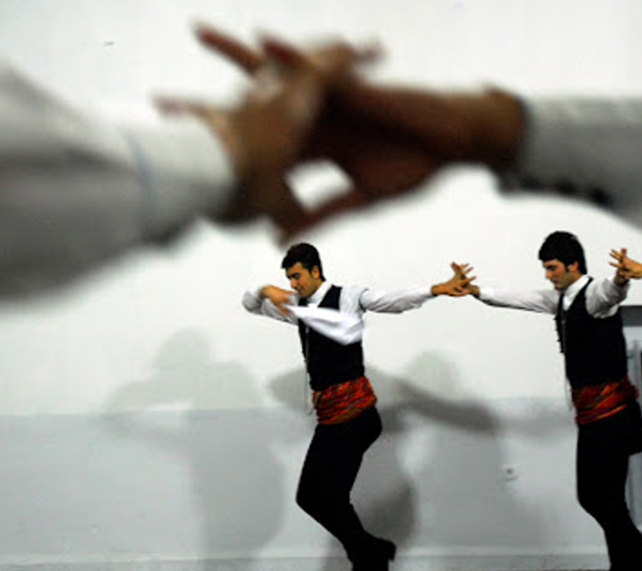

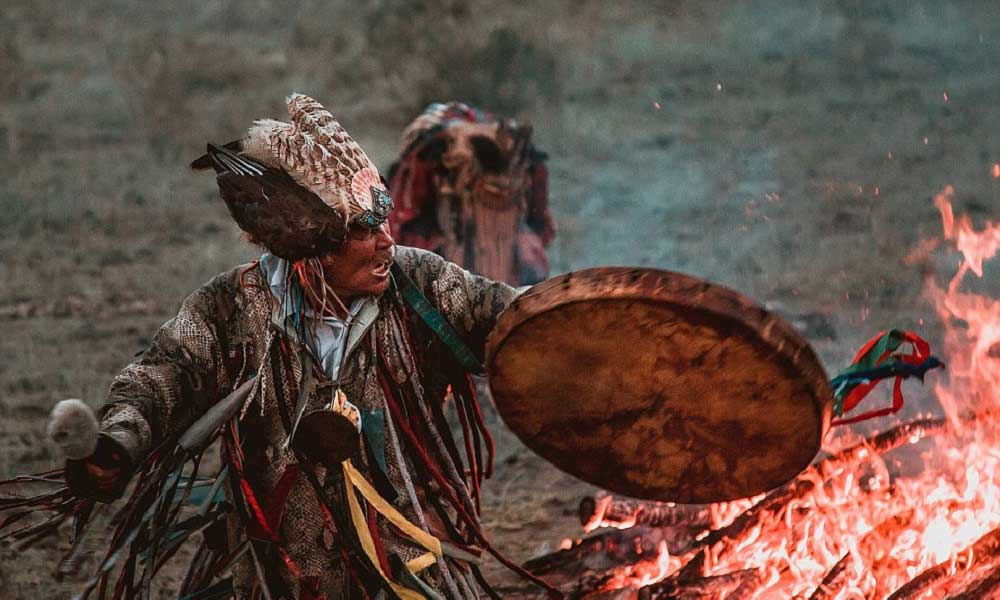

Hazırlayan

NİYAZİ KILIÇ

İlgililerin Dikkatine

Bu Kitap, 6279 sayılı yasa gereğince, Çoğaltılmış Fikir ve Sanat Eserlerini Derleme Kanununa dayanılarak hazırlanmıştır.

Derleme Kanunu Yasası gereğince KÜLTÜR VE TURİZM BAKANLIĞI Tarafından Uygulanmaktadır.

UYARI

Bu Kitap’ı Hazırlayandan izinsiz olarak kurum, kuruluş veya kişiler tarafından, kısmen veya bölüm ya da tamamının, Kopyalanması, çoğaltılması veya tekrar baskıya alınması Kanunen yasaktır. Aksine hareket edenlerin 6279, 2936 ve 3257 sayılı yasalar gereğince suç sayılmaktadır.

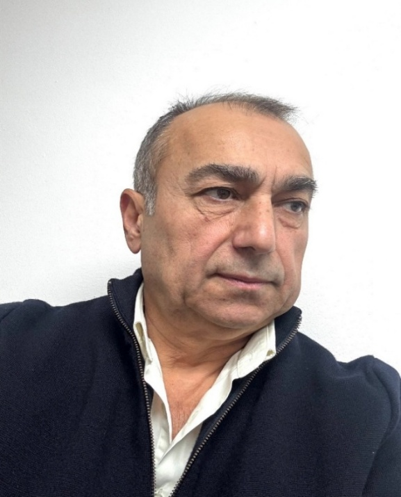

1961 Doğumlu olan Niyazi Kılıç, memleketi Erzurum Aşkale’dir. Öğrenim ve eğitimini Ankara’da yapan Niyazi Kılıç, Halk danslarına 1975 yılında başladı. Halk dansları üzerine çok yoğun bir şekilde çalışırken, bu esnada Milli Eğitim Bakanlığına bağlı İlk, Orta ve Liselerde Eğiticilik yaparken, aynı zamanda Halk dansları konusunda araştırmaları olan Niyazi Kılıç yurt içi uluslararası festivallere defalarca katılmış ve bunlar arasında; Samsun, Giresun, Ordu, Trabzon, Rize, Artvin, Erzurum, Afyon, Kütahya, Çorum, Zonguldak İzmit, Adapazarı, Nevşehir, Kayseri, Mersin, İskenderun, Denizli, Muğla, Aydın, Antalya, İzmir, Çanakkale, Kırşehir ve Eskişehir’dir. Halk dansları Hocalarının baskılarıyla Kültür ve Turizm Bakanlığı’nın Devlet Halk dansları Topluluğuna girmeyi hak kazanarak Profesyonel olarak göreve başlamış ve bununla paralel olarak Hacettepe Üniversitesi, ODTÜ ve Gazi Üniversite’lerinde Eğitmenlik yapan Niyazi Kılıç, kendi ifadesiyle kendi sininde Hocası olan Hacettepe Üniversitesi Müzikoloji bölüm başkanı ve Öğretim üyesi Prof. Dr. Cemil Demirsipahi’den Halkbilimi konusunda çok şeyler öğrendiğini ve kendisini geliştirdiğini söyler. Devlet Halk dansları Topluluğu ile bir çok yurt dışı hizmetlerinde bulunmuş ve bulunduğu ülkeler arasında ; ( Pakistan, Hindistan, Bangladeş, Endonezya, Malezya, Çin, Taylan, Singapur, Urumçi Uygur özerk bölgesi (Çin ), Hong Kong, Güney Kore, Japonya, B. A. E Abu Dabi, Suudi Arabistan ve Mısır ) Avrupa’da ise (Bulgaristan, Macaristan, Avusturya, Almanya, Hollanda, Belçika, Fransa, İtalya ve Lüksemburg ) Gülten Kılıç hanımefendi ile Evlendikten sonra, 1988 yılının sonlarında Almanya’ya gelmiş, Berkay ve Güney isimli iki erkek evlada sahip olan Niyazi Kılıç, halen Almanya’da yaşamaktadır.

**ÖNSÖZ**

Halk dansları üzerine yapmış olduğum araştırmalar neticesinde, o kadar değerli kaynaklara ulaştım ki Kültür ve Turizm Bakanlığı’nın Halk dansları üzerine çok yoğun ve titiz çalışmaları, Milli Eğitim Bakanlığı’nın konuya olan duyarlı çalışmaları, Üniversitelerde Halk dansları üzerine Doktora, Yüksek lisans ve Tez çalışmaları, Halk dansları camiasında çok değerli eğitmenlerin derleme çalışmalarından, Halk dansları Dernek’lerinin halk danslarına olan derleme katkıları, Ayrıca halk dansları üzerine çok çalışmış ve çok emek vermiş fakat aramızda olmayan üstatlara bu çalışmalarından dolayı, benim için özel yerleri olan Halkbilimi ile ilgili son derece geniş ve en ince ayrıntısına kadar araştırmaları olan büyük yazarlar ve üstatlar.

Benimde hocalarım olan Hacettepe Üniversitesi Güzel Sanatlar Enstitüsü Müzikoloji Bölüm Başkanı ve Öğretim Üyesi Prof. Dr. **CEMİL DEMİRSİPAHİ**, Kültür ve Turizm Bakanlığı Devlet Halk dansları Müdürü **MUSTAFA TURAN** ve **SAMİ İŞEL**, Koreograf ve Sanat Yönetmeni **DUYGU AYKAL**, Erzurum ve Bitlis Yöresi danslarının büyük çalıştırıcısı ve dans üstadı **SEYİT KIRMIZI**, Araştırmacı, Derlemeci ve Artvin Halk danslarının üstadı **NAİL TAN**, Muğla yöresi Zeybeği üzerine kapsamlı araştırmaları ve derlemeleri olan Muğla Halk dansları Eğitmeni ve üstadı **BEKİR NALBANTOĞLU**, Adıyaman Halk danslarının büyük çalıştırıcısı **HAMZA ÇİVİ,** Gaziantep Yöresi Halk dansları Eğitmeni **ULVİ CAN,** ve diğer Hocalarıma ayrı ayrı Teşekkürlerimi sunuyorum.

**NİYAZİ KILIÇ**

**Halk Dansları Eğitmen ve Yönetici**

# İçindekiler

- [1. Halkbilimi Folklor](#_Toc243142455)
- [2. Sanat](#_Toc243142456)
- [3. Halk Dansları](#_Toc243142457)
- [4. Halk Danslarının Tarihçesi](#_Toc243142458)
- [5. Halk danslarının Kökeni](#_Toc243142459)
- [6. İlkel ve Gelişmiş Topluluklarda Halk Danslarının Yeri](#_Toc243142460)
- [7. İlkel ve Gelişmiş Toplumlarda Dans Kavramı](#_Toc243142461)
- [8. 1900 Yılından Günümüze Halk Dansları Çalışmaları](#_Toc243142462)
- [9. Oynanış Biçimlerine Göre Halk Dansları](#_Toc243142463)
- [10. Bölgelere Göre Halk Dansları](#_Toc243142464)
  - [10.1. Bar](#_Toc243142465)
  - [10.2. Halay](#_Toc243142466)
  - [10.3. HORO, HORA ya da KARŞILAMA](#_Toc243142467)
  - [10.4. Horon](#_Toc243142468)
  - [10.5. Zeybek](#_Toc243142469)
  - [10.6. KAŞIK](#_Toc243142470)
- [11. Coğrafyanın etkisi](#_Toc243142471)
- [12. Dilin etkisi](#_Toc243142472)
- [13. Kültürün etkisi](#_Toc243142473)
- [14. Halk dansları türleri](#_Toc243142474)
- [15. İçerdiği konulara göre halk dansları](#_Toc243142475)
- [16. Doğayı konu alan halk dansları](#_Toc243142476)
- [17. Araçla oynanan halk danslarımız](#_Toc243142477)
- [18. Üniversitelerde halk dansları konservatuarları ve ilgili bölümler](#_Toc243142478)
- [19. Halk dansları ile ilgilenen kurumlar](#_Toc243142479)
- [20. Yörelere göre halk dansları](#_Toc243142480)
  - [20.1 Bitlis yöresi](#_Toc243142481)
    - [20.1.1 BİTLİS HAKKINDA BİLGİ](#_Toc243142482)
    - [20.1.2 BİTLİS YÖRE DANSLARI](#_Toc243142483)
    - [20.1.3 BİTLİS KOSTÜMÜ](#_Toc243142484)
    - [20.1.4 Yalnız Kadınlar Tarafından Oynanan Oyunlar](#_Toc243142485)
    - [20.1.5 Erkek Dansları](#_Toc243142486)
  - [20.2 Erzurum yöresi](#_Toc243142487)
    - [20.2.1 Giriş](#_Toc243142488)
    - [20.2.2 Erzurum’un Tarihi ve Coğrafi Konumu](#_Toc243142489)
    - [20.2.3 Erzurum Halk Dansları ve Bar Kavramı](#_Toc243142490)
    - [20.2.4 Araştırma Modeli](#_Toc243142491)
    - [20.2.5 Erzurum Barları](#_Toc243142492)
    - [20.2.6 Erzurum Barlarının Müzikal Yapısı](#_Toc243142493)
    - [20.2.7 Erzurum Barlarının Makamsal Yüzdeliği](#_Toc243142494)
    - [20.2.8 Erzurum Barlarının Usul Yüzdeliği](#_Toc243142495)
    - [20.2.9 Bilmeceler](#_Toc243142496)
    - [20.2.10 BAZI ARAC VE MALZEMELERE VE KİŞİSEL İSİMLERE VERİLEN ADLAR](#_Toc243142497)
    - [20.2.11 MAHALLİ DÜGÜN ADETLERİ](#_Toc243142498)
    - [20.2.12 ATA SÖZLERİ](#_Toc243142499)
  - [20.3 Bingöl yöresi](#_Toc243142500)
    - [20.3.1 Giriş](#_Toc243142501)
    - [20.3.2 Bingöl Halk Dansları](#_Toc243142502)
    - [20.3.3 Kartal Dansı](#_Toc243142503)
    - [20.3.4 Birinci Efsane:](#_Toc243142504)
    - [20.3.5 İkinci Efsane:](#_Toc243142505)
    - [20.3.6 Üçüncü Efsane:](#_Toc243142506)
    - [20.3.7 Delilo (Deliley-Koçeri)](#_Toc243142507)
    - [20.3.8 Halay (Gövend)](#_Toc243142508)
    - [20.3.9 Esmer (Horani)](#_Toc243142509)
    - [20.3.10 İki Ayak (Dılıng-Keçık)](#_Toc243142510)
    - [20.3.11 Çaçan (Çaçe)](#_Toc243142511)
    - [20.3.12 Çepik-Çepikay (El Cirpma)](#_Toc243142512)
    - [20.3.13 Meryemo ( Meryem )](#_Toc243142513)
    - [20.3.14 Gelin Götürme](#_Toc243142514)
    - [20.3.15 Bingöl Halk Dansları Giysileri](#_Toc243142515)
    - [20.3.16 Sonuç](#_Toc243142516)
  - [20.4 Elazığ yöresi](#_Toc243142517)
    - [20.4.1 GİRİŞ](#_Toc243142518)
    - [20.4.2 HALK DANSLARI](#_Toc243142519)
    - [20.4.3 ELAZIĞ HALK DANSLARI](#_Toc243142520)
    - [20.4.4 Meydan Oyunları](#_Toc243142521)
    - [20.4.5 Oda Oyunları](#_Toc243142522)
    - [20.4.6 ELAZIĞ’DA BİLİNEN OYUNLAR](#_Toc243142523)
    - [20.4.7 Unutulmak Üzere Olan ve Oyun Figürleri Az Hatırlanıp, Müziği Hakkında Karışık Hatırlamaların Yapıldığı Oyunlar](#_Toc243142524)
    - [20.4.8 Hem Oyun Figürlerinin Hem De Oyun Müziğinin Hatırlanamadığı Oyunlar](#_Toc243142525)
    - [20.4.9 ELAZIĞ’DA MÜZİK KÜLTÜRÜ](#_Toc243142526)
    - [20.4.10 ELAZIĞ HALK DANSLARINDA KULLANILAN ÇALGILAR](#_Toc243142527)
    - [20.4.11  ELAZIĞ HALK DANSLARI KIYAFETLERİ](#_Toc243142528)
    - [20.4.12 SONUÇ](#_Toc243142529)
  - [20.5 Kırklareli yöresi](#_Toc243142530)
    - [20.5.1 Mart Dokuzu (Nevruz) Kutlamaları](#_Toc243142531)
    - [20.5.2 HALK HEKİMLİĞİ](#_Toc243142532)
    - [20.5.3 KIRKLARELİ YÖRESİNDE OYNANAN ÇOCUK OYUNLARI](#_Toc243142533)
    - [20.5.4 ÇOCUK OYUNLARINDAN ÖRNEKLER](#_Toc243142534)
    - [20.5.5 HALK DANSLARI](#_Toc243142535)
    - [20.5.6 1941 – 1945 yılları arasında tespit edilen 15 adet halk dansı,](#_Toc243142536)
    - [20.5.7 1946 – 1950 yılları arasında tespit edilen 25 adet halk dansı,](#_Toc243142537)
    - [20.5.8 1991 yılına gelindiğinde Trakya’da tespiti yapılan ve oynanan halk dansları,](#_Toc243142538)
    - [20.5.9 Geleneksel Topçu Baba Kurban Törenleri](#_Toc243142539)
    - [20.5.10 Geleneksel Gül Baba Kurban Törenleri](#_Toc243142540)
    - [20.5.11 Yararlanılan Kisiler ;](#_Toc243142541)
    - [20.5.12 KAYNAKÇA](#_Toc243142542)
  - [20.6 Adıyaman yöresi](#_Toc243142543)
    - [20.6.1 Adıyaman Yöresi Halk Dansları](#_Toc243142544)
    - [20.6.2 Adıyaman Halk Danslarının Oynanış Formu](#_Toc243142545)
    - [20.6.3 Adıyaman Yöresi Halk danslarının Adları](#_Toc243142546)
    - [20.6.4 Adıyaman Yöresi Halk danslarının Gruplandırılması](#_Toc243142547)
    - [20.6.5 Adıyaman Yöresi Halk danslarında Bazı Gelenekler](#_Toc243142548)
    - [20.6.6 Adıyaman Yöresi Halk Danslarında Oyun Yeri](#_Toc243142549)
    - [20.6.7 Adıyaman yöresi kadın giyim kuşamı](#_Toc243142550)
    - [20.6.8 Adıyaman Yöresinde Erkek Giyimi](#_Toc243142551)
    - [20.6.9 Adıyaman yöresinde giyilen yazlık ve kışlık kıyafetler](#_Toc243142552)
    - [20.6.10 Halk Danslarında Kullanılan Otantik Kıyafetlerin Halkın Giyim-Kuşamına Yansıma Durumları](#_Toc243142553)
    - [20.6.11 Adıyaman Yöresine Ait Bazı Oyunlara ilişkin Bulgular](#_Toc243142554)
  - [20.7 Trabzon yöresi](#_Toc243142555)
    - [20.7.1 TRABZON İLİNDEKİ YER ŞEKİLLERİNİN İNSAN YERLEŞİMİNE ETKİSİ](#_Toc243142556)
    - [20.7.2 TRABZON COĞRAFYASINDAKİ NÜFUS ÇEŞİTLİLİĞİ’NİN TRABZON HALK DANSLARINA ETKİSİ](#_Toc243142557)
    - [20.7.3 TRABZON ÇEVRESİNDE OYNANAN HALK DANSLARI](#_Toc243142558)
    - [20.7.4 YUKARI KESİMLERDE OYNANAN HALK DANSLARI](#_Toc243142559)
    - [20.7.5 AĞASAR  (ŞALPAZARI)   BÖLGESİNDE  OYNANAN  HALK  DANSLARI](#_Toc243142560)
    - [20.7.6 TONYA BÖLGESİNDE OYNANAN HALK DANSLARI](#_Toc243142561)
    - [20.7.7 MAÇKA BÖLGESİNDE OYNANAN HALK DANSLAR](#_Toc243142562)
    - [20.7.8 OF, ÇAYKARA, SÜRMENE BÖLGELERİNDE OYNANAN HALK DANSLARI](#_Toc243142563)
    - [20.7.9 YUKARI KESİMLERDE OYNANAN DİĞER HALK DANSLARI](#_Toc243142564)
    - [20.7.10 AŞAĞI KESİMLERDE OYNANAN HALK DANSLARI](#_Toc243142565)
    - [20.7.11 AKÇAABAT BÖLGESİNDE OYNANAN HALK DANSLARI](#_Toc243142566)
    - [20.7.12 AŞAĞI KESİMLERDE OYNANAN DİĞER HALK DANSLARI](#_Toc243142567)
    - [20.7.13 SONUÇ](#_Toc243142568)
  - [20.8 Van yöresi](#_Toc243142569)
    - [20.8.1 Van Halk Dansları](#_Toc243142570)
    - [20.8.2 Van Halk Danslarının Çeşitleri ve Özellikleri](#_Toc243142571)
    - [20.8.3 Van halk Danslarında sıkça rastlanılan temel dans hareketleri](#_Toc243142572)
    - [20.8.4 Alanda Tespit Edilen Dansların Listesi](#_Toc243142573)
    - [20.8.5 Van Yöresi Bazı Halk Danslarının Hikâyeleri, Özellikleri ve Oynandığı Yerler](#_Toc243142574)
    - [20.8.6 Kadın Giysileri](#_Toc243142575)
    - [20.8.7 Erkek Giysileri](#_Toc243142576)
    - [20.8.8 Deme Çevirme](#_Toc243142577)
  - [20.9 Gaziantep yöresi](#_Toc243142578)
    - [20.9.1 GAZİANTEP MUTFAK KÜLTÜRÜ](#_Toc243142579)
    - [20.9.2 GAZİANTEP YÖRESİ HALK DANSLARI](#_Toc243142580)
    - [20.9.3 Coğrafi Durumun ve İklimin Yöre Oyunlarına Etkisi](#_Toc243142581)
    - [20.9.4 Sosyo-Ekonomik Yapının Yöre Oyunlarına Etkisi](#_Toc243142582)
    - [20.9.5 Dini İnançların Yöre Oyunlarına Etkisi](#_Toc243142583)
    - [20.9.6 Gaziantep Yöresi Halaylarında Dizim ve Tutuş Şekilleri](#_Toc243142584)
    - [20.9.7 Kadın Halayları](#_Toc243142585)
    - [20.9.8 Erkek Halayları](#_Toc243142586)
    - [20.9.9 Gaziantep Yöresi Halaylarının Oynanış Sırasına Göre Oyun Kümeleri ve İsim Tespitleri](#_Toc243142587)
    - [20.9.10 Kabalar](#_Toc243142588)
    - [20.9.11 Düzler ve Şirvaniler](#_Toc243142589)
    - [20.1.1 Seçmeli ve Türkülü Oyunlar](#_Toc243142590)
  - [20.10 Silifke halk dansları](#_Toc243142591)
    - [20.10.1 SİLİFKE ’NİN BÜYÜK KENTLER’DEKİ TANITIMI](#_Toc243142592)
    - [20.10.2 ÖNSÖZ](#_Toc243142593)
    - [20.10.3 Halk Danslarının Biçim ve İçerik Özellikleri](#_Toc243142594)
    - [20.10.4 Silifke Halk dansları](#_Toc243142595)
    - [20.10.5 Danslarda Giyim-Kuşam](#_Toc243142596)
    - [20.10.6 Dansların İcra Ortamları](#_Toc243142597)
    - [20.10.7 Danslar ve Oynanma Biçimleri](#_Toc243142598)
    - [20.10.8 Sonuç](#_Toc243142599)
  - [20.11 Diyarbakır yöresi](#_Toc243142600)
    - [20.11.1 Diyarbakır’ın Tarihçesi](#_Toc243142601)
    - [20.11.2 Diyarbakır’ın Coğrafi Özellikleri](#_Toc243142602)
    - [20.11.3 Diyarbakır’ın Sosyo-Ekonomik Yapısı](#_Toc243142603)
    - [20.11.4 Diyarbakır’da İcra Edilen Halk Danslarının Yapısal Özellikleri ve Tasviri](#_Toc243142604)
    - [20.11.5 Yörede oynanan oyunlar](#_Toc243142605)
    - [20.11.6 Diyarbakır Halk Oyunları İcrasında Kullanılan Oyun Formları](#_Toc243142606)
    - [20.11.7 Diyarbakır Halk Oyunları İcrasında Oyuncuların Görev ve Sorumlulukları](#_Toc243142607)
    - [20.11.8 Ekip Başının Yeri ve Önemi](#_Toc243142608)
    - [20.11.9 Ekip Sonunun Yeri ve Önemi](#_Toc243142609)
    - [20.11.10 Diyarbakır Halk Oyunlarının İcrasında Oyuncu Sayısının Yeri ve Önemi](#_Toc243142610)
    - [20.11.11 Diyarbakır Halk danslarında Cinsiyetin Yeri ve Önemi](#_Toc243142611)
    - [20.11.12 Diyarbakır Halk Dansları İcrasında Kullanılan Enstrümanlar](#_Toc243142612)
    - [20.11.13 Diyarbakır Halk Danslarında Kullanılan Ezgi ve Ritimler](#_Toc243142613)
    - [20.11.14 Diyarbakır’da Giyim ve Kuşam](#_Toc243142614)
    - [20.11.15 Erkeklerde Giyim ve Kuşam](#_Toc243142615)
    - [20.11.16 Kadınlarda Giyim ve Kuşam](#_Toc243142616)
    - [20.11.17 Diyarbakır’da Kullanılan Süs ve Takılar](#_Toc243142617)
    - [20.11.18 Diyarbakır Halk Dansları İcrasında Kullanılan Araç Gereçler](#_Toc243142618)
    - [20.11.19 SONUÇ](#_Toc243142619)
  - [20.12 Zeybek halk dansları](#_Toc243142620)
    - [20.12.1 EFE, ZEYBEK, KIZAN KİMDİR?](#_Toc243142621)
    - [20.12.2 TARİH’de BİLİNEN EFELER](#_Toc243142622)
    - [20.12.3 ZEYBEK VE ZEYBEKLİK KURUMU, ZEYBEKLİK GELENEĞİ, ZEYBEK KAVRAMI (KELİMENİN KÖKENİ)](#_Toc243142623)
    - [20.12.4 ZEYBEKLİĞİN   TARİHÇESİ](#_Toc243142624)
    - [20.12.5 KISALTMALAR](#_Toc243142625)
    - [20.12.6 Zeybeklerde Giyim Kuşam  Parçaları](#_Toc243142626)
  - [20.13 Kars Halk Dansları](#_Toc243142627)
    - [20.13.1 Kars Halk Dansları](#_Toc243142628)
    - [20.13.2 Kimileri öbür illerde de birtakım ayrılıklarla oynanan barlar:](#_Toc243142629)
    - [20.13.3 Kars ’da bilinen oyunlar ve anlamları](#_Toc243142630)
    - [20.13.4 Halay](#_Toc243142631)
    - [20.13.5 Kafkas](#_Toc243142632)
  - [20.14 Artvin yöresi](#_Toc243142633)
    - [20.14.1 ARTVİN İLİNİN TANITILMASI](#_Toc243142634)
    - [20.14.2 COĞRAFYA](#_Toc243142635)
    - [20.14.3 TARİHÇE](#_Toc243142636)
    - [20.14.4 Artvin Halk Dansları](#_Toc243142637)
    - [20.14.5 ARTVIN ve ARHAVI Halk Dansları Kıyafetleri](#_Toc243142638)
    - [20.14.6 Artvin Erkek Giysileri](#_Toc243142639)

# 1. Halkbilimi Folklor

Halkbilimi – Folklor **nedir**: Halkbilimi geniş kapsamlı bir terimdir. Bu kavramın kökeni, İngilizcedir FOLK – **HALK** Demektir. LORE – **BİLİM** demek olduğuna göre FOLKLOR ’un Türkçe karşılığı ise **HALKBILIMIDIR.**

Folklor terimi ilk defa İngiliz William Johns Thomas tarafından kullanılmıştır. Halkbilimi kavramı son yıllarda yurdumuzda yaygın olarak kullanılmaya başlanmış ve benimsenmiştir.

<u>HALKBİLİMİ:</u> Bir ulusun veya bölge halkının (maddi- manevi) kültürel, sosyal ve ekonomik alandaki tüm ürünlerini konu edinip, bunları öz yöntemlerle ve doğal biçimiyle araştıran, derleyen, sınıflayan, çözümleyen, yorumlayan ve bir sonuca vardırmayı amaçlayan bilim dalıdır.

“Folklor“ terimi, Halkbilimin karşılığı olduğuna göre gerçek anlamıyla bu sözcüğü kullanmak gerekir. Bugün yurdumuzda Halk Danslarına, Folklor, (Halkbilimi) denilmesi yanlıştır, ilk akla gelen Halk dansları kavramı olmalıdır. Bu yanılgıya öncelikle basın, radyo ve TV ’nin düşmemesi gerekirken zaman zaman  ‘‘Halk dansları Topluluğu‘‘ yerine Folklor Ekibi, ‘‘Halk dansları Gösterisi‘‘ yerine Folklor Gösterileri denilmektedir. Böylece geniş bir alanı kapsayan Halkbilimi, bilimsel anlamından saptırılarak dar bir anlamda sıkıştırılmıştır. Oysaki Halk dansları Halkbiliminin sadece bir dalıdır. Bu yanlışlıkların yanında ‘’Folklor Yıldızı‘’, “Folklor Sanatçısı”, “Folklor Söylemek” gibi büyük yanlışlıklara düşülmektedir.

**Halkbiliminin (Folklor) KONULARI**

1. Halk dansları
2. Halk müziği ve çalgıları
3. Halk sanatları ve zanaatları (İşleme, örme, dokuma, ağaç-taş işleri)
4. Halk giyim- kuşamı (Kadın, erkek, çocuk, günlük, tören giysileri)
5. Halk mimarisi (Ev, barınak yapımı ve eşyaların kullanılışı vs.)
6. Halk İnançları, gelenek, görenek ve adetleri
7. Doğum, çocukluk, evlenme, ölüm gibi geçiş dönemleri
8. Halk ekonomisi (Tarım, rençberlik, koyunculuk, arıcılık, avcılık, üretim, tüketim pazarlama)
9. Geçici ve sürekli yerleşim alanları (Yaylak, kışlak, köy, kasaba, kent)
10. Halk mutfağı (Sofra düzeni, yemek çeşitleri, besin türleri)
11. Dinsel şenlikler, yerel günler ve bayramlar, karşılama ve uğurlama vs.
12. Halk bilgisi, halk hukuku, halk zoolojisi, halk meteorolojisi, halk takvimi, halk hekimliği ve halk baytarlığı.
13. Halk eğlenceleri ve sporları
14. Halk tiyatrosu (Karagöz, Ortaoyunu, köy seyirlik oyunları)
15. Çocuk oyunları (Temsili olanlar, beceri ve yeteneği geliştirenler)
16. Dinsel ve büyüsel İnançlar (Türbe, Yatır, Mezar, Fal, Rüya Büyücülük)
17. Dinsel Kuruluşlar (Tarikatlar, esnaf dernekleri, komşuluk)

# 2. Sanat

Türk Dil Kurumu Türkçe Sözlüğünde “Sanat” kavramı için beş ayrı tanımlamaya yer verilmiştir:

1. Bir duygu, tasarı, güzellik vb. nin anlatımında kullanılan yöntemlerin tamamı veya bu anlatım sonucunda ortaya çıkan üstün yaratıcılık.
2. Belli bir uygarlığın veya topluluğun anlayış ve zevk ölçülerine uygun olarak yaratılmış anlatım.
3. Bir şey yapmada gösterilen ustalık.
4. Bir meslekte uyulması gereken kuralların tümü.
5. Zanaat” (Türk Dil Kurumu, 2005).

Araştırmada “Sanat” olgusu konusunda, bu tanımlamaların herhangi birine odaklanılmak yerine hepsini kapsayan bir bakış açısına odaklanılacaktır. Ancak özellikle Türkçe Sözlükteki ikinci tanımlama, diğerleri arasında, “Kültür” kavramının tanımlamasına yakınlığı ile oldukça dikkat çekicidir. Sanat olgusu; tanım çeşitliliğinden de kaynaklanarak çok farklı biçimlerde sınıflandırılabilir. “Sanat Sosyolojisi- Giriş” adlı eserinde Mahmut Tezcan, Bülent Özer’den alıntılayarak, sanat dallarının iki ayrı şekilde sınıflandırılabileceğini ifade etmektedir:

A- **Geleneksel Sınıflama;** güzel sanatları, seslendiği duyu organlarımıza göre sınıflar:

- Görsel Sanatlar (Plastik Sanatlar), göze ve görmeye dayanan sanatları bir grupta toplar. Bunlar; resim, heykel, mimarlık gibi dallardır.
- İşitsel Sanatlar (Fonetik Sanatlar), müzik ve türleri ile edebiyatı.
- Görsel İşitsel Sanatlar (Dramatik) ise hem görme hem de işitmeye seslenen sanat dallarını; söz gelimi tiyatro, opera, müzikal, bale, dans, sinema gibi türleri içerir.

B- **Çağdaş Sınıflama;** bu sınıflamada, söz konusu edilen sanat dalının niteliği ve tekniği göz önünde bulundurulmaktadır. Şöyle özetleyebiliriz:

- **Hareket (Devinim) Sanatları:** İnsanın bedeniyle anlatım gücü kazandırdığı sanatlardır. **Halk Dansları,** Bale, dans türleri, pantomim vb.
- **Ses Sanatları:** Müzik ve tüm türleridir. Halk müzikleri, klâsik müzikler vb.
- **Dil Sanatları:** Edebiyat ve yazı türlerini kapsar. Roman, öykü, şiir, deneme, tiyatro metni, film senaryosu vb.
- **Yüzey Sanatları:** Tüm iki boyutlu sanat çalışmaları, yani bir eni ve bir boyu olan kâğıt, tuval, duvar ya da kumaş üzerine uygulanan sanatlarıdır. Tüm resim ve türleri (yağlı boya, guaş, baskı sanatları, afiş, grafik çizimler), duvar resmi (fresko), mozaik, fotoğraf, karikatür, baskı vb.
- **Hacim Sanatları:** Üç boyutlu sanat çalışmalarıdır. Mimarlık, heykel, seramik çalışmaları, gibi.
- **Mekân Sanatları:** İç ya da dış mekânı içine alan ya da düzenleyen sanat dallarıdır. Başta mimarlık olmak üzere, bahçe mimarlığı (peyzaj mimarlığı), çevre düzenlemesi gibi mekâna ilişkin tüm tasarım çalışmaları.
- **Eylem Sanatları:** İnsanın eylem gücüyle ya da eyleme dönüşmüş ifadelerle kendini ya da bir olayı, bir olguyu anlattığı sanatlardır. Bunlara “dramatik sanatlar” da diyebiliyoruz. Tiyatro, opera, müzikal oyun, kukla gibi sahne sanatları ile sinema gölge oyunu gibi türleri buna örnek gösterebiliriz” (Tezcan, 2011).

**Sanat Eğitimi**

“Kavram, özellikle ülkemizde anlamı pek tartışmalı bir kavram olup, sanatçı yetiştiren öğretim, boş zamanları değerlendirmek amacıyla yapılan yaratıcı etkinliklerin düzenlenmesi ve folklor (Halkbilimi) çalışmalarına dek geniş bir anlam yaygınlığında kullanılmaktadır. 20. yüzyılın başından bu yana sanat eğitimi kavramı, kaplamsal ve genel anlamda, sanatların tüm alanlarını ve biçimlerini içine alan, okul içi ve okul

dışı yaratıcı sanatsal eğitimi tanımlamaktadır”, “Sanat eğitimi, sanatım tüm alanlarında gerçekleştirilen eğitim ve öğretimi kapsamaktadır. Günümüzde Sanat Eğitimi daha çok sanatlar eğitimi olarak adlandırılmaktadır ve dil (edebiyat); yüzey (resim, grafik, fotoğraf, hat, vb.); hacim (heykel); eylem (tiyatro); mekân (mimari); ses (müzik); hareket **(halk dansları ve bale)** vb. tüm sanat alanlarını kapsamaktadır” Sanat eğitiminin önemi ve gerekliliği hususundaki şu görüş de kayda değerdir: “Sanatçı ve uzman unvanını almış veya alacak kişilerin, ilgili sanatın gerektirdiği **teknik ve teorik** alt yapıya sahip olmaları gerekmektedir”.

Bu çalışmada sanat eğitimi, sanatın tüm alanlarında hem uygulamaya hem kurama hem de eğitimciliğe dayalı verilen eğitim sürecinin tamamını ifade etmek üzere

Kullanılacaktır.

**Sanatçı**

“Güzel sanatların herhangi bir dalında yaratıcılığı olan, eser veren kimse, sanat adamı, sanat eri, sanatkâr. Sinema, tiyatro, müzik, **dans**, vb. sanat eserlerini oynayan, yorumlayan, uygulayan kimseye” sanatçı denir. (Türk Dil Kurumu, 2005).

**Yerel**

“Yöresel” (Türk Dil Kurumu, 2005).

Tüm bu açıklamaların ışığında; “Oyun” olgusunun “Dans” kavramını da içerisinde barındırdığı ve “Halk Dansları” kavramı ile “Halk Oyunları” kavramlarının aynı şeyleri

İfade etmedikleri ortaya çıkmaktadır. “Dans” kavramının Türkçe dil kökeninden gelmemesi, bilimsel çalışmalar içerisinde “Halk Dansları” teriminin kullanılamayacağı

anlamına gelmemektedir. Nitekim Türkiye’de Türkçe dil kökeninden gelmeyen, ancak terminolojik olarak Türk akademik eğitimi içerisinde aynen kullanılan; biyoloji, dramaturji, fizyoloji, jeoloji, televizyon, arkeoloji vb. Birçok sözcük bulunmaktadır. “Halk Oyunları” kavramının da, tıpkı “Oyun kavramında olduğu gibi, “Halk Danslarının yanı sıra daha birçok kültürel ögeyi kapsadığı ortadadır. Nasıl ki “Folklor” sözcüğü “Halk Dansları” anlamına gelmiyor ise; “Halk Oyunları” sözcüğü de “Halk Dansları” anlamına gelmemektedir. **Akademilerde** verilen alan eğitimi, yalnızca “Halk Oyunları” olgusu içinde bulunan **“Halk Dansları”** eğitimine dayanmaktadır. Bu akademilerin eğitim programları içerisinde<strong>, “Halk Oyunları” olgusu içerisinde yer alan çocuk oyunları, orta oyunları, köy seyirlik oyunları, sportif oyunlar vb.</strong> Bu oyunlar, **Akademilerin** çalışma programları içerisinde yer almamaktadır. Bu sebeplerle çalışma boyunca, içeriği dolayısıyla **“Halk Dansları”** teriminin kullanımı tercih edilecektir. Yalnızca görüşme yapılan kişilerden yapılan alıntılarda kullanılan kavrama dokunulmamış ve aynen aktarılmıştır. Ayrıca akademik olarak da Halk Dansları teriminin kullanılması gerektiğine inanılmaktadır.

# 3. Halk Dansları

Geleneksel kültürümüzün vazgeçilmez unsurlarından biri olan Türk Halk Dansları, Türk insanının binlerce yıllık boyunca nesilden nesille aktarılarak devam eden kültürel özelliklerinden biridir. Bulundukları coğrafi özellikleri yansıtır. Ülkemizde ise coğrafi farklılar nedeni ile farklı müzikler, ritmik yapı, giyiniş, inanış halk danslarımızda da farklılık göstermektedir.

Halk danslarındaki farklılıkların oluşumunda ise en önemli etken dansların ritmik hareketleri ve bu ritmik hareketlerin insan bedeninde yerleşmiş şeklidir. Türk halk danslarının oluşumunda dinsel etkilerin yanında, sahip olduğumuz birbirinden farklı coğrafi yapılar ve iklim özelliklerinin de katkısı büyüktür. “Özellikle Türk kültüründe sık görülen su, toprak ve dağ **kült**leri, ateş ve hava kültürü gibi **kült**leri ile kurt, kartal, güvercin v. b. gibi hayvan **kült**leri Türk halk danslarının meydana gelişinde önemli rol oynar.”(Eroğlu, 1988) Yüzyıllar boyunca kuşaktan kuşağa aktarılan dini törenler, doğum, ölüm, evlilik, askere gitmek gibi törenlerde halk danslarının çıkış noktalarına vesile olmuştur. “Zamanla danslar dinsel ve törensel niteliklerini kaybederek anlamlarını tamamen açıklanamadığı soyut bir hale girmişlerdir. Bu gelişim çizgisinde konu ele alındığında, dansın doğması için bir olayın çıkması gerekmektedir. Ortaya çıkan olay bir sevinci anlatıyor ise dansın hareketli, yumuşak, dansçıların karşılıklı tutumlarının samimi olduğu, jest ve mimiklerin içten ve hoş oldukları görülür. Şayet olumsuzluğa sebep veriyorsa, bu kez, hareketler sert, karşılıklı tutumlar ise asabi bir havadan asla sıyrılamazlar.”

**Kült:** Kült kelimesi (İngilizce: Cult, Fransızca: Culte, Almanca: Kult) batı dillerine tapınma anlamındaki Latince cultus kelimesinden girmiştir. Türkçede de batı dillerindeki gibi tutku, ilahlaştırma aşırı saygı anlamlarını taşır.

En genel anlamıyla, bir kişiye, fikre, esere veya sisteme duyulan derin saygı ve bağlılık ifade eder. **Kültler,** popüler kültürdeki fanatik takipçiler veya bir lider etrafında oluşan kişi kültleri gibi farklı alanlarda karşımıza çıkar.

# 4. Halk Danslarının Tarihçesi

Tarihte ilk Türk uygarlıklarından Şamanların, Hunluların, Oğuzların günümüze uzanan belgelerinden, geleneklerine bağlı olarak yapılan törenlerinin en önemli bölümünü Halk Danslarının oluşturduğunu anlamaktayız. Orta Asya’daki bu uygarlıkların, oyunları ile ilgili ilginç belgelere rastlanmaktadır. Çinli bir şair hanım, Han Beyi’ne gelin gelmiş ve memleketine gönderdiği mektupta Hunluların adetlerinden manzum alarak şu şekilde söz etmiştir. DAVULU HER GECE DURMAZ DÖVERLER TA GÜNEŞLER DOĞANA DEK DÖNERLER! Bu yazı sıra oyunlarının (M. Ö 2000) yıllarında ateş çevresinde davul eşliğinde oynandığını ve güneşin doğuşunu, batışını çevredeki doğal olayları öyküleyen halk danslarının sabahlara dek sürdürüldüğünü kanıtlayan bir belgedir. Bu ve buna benzer belgeler, Çin’in Pekin Üniversitesi Kütüphanesinde bulunmaktadır. Anadolu’da yaşayan Türk uygarlıklarında ise Asya’dan getirdikleri geniş kültür birikimleri ile eski Anadolu uygarlıklarının kültür ürünlerinin özümlenmesini görmekteyiz. Bunun sonucu, uygarlıkların beşiği Anadolu’da, Atalarımız, yaratıcı gücü, sanat anlayışı, beğeni ve becerilerinin de katkısıyla değer biçilmez halk danslarımızı oluşturmuşlardır. Anadolu’da yaşayanlar dil, din, tarih, yerleşim alanı ve ekonomik ilişkiler bakımından çeşitli kültürlere bağlıydılar. Türkler Orta Asya’dan getirdikleri Hititlerin, Frigya, İyon, Bizans kültür birikimleri üzerinde, Selçuklular ve Osmanlılarla sürdürerek geliştirdiler. Bu yücelme sonucunda ortaya çıkan değer biçilmez halk danslarımızı, gelenekler içinde törenlerimizde yaşatarak bütün çeşitleri ile günümüze kadar getirdiler. Halk dansları toplum üyelerince kabul görerek insan davranışlarını öğrenilen ve kuşaktan kuşağa aktarılan kültür ürünü olarak yerini aldı.

Gazeteci ve Araştırmacı olan Kazak Türkü Nazgül Kenzhetay’a göre Günümüzde Rusya’da yaşayan Yakutistan Saha Türkleri, bugüne kadar halen aynı kültürü yaşatmaktadır der. Saha Türklerinin oynadıkları OSEHAYT isimli (Güneş Dansı) dans bugüne kadar 14 asırdır korunan en eski dans türlerinden biridir. Bu dans sadece Sahalara ait değil şu ana kadar, Saha Türkleri tarafından korunan bu dans aslında tüm Türk toplumların danslarının babasıdır der. Yakutistan daki Saha Türklerinin dans Kültürlerini araştıran Nazgül Kenzhetay, Saha Türklerine ait olan OSEHAYT dansı yani Güneş Dansı ile ilgili çarpıcı açıklamaları olmuştur. Saha Türklerinin Yakutistan Cumhuriyetinin vitrini der ken, Gerçekten haklılarmış der. Yakutistan da oynanan bir başka dans türü ise Türk Şamanlarının orta asya da oynadıkları ateş çevresindeki dans türüdür. Bu günkü Amerika’da yaşayan Kızılderililerin yapmış olduğu danslar, orta Asya’daki Türk Şamanlarının yapmış olduğu danslarının kopyasıdır der. Nazgül Kenzhetay.

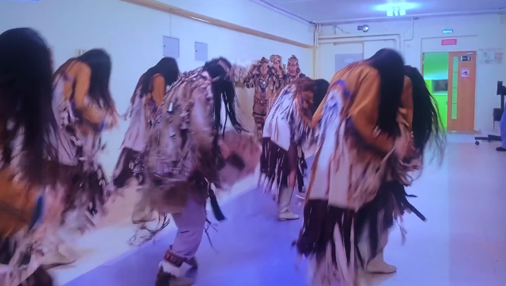

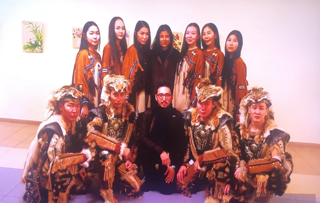

# 5. Halk danslarının Kökeni

Dr. Ribot’ a göre ‘’ Sanatin en ilkel şekli danstır.’’

Johan Huizinga’ya göre ise “Oyun, kültürden öncedir. Çeşitli kültürlerden çıkma ya da bir rastlantı sonucu değil, tersine çeşitli kültür biçimlerinin doğuşunda başlıca etkendir” der.

Prof. Dr. Özdemir Nutku’ya ait “Dünya Tiyatrosu Tarihi” adlı eserde, ilkel törenlerde görülen büyü, maske ve dansta gelişen oyun, doğaya alışmada olduğu kadar insanlar arasındaki duyguların gelişmesinde, doğumda, evlilikte, ölümde, dinsel ve büyüsel özlü danslar yapılmıştır.

En ilkel zamanlarda bile dans yapılıyordu. Örneğin bazı hareketler ahenkli bir şekilde ve müzik eşliğinde, ateş çevresinde davul eşliğinde, güneşin doğuşu, batışı ve doğa olaylarının öykülenmesinde, mehtaba, karanlık geceye ateşe ve güneşe yapılırdı. Yağmur için, karanlıktan kurtulmak için raks edilirdi. Çünkü raks insanın kültürel mirasını öğrenip yaşatması ve aktarması ile bir görevdi.

Bereket, verimlilik, ölülere tapma gibi pek çok işi dansla yapıp yaşamdaki sorunları azaltmaya çalışıyorlardı.

# 6. İlkel ve Gelişmiş Topluluklarda Halk Danslarının Yeri

İlkel insanlarda hayat, düşüncelerle değil devinimlerle başlamıştır. Bu insanların teori ile pratiği birbirinden ayıramadığı ve zihinsel soyutlamanın hayatlarına yeterince girmediğini görmekteyiz. Zaten bu aşamada henüz teoriden bahsetmekte mümkün değildir. Ve yalnız ilkel tapınma törenleri söz konusudur. İlkel tapınma da henüz pratiktir ama emekten bilinçli olarak ayrılmış bir pratiktir. Bu törenlerde yapılan tapılan en önemli bölümü yansılıma (öykünme) danslarından oluşurdu. Böylece bugünkü öykünme bize atalarımızdan miras kalmış bir özelliktir diyebiliriz.

İlk insanlar bir işi yapabilme yeteneğini geliştirmek için o işi yapmadan önce temsili olarak ortaya koyup taklit ederlerdi. Böylece nesnel bir işlevi yerine getirmek için öykünme (taklit) doğmuş oluyordu. Atalarımız bazen doğayı evcilleştirmek, bazen avına bir üstünlük, bazen de totemin doğa üstü güçlerinden yararlanmayı törenlerinde amaçlıyor ve işlerinin bir çoğunluğunu danslarla yerine getiriyorlardı. İlkel toplumlarda dinsel törenler, bireyleri toplumla yaşamaya zorluyor ve koyduğu kurallarla ilişkilerin uyumlu ve dengeli yaşamın da daha az sorunlu olmasına yardımcı olunmasını sağlıyorlardı.

Törenlerde oynanan oyun bir görevi üstlenip bu ödevi yerine getirmektir. İnancı, oynanan oyunun bireyleri bağlayıcı nitelikte ve belli amaçlara yönelik olduğu düşüncesini açıklamaktadır. Bu nedenle törenlerde yapılan danslar zamanla belli kural ve kalıplara bağlanarak yaşatılmış ve daha sonraki kuşaklara taşınmıştır.

İlkel insanlarda yaşamlarını sürdürmek için ihtiyaçlardan doğan bu danslar, deneyler sonucu gelişerek sanatın ilk halkalarını oluşturdu. İlkel insanı yaratmakta, gücünü artırmakta ve yaşayışını zenginleştirmede kendine gerçek bir yol buldu.

Ava çıkmadan önce yapılan çılgın dans, topluluğun güven duygusunu gerçekten artırıyordu. Yüze sürülen savaş boyaları, atılan savaş çığlıkları savaşçıyı daha kararlı yapıyordu. Ayrıca düşmanı da ürkütebiliyordu. Ürkütücü doğa karşısındaki güçsüz yaratık (insan) gelişmesinde yaptığı dansların büyük etkisinden destek alıyordu.

# 7. İlkel ve Gelişmiş Toplumlarda Dans Kavramı

İlkel toplumlar da raksın (Dans) anlamı o kadar önemlidir ki, her hareketi başka başka olayların temsili sayılmaktadır. Örneğin; bugün bile, Amerika yerlileri Afrika da çıplak gezen vahşi kabilelerin oyunlarında mana hakimdir. Ava çıkmadan önce toplu olarak yapılan çılgın danslar güven duygusunu arttırır, yüze sürülen savaş boyaları savaşçıları daha kararlı yapar ve düşmanı ürkütüp korkutur diye düşünülmektedir. Bütün bunlar tehlikeli ve ürkütücü doğa karşısındaki güçsüz yaratık insanın gelişmesinde büyüden büyük destek beklediğini açıklamaktadır. İlkel toplumların yaşamlarını sürdürebilmeleri için ihtiyaçtan doğan bu danslar, deneyler sonucu gelişerek sanatın ilk halkalarını oluşturmuştur. İlkel toplumlar törenlerde oynadıkları tüm oyunları görev olarak üstlenip, bir görevi yerine getirdiklerine inanırlardı. Bu amaçla törenlerde yapıla gelen danslar zamanla belli kural ve kalıplara bağlanarak daha sonraki kuşaklara aktarılırdı. Vahşi (ilkellerin) manidar rakslarına karşın gelişmiş toplumlarda mana kaybolup, hareket hâkim olmuştur. Medeni raks şekil ve görünüm olarak çok gelişmiş olsa da, yaşantımızdaki olaylarda görülme sıklığı, manidarlığı ve önemini kaybetmiştir. Özellikle danslardaki mana yerini sanatsal hareketlere bırakmıştır. Çünkü insanların en önemli işi raks değildir. Günümüzde, Halkbilimin içinde doğan ve onun içinde gelişen halk oyunlarımızın, tüm bilgi edinme kaynaklarından etkilendiği ve bu çabalardaki ortak payda olan bilgilenme sonucunda, kontrollü değişkenlerin değil, toplumun ihtiyacı olan yönelmelere yardımcı olunması sentezlerine ulaşıldığı gözlenmektedir. Bundan anlaşılacağı gibi, “Oyun kültürün doğuşunda başlıca etkendir”. O halde kültürün kapsamı için de yer alan sanatın da kökeninin “oyun” olduğunu ve sanatın doğuşunda önemli bir rolünün bulunduğunu söylemek mümkündür.

# 8. 1900 Yılından Günümüze Halk Dansları Çalışmaları

Halk dansları çalışmalarında yöntem konu, kadro alan gibi kuramsal bilgiler yanında araştırma, inceleme, derleme ve gösteri gibi uygulamalarla da karşılaşılmaktadır. Bu bakımdan başlangıçtan zamanımıza kadar olan çalışmalarda sık sık değişik konulara öncelik verildiği görülmektedir. Örneğin; başlangıçta sadece halk danslarının öneminden söz edilirken, cumhuriyetin kuruluş yıllarında yazılan yazılarda zeybek gösterileri ele alınmaya başladı.

**1900** yılında Rıza Tevfik (Bölükbaşı) tarafından yazılmıştır. “Raks” başlığı taşıyan bu yazıda halk dansları üzerine bugün bile aktüalitesini kaybetmeyen konulara değinilmiş, önemli bilgilere yer verilmiştir. Bu nedenle de bu yazı Türkiye’deki halk dansları ile ilgili çalışmaların başlangıcı olarak kabul edilebilir. “Raks hakkında” adlı bu yazıdan sonra,

**1917** tarihinde okullarımıza girmiş ve öğretilen ilk dansta zeybek olmuştur. Bu zeybeğe “Tarcan” zeybeği denmesinin nedeni de Selim Sırrı Tarcan tarafından derlenmiş olmasıdır. Bu oyunun ilk defa İstanbul Öğretmen okulu öğrencileri tarafından İdman Bayramında halka sunulduğunu görmekteyiz. Cumhuriyet yönetiminin kurulması ile halka eğilme ve halkla kaynaşma aşamasının ilk aşamasına geçilmiştir.

**1926** yılında İstanbul Belediyesi tarafından konservatuar Halk müziği derleme gezileri düzenliyor ve bu gezilerde Halk danslarına da yer veriyordu. Ayrıca Selim Sırrı Tarcan Ocaklarında konferanslar verip Zeybek oyunları, gösterileri düzenliyordu.

**1927** yılında kurulan Halk Bilgisi Derneği’nin Tüzüğünde halk danslarına “raks” adlı bir ana madde koyulduğunu fakat konuya fazla eğilmediklerini söyleyebiliriz.

**1929** yılında halk dansları ilk kez filme saptandı. İleriyi iyi gören halkbilimcilerimizde Yusuf Ziya Demircioğlu, Mahmut Ragıp Gazimihal, Feruh Arsunar ve Abdülkadir İnan’dan kurulu bir ekip sinema operatörü aracılığı ile Trabzon, Rize, Erzincan ve Erzurum halk danslarını İstanbul Konservatuarı adına filme aldılar. Bu olayın önemli olmasının nedeni ise, halk danslarının bundan sonra bilimsel nitelikli olarak ilme alınabilmesidir.

**1932** yılında kurulan Halkevlerinde kendini gösterme fırsatı buldu. Dağınık bir biçimde yapılan çalışmalar düzenli, bilinçli bir şekilde yapılmaya başlanarak tüm yurt düzeyine yayıldı. Tüm illerde halk dansları toplulukları kuruldu. Ankara başta olmak üzere festivaller düzenlenmeye başlandı.

**1941** yılında halk dansları üzerinde bilimsel çalışmalar sürerken Vahit Lütfü Salcı araştırmalarını “Gizli Türk Dini Oyunları” adlı eserinde toplayarak yayınladı.

**1944** yılında Kasım Ülgen’in 3 ciltlik “Doğu Anadolu Oyun Havaları” yayınlandı. Bu kitapta ilk defa oyunların notaları, ayak hareketleri resimlerle çizilerek halk danslarının kalıcı olmasını sağladı.

**1950** yıllarından sonra ise festivallerle birlikte anılmaya başlanmıştır. Türkiye’de halk dansları ile ilgili ilk yazı

**1951** yılında Halkevleri siyasi gerekçelerle Adalet Partisi tarafından kapatılınca, halk dansı topluluklarının çatısı altında barındıkları yuvası dağılmış oldu. Bu duruma Üniversite ve Yüksek okullarımızdaki gençler, sahipsiz ve ilgisiz kalan halk danslarımıza sahip çıktılar.

**1955** yılında ilk defa bir kurum olarak Yapı ve Kredi Bankası bu kültür hizmetine sahip çıktı. Türk halk danslarını geliştirmek ve yaşatabilmek amacıyla “Türk Halk Danslarını Yaşatma ve Yayma Tesisi” adlı bir bölüm kurdu ve yuvasız kalan halk danslarımızı bu çatı altında barındırdı. Bu çatı altında değerli bilim adamlarımız 14 yıl halk danslarını geliştirmek, yaşatmak ve yaymak için çalıştılar. Yüzlerce araştırma ve rapor hazırlandı. Foto, film ve teyple saptamalar yapıldı. Halk dansları festivalleri düzenlenerek buralarda 600’e yakın dans gösterildi. Bu çalışmalarda 1600 kadar dans olduğu bunların 400 kadarının yaşamakta olduğu anlaşıldı. Tesiste yapılan tüm çalışmalar ve hazırlanmış olan bant, nota, foto, film ve dia gibi dans ve müzik ürünlerinden yararlanılarak Sadi Yaver Ataman tarafından hazırlanan “100 Türk Halk Oyunu” adlı eser, Yapı Kredi Bankası tarafından 1975 yılında yayınlandı. Günümüzde ise Halk dansları ile ilgili çalışma, araştırma, derleme ve gösteriler çeşitli kuruluşlar tarafından yürütülmektedir. Cumhuriyet döneminde Halkevleriyle başlayan ve giderek büyük kentlerde Okul, Dernek, Klüp ve topluluklarca sürdürülen Halk dansları çalışmalarına; Turizm Bakanlığı, Milli Eğitim Bakanlığı, Gençlik ve Spor Bakanığı, Köy İşleri Bakanlığı ve Dış İşleri Bakanlığına bağlı çeşitli kuruluşlar katılmıştır.

**1966** yılında Milli Eğitim Bakanlığı bünyesinde “Milli Folklor Ensitüsü“ kurulmuş olup daha sonra Kültür Bakanlığına bağlı “Milli Folklor Araştırma Dairesi” ne ( M. F. A. D) dönüştürülmüştür. Turizm bakanlığı bünyesinde “Devlet Halk Dansları Topluluğu” oluşturulup, Gençlik ve Spor Bakanlığına bağlı İzcilik ve Boş Zamanları Değerlendirme Genel Müdürlüğünde Halk Oyunları Şubesi kurulmuştur.

**1970** yılından sonra Turizm ve Tanıtma Bakanlığı halk dansları ekiplerini yurt dışı uluslararası gösterilere göndermeye başladı. Halk dansları ekipleri daha sonra Japonya- Osaka fuarındaki gösterilere, katıldı.

**1972** yılında ise Fransa’nın Dijon şehrindeki uluslararası Halk Dansları festivaline gönderildi. Bundan sonra artık Avrupa gezileri dönemi başladı.

**1974 yılında Devlet Halk Dansları Topluluğu kurulmuştur.** Bu durum, 2908 sayılı kanuna göre kurulan folklor (Halkbilimi) konulu dernekler açısından önemlidir.

# 9. Oynanış Biçimlerine Göre Halk Dansları

Halk dansları oynanış biçimlerine göre “tekli oyunlar”, “ikili oyunlar” ve “toplu oyunlar” olmak üzere üçe ayrılır.

Tekli oyunlar, genellikle zeybek, bengi türü oyunlar ile çiftetelli türü oyunları kapsar. Bunlar zaman zaman birden çok kişinin katılmasıyla oynansa bile oyuncuların el ele tutuştuğu görülmez.

İkili oyunlar, savaşan iki kişiyi canlandıran ve kılıç, bıçak, hançer ya da sopayla oynanan oyunlardır. Topluca ve takımlar halinde oynanan Bursa yöresinin “kılıç-kalkan” oyunu da aslında ikili oyunlardan sayılır. Toplu oyunlar, ikiden fazla kişinin bir dizi oluşturarak el ele, kol kola, omuz omuza, yan yana oynadıkları oyunlardır. Bunlardan bazıları halka oluşturarak da oynanır.

# 10. Bölgelere Göre Halk Dansları

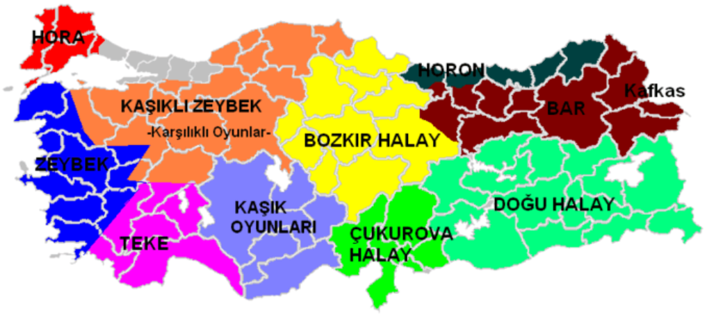

Türkiye, halk danslarının çeşitliliği ve bölgesel özelliklerin büyük farklılıklar göstermesi bakımından altı bölgeye ayrılmaktadır. Bu bölgelere giren illerden bazılarının oyunları yakın bölgenin oyunlarının özelliklerini de taşıyabilir. Bir halk dansının yaygın olduğu bölgede başka bir oyun da görülür.

## 10.1. Bar

**Bar** Bölgesi Erzurum, Erzincan, Bayburt, Kars, Artvin ve Ağrı illerini kapsar. Barlar en az beş kişiden oluşan dizi halinde oynanır. Başlangıçta ağır sayılabilecek bir ritimle başlayan bu oyunlar giderek hızlanır. “Sekme” ya da “yelleme” bölümlerinde çabuk ve çevik hareketlerle sürer. Davul zurna eşliğinde oynanan barlarda dizi başındaki oyuncuya “barbaşı” adı verilir. Barbaşı öteki oyuncuları yönetebilecek bilgisi ve oyun deneyimi olan kişiler arasından seçilir. Dizinin öteki başında yer alan, barbaşının işaret ve ünlemlerine göre oyunun düzenine yardımcı olan oyuncuya da “pöçük“ denir. Barbaşı ve pöçük serbest kalan ellerinde mendil tutarlar. Barlar genellikle erkekler tarafından oynanırsa da kadınların oynadığı barlar da vardır. Oynanış sırasına göre bazı bar adları şöyledir: Baş Bar, Sarhoş Barı, İkinci Bar, Dikine Bar, Sekme Barı, Hoş Bilezik, Aşırma, Nari, Timur Ağa, Tamzara ve Hançer Barı.

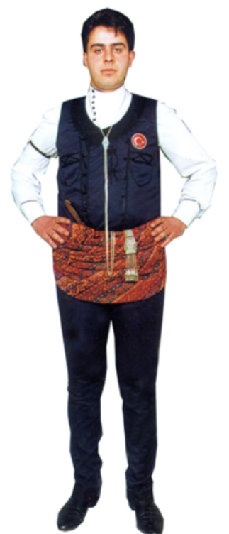

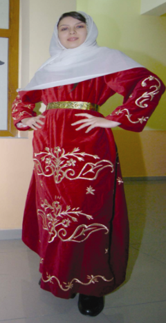

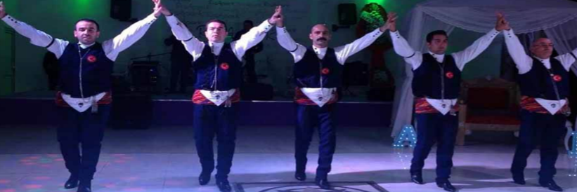

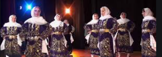

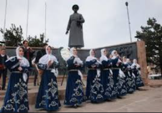

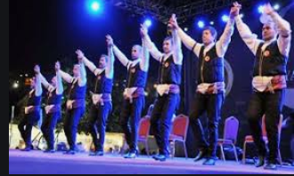

## 10.2. Halay

**Halay** Bölgesi, Adıyaman, Urfa, Diyarbakır, Gaziantep, Elâzığ, Malatya, vs illerini kapsar. Halay dizi halinde ve her zaman davul zurna eşliğinde oynanır. Her halayın kendine özgü müziği ve çalgı eşliğinde söylenen türküsü vardır. Halay dizisi “halay başı“ adı verilen oyuncu tarafından yönetilir. Dizinin başında duran halay başının yardımcısı dizi sonundaki “pöçüktür. Barda olduğu gibi her ikisinin de elinde birer mendil vardır. Genellikle çok ağır başlayan halaylar, “ağırlama” da denen bu bölümün ardından giderek hızlanır. Sıçramaların sıklaştığı, hareketlerin keskinleştiği görülür.

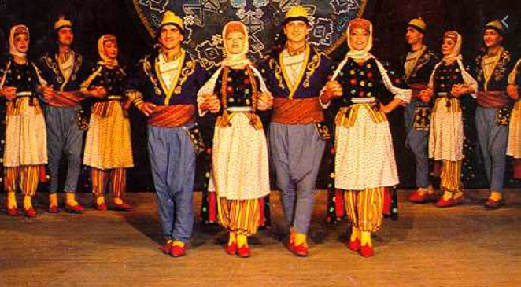

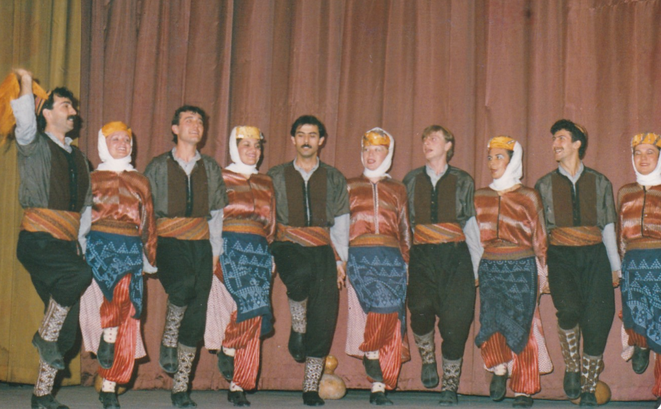

## 10.3. HORO, HORA ya da KARŞILAMA

**Horo** (ya da Hora) ve **Karşılama** Bölgesi Kırklareli, Tekirdağ ve Edirne illerini içerir. Horo da bar ve halay gibi yan yana dizilerek oynanır. Horo, ayak vuruşlarıyla yeri döverek oynanır ve bu ortak özellikten dolayı bu yöre oyunları genel olarak bu adla anılır.

Kasap oyunları da bu bölgeye özgüdür ve “kasap havası” adı verilen bir ezgi eşliğinde oynanır. Türkiye’de oynanan biçiminde Balkanlar’a özgü hareketler ile Türklere özgü hareketler bir arada sergilenir.

Bu bölgede ve İzmit, Adapazarı, Çanakkale, Bursa, Bilecik, Bolu illerinde görülen “karşılama” da en az iki kişi tarafından karşılıklı ve birbirinin eşi hareketlerle, belirli bir uyum içinde oynanan bir oyundur. Kadın erkek karşılıklı oynadığı gibi yalnızca erkekler ya da kadınlar arasında da oynanabilir.

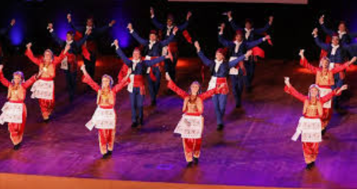

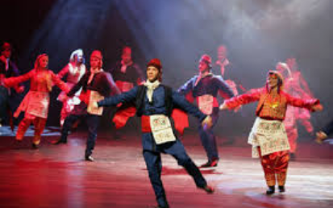

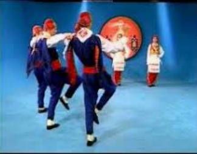

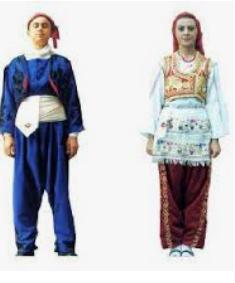

## 10.4. Horon

**Horon** Bölgesi Karadeniz’in doğusunda başta Rize, Trabzon ve Ordu illeri ile Sinop, Samsun, Giresun, Artvin illerini de yer yer kapsar. Horonlar da topluca ve dizi halinde oynanan halk danslarıdır. Dizi oluşturulurken oyuncular birbirlerinin omuzlarından tutmazlar, ama sıkışık düzen içinde el ele tutuşabilirler. Genellikle kemençe eşliğinde oynanan horonlara bazı yörelerde davul zurna ve tulum denen bir çeşit üflemeli çalgı da eşlik eder. Genellikle erkeklerin oynadığı bir oyun olan horonların kadınlara özgü olanları da vardır. Kemence çalınırken çoğu zaman Karadeniz ağzıyla söylenen türküler de horona eşlik eder. Düz, Atlama, Kız, Bıçak horonları gibi çeşitleri vardır.

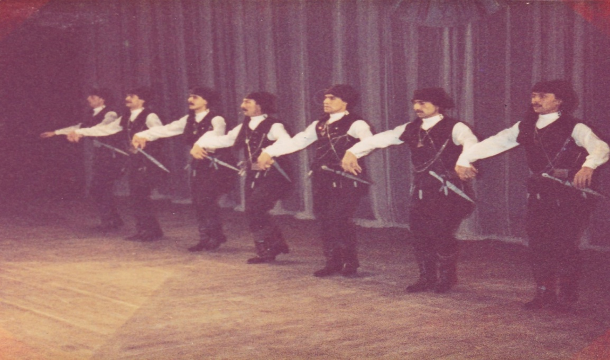

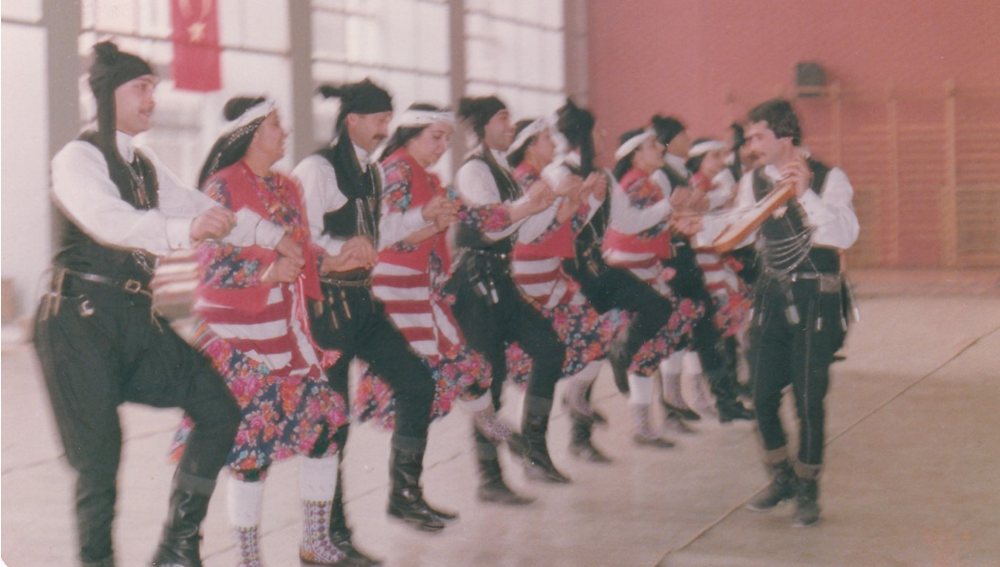

## 10.5. Zeybek

**Zeybek**, Balıkesir, Bergama, Ödemiş, Aydın, Denizli, İzmir, Muğla, Uşak, Burdur, Kütahya, Manisa illerini kapsar. Seymen ve Bengi Bölgesi Ankara, Bolu, Kastamonu illerinde de Ege’nin zeybek oyunlarını andıran, ama onlardan birçok yönden ayrılan efe ve seymen oyunları görülür. Bu oyunlar, eskiden bu yörelerde yaşayan ve zeybek, efe, seymen adıyla anılan yiğit kişilerin oynadığı, köklü bir geleneği olan oyunlardır. Bu oyunlar günümüzde de efe ve zeybek giysileriyle, tavırlarıyla oynanır. Her birinin kendine özgü ezgisi vardır. Ya davul zurna ya da yöresel çalgılardan biri eşliğinde oynanan bu oyunların çoğunun türküsü de vardır ve bu türkü oyun sırasında söylenir.

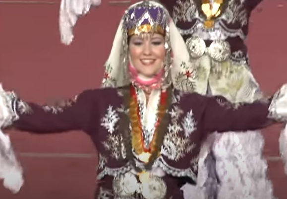

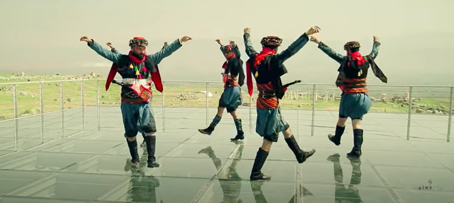

## 10.6. KAŞIK

Dansları Bölgesi İçel’in Silifke ve Mut ilçeleri ile Antalya’yı kapsar. Konya, Kırşehir, Eskişehir, Bartın ve Safranbolu yörelerinde de kaşık oyunları görülür. Kaşık, oyun sırasında bir ritim aracı olarak oyuncuların ellerinde bulunur. Oyuncu her iki elinde birer çift kaşık tutarak ve bunları uyumlu bir biçimde birbirine vurarak müziğe eşlik eder. Silifke ve Mut yöresinin kaşık oyunları ve müziği son yıllarda ülke çapında yaygınlık kazanmıştır.

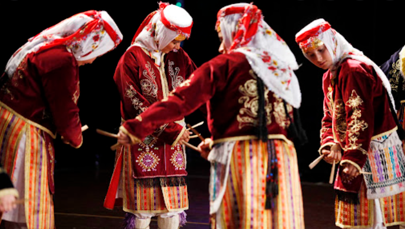

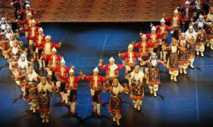

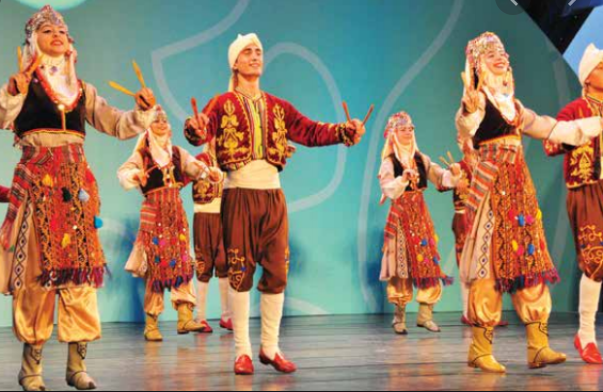

# 11. Coğrafyanın etkisi

Kültürlerin farklılığı, insanın beden yapısı, kişilik oluşumu, maddi ve manevi hayata yön veren coğrafyadır. Çünkü insan hayatını devam ettirebilmek için kaynaklarını tabiattan temin eder. Farklı tabiatlar, farklı hayat biçimleri ekonomik ilişkileri ortaya koyar. Coğrafyanın insan ve kültürler üzerindeki tesirlerini en somut biçimde, dillerdeki lehçe, ağız farklılıklarında; giyim – kuşamda, mimaride, halk danslarında görebiliriz.

# 12. Dilin etkisi

Musiki ve raks sahasında da bu kültür mirasının rengârenk güzellikleri, numuneleri ve türleri vardır. Toy manilerinden mersiyelere, laylaylardan yallılara, halaylardan bozlaklara kadar pek çok musiki ve raks numunesi, her zaman hüzünlendirir, neşelendirir ve hatta ağlatır. Bunlar insanları birbirine daha sıkı bağlar ve yakınlaştırır.

# 13. Kültürün etkisi

Ülkemizde halk danslarının çalışmalarda, eğitimde, kültürde ve diğer alanlarda değerlendirilmesi ancak bu yüzyılda önem kazanmıştır. “Oyun, kültürün doğuşunda başlıca etkendir.” Buna göre kültürün kapsamı içinde yer alan sanatın da kökeninin “oyun” olduğunu ve sanatın doğuşunda önemli bir rolünün bulunduğunu söylemek mümkündür. Tarihte ilk Türk uygarlıklarından; Şamanların, Hunların, Oğuzların geleneklerine bağlı olarak yaptıkları törenlerin önemli bir bölümünü halk danslarını oluşturduğunu, bugüne kadar gelebilen belgelerden anlıyoruz. Anadolu’da yaşayan Türk uygarlıklarında ise, Asya’dan getirdikleri geniş kültür birikimleri ile Anadolu uygarlıklarının kültür ürünlerinin özümlenmesini görmekteyiz. Bunun sunucu olarak uygarlıkların beşiği olan Anadolu’da Atalarımızın yaratıcı gücü, sanat anlayışı, beğeni ve becerilerinin de katkısıyla değer biçilmez halk danslarımız ortaya çıkmıştır. Türklerde danslar; kılıçla, mumlarla, kutsal sayılan araçlarla oynanırdı. Uğur getirmesi için yapılan halk danslarına sıkça rastlanmaktaydı. Günümüzde bunların kalıntıları danslarımızın birçoğunda görülür. Bu dansların kutsal amaçlarının zamanla ortadan kalkarak eğlence için yapıldığını görüyoruz. Anadolu’da ölüm dansına (ölen kişi için yapılan) rastlamamaktayız. Birçok yabancı ülkede günümüzde bile görülen ölüm dansı eskiden bazı Türk boylarında da yapılmamaktaydı. Tarihsel süreç içinde oluşan din olgusu, halk danslarına kökenlik etmiş, onun ayin biçimi ve ibadet gelenekleri bu ulusal kaynağı şekillendirmiştir. İbadet devinimleriyle oluşan figürler motifler, ilkel din sistematizmi içinde imajlarını oluşturarak ve düşünsel yapıda belirginleşerek anlam kazanmış, yine, ayinsel fonksiyonlar içeren dinsel ilahiler, varlıklar dünyasının ve tabiattaki tabii seslerin taklidi biçimindeki terennümlerden (terennüm = mırıldanma) ortaya çıkmıştır. İnisiyasyon (Kabul edilme) ayinlerinin ürünü olan bu değerler, toplumların tarihsel gelişimi içinde, bilinç dışı olmak üzere, nesilden nesille aktarılarak yine dinsel ortamında işlenmiş ve geliştirilmiştir. Zaman içerisinde Türk Toplumu’nun çeşitli yabancı dinlere girmesi, onların kültürel ve dinsel etkisinin altında kalması, somut ve anlaşılır anlamlar taşıyan devinimleri ve melodileri, soyut ve anlamı bilinmeyen, dinselliği kaybolmuş danslar şekline dönüştürmüştür. Her biri bir dinsel inanç ve eylemi ifade eden devinimler, anlamlarından ve özel giysilerinden soyutlanması sonucu “Köçek” danslarında olduğu gibi erotik bir anlam kazanmasına neden olmuştur. Türkler Orta Asya’dan getirdikleri kültür birikimlerini, Hititlerin, Frigya, İyon, Bizans kültür birikimleri ile pekiştirerek, Selçuklular ve Osmanlılarla sürdürerek yücelttiler. Bu yüceltme sonucunda ortaya çıkan paha biçilmez halk danslarımızı gelenekler içinde törenlerimizde yaşatarak bütün çeşitleri ile günümüze kadar getirdiler. Günümüzde halk dansları ile ilgili çalışma, araştırma, derleme ve gösteriler çeşitli kuruluşlar tarafından yürütülmektedir. Dünya da hiçbir ülkede bulunmayan zenginlikteki halk danslarımız, kendi halkımıza ne yazık ki basit bir eğlence aracı olarak yansıtılmaktadır. Genelde konu bir kültür ünitesidir. Onun içindir ki, konuya kültür açısından bakmak gerekmektedir. Oysa ülkemizde, halk kültür ürünlerinin en yaygın olanı, halk dansları başta olmak üzere yalnız tanıtma amaç edinilmiştir. Gerekli bilimsel çalışmalar yapılmadan, yüzeysel ve dayanağı olmayan biçimde konulara el atılmıştır. Sonuç olarak bir kültür hazinesi olan halk danslarımızın gelecek kuşaklara daha sağlıklı bir şekilde aktarılması ve hak ettiği seviyeye ulaştırılması en büyük görevimiz olmalıdır.

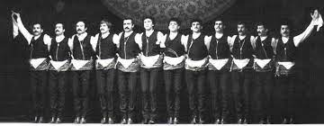

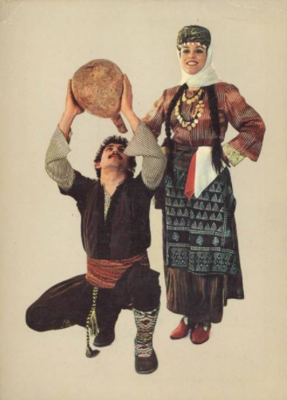

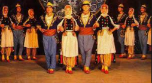

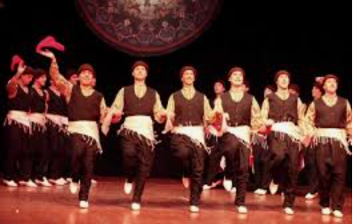

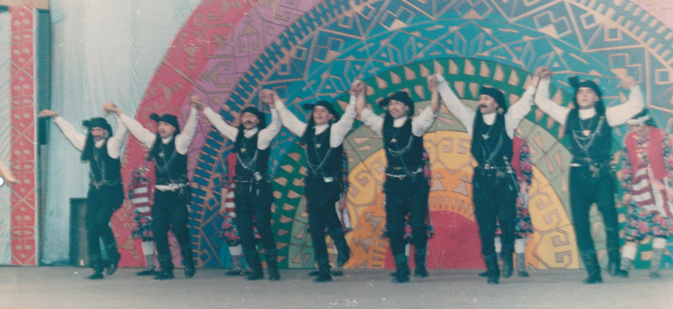

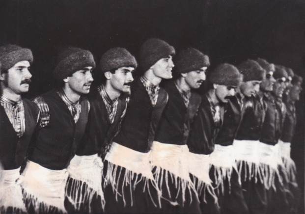

# 14. Halk dansları türleri

**Ana Türler**

A- BARLAR

B- HALAYLAR

- Doğu Halayları
- Bozkır Halayları
- Çukurova Halayları

C- HORONLAR

D- KARŞILAMALAR

E- KAŞIK OYUNLARI

F- ZEYBEKLER

- Asıl Zeybek Bölgesi
  - Ağır zeybek (Erkek Zeybekleri)
  - Kıvrak zeybek (Kadın Zeybekleri)
- Teke Zeybek Bölgesi
- Kaşıklı Zeybek Bölgesi

**Ara Türler**

Bengiler, Mengiler ve Seymenler Zeybeklerin etkisinde kalan lokal oyunlardır.

A- Bengiler

B- Mengiler

C- Seymen Oyunları

D- Teke Oyunları

E- Yallılar

F- Horalar

G- Güvendeler

**Bengiler:** Marmara bölgesinin güneyinde genellikle Balıkesir dolaylarında görülen bir oyun türüdür. Balıkesir, Manisa, Bursa, Çanakkale illerinde oynanır.

**Mengiler:** Ege bölgesi ve Akdeniz bölgesinin bazı İllerinde bu oyun türüne rastlamak mümkündür.

**Seymenler:** Özellikle Ankara çevresi köy düğünlerinde kız evine gelin almaya giden ve bundan başka bazı törenlere de katılan yöresel giyimli kişilerin oluşturduğu topluluktur. Davul ve zurna ile oynanması nedeniyle yörede oynanan diğer zeybeklerden farklı olan seymen zeybeği iki ya da üç kişi ile düğünlerde düzenlenen Seymen alayının önündeki efelerce oynanır. Kılıç ya da teke palası kuşanan efeler, oyun boyunca bunları havada savururken naralar da atarlar.

**Teke Oyunları:** Bu tür de yine Türkiye’nin batı ve güney bölgelerinde oynanır, Antalya, Isparta, Burdur, Alanya

**Yallılar:** Kars yöresinde bir sıra oyunu adıdır. Düğünlerde el ele tutuşulur, kadınlar ve erkekler tarafından yürütülür. Yallı oyunu, tek çeşitten ibaret değildir. Kars yöresinde muhtelif yallılar vardır. Yallılar, doğuda Kafkas Azerbaycan’ında içine alır.

**Horalar:** Kırklareli, Tekirdağ, Edirne asıl bölgeleri karışık olarak Çanakkale yöresi ve karışık bölgelerde görülmektedir.

**Güvendeler:** Güvende kelimesi yazılı kaynaklar, yöredeki kaynak kişiler ve uzmanlara göre açıklanmaya çalışılmış ancak, tam olarak neyi ifade ettiği konusunda net bulgulara ulaşılamamıştır. Yörede ağırlıklı olarak “güvenmek ve dayanmak” anlamlarında kullanıldığı tespit edilmiştir. Özellikle Bursa ve yöresine ait dağ köylerindeki Yörüklere ait olan köy güvendelerdir. Dağ köylerinde yaşayan yörük köylüleri ve bunların oynadıkları kendilerine has oyunlardır.

**Halk dansları aşağıdaki maddelere göre de tasnif edilmiştir.**

- İsimlere göre
- Oynayanların cinsine göre
- Oyunun hızına göre
- Hareketlere göre
- Düzenlerine göre
- Tutuş şekillerine göre
- Konularına göre
- Kişi sayısına göre

**Türkiye’de yaklaşık 3.000 veya üzeri Halk dansı vardır.**

**BAR:** Yapı ve düzenlemeleri ile grup olarak ve açık havada oynanmaktadır. Birbirini izleyerek yanyana oynanır. Diğer bir anlamda geleneksel yanyana oynanan halk dansıdır. Genel olarak Doğu Anadol’unun bir bölümüne yayılmıştır. (Erzurum, Bayburt, Ağrı, Kars, Artvin ve Erzincan illeri). Karakteristik düzenlemesi yanyana, el ele, omuz omuza ve kol kola oynanır. Kadın ve erkek Barları birbirinden farklıdır. Bar halk dansının ana enstrümanları davul, zurna, kavaldır. Daha sonra klarnet kadın barlarına ilave edilmiştir. Sol nota ölçüleri 5/8 lik ve 9/8 likdir. Bazen 6/8lik ve 12/8 lik de kullanılır. Aksak 9/8 lik ölçü ise aynı zamanda Türk halk danslarının önemli karakteristik ölçüsüdür. Bu dansta Türk halk müziği tamamıyla farklı yapılanmıştır.

**HORA:** Trakya Bölgesi’nde oynanan bir halk dansıdır. Ritmi çok hızlı ve kıvraktır. Ayak adımları ön planda olan detaylardandır. Çanakkale, Edirne, Kırklareli, Silivri, Çatalca, Tekirdağ hora oyununun icra edildiği illerdir.

**KARŞILAMA:** Karşılama iki kişinin karşılıklı durarak oynadıkları bir oyun biçimidir Çiftlerin karşılıklı olarak toplanmalarıyla bir grup halinde de oynanmaktadır Kız ve erkek karşılıklı çiftlerin karşılıklı iki sıra halinde dizilmesiyle bir grup oyunu biçiminde de sürdürülmektedir Karşılamalar salma oyunlardır. Oyuncular birbirlerine tutunmazlar Bazı karşılamalarda bütün oyuncuların ellerinde birer mendil bulunur. Genellikle Trakya’da, kısmen de Marmara’nın doğu ve güneyinde görülen bir oyun türüdür. Edirne, Tekirdağ, Kırklareli, İzmit, Adapazarı, Çanakkale, Bursa, Bilecik.

**KAŞIK:** Ellerinde ritim aracı olarak tahta kaşıklar bulundururlar. Güney Anadolu’nun Akdeniz’e uzanan kesimleri genellikle kaşıklı oyunlar bölgesi olarak gösterilir bu danslar genelde en fazla Akdeniz Bölgesinde görülmektedir. Kültürel ve oyun düzenlemeleri olarak müzik karakterlerinde ve ritmik yapıda çok farklılıklar göstermektedir. Müzikleri daima tahta kaşıklar ile çalınmaktadır ve karakteristik ölçüsü 2/4 ya da 4/4 dür. Genel de kullanılan enstrümanlar ise saz, bağlama ve klarnetdir ve halk türküleri ile eşlik edilmektedir. Mersin, Konya, Eskişehir, Afyon, Kütahya, Bilecik, Kırşehir, Antalya, Bolu, Bursa.

**HORON:** Horon ya da dönerek yapılan dans, Karadeniz kıyılarının ve iç bölgelerinin tipik dansıdır ve tamamen farklı yapıdadır. Bahsettiğimiz gibi bölge halkı, coğrafik ve iklimsel yapısı Karadeniz’in karakteristik bir örneğidir. Horon diğer bölgelerdeki halk danslarından tempo, ritim, düzenleme ve ölçü olarak farklıdır. Horon genellikle grup olarak oynanır ve karakteristik ölçüsü 7/16 dir. Müzikleri çok hızlıdır ve her enstrümanla çalmak çok zordur. Horon’un vazgeçilmez çalgısı elbette Kemençe, Davul ve zurna ile çalınabilir. Horon müzikleri asıl adı Cura olan küçük zurna ile çalınır. İlave olarak bölgenin iç kısımlarında üflemeli enstrüman olarak Tulum, Mey ve Cura kullanılır. Diğer kullanılan ölçü ise 2/4,5/8 ve 9/16 dır.

**HALAY:** Bu halk dansı doğu, güneydoğu ve orta Anadolu da geniş alanda sergilenmektedir ve çok hareketli bir danstır. Bu özelliği ile müzik ve figürlerin bir bölgeden diğerine değişik biçimler ile uygulandığı anlaşılmaktadır. Halay dansı bir ya da iki hatta üç bölüm olabilir. Bir yanda zengin figür yapısı ve diğer bir yanda ise müzik yapısındaki sadeliği, halkın yaratıcılığının ve özgünlüğünün sembolüdür. Halayın ritmik ögeleri çok zengindir. Çoğu davul, zurna karışımıdır. Aynı zamanda kaval, sipsi, çığırtma ya da bağlama ve halk şarkıları ile söylenmekte ve çalınmaktadır. Halay halk dansının müziklerinde Türk halk müziklerinin bütün ölçülerini duyarsınız.

**ZEYBEK:** Zeybek halk dansları genel olarak Batı Anadoluya dağılmıştır. Zeybek kelimesi asker ve geçmiş dönemde yaşamış sivil halk için kullanılmıştır. Fakat sonra folklorik karaktere dönüşmüştür ve şimdi halk dansı ve halk müziği ismi olarak kullanılmaktadır. Zeybek müzik şekli ve zengin dansları ile Anadoluya en geniş alanda dağılmış olarak kabul edilmektedir. Zeybek tek kişi ile, iki kişi ile ya da grup olarak oynanmaktadır ve Orta Anadolu’da zeybek ismi örneğin Seymen olarak adlandırılır. Zeybek dansının genel ölçüleri 9/8 formlanmıştır ve çeşitli tempoları vardır. Örneğin çok yavaş, yavaş, hızlı ve çok hızlıdır. Çok yavaş zeybek dansının ölçüsü 9/2, yavaş zeybek dansının ölçüsü 9/4 ve bazıları 9/8 likdır. Çok hızlı zeybek dansı misal olarak alınırsa Burdur - Fethiye Bölgesinin keçi dansı bu karakterde dans olarak kabul edilir. Geleneksel ölçüsü 9/16 dir. Zeybek bölgesinin diğer tipik bir dansı ise Bengi dir. Zeybekden çok farklı oynanır ve farklı müzik özelliğindedir. Benginin karakteristik ölçüsü 9/8 likdir. Görüldüğü gibi Zeybek tipik halk dansları Batı Anadolu’nun her tarafını kuşatmıştır. Genelde her biri bir diğerinin benzeridir fakat hep farklı ölçüler, ritmik özelliklerinde ve figür karakterlerinde. Sol notası ölçüleri 9/4,9/8 ve 9/16 diğer ölçüleri özellikle 2/4 ve 4/4 aynı zamanda kullanılmaktadır. Özellikle yavaş zeybekte geleneksel enstrüman davul ve zurna birleşimidir. İki davul ve iki zurna bileşimi gelenektir. Bir zurnanın görevi eşlik etmektir (akompaniman) diğer anlamda melodiye ikinci sabit tonda eşlik etmektedir. Davul ve zurnadan başka diğer enstrümanlar ise bağlama, saz gibi yaylı çalgılardır. Bunlar hızlı zeybek için kullanılmaktadır. Özellikle Teke (keçi) dansı bölgesinin geleneksel enstrümanı sazdır.

# 15. İçerdiği konulara göre halk dansları

<strong><u>İnsan-İnsan İlişkilerini Konu Alan Halk Dansları</u></strong>

**Vuruşma ya da kavgayı konu alan halk dansları:**

- **Silahlı;** Hançer barı (Erzurum), Bıçak horonu (Trabzon, Rize)
- **Silahsız;** Harkuşta (Bitlis), Sim sim (Adıyaman)

**Kadın-Erkek İlişkilerini Konu Alan Halk Dansları:**

- Kıskanç (Kars),
- Arzu ile Kamber (Edirne).

**Akrabalık İlişkilerini Konu Alan Halk Dansları:**

- Emmiler (Konya),
- Musa amca (Diyarbakır).

**Kişi Adlarını Konu Alan Halk Dansları**

- Mahir çavuş (Amasya),
- Ata barı (Artvin).

<strong><u>Tören Oyunları</u></strong>

<strong><u>Geçiş töreni oyunları (doğum, sünnet, kına gecesi, asker uğurlama):</u></strong>

- Çayda çıra, askeran (avreş) (Elazığ),
- Çiftetelli (Adana).

# 16. Doğayı konu alan halk dansları

**Deniz ve suları konu alan halk dansları:**

- Horon kurma (Rize, Trabzon)
- Kelek (Van)

**Dağ ve ova adlarını konu alan halk dansları:**

- Yayla yolları (İçel)
- Ormandan gel (Uşak)

**Meyve ve bitki adlarını konu alan halk dansları:**

- Zambak (Konya),
- Kavak (Erzurum).

**Doğa olaylarını konu alan halk dansları:**

- Yağmur duası (Adıyaman),
- Kar mı yağdı (Kütahya).

**Hayvan Taklitli Halk Dansları:**

- Kartal halayı (Bingöl,)
- Kurt-kuzu (Diyarbakır)

<strong><u>KAREOĞRAFİK DÜZENLERİNE GÖRE HALK DANSLARI</u></strong>

<strong><u>Dansçı Sayısına Göre</u></strong>

**Tek Kişilik Danslar:**

**Kadın Dansları** Temel Deyren (Muğla), Şeve Kırma (Elazığ), Yoğurt (Eskişehir), Estireyim Mi (Bolu), Kız Havası (Burdur), Çiftetelli ve Çengi Dansları.

**Erkek Dansları** Misket, Fidayda, Mor Koyun (Ankara), Zeybek’ler (İzmir, Muğla, Aydın, Balikesir, Denizli, Manisa)

**İki Kişilik Danslar:**

**Kadın Dansları** Kahveyi Kavururlar (Eskişehir), Ördek (Bolu), Mandalar (Tekirdağ, Kırklareli), Nöbey (Malatya), Silvani (Muş)

**Erkek Dansları** Kırka Zeybeği, İnönü Zeybeği (Eskişehir), Bıçak Horonu (Rize, Trabzon), Hançer Barı (Erzurum), Dokuz Ayak (Bitlis).

**Topluluk Halinde Oynanan Danslar:**

**Kadın Dansları** Güvercin, Aşşahtan Gelirem (Erzurum), Keçike (Elazığ), Teşi, Acara Kız Horonu (Artvin) Mendil, Goc’öküz (Eskişehir), Çömüdüm (Kütahya), Keziban Yenge (Burdur).

**Erkek Dansları** Ankara Zeybeği, Sin Sin (Ankara), Koçaklama (Ağrı), Coşkun Çoruh, Horomi, Deli Horon (Artvin), Serenler (Burdur), Baş, Bar, Sekme (Erzurum)

**Kadınlı – Erkekli Danslar** Atabarı, Şavşat Barı (Artvin), Zigoş, Mendil, Galamatya (Edirne), Fatmalı, Dokuzlu, Hadidiye (Gaziantep), Delilo (Elazığ), Yayla Yolları (İçel).

<strong><u>SAHNE DÜZENİNE GÖRE DANSLAR</u></strong>

**Halka Biçimli Danslar**

İğdeli Gelin (Çorum), Düz Horon (Artvin), Bengi (Balıkesir) Halka Oyunu (Eskişehir)

**Dizi Biçimli Danslar**

(Bingöl, Elazığ, Diyarbakır, Malatya), Bar’lar (Erzurum, Artvin, Kars)

<strong><u>Adım Biçimlerine Göre Danslar</u></strong>

**İlerleyip Geriye Dönen Adımlı Danslar**

Horon Kurma (Trabzon), Temirağa (Elazığ, Sivas), Arnavut Halayı (Sivas), Tek Ayak, İki Ayak (Diyarbakır).

**Sürekli İlerleyen Adımlı Danslar**

Keklik (İçel), Çepikli, Meryem (Gaziantep), Çepik (Bingöl, Diyarbakır), Atabarı, Horomi (Artvin), Mendil (Edirne)

# 17. Araçla oynanan halk danslarımız

**(AHMET ÇAKIR) ÇALIŞMASIDIR**

<strong><u>Halk Danslarında Kullanılan Araçların İsim Listesi</u></strong>

Solo oyunlarının dışında oyuncu sayısı mutlaka çifttir.

1. Altın
2. At
3. Ayna
4. Bıçak
5. Cam bilezik – seve
6. Davul
7. Havlu
8. Helke
9. İğ
10. Kabak
11. Kalbur
12. Kalkan
13. Kama
14. Kaşık
15. Kaval
16. Keçe
17. Kılıç
18. Mendil – Peşkir
19. Mum
20. Orak
21. Para – Madeni – Kağıt
22. Post – Tilki – Koyun vb.
23. Poşi
24. Sini
25. Sopa - Deynek
26. Tabak
27. Tarak
28. Tef
29. Tencere Kapağı
30. Tesbih
31. Testi
32. Tırpan
33. Tüfek
34. Un
35. Urgan
36. Yemeni – Ayakkabı
37. Yorgan
38. Yüzük
39. Zil

<strong><u>Hangi Yöresel Oyunlarda Hangi Araçlar kullanılır</u></strong>

1. **ALTIN**
- Adana
- Artvin
- Çorum
- Yozgat
2. **AT**
- Çankırı
3. **AYNA**
- Adana
4. **BIÇAK**
- Artvin
- Trabzon
- Bolu
- Bursa
- Çanakkale
- Çorum
- Elazığ
- Erzincan
- Erzurum
- Aydın
- Bitlis
- Bayburt
- Giresun
- Gümüşhane
- Igdır
- Isparta
- İçel
- İzmir
- Kars / Igdır, Ardahan
- Kastamonu
- Muş
- Muğla
- Rize
- Ordu
- Samsun
- Sivas
- Şanlıurfa
5. **DAVUL**
- Ankara
- Kırıkkale
- Bala
- Çorum
- Kastamonu
- Kırşehir
- Samsun
- Yozgat
6. **HAVLU**
- Kars
- Kırşehir
7. **HELKE**
- Şanlıurfa
8. **İĞ**
- Artin
- Şanlıurfa
- Yozgat
- Gaziantep
9. **KABAK**
- Adıyaman
10. **KALBUR - ELEK**
- Şanlıurfa
- Bursa
- Elazığ
- Kütahya
- Şanlıurfa
11. **KAMA**
- Kars
- Trabzon
- Yozgat
12. **KAŞIK**
- Afyon
- Ankara
- Kırıkkale
- Antalya
- Balıkesir
- Bilecik
- Bolu
- Burdur
- Bursa
- Cankırı
- Eskişehir
- Isparta
- İçel
- İzmit / Adapazarı
- Kastamonu
- Konya
- Aksaray
- Karaman
- Kütahya
- Manisa
- Niğde
- Sinop
- Uşak, Zonguldak / Bartın
13. **KEÇE**
- Adıyaman
14. **KILIÇ**
- Ankara
- Bursa
- Erzurum
- Kütahya
15. **MENDİL**
- Bitlis
- Edirne
- Gaziantep
- Hatay
- Kırklareli
- Şanlıurfa
- Tekirdağ
16. **MUM**
- Elazığ
17. **ORAK**
- Adıyaman
18. **PARA – MADENİ – KAĞIT**
- Adana
- Artvin
- Çorum
- Yozgat
19. **POST – TİLKİ – KOYUN**
- Amasya
- Bingöl
- Tokat
- Yozgat
20. **POŞU – GELİN ALİ**
- Adana
- Çorum
- Yozgat
21. **SİNİ**
- Eskişehir
22. **TABAK**
- Ağrı
- Elazığ
23. **TARAK**
- Adana
- Çorum
- Yozgat
24. **TEF**
- Eskişehir – Kirim
25. **TENCERE KAPAĞI**
- Yozgat
26. **TESBİH**
- Kırşehir
- Edirne
27. **TESTİ**
- Kırklareli
- Kars
- Şanlıurfa
28. **TIRPAN**
- Van
29. **TÜFEK**
- Giresun
- Adana
30. **UN**
- Kars
31. **YÜZÜK**
- Adana
- Artvin
- Çorum
- Yozgat
32. **ZİL**
- Ankara
- Bolu
- Çorum
- Kastamonu
- Kırşehir
33. **YORGAN**
- Ağrı
- Amasya
- Diyarbakır
- Hatay
- Van
- Yozgat
34. **SOPA – DEYNEK - ASA**
- Kırklareli
- Tekirdağ
35. **YEMENİ – AYAKKABI**
- Bursa
36. **URGAN**
- Kırşehir
- Diyarbakır
- Elazığ

<strong><u>YARARLANILAN KAYNAKLAR</u></strong>

T. C. M. E. B. Yayınları

Bitlis il Kültür ve Turizm Müdürlüğü

Bitlis Valiliği

Koyunlu Ohin Beldesi

HALK BİLİMİ KURULU

Ahmet Çakır

Eşref GÜNDOĞDU

İstanbul çağdaş

Burcu AKÇIL

Turğut Kenan ÇATALKAYA

# 18. Üniversitelerde halk dansları konservatuarları ve ilgili bölümler

- ODTÜ Halk Bilimi Topluluğu
- Ankara Üniversitesi Halk Bilimi Bölümü
- Hacettepe Üniversitesi Halk Bilimi Bölümü (Ankara)
- Gazi Üniversitesi Halk Bilimi Bölümü (Ankara)
- Diyarbakır Dicle Üniversitesi Devlet Konservatuvarı
- İzmir Ege Üniversitesi Konservatuvarı Türk Halk Dansları Bölümü
- İstanbul Teknik Üniversitesi Konservatuvarı Türk Halk Dansları Bölümü
- Gaziantep Üniversitesi Konservatuvarı Türk Halk Dansları Bölümü
- Sakarya Üniversitesi Konservatuvarı Türk Halk Dansları Bölümü
- Sivas Cumhuriyet Üniversitesi Halk Bilimi Bölümü
- Ordu Üniversitesi Müzik ve Sahne sanatları Fakültesi
- Giresun Üniversitesi Devlet Konservatuvarı

# 19. Halk dansları ile ilgilenen kurumlar

**Türk Halk Dansları Federasyonu:** Dernek ve Kulüpler 2001 yılında Türk Halk Dansları Federasyonu’nu oluşturmuşlardır. Spor federasyonları statüsündedir. Derleme faaliyetleri ve yarışmalar organize etmektedir.

**Kültür ve Turizm Bakanlığı:** Halk Dansları ile ilgilenen bir diğer kurum Kültür Bakanlığı’dır. Bünyesindeki Halk Kültürünü Geliştirme ve Araştırma Müdürlüğü aracılığıyla halk oyunlarının araştırılmasına yönelik çalışmalar yapar. \[HAGEM\] Ayrıca Kültür ve Turizm Bakanlığı ve sponsoru Sabancı ortaklaşa her yıl Vak-Sa halk dansları yarışması yapmaktadır. Halk dansları dernekleri arasında yapılmaktadır. Halk Danslarının oscar’ı niteliğindedir. Bunun yanında Kültür Bakanlığı köyler arası mahalli halk dansları yarışması düzenlemektedir.

**Milli Eğitim Bakanlığı Okul içi Beden Eğitimi ve İzcilik Dairesi Başkanlığı**: Milli Eğitim Bakanlığı’nın ilgi alanlarından biri de Türk Halk danslarıdır. Her yıl M. E. B.’na bağlı bütün okulların katıldığı Türkiye’nin en yaygın halk dansları yarışmaları yapılmaktadır. *Yarışmalar ilçe yarışması, il yarışması, grup yarışması ve Türkiye Finalleri şeklinde yapılmaktadır.* Türk Halk dansları’na derlemelerin yapılmasında MEB’nın büyük rolü vardır. M. E. B. Halk dansları dairesinin müdürü; *Z. Bilge Erden*dir. Yarışma Branşları;

1. İlköğretim Minikler Geleneksel
2. İlköğretim Yıldızlar Geleneksel
3. Lise Büyükler Geleneksel
4. Yaygın Eğitim Kurumları Geleneksel
5. İlköğretim Minikler Sahnelemeli
6. İlköğretim Yıldızlar Sahnelemeli
7. Lise Büyükler Sahnelemeli
8. Yaygın Eğitim Kurumları Sahnelemeli

**Üniversiteler:** Üniversiteler halk danslarıyla ilgilen kurumlardır. Gerek öğrenci kulüpleri gerek beden eğitimi spor yüksek okulları ve gerekse Sağlık Kültür ve Spor Daire Başkanlığı aracılığıyla halk danslarına katkıda bulunurlar. Üniversite Sporları Federasyonu her yıl üniversiteler arası yarışma düzenlerler.

**Yurt-kur**: Yurt-kur her yıl devlet yurtları arası halk dansları yarışması düzenlemektedir.

**Halk Dansları dernekleri ve kulüpleri**: Pek çok şehirde halk oyunlarını öğretmek ve yaşatmak amacıyla dernek ve kulüpler kurulmuştur.

**Halk eğitim merkezleri:** Hem’lerin asli görevlerinden biri de yöre halk danslarını araştırmak ve eğitici yetiştirmektir.

**Gençlik merkezleri:** Gençlik ve Spor’a bağlı gençlik merkezleri de halk danslarına hizmet vermektedir.

# 20. Yörelere göre halk dansları

**İçindekiler**

- [20.1 Bitlis yöresi](#_Toc241841159)
- [20.2 Erzurum yöresi](#_Toc241841160)
- [20.3 Bingöl yöresi](#_Toc241841161)
- [20.4 Elazığ yöresi](#_Toc241841162)
- [20.5 Kırklareli yöresi](#_Toc241841163)
- [20.6 Adıyaman yöresi](#_Toc241841164)
- [20.7 Trabzon yöresi](#_Toc241841165)
- [20.8 Van yöresi](#_Toc241841166)
- [20.9 Gaziantep yöresi](#_Toc241841167)
- [20.10 Silifke halk dansları](#_Toc241841168)
- [20.11 Diyarbakır yöresi](#_Toc241841169)
- [20.12 Zeybek halk dansları](#_Toc241841170)
- [20.13 Kars Halk Dansları](#_Toc241841171)
- [20.14 Artvin yöresi](#_Toc241841172)

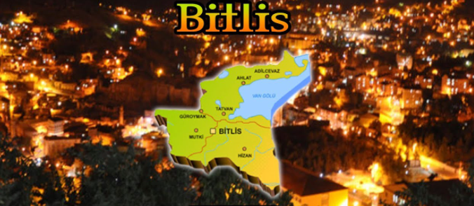

## 20.1 Bitlis yöresi

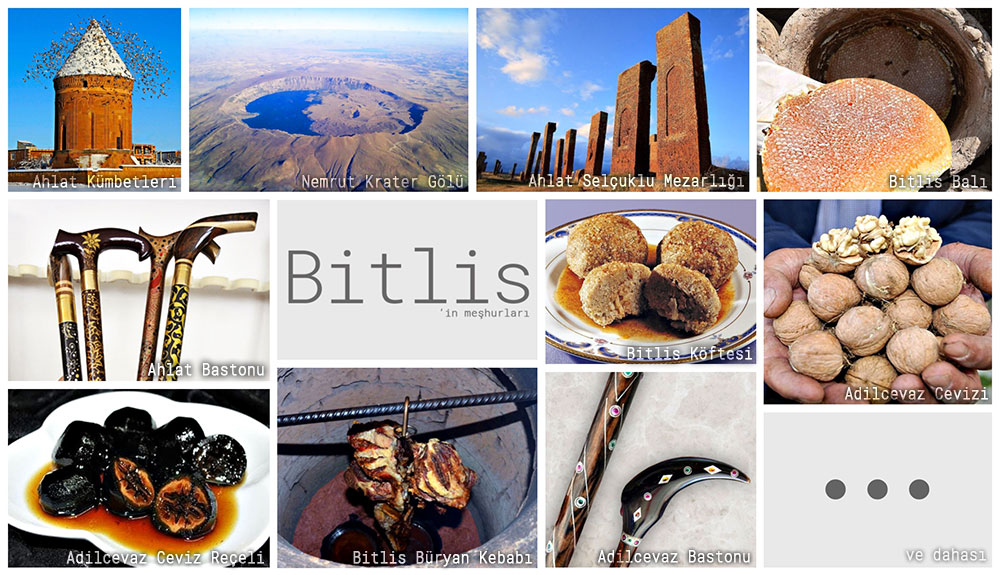

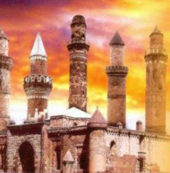

**Şekil 1:** Bitlis ’de Beş Minare

**İçindekiler**

- [20.1.1 BİTLİS HAKKINDA BİLGİ](#_Toc243139863)
- [20.1.2 BİTLİS YÖRE DANSLARI](#_Toc243139864)
- [20.1.3 BİTLİS KOSTÜMÜ](#_Toc243139865)
- [20.1.4 Yalnız Kadınlar Tarafından Oynanan Oyunlar](#_Toc243139866)
- [20.1.5 Erkek Dansları](#_Toc243139867)

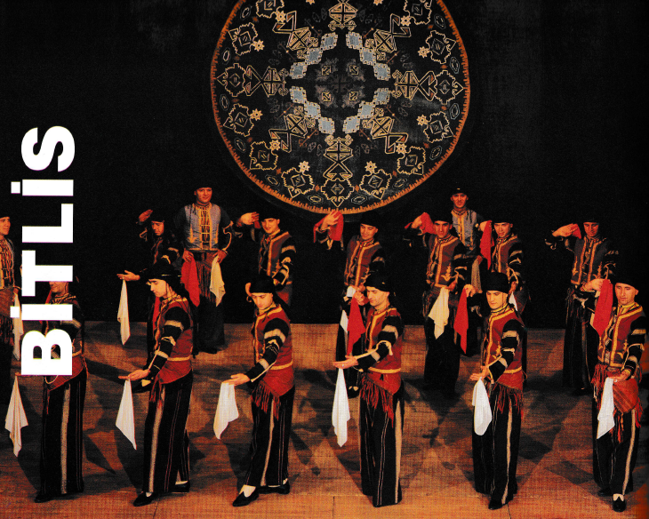

### 20.1.1 BİTLİS HAKKINDA BİLGİ

Bitlis’in tarihi geçmişi MÖ 2000 yıllarına dayanmaktadır. Bölge topraklarında sırasıyla Urartular, Persler, Büyük İskender Krallığı, Roma ve Bizanslar hüküm sürmüştür. Bitlis 1071’den itibaren çeşitli Türk devletlerinin ve beyliklerinin idaresine girmiştir. (Selçuklu, Eyyübi, Safevi, Ahlatşahlar, Karakoyunlu, Akkoyunlu, Şerefhanbey, Candaroğulları ve Osmanlılar). Bitlis Osmanlı Devleti zamanından, Cumhuriyetin kuruluş tarihine kadar geçen süre içinde Devletin sayılı illerinden biri olmuştur. Bu sıralarda Bitlis ilimizde bir çok yabancı devletlerin temsilcileri bulunmakta idi. Ayrıca Türk okullarından Askeri Rüştiye, Sultani de idadi okulları faal durumda idi, Ticari bakımdan Bitlis İran ve Doğu Anadolu yol kavşağı üzerinde ayrı bir önem kazanmıştı. Birinci Cihan Savaşında istilaya uğrayan Bitlis göç sebebiyle çoğu ölmüş, bir kısmı da göçten sonra dönmeyen halkın şehir nüfusunun azalmasına büyük bir tesiri olmuştur. Savaşın sona ermesi ve düşman istilasından kurtulması sonucunda Bitlis’e dönen az bir halk Bitlis’i bir harabe halinde bulmuşlar. Modern Türkiye Cumhuriyeti kurulduğunda Muş’a bağlı bir ilçe iken 1936 yılında il statüsü elde etmiştir. Yörenin efsane türküsü ’Bitlis’te Beş Minare’nin 1916 yıllarında Rus işgaline karşı savaşan bir baba oğulun Bitlis’e döndüklerinde yaşadıkları travma sebebiyle ortaya çıktığı söylenmektedir. Bitlisli baba, oğlundan viraneye dönen şehri kontrol etmesini ister. Oğul şehri iyice kolaçan ettikten sonra bölgede yalnızca 5 minarenin kaldığını ve her şeyin bertaraf edildiğini, insanların ise bölgeden ayrıldığını söyler. Daha sonra dertli babanın dilinden milyonlarca insanın ezbere bildiği ’Bitlis’te Beş Minare’ türküsünün mısraları dökülür.

Bitlis’te yaşayan insanların yaygın olarak meşgul oldukları ekonomik faaliyet tarımdır. Yöre insanı genel olarak tarım, hayvancılık ve orman ürünlerinden geçimini sağlamaktadır.

Tarım alanlarının çoğunda tahıl üretimi yapılır. Buğday, darı ve çavdar en çok yetiştirilen ürünlerdir. Bunun yanında çeşitli sebze ve meyveler de yetiştirilir. Bitlis’te başta fasulye olmak üzere baklagil üretimi de fazladır.

Hayvancılık faaliyetlerinin de yapıldığı ilde başta keçi, koyun ve sığır yetiştiriciliği olmak üzere arıcılık da yapılmaktadır.

Yol kavşağı üzerinde bulunması, van gölü ve kaplıcalarının varlığı turizm yönünden de bölgeyi etkiler. Un fabrikaları, tütün işleme atölyesi, halk tezgahları, battaniye dokunması önemli sanayi kuruluşlarıdır.

Karayolu, Demiryolu, Van gölü ulaşımı ekonomik etkinliğin gelişmesine yol açmaktadır. Bitlis yer altı kaynakları bakımından fakirdir. Ancak sanayisi gelişim göstermektedir. Bölgede hayvansal ürünlere (et ve süt) dayalı sanayi daha fazla gelişmiştir. Bitlis’e ilce ve köy’lerden olmak üzere daima bir akın vardır. Bunlar önce şehrin kenar mahallelerinde yeteneklerine göre bir mesken sahibi olur, çalışır, çabalarlar şehirliye ayak uydurur, medeni imkanlardan yararlanır, çoğunu okutur daha sonra şehrin merkezine doğru bir yönelim gösterirler. Buna karşılık yerli halk ticaret veya kültür alanında başarı gösterirler. Bitlis’i terk edip başka şehirlere akın etmektedirler. Aile hayatları ise Bitlis’de 25-30 yıl önce 40-50 kişilik aileler bulunurken bugün en geniş aile 10-15 en küçük aile 2-3 kişiden meydana gelmektedir.

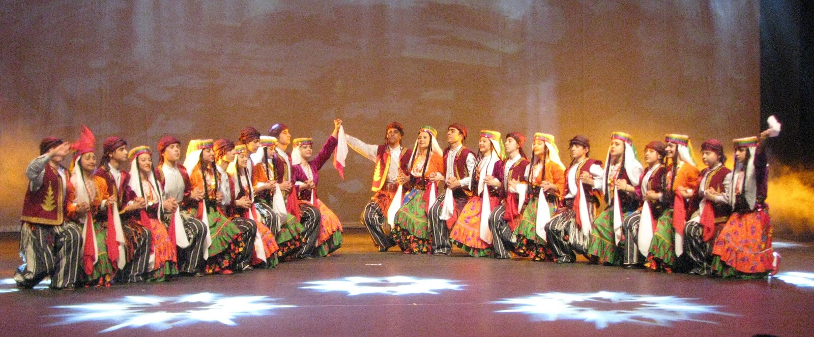

### 20.1.2 BİTLİS YÖRE DANSLARI

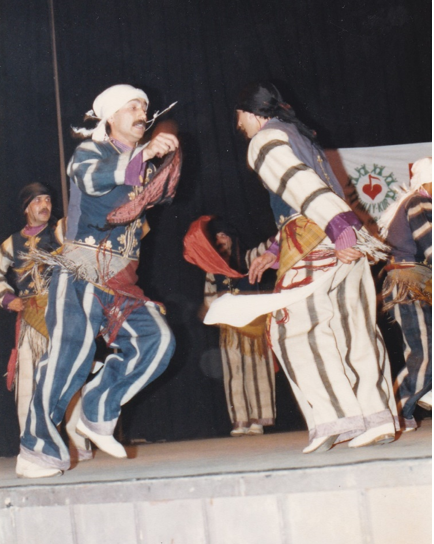

Bitlis yöresi halk dansları renkliliği ve özgünlüğüyle Doğu Anadolu Bölgesi halk dansları içerisinde önemli bir yeri vardır. Yöre insanının zor koşullar içindeki sevdaları ayrılıkları, ölümler, doğa olayları, halk danslarına yansımıştır. Oyunlar genelde insanın mertlik, birlik-beraberlik ve insan sevgisi duygularını ifade eder. Bitlis’te halk danslarını kadınlar ayrı erkekler ayrı oynarlar, birlikte oynamazlar. Ancak halayda oynayanların yakın akraba olması halinde aile içinde kadın erkek birlikte oyun oynayabilirler. Oyunlar, koreografik düzenleme yönünden çeşitlilik gösterir. Sıralarda bağlantılar, çeşitli biçimlerde olur. Degirmenci’de, Govenk’te, Nare’de, Temirağa’da oyuncular, birbirlerini parmaklarından tutar, Hımhimi’de kol kola girer, Tenzere’de parmaklar kenetlenir. Barlarda eller taraklanır. Düz halayda oyuncular birbirlerine sarılır. Yallı’da tutuşmalar omuzdandır. Tiringo, Papuri oyunları kadınlı, erkekli karma oynanır. Karma oyunlarda kadınlı erkekli dizilirler değişik olur. Nanaylar’da iç içe halkalar oluşturulur. Erkekler, çoğunlukla iç halkadadır. Oyunlar çabuk ve karmaşıktır. Devinimler zengindir. Yöre oyunlarında rastlanan bir özellik de, değişik biçimlerdeki el vuruşmalardır. Mutki Harkuştası’nda, Çiftler yan yana dururken el vuruştururlar. Meryem Harkuştası’nda ise ters yönden gelen çiftler birbirlerini bir boy geçtikten sonra dönüp ellerini vuruşturur, sonra elleri yukarda tutarlar. Tüm oyunlar yerel giysilerle davul, zuma, bağlama, kaval, tef eşliğinde oynanır. Bazılarında oyuncular, müziğe sözle katılır. Halay başı halayı mendille idare ettiği gibi nara atarak da halayı idare eder.

Bitlis’te halay çekilirken atılan naralar bir başkadır. Genelde halay başının tey, tey, hopba, yallah naralarına halayda bulunan oyuncular hep birlikte “habress” narası ile “tıssi” fısıltısıyla katılırlar. Bu naralar figür geçişlerinde ve oyun bitirişlerinde atılır.

**Govend (Güvenk)**

Yöre insanının ağır başlılığını, vakur ve ciddiyetini, hareketlerle en güzel anlatan oyunlardandır. Düğünlerde gelin ve damadın birlikte oynadıkları tek oyundur. Oyun gelinle güvey (damat) ailesini tanıştırmayı amaçlar. Bu oyunun sade ve ağır havası damadın en sevinçli anında bile ağır başlılığını gösterir. Bu aile kültürü ve geleneklerin sergilenmesinde çok şeylerin anlatıldığı bir görüntüdür. Çünkü; Bitlis’te gelinle damat düğüne, hatta gerdek gecesine kadar birbirlerini hiç görmezler. Gelin ve damat düğün sonrası evlerine atla veya yaya olarak getirildiklerinden dolayı yorgun olmaları, gelinin de evine yabancı olması nedeniyle oyun bu yüzden çok ağır oynanmaktadır. Kadınlar karşılama biçiminde oynadığı gibi, karma olarak da oynanmaktadır. Halay türü bir oyundur.

**GOVEND GÜVENK (oynanışı)**

1. Müzik
2. Ritim (2/4)
3. Birinci adım

   a) Sağa ve sola yaylanma.

   b) Sağ ayakla öne doğru hareket etme.

   c) Geriye doğru hareket etme,

   d) Yerimizde sağ ayak önde olacak şekilde öne geriye sekme yapma.

   e) Serçe parmaklarla tutuşma.

   f) Sağa doğru sağ ayakla yarım daire oluşturarak yürüme.

4. Üçüncü adım; Kollar ayağın ritmine göre sağa sola öne hareket etme

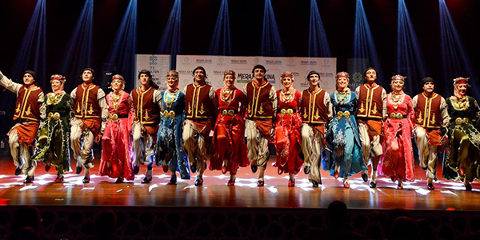

**Meyroki** Meyroki oyununda, ileri gidişlerde düz bir gidiş yerine önce sağa doğru bir yürüyüş sonra sola doğru bir yürüyüşle yay çizilir. Bu, sarhoşların fazla içtikten sonra yolda yürümelerini andırır. Bunun için oyuna mey: içki, ro: yol ve ki tamlama eki ile içki yolu anlamını taşıyan bir isim konulmuştur. Meyroki oyunu için ikinci bir rivayet vardır. Meyroki oyununa konu olan meyro adı isim bozmasından meydana gelmiş bir kahramandır. Meyro’nun asıl adı Meyrem’dir. Ama halk kolaylık olsun diye Meyrem’i Meyro olarak çevirir. Meyro, meydanda davul zurna çalınca köy delikanlıları ile birlikte kendinden geçer, kendinden değişik figürler katarak oyunlar oynar. Bu, halkın çok hoşuna gider. Herkesin dilinde Meyro’nun oyunları vardır. Halk her seferinde Meyro’nun oynadığı oyunlar manasında Meyroki deyip geçer. Bu isim böylece günümüze kadar gelir. Hem kız hem erkekler arasında oynanır. Sertlik göstermez. Daha çok titreme ve gösteriş oyunudur.

[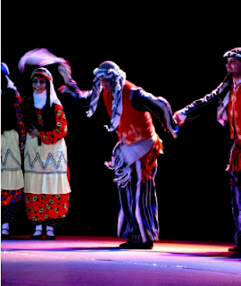](http://4.bp.blogspot.com/-fEK_VZPaBPI/Vqbe1WFOJLI/AAAAAAAAAts/G2lUJVzpdpg/s1600/Ekran%2BAl%25C4%25B1nt%25C4%25B1s%25C4%25B1.PNG)

**MEYROKI**

1. Müzik
2. Ritim (2/4)
3. Birinci adım;

   a) Sol ayakla iki vuruş yapmak.

   b) Sol ayakla sek ki üç yapmak.

   c) Sol ayak burun ucuyla öne doğru vuruş yapmak.

   d) İlerde iki defa burun ucu vurup zıplayıp dönmeye hazırlanmak

4. İkinci adım;

   a) Sek ki üçle geriye gelmek.

   b) Elleri çırparak ileri gidip figür yapmak.

5. Geriye dönüşte eleri kalçaya atıp sekerek yerine gelmek.

**PEYRIJVAN**

1. Müzik
2. Ritim (2/4)
3. Birinci adım;

   a) Sol ayak burun ucuyla ön sağa doğru vuruş yapmak.

   b) Sol ayakla sağ sola doğru sekerek ileriye hareket etmek,

   c) İleride iki defa sol ayağı vurup dönmek,

4. İkinci adım;

   a) Geriye doğru sekerek yerini almak,

   b) Tekrar aynı figürlerle ileriye gidip,

   c) Önde üç defa öne, yarım sağa doğru çöküş yapmak,

   d) Çöküşten sonra kalkıp sekerek yerine gelmek,

**Garzane** Halay bölgesi karakteristik oyunlarından olan halaya Bitlis’te GARZANE denir. Önemli özellikleri; sürekli omuz titretme, sert ayak figürleri ve yumuşak bas devinimleridir. Burası da Garzan denilen bölgeye yakın olduğu için orada yaygın bir oyun olduğu için bölgenin ismine hitaben GARZANE adı verilmiştir.

**GARZANE (oynanışı)**

1. Müzik
2. Ritim (4/8)
3. Birinci adım;

   a. Sek iki üç sol Ayak üzerine zıplayarak sağ ayağı yukarı doğru çekme.

   b. Sağ ayağı üzerine düşüp sol ayak yukarı çekme.

   c. İki ayak parmak üzerinde titre titre yapmak.

4. İkinci adım;

   a. Zıplayarak çift ayak üzerine düşerek sek iki üç sayısını çıkarmak.

   b. Öne doğru eğilerek ileriye hareketi sağlamak.

5. Üçüncü adım; İleriye doğru sekerek hareket etmek.
6. Dördüncü adım; Geriye doğru sekerek hareket etmek

**DELLO**

1. Müzik
2. Ritim (3/4)
3. Birinci adım;

   a. Sağ topuk vuruş

   b. Sol topuk vuruş.

   c. Sağ topuk burun vuruş,

   d. Sek ki üç yürüme.

4. İkinciadım;

   a. Öne arkaya vuruş.

   b. Sek ki üç yaparak el çırpma.

5. Sek ki üç yaparak öne arkaya vuruş yapma.

**KAVAŞ**

1. Müzik
2. Ritim (2/4)
3. Birinci adım;

   a) Sağ topukla titreyerek vuruş yapmak.

   b) Sol topuk titreyerek vuruş yapmak,

   c) İleriye düz ve sert adımlarla yürümek,

   d) Geriye ayakları sallayarak gelmek,

4. İkinci adım;

   a) Sol topuğu zıplayarak vurmak,

   b) Tekrar ileriye sekerek yürümek,

   c) Ve ilerde son vuruşları sağa sola vurmak,

**HALKUŞTA – HARKUŞTA**

Düğünlerde bütün köy halkı ve civar köylerden gelenler köy meydanında toplanırlar. Bu alanda durup dinlenmeden, bıkıp usanmadan saatlerce oyunlar oynanır. Bu arada köyün bekar delikanlıları civar köylerden ve kendi köylerinde bulunan yetişkin kızlara kur yapmak isterler. Harkusta “vuruş” anlamındadır. Oyunlar içinde sertlik hakimdir. İki tarafa ayrılan gençler sanki bir savaş meydanındaymış gibi karsısındakine düşman gibi bakarak, müziğin ritmine uyarak kıran kırana bir gösteri yaparlar. Sert vurma ve vurulan ellerden ses çıkarma kızlar arasında çok rağbet görür. Ve oyunun başlıca özelliğidir. Oyunda tamamen sertlik ve ciddiyet hakimdir.

**Halkuşta** oyununun üç Bölümü vadır:

A- **Melefani**

B- **Halkusta**

C- **Motgane**

**HALKUŞTA**

1. Müzik
2. Ritim (5/4)
3. Birinci adım;

   a. Sağ ayağı öne atarken sol kol serbest olarak sağa doğru sağlamak.

   b. Sol ayağı geriye atarken sağ kol sola doğru sağlamak,

   c. Sol ayak topuğu vururken elleri de beraber çırpmak,

4. İkinci adım;

   a. Sek ki üç yaparak ileri doğru hareket etmek,

   b. Karşısındaki rakibin eline vurmak,

   c. İki rakip ortada buluşarak birbirilerinin eline vurmak

   d. Tekrar iki gurup halindeki rakipler çember şeklinde birbirini kovalamak,

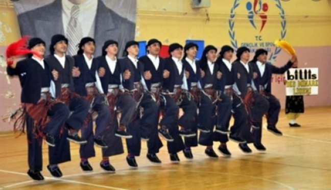

e. Karşılaştıkları anda ise birbirlerinin eline vurmak.

**DEĞIRMENCI**

1. Müzik
2. Ritim (4/4)
3. Birinci adım;

   a. Önce sağa sonra sola diz ve öne doğru kırmak,

   b. Sol ayakla öne doğru hareket etmek,

4. İkinciadım;

   a. Geriye doğru sağ ve sol ayak burun uçlarıyla vurup geriye gelmek.

   b. Geride üç defa önce sağ sonra sola ve öne doğru çöküp kalmak.

**SEPPE (Sepê)**

Seppe olarak yazılmasına karsın halk diline sepê olarak yerleşmiş olup daha çok bu şekilde telaffuz edilmektedir. Halay yöresi oyunlarının en karakteristik oyunu olup; Bitlis yöresinin tek figürlü geçiş veya giriş oyunudur. Erkek oyunudur. **Se** <strong>:</strong>üç **pê:** ayak anlamına geldiğinden oyunun adı ”üç ayak” olarak da kullanılır. Üç ayak oyununun başlıca özelliği; sağ ayağın öne doğru sallanmasından sonra, bir es yapıp sol ayakla bir duraklama yapılması ve sonra hemen yine sağ ayağın üçlemesine geçilmesidir. Oyunda tutuşmalar omuzdandır.

**SEPPE (oynanışı)**

1. Müzik
2. Ritim (4/4)
3. Birinci adım;

   a. Sol topuğu vurarak ayak değiştirme

   b. Sol ayak üzerinde üç kez sekme,

   c. Yarım daire şeklinde yürüme,

   d. Sağ ayak üzerinde sekme,

4. İkinci adım;

   a. Düz yürüme,

   b. Sol ayak üzerinde ileriye doğru yürüme,

   c. Sağ ayak üzerinde ileriye doğru sekme,

   d. Sol ayak üzerinde sekerek geriye doğru yürüme

**Tiringo** Ellerde kırmızı ve beyaz mendiller vardır. Mendiller sallanarak sağa sola, ayaklar sağa-sola çapraz atılarak oynanır. Erkek oyunudur. Tiringo’nun bitimi Papuri’nin başlangıcını teşkil eder.

**TRİNGO** **Müzik**

1. Ritim (4/8)
2. Birinci adım

   a. Sağa sola çapraz adımlarla sekerek oynamak.

   b. Yerinde sekerek oynama.

   c. İleriye doğru sekerek yürüme

   d. Vücudu sağa sola döndürerek oynama

   e. Yan durup sol ayak üzerinde zıplayarak oynama,

3. İkinci adım; a. İki elde mendil tutarak oynama.

   a. Mendille ayakları aynı ritimde sallama.

   b. Sağ ayağı kaldırıp sol ayak üzerine çökme.

**Pappori (Papuri)**  Pappori genellikle ayak figürleriyle oynanan bir oyun olduğu için Pappo: ayak, -:ismin –i hali ve –r: kaynaştırma harfidir. Bütün figürler ayakta toplandığı için bu ismi almıştır. Kısaca ayak oyunu anlamında kullanılır. Karma bir oyundur. Diğer oyunlar arasında nare, çarşıda atlas, memoş, bolag attım havaya, temiraga, dello, botane, adley, gezai ve dokuz ayak yer almaktadır.   **GAZALI** 1. Müzik 2. Ritim (4/4) 3. Birinci adım; a. Sağ ayakla sekerek yana doğru yürümek b. Sek ki üç sayısını yaparak sol ayağı sağa atmak, 4. İkinci adım; a. Sekerek gidip iki sağa iki sola yaylanmak. b. Tekrar sek ki üç sayısını çıkararak yana doğru ilerlemek. **B. PAPURĠ**

1\. Müzik 2. Ritim (4/4) 3. Birinci adım; a. Sağ ayakla sağa doğru sekerek hareket etmek. b. Sol ayak topuğunu vurmak, c. Sağ ayak burun ucuyla üç vuruş yapmak, 4. İkinci adım; a. Sağa doğru sek ki üç sayısıyla ilerlemek, b. Sek ki üç sayısıyla el çırpmak,

**AŞIRMA** 1. Müzik 2. Ritim (3/3) 3. Birinci adım; a. Sol ayakla sağa doğru yürümek b. Sağ ayakla sol ayağa destek verip yürümek 4. İkinci adım; a. Vücudu yarım sağa dönerek yürümek. b. Öne geriye hareket yapmak. 5. Hareket halindeyken seklerle yürümek.  **B. TEMİRAĞA** 1. Müzik 2. Ritim (4/4) 3. Birinci adım; a. Sağ ayakla hafif ileriye doğru sallamak. b. Sol ayağı ileriye hafif ileri doğru sallamak, c. Sağa doğru dört adımla yürümek, 4. İkinci adım; a. Tekrar geriye doğru dört adımla yerine gelmek, b. Aynı figürle zıplayarak ileri gitmek, c. Sekerek tekrar geriye doğru gelme

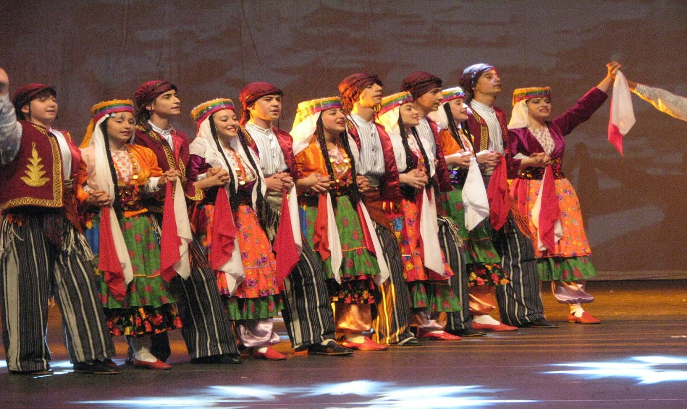

### 20.1.3 BİTLİS KOSTÜMÜ

Tamamen el dokuması olan erkek giysileri, “Gej” denilen tiftik kılından dokunan kumaşla yapılır. Halkoyunlarında olduğu gibi yöresel giysilerde de bir zenginlik ve çeşitlilik bulunmaktadır. Bitlis halkı, yöresel giysilerini çok yönlü düşüncelerle seçmiş ve kullanmıştır.

<strong><u>Kadın Giysileri:</u></strong>

Kadın giysileri oldukça geniş bir zenginlik gösterir. Giyilen giysiden Kadinin evli mi, bekar mi zengin mi, nişanlı mı olduğunu anlamaya yarayan özellikler mevcuttur. Kadınların kullandığı giysiler kısaca şunlardır:

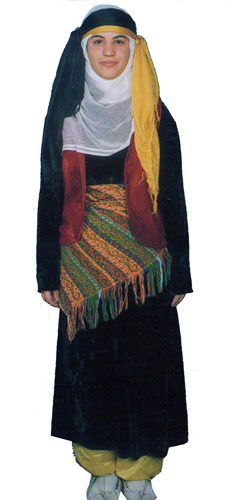

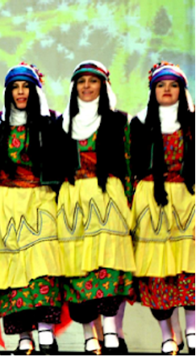

**1– Baş** **Kofi:** Basa geçirilen fes benzeri, kenarları çuhaya benzeyen kumaşla çevrilmiş, tepe kısmı ipek veya benzeri ipliklerle elde işlenmiştir. Kofinin çevresinden sırta ve omuzlara doğru sarkan püsküller bulunur. Alın tarafına gelen kısmına ise “Tikme” adı verilen küçük altınlar (genellikle çeyrek altın) dizilir.  **Merheme (Leçek – Laçik):** Saçlar görülmeyecek şekilde boydan boya başa örtülen ince, beyaz ve sık dokunmuş örtüdür. Etrafı elle örülmüş oyalar veya pullarla çevrelidir.  **Puşu:** Serpus da denilen bu giysi, basın çevresine alından geçirilme Suretiyle merheme üzerine sarılır. Sol tarafta düğümlenerek aşağıya doğru sarkıtılır. Bazı yörelerde birden fazla olduğu da görülmektedir.

**Hızma:** Tek burun deliğine veya burnun iki tarafına madenden yapılma (genellikle gümüşten), içten vidalı veya geçmeli olarak takılan bir çeşit süs eşyasıdır. Halk Bilimi Çalışmaları-Bitlis Yöresi

[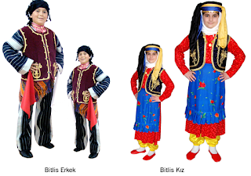](http://4.bp.blogspot.com/-n0Mj-MplFvg/Vqed7wzvEMI/AAAAAAAAAvc/GzZF66VBbiI/s1600/Ekran%2BAl%25C4%25B1nt%25C4%25B1s%25C4%25B1d.PNG)

**Tikme:** Kırmızı veya siyah renkli, kofiden daha kısa kenarlı olup başa giyilen bir giysidir. Bu giysi, alın hizasında olup üzeri, Hamidiyelerle süslü, zenginlerin giydiği bir başlık seklidir. **2 – Boyun** Özellikle genç kızların boyunlarına bol miktarda ve değişik şekil ve renklerde boncuk asılır. Bu adet köylerde yapılmakta ve halen de devam etmektedir. Zengin olanlar, bunların dışında ip sekline getirilmiş olan kumasın üzerine kulplu altın takarlar. **3 – Vücut** **Fistan:** Genellikle kadife veya satenden yapılmış elbisedir. Bu elbiselerin üzerine renkli işlemelerle çeşitli motifler veya sırma işlemeler yapılır. Kolları uzun, belden aşağısı geniş ve uzundur. **Cepken:** Fistan üzerine giyilen, kadife veya diğer kumaşlardan yapılan yarım boy giysi veya yelektir. Cepken değişik renklerde olduğu gibi, uzaktan bakıldığında göz alıcı bir şekildedir. **Kemer:** Fistanın üzerinde takılan, kalın deriden yapılan ve “palaska” adı verilen kemerdir. Fistanın, ön taraftan iki ucu bu kemerin altına sokulur. Nedeni; hem uzun olan eteğin yere sürünmesini önlemek, hem de iç kısma giyilen diğer elbiselerin görünmesini sağlamaktır.  **4 – Ayaklar**

Köy kadınları ayaklarına yünden örünmüş değişik renkteki çorapları giyerler. Ayakkabı olarak “Trabzon” adı verilen lastik ayakkabı, aynı tipte yapılmış renkli naylon ayakkabı veya ender de olsa Harik giyilir. Eski tarihlerde köy kadınları ayaklarına halhal takarlardı.

[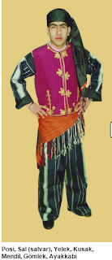](http://3.bp.blogspot.com/-urcXL3U7oUE/Vqed347K8gI/AAAAAAAAAvE/tMEPKquYHb8/s1600/Ekran%2BAl%25C4%25B1nt%25C4%25B1s%25C4%25B1w.PNG)

<strong><u>Erkek Giysileri</u></strong>

**1 – Baş** **Puşu**: Kadınlarda olduğu gibi erkekler de bu giysiyi kullanmaktadırlar. Özel kumaştan yapılarak, renk ve dokunuşlarına göre isimlendirilirler. Siyah, mavi, mor, beyaz, kırmızı puşu, altuniye ve desenli puşu şeklinde isimlendirilirler.

**Egal:** Erkeklerin kış aylarında başlarına bağladıkları, yün ve pamuktan dokunan, siyah ve mor renkli giysilerdir.

**2 – Vücut** **Köynek:** Erkeklerin iç kısma giydiği, desenli kumaştan yapılan düğmeli bir giysidir.  **Şal:** Tiftik yününden yapılmış özel pantolondur. Her tarafı bol paçalı olup, ayağın üzerine kadar uzanır. Bele, pamuk ipliğinden yapılmış “uhçur” la bağlanır. Kemer takılanlara rastlamakta mümkündür.   **Şapik:** “Gej” (tiftik keçisinin kılları ile dokunan, mekik sayısına göre kalitesi değişen, kışın sıcak, yazın serin tutmasıyla özellik gösteren, yöreye mahsus bir kumaş) adı verilen özel kumaştan yapılır. Ceket gibi kullanılan düğmesiz bir giysidir. Önü ve kol altları açıktır (yaz aylarında giyildiğinde hava almayı sağlar). Kol ağızları geriye doğru kıvrık olup, renklikumaştan yapılır. Bu giysiler; el tezgahlarında, yün ve tiftikten dokunur. Kollarda ayrıca “Cellahi” adı verilen, bir metre boyunda, beyaz kumaştan yapılmış ve kola pazu kısmından bağlanan kol bağı bulunur. Şapikin içine yarım dik veya yakasız iç gömleği giyilir. Bu gömleğin kollarında 50 – 60 cm. uzunluğunda, beyaz kumaştan yapılmış, 3 – 5 cm. eninde bir ek kumaş bulunur. “Salte” adı verile bu ek parça, şapik giyildikten sonra geniş olan kolların devamlı olarak aşağıya doğru düşmemesini, yapılan işe mani olmaması için şapikin üzerine sarılarak dirsek hizasında bağlanır. Bu yeleğin her iki yanı işlemelidir. Yine yeleğin her iki yanında el işiyle yapılmış cep bulunur.

**Aba:**

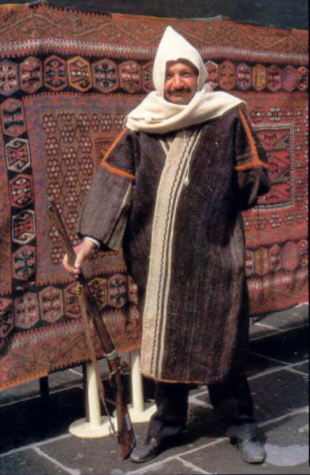

Keçi derisinden, kolsuz veya kollu olarak yapılmış tüylerle kaplı, kış aylarında soğuktan korunmak amacıyla giyilen bir giysidir.

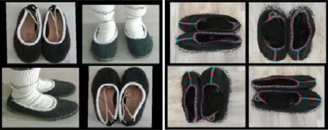

**3 – Ayak** **Harik:**  Üstü keçi tüyünden örülmüş, altı ise kendir ipinden dokunan bir ayakkabıdır. Serin tutması nedeniyle genellikle yaz aylarında giyilir.

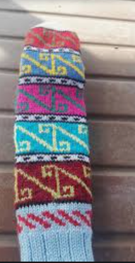

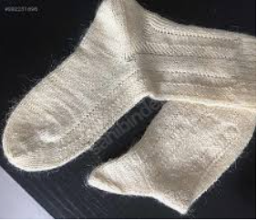

**Çorap:** Düz beyaz, renkli, veya desenli olarak yünden örülür.

**Çarık:**  Manda derisinden yapılır. Kadın ve erkekler dört mevsimde de giyerler. Uzun deri ip bağları ile bileğe bağlanırlar. Anadolu’nun yabancı olmadığı bir giyecektir. Oyunlarımız hakkında azda olsa bilgi edindik, Şimdi de yalnız kadınlar tarafından oynanan oyunlarla ve yalnız erkekler tarafından oynanan oyunları ayıralım.

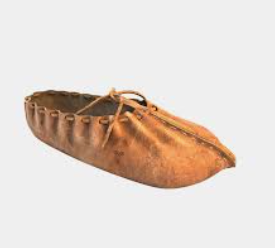

### 20.1.4 Yalnız Kadınlar Tarafından Oynanan Oyunlar

Bitlis Halk danslarında kadın oyunları karakter olarak erkek oyunları ile birliktelik arz eder. Ancak, kadın oyunları daha yumuşak, narin, erkek oyunları hızlı, sert ve zorlu hareketlerden oluşur. Kadın oyunları davul zurna eşliğinde oynandığı gibi, genelde kadın çalgıcıların (defçi)

çaldıkları tef (def) eşliğinde oynanır. Oyuncular, kadın defçinin defle tuttuğu ritimle birlikte söylediği türkü eşliğinde oyunlarını oynarlar. Oyuncuların da türkülere katıldığı görülür. Kadınlar oyunlarında genelde birbirinin belinden tutarak oyunları oynarlar. Bu, kadın oyunları ile erkek oyunlarını bir birinden ayıran önemli bir unsurdur.

**a) Baloh Attım Tevaye**

En az dört, beş kişiyle sıra hilinde eller yan da tutularak sıkı düzen içerisinde oynanan bu oyun, türkülü oyun grubu oyunlarındandır. Oyun, sağ ayak hafif ileride ve dizden kırık, yürüme yönünde gidişlerle oynanır.

Baloh attım tevaye ha ha ninna

Başledi oynemağe ha ha ninna

Ninna ellerin mali ha ha nina

Küçük beylerin mali ha ha ninna

Ele vır tozi çıhsın ha ha ninna

Düşmanın gözü çıhsın ha ha ninna

Ninna ellerin mali ha ha ninna

Küçük beylerin mali ha ha ninna

**b) Memmi (Memmoş)**

Tekli oynanan oyunlarınızdandır. Memmi oyunu tek kişi tarafından oynandığı gibi karşılıklı iki oyuncu tarafından da oynanır. Düğün, tören veya toplantılarda en güzel oynayan oyuncular tarafından oynanılan bu oyunda oyuncuların iki elinde mendil bulunur. Defçinin söylediği türküye göre titreme, ileri ve geri hareketler ve çökme figürleri yapılır.

Kaih gidah belesıne memmi

Erenler mehlesıne memmi

Öle bir yar sevmişem memmi

Kurbanem men sesine memmi

Memmi heyranın olem memmi

Memmi kurbanım olem memm

Memmi yesirin olem memmi

Mehlede deli uşağ memmi

Kerem et hek kavuşağ memmi

Evden izin çıhmezse memmi

Aldırmiyah savuşah memmi

Memmi heyranın olem memmi

Memmi kurbanın olem memmi

Memmi yesirin dem memmi

**c) Dümme**

Yarım daire veya düz sıra halinde, eller bel den kavranarak sağ ayak hafif ileride ve sağ ayak üzerinde dizlerden az kırık oynanır. Oyun soldan sağa doğru yürünerek oynanır, gittikçe hız artırılarak oyun bitirilir. Türkülü bir oyundur. Bu oyun Kars ve Ardahan’da aynı isim altında oynanmaktadır.

**ç) Meyremo (Meryem)**

Yarım daire halinde türkü eşliğinde kadın oyunu olarak oynandığı gibi karma olarak da oynanılır. Bu oyunda, oyundan ziyade oyunun türküye alıştırılması söz konusudur. Oyun, ağır ve düz olarak üç figürle bir müddet sürdükten sonra giderek hız arttırılarak diz çekme figürüyle desteklenir bir kaç tekrardan sonra sona erer. Bu oyunun Mahmut Ragıp Gazimihal’ın Türk halk oyunları kataloğu adlı kitabında 1943’den sonra ilde görüldüğü yazılıdır. Türkünün ilk iki sözü derlenebilmiştir.

**d) Memyane**

Tek düz sıra biçiminde veya yarım daire bi çiminde, belden tutuşarak oynanır. Bu oyunu muzda, türkü eşliğinde oynanılan oyunlardan dır. Sağ ayak hafif önde ve sallanmalarla sol dan sağa doğru gidilerek oynanan türkülü bir oyundur.

**e) Nare**

Yarım daire biçiminde el ele tutuşarak belden kavranarak sıkı düzen içerisinde oynanan bir oyundur. Yalnız kadınlar ve yalnız kekler arasında oynandığı gibi karma olarak da oynanan türkülü oyunlardandır. Diz kırma. yaylanmayla oynanılan ağır ve sade figürlü bir oyundur.

Nare nare hey nare nare

Acımdan karınım ağre nare

Narenin kaşı güzü nare

Meni ciger dan yağe nare

Nare nare hey nare nare

Acımdan karnım ağre nare

**f) Güvengin Yolları (Küvenk, Kövent)**

Düz sıra veya yarım daire biçiminde tutuşarak veya serçe parmaklardan tut. oynanılır. Dört zamanlı bir oyundur. Türkü eşliğinde oynanılır. Oldukça ağır adımlarla oynanılan, bu oyun düğünlerde özellikle gelin damadın oynatıldığı (güvenge çekildiği) Gelinler oynarken anne evinden ay hüznüyle ağladığından bu oyuna “gelin ağlatma oyunu” da denir.

Güven gin yollannda güvengin yollarında

Çimeydım göllerinde, çimeydım göllerinde

Hey anam hey

İlik dümme oleydım ilik dümme oleyd

0 yarın kollerinde o yarın kollerinde

Hey anam hey

Güveng yolu bu mudur güveng yolu bu mudur

Desti dolu su mudur desti dolu su mudur.

Hey anam hey

Gittin ki tez gelesin gittin ki tez gelesin

Tez gelişin bu mudur tez gelişin bu mudur

Hey anam hey

**g) Kına**

Yarım ay biçiminde dizilip serçe parmaklar ile tutularak oynanılan türkülü bir oyundur.

Gelin ve damadın kınalarının yakılması esnasında oynanan bu oyunda, adımlar esnek ve yavaştır. Oyun dört zamanlı bir oyundur.

Kıneyi getir ane

Parmağın batır ane

Bu gece misafirem

Koynunde yatır ane

Ağaç başı kuşpuni

Oldum yarın düşküni

Baş açık yalın ayak

Yole düştüm kış gün

### 20.1.5 Erkek Dansları

**a) Koçceri (Köççeri)**   Bitlis’in tek düz sıra biçiminde oynanan oyunlarından olup yarım daire biçiminde de oy nanılır. Oyun esnasında türkü söylenir. Oyun, el ele tutuşarak soldan sağa doğru

Oynanır. Bu oyunda diz kırma, yaylanma ve sallanma figür leri vardır.

**b) Hırpani**

Bu oyunda oyuncular el ele tutuşurlar. Oyu nun formu düz sıra biçimindedir. Dizden yay lanma ve vücut titreme figürleri vardır. Türkülü oyundur. ki bölümden oluşan bu oyun ağırdan başlayıp gittikçe hızlanır. Hırpani oyunu Grani oyunu ile aynı özellikleri taşır.

**c) Koç Halayı**   Yalnız kadın ve erkeklerce oynandığı gibi karma olarak da oynanır. Bu oyunun formu da karşılıklı düz sıra biçimindedir. Oyunculardan bir grup ileri giderken diğer grup geriye yürür ve oyun bu şekilde devam eder. El ele tutuşarak sıkı düzen içereninde karşılıklı iki grubun söz değişimleri ile oynanır. Bir grup türkü söylerken karşı grup oynar ve türkü söyleyen grubun türküsünün sözlerinin bittiği son heceden alarak türküyü tekrar söylerler bu biçimde tekrar söylenilen türkü ve manilere Berite denir. Oyun sözleri ve atışmaları istenildiği kadar karşılıklı söylenebildiği için oyun uzun sürer. Oyuncuların sustuğu, türkü söylemedikleri zamanlarda çalgı devreye girer. Genelde köylerimizde tef eşliğinde oynanan bir oyundur. Koç koçe koçler katıldı Bal ile şeker karıldı Yar yâre işmar edende 0 yar o yare satıldı Yar satıldı yar satıldı İki can cane katıldı

**ç) Dıldıl (Sarhoş Halayı)**  Bu oyunun da formu yarım daire biçiminde dir. Oyuncular birbirini omuzdan tutarak oynarlar. Oyun ağırdan başlanarak yürüme adımı yönünde yana doğru üç ileri bir geri adımla g tikçe hızlanan yaylanmalar ve ayak atma gürleri ile desteklenen hareketli bir oyundur. bu oyunda, belli aralıklarla zurna uzun ha. çaldığı zaman oyuncular hep birlikte ayak açık duracak biçimde sağa ve sola yaylanma yaparlar. Oyuncuların içinden sesi güzel ol uzun hava söyler, süs yerlerinde di oyuncular “Tey Tey” der bölüm sonun da“habres” çekilerek yürünür ve çalgı başlar. Oyun ve türkü ile süslenen bu oyundaki sallama hareketleri sarhoşun sallanmasına benzetildiği için oyuna sarhoş halayı denmiştir.  **d) Garzane (Karzani, Garzoni)**  Bu oyun Bitlis halk danslarının temel oyunlarından biridir. Hakkari, Muş, Siirt, Van iller benzer biçimde oynanılan Garzane oyunu. - Bitlis’teki oynanışı daha farklıdır. Dans düz biçiminde oynanır. Tavır ve üslup yönünden seyredenleri etkiler. Bu dans en az 4 5 defa oynanılır. Oldukça hareketli ve zorlu bir danstır.

**e) Ağır Güvenk (Ağır Küvenk, Bitlis Barı)**  Yöre insanının ağır başlılığını, vakur ve ciddiyetini, hareketlerle en güzel anlatan oyunlardandır. İsminden de anlaşılacağı gibi ağır oyun (Ağır Güvenk)dur. Düğünlerde geline ve damadın birlikte oynadıkları tek oyun Bu oyunun sade ve ağır havası damadın en sevinçli anında bile ağır başlılığını gösterir. Bu aile kültürü ve geleneklerin sergilenmesinde çok şeylerin anlatıldığı bir görüntüdür. Ağır Güvenk oyunu sanki oyunlara adapte olmak ve ısıma için oynanan bir oyun gibidir. Oyunda ağır adım hızını ifade etmektedir. Ağır Güvenk oyunu Van, Muş, Siirt illerinde de benzer şekilde oynanmaktadır.

<strong><u>KAYNAKLAR</u></strong>

Prof. Dr. : Türk Halk Oyunları, Türkiye İş Bankası Kültür Yayınları:148, CEMİL DEMİRSİPAHİ Ankara,1975.

Prof. Dr. Metin And : Oyun ve Bügü. Türk Kültüründe Oyun Kavramı,

İstanbul 1974, Baha Mat. 13.95 s. İş Bankası.

Kültür Yayınları

Türk Köylü Dansları. İstanbul 1944, İzlem Yayınevi 50 – 74 s.

EGE ÜNİVERSİTESİ : Devlet Türk Müziği Konservatuarı Türk Halk Oyunları Bölümü Ekin

Topluluğu Türk Halk Oyunları Serisi, Folk Dance and Traditional

Dance Theatre Ensemble “EGE” Servet Yapım

FIRAT ÜNIVERSİTESİ : Halk Oyunları Topluluğu Derleme Çalışması “Elazığ Halk Oyunları”,

Fırat Üniversitesi Matbaası, Elazığ, 1984.

Ahmet Kutsi TECER : (1993). Oyunlarımızın Bölge ve Tipleri Hakkında. *Türk Folkloru Arastırma* Dergisi, 64.

##### 1.1.1.1.1 BAYKURT, Şerif : Türkiye’de Folklor, Kalite Matbaası, Ankara,1976

Gazimihal Mahmut Ragıp : Yurt Oyunları Kataloğu. HAGEM Arsiv No: N. E 69.000. I – 0015.

Baykurt Şerif :Türk Halk Oyunları. Ankara 1965, Basnur Mat.

27 – 133 s. Halk Evleri Gen. Mrk. Yay. No : 1.

Ataman Sadi Yaver : 100 Türk Halk Oyunu. İstanbul 1975, Tifdruk Mat.

San. A. S. 4, 130. s. Yapı ve Kredi Bankası Kültür

Yayınları

KOÇKAR, M. Tekin :Çağlar Boyunca İletişim Sanatı Olarak Dans ve Halk Dansları, Bağırgan

Yayımevi, Ankara, 1998. CÖNGER, Mümtaz : Milli Oyun Çalışmaları, Milli Eğitim Basımevi, Ankara, 1987.  EROĞLU, Türker : Elazığ Halk Oyunlarının Halk Bilimi Açısından İncelenmesi, Lisans

: Tezi, Yöneten: Yrd. Doç. Dr. Halil Narman. Fırat Üniversitesi Fen

: Edebiyat Fakültesi Antropoloji Bölümü, Elazığ, 1985.

KOÇKAR M. Tekin

RAMAZAN Musa : Kafkas Halk Dansları Öğretim Yöntemi ve Teknikleri, Şamil Eğitim ve

Kültür Vakfı Yayınları, İstanbul 1987.

ÖRNEK Sedat Veyis : Etnoloji sözlüğü, Ankara Üniversitesi Basımevi, Ankara, 1971.

TEBER, Dr. Serol : Davranışlarımızın Kökeni, Sorun Yayınları, İstanbul, 1978.

TERZİOĞLU, Ahmet “Halk Oyunlarının Eğitimdeki Rolü” Türk Halk Oyunlarının Öğretiminde

Karşılaşılan Problemler Sempozyumu Bildirileri, Ankara 1991, S. 43.

## 20.2 Erzurum yöresi

Erzurum yöresi halk danslarının müzikal yapısını saptamak, türkülerin makam ve usul yapıları Tür olarak **betimsel** türde, model olarak **genel tarama** modelindedir. Araştırmada T. R. T nota arşivine kayıtlı Erzurum yöresi halk danslarının incelemesi yapılmıştır.

Elde edilen sonuçlara göre, Türk Halk Dansları türleri arasında “Bar” olarak tasnif edilmiş olan danslar, kadın ve erkek barları diye ikiye ayrılmıştır. Erzurum barları, Uşşak, Hüzzam, Buselik, Hüseyni, Rast, Çargah makamlarından oluşmaktadır ve 4/4, 5/8, 6/8, 9/8, 10/8, 12/8, 16/8, 18/8, 2/4 usullerdedir.

**İÇİNDEKİLER**

- [20.2.1 Giriş](#_Toc243140422)
- [20.2.2 Erzurum’un Tarihi ve Coğrafi Konumu](#_Toc243140423)
- [20.2.3 Erzurum Halk Dansları ve Bar Kavramı](#_Toc243140424)
- [20.2.4 Araştırma Modeli](#_Toc243140425)
- [20.2.5 Erzurum Barları](#_Toc243140426)
- [20.2.6 Erzurum Barlarının Müzikal Yapısı](#_Toc243140427)
- [20.2.7 Erzurum Barlarının Makamsal Yüzdeliği](#_Toc243140428)
- [20.2.8 Erzurum Barlarının Usul Yüzdeliği](#_Toc243140429)
- [20.2.9 Bilmeceler](#_Toc243140430)
- [20.2.10 BAZI ARAC VE MALZEMELERE VE KİŞİSEL İSİMLERE VERİLEN ADLAR](#_Toc243140431)
- [20.2.11 MAHALLİ DÜGÜN ADETLERİ](#_Toc243140432)
- [20.2.12 ATA SÖZLERİ](#_Toc243140433)

### 20.2.1 Giriş

Oyun; sözlük anlamıyla “Vakit geçirmeye yarayan, belli kuralları olan eğlence. Hile, düzen, desise, entrika. Bedence ve kafaca yetenekleri geliştirmek amacıyla yapılan, çevikliğe dayanan her türlü yarışma. Sahne veya mikrofonda oynamak için hazırlanmış eser, temsil, piyes.” (Türk Dil Kurumu Sözlüğü ).

“İnsanda içgüdüsel olarak mevcut bulunan, temeli din ve büyü ile ilgili bazı töre ve törenlere dayanan; toplumların kültür yapılarına göre şekillenen ve toplumdan topluma farklılıklar gösteren; yer ve zaman bakımından günlük hayattan farklı; isteğe bağlı, gönüllü, hür hareketlerdir.” (Eroğlu, 1995 ).

“Oyun enerji fazlasını atmak, benzetme içgüdüsünü doyurmak, boşaltmaktır. Bir kurama göre, genç yaratıkları ilerde yaşamın gerektirdiği ciddi işve uğraşlara hazırlamak, yetiştirmek içindir. Ya da doğuştan bir geliştirme etkisi ya da üstün gelme ve yarışma isteği, yitik enerjiyi tek yönlü canlılıkla, eylemle onarmadır.” (And, 1974).

“İlk insanlar oyunla, düşünce, tasavvur, arzu, ihtiras ve efsanelerini anlatırlardı. İlk insan henüz hiçbir şey bilmediği bir dönemde, tabiat içinde yaşarken, bir takım sesler duydu, hareketler gördü. Zamanla bu hareketler ve sesler, kafasında çağrışım yapmaya başladı, hareketleri ve sesleri taklit etmeye başladı. İşte o zaman, ses ve hareketin bütünü olan oyun ortaya çıktı.” (Ay, 1999).

“Toplumbilimci için insanların toplum içinde dinlenme ve eğlence aracı olarak giriştikleri bütün fiiller oyun çerçevesi içindedir (At yarışları, sinema, dağcılık, tiyatro, dans, risk ve panayır eğlenceleri v. b. gibi )”(Boratav, 1982).

“Oyun insan hayatının her safhasında vardır ve hayatın geneli de bir oyuna benzetilebilir. İnsanların toplum içinde üstlendikleri statüler onları branşlarında birer oyuncu konumuna sokmaktadır. Anne-baba olmak, öğretmen-öğrenci ya da işçi-memur olmak gibi. “İnsanlar yaşadıkları cemiyet içindeki statülerine göre rol yaparlar. Gerçekte yeryüzünü sahne kabul edersek, insan hayatı bir oyun, insanlar da bu oyun içinde kendilerine düşen görevleri yapan birer aktördür. Öyle ise insanın en önemli özelliklerinden, vasıflarından biri de onun oyunculuğudur.”(Eroğlu, 1995).

Bu araştırma, Erzurum yöresi halk danslarının müzikal yapısını saptamak, türkülerin makam ve usul yapıları incelemek amacı ile hazırlanmıştır.

### 20.2.2 Erzurum’un Tarihi ve Coğrafi Konumu

Erzurum’un kuruluş yeri hakkında tam bir fikir birliği sağlanamamış olmasına rağmen, M. Ö. 4 binlere kadar uzanan prehistorik çevrede ortaya çıkan çok sayıdaki kültür kalıntılarından yaklaşık altı bin yıldır Erzurum ve çevresinin iskân yeri olduğu anlaşılmaktadır. Yapılan kazılarla ortaya çıkarılan Karaz (Kahramanlar) bölgesi bazı arkeolog ve tarihçiler tarafından en eski yerleşim yeri olarak gösterilirken, bazıları da Pulur (Ömertepe)’u ilk yerleşim yeri olarak göstermektedir. Bu görüşlerle birlikte Tufanç (Güzelova) ve bugünkü kale çevresi de ilk yerleşim yeri olarak gösterilmektedir (Gündoğdu ve ark., 2010).

Kendi adıyla anılan verimli bir ovanın güneydoğu kenarında ve Eğerli daği (2974 metre) eteğine kurulmuş olan Erzurum, deniz seviyesinden 1830 – 1980 metre yükseklikte meyilli bir satıh üzerinde kurulmuştur. Fırat’ın başlangıcı olan Karasu kaynaklarının ve kollarının çıktığı Dumlu (kuzeyde), Kargapazarı (doğuda) Palandöken (güneyde) Kop (batıda) sıra dağların arasındadır. 39-55 kuzey enlem 41-46 doğu boylam üzerinde bulunan Erzurum’un alanı 25.066 km2, 2012 nüfus sayımına göre vilayet nüfusu 778,198 merkez 395.572’dir. Kilometrekareye 32 kişi düşmektedir.

**Erzurum’un Tarihi ve Coğrafi Konumu**

Erzurum’un kuruluş yeri hakkında tam bir fikir birliği sağlanamamış olmasına rağmen, M. Ö. 4 binlere kadar uzanan prehistorik çevrede ortaya çıkan çok sayıdaki kültür kalıntılarından yaklaşık altı bin yıldır Erzurum ve çevresinin iskân yeri olduğu anlaşılmaktadır. Yapılan kazılarla ortaya çıkarılan Karaz (Kahramanlar) bölgesi bazı arkeolog ve tarihçiler tarafından en eski yerleşim yeri olarak gösterilirken, bazıları da Pulur (Ömertepe)’u ilk yerleşim yeri olarak göstermektedir. Bu görüşlerle birlikte Tufanç (Güzelova) ve bugünkü kale çevresi de ilk yerleşim yeri olarak gösterilmektedir (Gündoğdu ve ark., 2010).

Kendi adıyla anılan verimli bir ovanın güneydoğu kenarında ve Eğerli daği (2974 metre) eteğine kurulmuş olan Erzurum, deniz seviyesinden 1830 – 1980 metre yükseklikte meyilli bir satıh üzerinde kurulmuştur. Fırat’ın başlangıcı olan Karasu kaynaklarının ve kollarının çıktığı Dumlu (kuzeyde), Kargapazarı (doğuda) Palandöken (güneyde) Kop (batıda) sıra dağların arasındadır. 39-55 kuzey enlem 41-46 doğu boylam üzerinde bulunan Erzurum’un alanı 25.066 km2, 2012 nüfus sayımına göre vilayet nüfusu 778,198 merkez 395.572’dir. Kilometrekareye 32 kişi düşmektedir.

### 20.2.3 Erzurum Halk Dansları ve Bar Kavramı

Erzurum’da halk dansı geleneği asırlar öncesine dayanan ve bugüne kadar oldukça büyük bir bölümü korunarak günümüze ulaşmış oyunlardır. Türk Halk Dansları türleri arasında “Bar” olarak tasnif edilmiş olan danslar, kadın ve erkek barları diye ikiye ayrılmıştır. Erkek barlarında erkeğin yiğitliğini ve mertliğini ifade eden vakar ve onuru temsil edercesine sert; aynı zamanda da estetik, çevik figürlerin hâkimiyetinin yanında, kadın barlarında da kadının zarafetini, ağır başlılığını ve estetiğini ifade eden figürler barınmaktadır. Yörede delikanlılara erkeklik ve mertlik anlamına gelen Dadaş denilmektedir.

**Bar;** Gazimahal’ a göre; “Bar” ismini köken olarak Orta Asya’ya dayandığını belirterek şu açıklamayı yapmaktadır: “Şaman Moğollarda davul vardır ve buna “Bar” diyorlar. “Boret, Halhal “ Moğollarında ve “Tannu- Oranha” Türklerinde de (davul) a “Par” diyorlar; Altay Türkçesinde, “par” pars derisi demektir. Altay Şaman “Tüngür” yani davullarındaki bir surete de (Bar) diyorlar.” (Gazimihal, 1930).

Şaman davulunun sapına hatta kendisine Altayların kimi kabilelerinde “ BAR “ denildiği de vurgulayan Gazimihal, BAR oyunlarında” tutmak yardımcı fiili ile “ bar tutmak” denilmesini de “el ele bağlanmak” ifadesiyle anlamdaş düştüğünün tespit etmektedir.” (Gazimihal, 1960).

Göktan Ay’a göre “bar” birliktelik, beraberlik, el ele tutuşarak oynanan oyun, bir çeşit şaman davulu, birlikte oynanan sıra raksı. Eski sözlük ve diyalektlerde “bar”, “barça”, “baru” topluluk anlamına gelir

Gazimihal’e göre Bar sözcüğü “r” ve “ğ” ses değişimine uğramış Türkçeliği kesin bir sözcüktür. Bağ sap, küme, horum gibi anlamlara gelir. Bağ tutmak el ele bağlanarak sıra tutmak demektir. Çağatay Türkçesi’nde “barlamak” düzeltmek, tertip tanzim etmek, zapt-ü rabt altına almak demektir. Fiilin “bar” kökü tertip, nizam, dizi ve sıra demek olur. Bu tanımlamaya göre bar tutmak, sıra kurmak, sıralanmak demektir.

Atılcan’ a göre Erzurum barları Bar Dansı ve Bar Ayini olmak üzere iki guruba ayırmıştır. İlkinde içgüdünün etkisiyle eğlenmek, bir takım anlamsız hareketlerle ruhu doyuruncaya kadar zıplayıp dönmek, ikincisinde ise bilerek ve inanarak her hangi bir inancı anlatmak amacıyla yapılan anlamlı hareketler olarak nitelemiştir. Atılcan’a göre Bar Dansları: İçgüdü ile sadece eğlenmek için oynanan danslardır.

### 20.2.4 Araştırma Modeli

Araştırma, tür olarak betimsel türde, model olarak genel tarama modelindedir. Genel tarama modelleri, çok sayıda elemandan oluşan bir evrende, evren hakkında genel bir yargı ya varmak amacı ile evrenin tümü ya da ondan alınacak bir grup, örnek ya da örneklem üzerinde yapılan tarama düzenlemeleridir

**Araştırmanın Evreni**

Araştırmada T. R. T nota arşivine kayıtlı Erzurum yöresi halk danslarının incelenmesi ile sınırlandırılmıştır. Türkiye’de 1969 yılında Posta pulları üzerine Erzurum Halk dansları bar oyunu resmi basılmıştır

### 20.2.5 Erzurum Barları

<strong><u>Erkek Barları</u></strong>

**Başbar** (Birinci bar, Sarhoş barı), **Dikine** (İkinci bar, Birinci aşırma), **Hoşbilezik,** **Sekme**, **Koçeri**, **Dello, Temirağa, Tamzara, Aşırma, Yayvan, Köroğlu, Uzundere, Nare, Tavuk barı** (Felek), **Daldalan, Çingenler, Hançer barı**

**1 – BAŞ BAR:** Açık oynanır, güftesi yoktur. Bestede başlangıcı ve son ağrı olmak üzere iki tür müzik vardır. Hüseyini makamındadır. Bu dans Dadaşın ağır başlı, zevk ustalığı eğlence laubaliliğinden ziyade ağır başlılık ve vakurlu olduğunu ifade eder.

**2 – İKİNCİ BAR: (Birinci Aşirma)**: Kapalı Barlardandır, Güftesi yoktur. Hüseyini makamda bestesi yapılmaktadır. Dadaşların birbirlerine gönülden gönüle bağlı, **mütehit** ve **mütesanit** olduğu ifade eder. (yani, demek oluyor ki); Dadaşların birbirlerine gönülden gönüle yapıcı ve dayanışma içerisinde olduğunu ifade ederler.

**Mütehit**: yapıcı demek **Mütesanit**: dayanışma demek

**3 – SEKME (TİKİNE):** Güftesi yoktur. Hüseyni makamındadır. Dadaşın yerine göre çok hareketli, fakat şuurlu ve müşterek sonucu ulaşma iradesi temsil eder.

**4 –** **İKINCİ AŞIRMA:** Güftesi yoktur. Hüseyni makamındadır. Dadaşların savaşta ve Barışta hareket halinde, İş hayatında birlik ve beraberlik içinde olduklarını ifade eder.

**5 – NARİ:** Güftesi yoktur, Açık bardır, Hüseyni makamındadır. Dadaşın güzel zevkli aşk, sevgi yaşantılarının Atalarından gelen **hasletlerini** ( yaradılış huylarını ) çevreye aktarma duygularını sembolize eder.

**6 – DELLO:** İki türlü müziği vardır. Dansıda iki türlüdür, birinci kısma düz dello, ikinci kısma bitlis dellosu denir. Kapalı bardır, Dadaşın en hareketli ve ritmik danslarından birisi olan dello’da, dadaşları hep birden bir komut altında ileri saldırı, ve ani olarak geriden gelen tehlikeye karşı karşılıkta bulunma yapısına sahip bulunduklarını kompeze eder.

**7 – KOÇERİ:** İki motif halinde oynanmaktadır. Birinci kısmın figürü ayrı, İkinci kısmın figürü ayrıdır, aynı zamanda her kısmın müzik ve besteleride hüzzam makamındadır. Birinci kısım kapalı, ikinci kısım açıktır. Adından anlaşıldığı gibi Dadaşların savaşlara gönüllü katıldığını ve kahramanca döğüşmeden zevk aldıklarını sembolize eder, güftesi yoktur.

**8 – TEMİRAĞA:** Açık bir bardır, güftesi yoktur, Hüseyni makamındadır. Temirağa adlı ritmik dansları, meşhur bir dadaş’tan alındığı söylenen bu bar, cesaret ve kahramanlığı sembolize eder.

**9 – TAMZARA**: Güftesi yoktur, Hüseyinimakamındadır, Yarı kapalı yarı açık oynanmaktadır. Bu oyuna Erzurum köylerinde, şehirde olduğundan başka bir takım figürler iradesiyle oynanmaktadır. Dadaşın kafa ve beden güçlülüğünü ifade etmektedir.

**10 – TAVUK BARI:** Hüseyni makamındadır, güftesi yoktur, Totenizm ligini temsili olarak muhafaza etmektedir. Kökeninin Orta Asya olduğu söylenir.

**11 – FELEK:** Açık oynanır, Hüseyni makamındadır, Güftesi vardır.

**12 – ÇİNGENELER:** Açık oynanır, Güftesi yoktur, Rast makamındadır. Çingene alemlerini taktim karekterinde bir danstır.

**13 – UZUN DERE:** Açık oynanır, Güftesi yoktur, Hicaz makamındadır.

**14 – DALDALAN:** Kapalı danslardandır, Hüseyni makamındadır, Güftesi vardır.

**15 – YAYVAN:** Bu dans iki kısım halinde oynanmaktadır. Bu iki çeşit figürler birleşerek bir bütün teşkil ederler. Birinci kısım kapalıdır. Dadaşlar hüseyni makamında olan müzikle, yayvan barını oynarlar. Bu barın bitiminde içlerinden ikisi ortaya çıkar, diğerleri köşelerde seyirci olarak tablo teşkil eder. Ortadakiler Köroğlu dansını oynarlar.

**16 – HANÇER BARI:** İki kişi ile oynanır. Hüseyni makamındadır. Son bölümde müzik ve ritim değişir. Birinci kısımda düello halindeki dadaşlar, ikinci kısımda birbirlerini affederek kusuru bağışlama ve hoşgörülük ruh yapısı içinde, neşeli gösteri dansları ile devam ederler. Böylece dans biter.

<strong><u>Kadın Barları</u></strong>

Erzurum kadın barları da erkek barları gibi kapalı ve ya açık olarak oynanmaktadır. Genellikle Tef, Ney, Gıranata (klarnet) gibi ince saz aletleri kullanılır.

**Makam:** ‘‘Kendine özel aralıklarıyla belirli seslerin, karakteristik bir akış (Seyir) içinde kullanılmaları, makamı meydana getirir. Makamların en önemli özellikleri, kullandıkları sesler, yani dizi’ leri (gam’ları); bu seslerin ardı ardına gelişiyle oluşturdukları melodinin genel alışkanlıkları (inici veya çıkıcı oluşları, bazı seslere önem verip etrafında dolaşmaları) yani seyir’leridir’’

**Usûl:** “Vuruşlardan meydana gelen birer kalıptır. “Veya muayyen düzümlerden yapılarak kalıp halinde tespit edilmiş ölçülerdir.”

**Çift beyaz güvercin, Tersine** (Döne), **Kavak, Sallama** (Bayburt Sallaması), **Aşşahdan gelirem,** **Ağca ferikler, Habudiyar, Atın üstünde eğer, Loy- loy** (Kavak uzanır gider), **Çarşıda üzüm** **kara**

**1 – KAVAK:** Kız ve gelinlerin el ele tutarak oynadıkları bir bardır. Güftesi vardır, Hüseyni makamındadır. Dansın sonuna doğru müzik daha hareketli çalınır, ritm hızlanır ve dans biter.

**2 – ÇİFT BEYAZ GÜVERCİN:** Açık ve kapalı karma bir bardır. Hüseyni makamındadır çalgı ve dansçıların türlü şekilde seslendirdikleri güftesiyle müşterek oynanır.

**3 – ÇEMBER:** Çember dansı aynı ekip tarafından oynanır. Hüseyni makamındadır, çalgılarda değişiklik yoktur, güftesi vardır.

**4 – DÖNE:** Aynı ekip tarafından oynanır, Hüseyni makamındadır, Güftesi yoktur, bir ileri bir geri oynandığı için adına döner de denir.

**5 – NARİ:** Söylenerek ve çalgı eşliğinde oynanır. Güftesi erkek barlarındaki narinin güftesi gibidir. Hüseyni makamındadır, Aynı ekip tarafından oynanır.

**6 – ÇARŞIDA ÜZÜM KARA**: Çalgılar aynıdır, güftesi vardır, Aynı ekip tarafından oynanır.

**7 – SALLAMA:** Aynı ekip tarafından oynanır. Güftesi yoktur, Yalnız çalgılarla oynanmaktadır.

**8 – TORTUMUN EYMELERİ:** Çalgılarda değişiklik yoktur, Tortum kazasına aittir, Hüseyni makamındadır, Aynı ekip tarafında oynanır.

**9 – AŞAHTAN GELİREM:** Aynı ekip tarafından aynı çalgılarla oynanır, Hüseyni makamındadır, Güftesi vardır.

**10 – KÖYLÜ KIZI:** İki kişi tarafından oynanır, Bir köylü kızının günlük yaşantılarını yansıtan taklidi bir danstır, Güftesi vardır.

**11 – DELİ KIZ:** Bir bayan ve bir erkek tarafından oynanır, Temsili bir sahne dansına benzer, Söylentiye göre bedenen sakat ve aklı dengesi bozuk bir kızın hocaya verilmesi vadiyle kendisine oynatılan danstır. Karşılıklı beste ve güfte karışımı olarak söylenen sözlerle ritmik hareketlerin temsili halleri bağlantı halinde devam ettirilir. Çalgı, tef, ney veya davul zurnadır.

### 20.2.6 Erzurum Barlarının Müzikal Yapısı

| **No** | **Eser Adı** | **Makamı** | **Usul** |
|---|---|---|---|
| **1** | Ağırlama | Uşşak | 4/4 |
| **2** | Atın Üstü Eğer | Hüzzâm | 4/4 |
| **3** | Aşşahtan Gelirem | Buselik | 12/8 |
| **4** | Ankara Postası (Sallama ) | HUSEYNI | 9/8 |
| **5** | Aşirma | Uşşak | 12/8 |
| **6** | Akça Ferikler | Rast | 10/8 |
| **7** | Baş Bar | Uşşak | 9/8 |
| **8** | Berde | Uşşak | 2/4 |
| **9** | Bayburt Sallaması | Uşşak | 9/8 |
| **10** | Çayır İnce Biçemedim | Hüseyni | 9/8 |
| **11** | Çarşıda üzüm kara | Çargâh | 12/8 |

<table>
  <tr>
    <td><strong>12</strong></td>
    <td>Çingeneler</td>
    <td>Uşşak</td>
    <td>9/8</td>
  </tr>
  <tr>
    <td><strong>13</strong></td>
    <td>Çift Beyaz Güvercin</td>
    <td>Çargâh</td>
    <td>4/4</td>
  </tr>
  <tr>
    <td><strong>14</strong></td>
    <td>Dahlenk</td>
    <td>Uşşak</td>
    <td>4/4</td>
  </tr>
  <tr>
    <td><strong>15</strong></td>
    <td>Delloy</td>
    <td>Uşşak</td>
    <td>4/4</td>
  </tr>
  <tr>
    <td><strong>16</strong></td>
    <td>Daldalan</td>
    <td>Uşşak</td>
    <td>5/8</td>
  </tr>
  <tr>
    <td><strong>17</strong></td>
    <td>Gelin Çıkarma Havası</td>
    <td>Uşşak</td>
    <td>10/8</td>
  </tr>
  <tr>
    <td><strong>18</strong></td>
    <td>Hekkari</td>
    <td>Uşşak</td>
    <td>10/8</td>
  </tr>
  <tr>
    <td><strong>19</strong></td>
    <td>Ha Bu Diyar</td>
    <td>Çargâh</td>
    <td>12/8</td>
  </tr>
  <tr>
    <td><strong>20</strong></td>
    <td>Hançer Barı</td>
    <td>Hüseyni</td>
    <td>6/8</td>
  </tr>
  <tr>
    <td><strong>21</strong></td>
    <td>Hoş Bilezik</td>
    <td>Uşşak</td>
    <td>12/8</td>
  </tr>
  <tr>
    <td><strong>22</strong></td>
    <td>İkinci Bar ( Dikine )</td>
    <td>Uşşak</td>
    <td>12/8</td>
  </tr>
  <tr>
    <td><strong>23</strong></td>
    <td>Koçeri</td>
    <td>Uşşak</td>
    <td>4/4</td>
  </tr>
  <tr>
    <td><strong>24</strong></td>
    <td>Kavak Uzanır Gider</td>
    <td>Rast</td>
    <td>12/8</td>
  </tr>
  <tr>
    <td><strong>25</strong></td>
    <td>Köroğlu</td>
    <td>Hüseyni</td>
    <td>6/8</td>
  </tr>
  <tr>
    <td><strong>26</strong></td>
    <td>Nare</td>
    <td>Uşşak</td>
    <td>6/8</td>
  </tr>
  <tr>
    <td><strong>27</strong></td>
    <td>Paşa Köşkü</td>
    <td>Uşşak</td>
    <td>5/8</td>
  </tr>
  <tr>
    <td><strong>28</strong></td>
    <td>Sallama</td>
    <td>Uşşak</td>
    <td>9/8</td>
  </tr>
  <tr>
    <td><strong>29</strong></td>
    <td>Sekme</td>
    <td>Hüseyni</td>
    <td>9/8</td>
  </tr>
  <tr>
    <td><strong>30</strong></td>
    <td>Tamzara</td>
    <td>Uşşak</td>
    <td>9/8</td>
  </tr>
  <tr>
    <td><strong>31</strong></td>
    <td>Tavuk Barı</td>
    <td>Uşşak</td>
    <td>5/8</td>
  </tr>
  <tr>
    <td><strong>32</strong></td>
    <td>Temir Ağa</td>
    <td>Uşşak</td>
    <td>4/4</td>
  </tr>
  <tr>
    <td><strong>33</strong></td>
    <td>Tersine</td>
    <td>Uşşak</td>
    <td>18/8</td>
  </tr>
  <tr>
    <td><strong>34</strong></td>
    <td>Uzun Dere</td>
    <td>Uşşak</td>
    <td>6/8</td>
  </tr>
  <tr>
    <td><strong>35</strong></td>
    <td>Yayvan Barı</td>
    <td>Hüseyni</td>
    <td>16/8</td>
  </tr>
</table>

<table>
  <tr>
    <td><strong>33</strong></td>
    <td>Tersine</td>
    <td>Uşşak</td>
    <td>18/8</td>
  </tr>
  <tr>
    <td><strong>34</strong></td>
    <td>Uzun Dere</td>
    <td>Uşşak</td>
    <td>6/8</td>
  </tr>
  <tr>
    <td><strong>35</strong></td>
    <td>Yayvan Barı</td>
    <td>Hüseyni</td>
    <td>16/8</td>
  </tr>
</table>

### 20.2.7 Erzurum Barlarının Makamsal Yüzdeliği

### 20.2.8 Erzurum Barlarının Usul Yüzdeliği

### 20.2.9 Bilmeceler

Erzurum da bilmeceye **mesel** de denir. Sayıları tespit edilememiş bulunan meseller büyük bir olasılıkla binin üzerindedir.

**ÖRNEKLER:**

Sarı sarı sarharam, düşerem diye korkaram. (Ayva)

İri gözler ufak gözler, yarı gizler beni gözler. ( Tirhic ) - ( Pencere Parmaklığı )

İki merek bir direk (Burun)

### 20.2.10 BAZI ARAC VE MALZEMELERE VE KİŞİSEL İSİMLERE VERİLEN ADLAR

Emi:      Amca

Mahrama:    Mendil

Caferlik:     Odunluk

Keyvani:     Ev hanımı

Pingel:     Yumurtalık

Tanko:     Sosyetik

Hatircek (Egiş):  Tandır demiri

Gudik:    Köpek Yavrusu

Cakkil:    Su götürmeye yarayan araç

Pisik:     Kedi

Kartol:    Patates

**GELENEK VE GÖRENEKLER**

Erzurum’da mahalli adet ve gelenekler çok zengindir. Bunların bazıları

Diş hediği, Baca sökme, Kulak çekme, Ayak açma

### 20.2.11 MAHALLİ DÜGÜN ADETLERİ

Erzurum ve çevresinde evlenme ve düğün olağan üstü sayılan sosyal faaliyetlerdendir. Şehir’de ve köylerde uygulanan evlenme Töreleri birbirine benzer. Ancak ekonomik ve sosyal durumlarına göre bazı konularda ufak ayrıcalıklar gösterir. Evlenme Töreleri kısaca şöyledir.

1- Görücü

2- Şerbet

3- Nişan

4- Şeker Başı

5- Nişanlı Görme

6- Düğün Daveti

7- Düğün

8- Gelin Saçı

9- Düğün Hamamı

10- Kına Gecesi

11- Kısır Gecesi

12- Gelin Götürme

**ERZURUM ŞİVESİ İLE HALK DİLİNDE SÖYLENEN BAZI SÖZLER**

- Viş toprah başşan ola geberesen
- Seni top hışmına gelesen
- Seni bemirat tahtasına uzanasan
- Babanın beşi, zıkkımın kökü
- O suratın töküle

### 20.2.12 ATA SÖZLERİ

Asıl azmaz, bal kokmaz, kokarsa peynir kokar, çünkü aslı ayrandır.

Söz bilirsen güzel konuş, herkes senden alsın ibret, söz bilmezsen sükut eyle, herkes seni insan sansın.

İt yaza çıkar ama yediği ayazı bilir.

<strong><u>KAYNAKÇA</u></strong>

Erzurumlular Kültür ve Dayanışma Vakfı Yayınları-1, Dinç Matbaası.

Atılcan, İ. C. (1997). Erzurum Yakutiye Dergisi, “Bar Oyunu Bar Ayini”.

Gazimihal, M. R. (1991). Türk Halk Oyunları Kataloğu, Kültür Bakanlığı Halk Kültürünü Araştırma Dairesi Yayınları:161, Ankara.

Atılcan, İ. C. (1991). Erzurum Barları ve Yöresel Giysileri. İstanbul:

Türk Dil Kurumu Sözlüğü, Oyun Maddesi, s.34

Akbulut, Y. (1990). Klasik Türk Müziği Şarkı Formunda Usûl-Aruz Vezni İlişkisi. Konya: Sanatta Yeterlilik Tezi.

And, Metin. (1974). Oyun ve Bügü, İş Bankası Yayınları, İstanbul.

Ay, G. (1990). Folklora Giriş, İTÜ Türk Musikisi Devlet KonservatuarıMezunları Yayınları 1, Kasım.

Boratav, P. N. (1973). 100 Soruda Türk Halk Edebiyatı, Ankara: Fono Matbaacılık.

Bulut, S. (1984). Kuşaktan Kuşağa Erzurum Folkloru. Ankara: Erzurum Halk Oyunları Türküleri Derneği Yayınları.

Doğan, A. S. (2011). Erzurum’un İlçelerinde Oynanan Halay Oyunlarında Bilinmeyen Garabet (Garampet) Ekev Akademi Dergisi.

Eroğlu, T. (1995). Doğu ve Güneydoğu Anadolu’da Halk Oyunları ve Halaylar’ın İncelenmesi, Ankara, 12.

Ekici, S. (2002). “Türk Müziği Devlet Konservatuarlarında Nasıl Bir Yapılanma Olmalıdır”,

21\. yy başında Türkiye’de Müzik Sempozyumu, s.217, Sevda Cenap And Müzik Vakfı, Ankara.

Ekmekcioğlu, İ. (2001). Türk Halk Oyunları, İstanbul.

Eroğlu, T. (1988). Türk Halk Oyunlarının Sahnelenmesinde Sahne Düzeni Uygulamasının Gerekliliği ve Ortaya Çıkan Problemler, Sempozyum Bildirileri, Ankara.

Gazimihal, M. R. (1930). Şarki Anadolu Türkü ve Oyunları, İstanbul, s. 5.

Gazimihal, M. R. (1960). Erzurum Yakutiye Dergisi, Yıl 2, Sayı 2, s. 31.

Hamza, G., Bayhan, A. A., Aslan, M. (2010). Sanat Tarihi Açısından Erzurum, Atatürk Üniversitesi Güzel Sanatlar Enstitüsü Yayınları, Erzurum.

Karasar, N. (2010). Bilimsel araştırma yöntemi. Ankara: Nobel Yayın Dağıtım.

Örnek, S. V. (1971).100 Soruda İlkelerle Din, Büyü, Sanat, Efsane, İstanbul, Gerçek Yayınevi.

Torun, M. (1996). Gelenekle Geleceğe Ud Metodu, İstanbul: Çağlar Yayınları.

## 20.3 Bingöl yöresi

**İÇİNDEKİLER**

- [20.3.1 Giriş](#_Toc243140074)
- [20.3.2 Bingöl Halk Dansları](#_Toc243140075)
- [20.3.3 Kartal Dansı](#_Toc243140076)
- [20.3.4 Birinci Efsane:](#_Toc243140077)
- [20.3.5 İkinci Efsane:](#_Toc243140078)
- [20.3.6 Üçüncü Efsane:](#_Toc243140079)
- [20.3.7 Delilo (Deliley-Koçeri)](#_Toc243140080)
- [20.3.8 Halay (Gövend)](#_Toc243140081)
- [20.3.9 Esmer (Horani)](#_Toc243140082)
- [20.3.10 İki Ayak (Dılıng-Keçık)](#_Toc243140083)
- [20.3.11 Çaçan (Çaçe)](#_Toc243140084)
- [20.3.12 Çepik-Çepikay (El Cirpma)](#_Toc243140085)
- [20.3.13 Meryemo ( Meryem )](#_Toc243140086)
- [20.3.14 Gelin Götürme](#_Toc243140087)
- [20.3.15 Bingöl Halk Dansları Giysileri](#_Toc243140088)
- [20.3.16 Sonuç](#_Toc243140089)

### 20.3.1 Giriş

İlk insanlar duygularını ve düşüncelerini anlatabilmek için doğada bulunan hayvanları çeşitli mimik ve hareketlerle taklit etmeye çalışmış-lardır. Bu ses ve taklitlerin birleşiminden ise halk dansları ortaya çıkmış-tır. İçinde zekâ, yetenek ve eğlence unsuru barındıran halk danslarının kökeni; şamanların kutsal ve güçlü kabul ettikleri yırtıcı kuşların hareketlerini av ritüelleri sırasında taklit etmelerine dayanır. Şamanın bu tür taklitli oyunlarının nedeni; Tanrı katına, göklere yükselmek ya da taklidi yapılan hayvanların üstün yeteneklerini elde etmekti. Şamanların Göktanrı katına çıkabilmek için en çok tercih ettiği yırtıcı kuş ise kartallardı. Eski Türklerde ava çıkmadan önce avın âdeta sahnede canlandırıldığı bir tören düzenlenirdi. Bu durum simgesel olarak av yapma isteğine dayanmaktaydı. Avda başarılı olmak için ava çıkmadan önce yapılan bu dinsel törende av, ritüel olarak tekrar ediliyordu. Böylece törende hayvan kılığına giren insan kendisinden daha kuvvetli olan hayvanları avlamakta güçlük çekmeyecekti. Bir toplumun tutum ve davranışları halk danslarında yansımasını bulmaktadır. İnsanlar, çatışmalar, kavgalar, savaşlar veya vahşi hayvanların saldırısına karşı kendini koruma gibi sebeplerden dolayı sopa, bıçak, kama, tüfek ve tabanca gibi araçlara ihtiyaç duymuşlardır. Bu yüzden halk danslarında bu tür araç ve gereçler kendini koruma içgüdüsü olarak bir anlam kazanmaktadır. Göçebe kültürden yerleşik hayata geçişle birlikte bazı hayvanlar evcilleştirilmiş ve böylece halk dansların da benzetme veya taklide dayalı hayvan motifleri ortaya çıkmıştır. Örneğin; kartal, turna, güvercin, kınalı keklik, tavuk, horoz, kara kuzu, ördek, kedi gibi hayvanların hareketleri halk oyunlarında yansıtıldığını söyleyebiliriz. Hatta bazı yörelerimizde bu oyunlar hayvan adlarıyla adlandırılmıştır. Türk halk danslarında; kartalın bir av peşinde dolaşması, rakibi etrafında bir sağa bir sola sıçrayarak mücadelesi, kanatlarını açıp kapatarak avına saldırı için fırsat kollaması ve avına saldırışı sembolleştirilmektedir. Günümüzde halay, bar ve horon gibi halk danslarında kartalın taklit edilmesi ve kartal figürlerinin işlenmesi, bu dansların eski geleneğe nedenli bağlı olduğunu gösterir. Zeybeklerin kartalı taklit eden dans hareketleri; âdeta bir şamanın merasim esnasında kartalı taklit eden hareketlerinin daha incelmiş, daha estetik ve sanatsal hâle gelmiş biçimidir. Zeybeklerin, Şamanların yaptığı gibi kollarını açıp yere diz vurması, kötü ruhlarla olan mücadeleyi simgelemektedir. Budurumda; tarihin en eski dönemlerinde dinî ritüeller, büyüsel işlemler, doğayı taklit gibi sebeplerle insanların birtakım hareketler yapması, zamanla bu hareketlere müzik, ritim, ses gibi öğelerin de katılmasıyla halk dansları ortaya çıkmıştır. Halk dansları ilk olarak, şamanın dinsel ve büyüsel nitelikli uygulamalarına dayalı olarak çıkmasına rağmen zaman içerisinde bu dinî ve büyüsel özelliklerini kaybederek yeni işlevler yüklenmiştir. Bugün icra edilen halk danslarının eğlence amacıyla kullanılması bu durumu açıkça ortaya koymaktadır. Halk dansları Anadolu’da tür özelliklerine göre; zeybek, halay, horon, bar, hora, karşılama, kaşık ve bengi olarak kümelendirilmektedir. Bölgesel olarak ise; Ege ve Batı Anadolu; Zeybek Bölgesi, Orta ve Güney Anadolu;Halay Bölgesi, Doğu Karadeniz; Horon Bölgesi, Doğu Anadolu; Bar Bölgesi, Trakya; Hora Bölgesi adını almaktadır. Ancak bu kümelendirme kesin çizgilerle birbirlerinden ayrılamadığı için halaya, Orta ve Güney Anadolu dışında Doğu bölgelerinde veya başka bölgelerde de rastlamak mümkündür. Buna örnek olarak Bingöl’ü verebiliriz. Bingöl Bar Bölgesi’nde olmasına rağmen burada oynanan danslar Halay Bölgesi’ne girmektedir. Bingöl, Diyarbakır, Elazığ, Muş, Bitlis gibi iller halay bölgesine girmektedir. Halay bölgesinde yer alan Bingöl’ün halk danslarından “Delilo”, Elazığ ve Diyarbakır halk dansları ile benzerlikler gösterse de müzik, ritim ve danstaki figürler bakımından onlardan farklılık göstermektedir.

### 20.3.2 Bingöl Halk Dansları

Bingöl’de oynanan halk dansları şunlardır: Kartal, Delilo (Deliley-Koçeri), Halay (Gövend), Esmer (Horani), İki Ayak (Dılıng-Keçik), Çaçan(Çaçe), El Çırpma (Çepik-Çepikay), Meryem (Meyremo), Gelin Götürme, DizKırma (Üç Ayak-Sekkari). Bingöl halk dansları; sözlü söyleyip oynamalar, kaval (billur) ile oyna-malar ve davul zurna ile oynamalar şeklinde üç bölümde ele alınmaktadır. Davul ve zurna, Bingöl halk danslarına ilk olarak Şeref Bığ tarafından1938’li yıllarda girmiştir. Bingöl halk dansları, belirli kurallar ve ritimler dahilinde yörenin karakteristik özelliklerini yansıtmaktadır. Danslar, yöre halkının yaşam tarzına uygun olarak canlı ve hareketlidir. Bingöl halk dansları bir olayı veya bir konuyu ele alır. Ayak figürlerinin atılışından vücut hareketlerine, dansın temasından anlatımına kadar her şey yörenin yapısına uygun bir şekilde danslara yansıtılmaktadır.

### 20.3.3 Kartal Dansı

Kartal hareketlerinin konu edildiği bu oyun en çok sevilen ve oyna-nan oyunlardan olup Bingöl’e özgüdür. Kartal Dans’ında Bingöl’ün çetin doğa koşullarının ve yaşam mücadelesinin figürize edilmiş halini görmek mümkündür. Kartal dansı, hayvan saldırılarını konu alan tek oyun olma özelliği taşıması yönüyle dikkat çekici bir danstır. Kartal Dansı davul ve zurnayla oynanan bir danstır. Danscılar giysi olarak şalvar, kuşak, gömlek ve yelek kullanırlar. Kafalarına yöresel bir börk, ayaklarına ise birçarık giyerler. Kartal hareketlerinin taklit edilmesine dayanan bu dans ileilgili yörede üç tane efsane anlatılmaktadır:

### 20.3.4 Birinci Efsane:

Birinci Dünya Savaşı’nda Rus birlikleri Bingöl’ün Sol-han ilçesi yakınlarında ‘’Eşek Meydanı’’ denilen düzlüğe kadar ilerlemiş-lerdir. Milis kuvvetlerin üstün gayretleri neticesinde Rus birlikleri kayıp vererek geri çekilmek zorunda bırakılır. Savaş bittikten sonra düzlüktekalan Rusların cesetlerine saldıran kartalların kıyasıya mücadele ettik-leri gören yöre insanları, kartalların figür ve hareketlerinden etkilenerek bunu danslarına yansıtmışlardır. Bu galibiyetten sonra Eşek Meydanı’nınadı ‘’Şeref Meydanı’’ olarak değiştirilmiştir.

### 20.3.5 İkinci Efsane:

Bir avcı avlandıktan sonra avladığı ceylanı suyun kenarında yıkamak için bir taşın üzerine bırakıp dinlenmeye koyulur. O esnada heybetli bir kartal avı kaptığı gibi yüksek kayalıklara doğru uçmaya başlar. Durumu fark eden avcı tüfeğini kaptığı gibi kartalın uçtuğu kayalığa doğru koşar. Oraya vardığında ne görsün; avı kapıp götüren kartal, avı kaptırmamak için diğer kartallarla büyük bir mücadele içindedir. Kartalların birbirleriyle olan amansız mücadelelerini gören avcı hemen köye dönüp gördüklerini köylülere kartalların hareketlerini taklit ederek anlatmaya çalışır. Köy halkı da bu figür ve hareketlerden esinlenerek Kartal Dans’ını oynamaya başlar.

### 20.3.6 Üçüncü Efsane:

Köyün birinde zengin bir ağanın sürüsünü otlatan sağır ve dilsiz bir çobanı vardır. Ağa sürünün içinde bulunan koyunlardan özellikle kara bir kuzuyu çok severmiş. Günlerden bir gün çoban, koyunları otlatırken bir ağacın gölgesinde dinlenmeye çekildiği sırada bir kartal bu fırsattan istifade ederek kara kuzuyu kaptığı gibi dağın zirvesine doğru uçar. Sürüde kara kuzunun olmadığını fark eden çoban, dağın zirvesinde kartal sürülerini görünce hemen o yöne doğru koşmaya başlar. Dağın zirvesine ulaştığında ise kartalların kara kuzuyu yemek için birbirleriyle kıyasıya dövüştüklerini görür. Çaresiz bir şekilde gidip durumu ağaya anlatmaya karar veren çoban, sağır ve dilsiz olduğu için bu olayı kartalların yaptığı hareketleri ve mücadele biçimlerini taklit ederek ağaya ifade etmeye çalışır. Ağa ve köylüler çobanın bu kartal figürü ve hareketlerinden esinlenerek Kartal Dans’ını oynamaya başlarlar. Zamanla bu dans, düğün ve şenliklerde oynanarak yaygınlık kazanır. Kartal dansının ortaya çıkışı ile ilgili olarak yörede anlatılan bu efsanelerden özelikle üçüncüsü halk arasında çok yaygın olarak bilinmekte ve bu dansın çıkış kaynağı olarak kabul edilmektedir. İkinci efsane de hemen hemen üçüncü efsane ile aynı olup bu efsanede çobanın yerini avcı almıştır. Kartal dansının ortaya çıkışı ile ilgili anlatılan birinci efsane çok eski bir geçmişe sahip değildir. Bu rivayet Cumhuriyet dönemi yıllarında duyulmaya ve yayılmaya başlamıştır. Rivayete göre Kartal Dans’ının Birinci Dünya Savaşı’ndan sonra ortaya çıktığı belirtilmiştir. Kartal Dans’ında savaş aletlerinin ve figürlerinin yer almaması ve bu dansın 200 yıllık bir geçmişi olduğu göz önüne alındığında birinci efsanenin, Kartal Dans’ının ortaya çıkmasındaki etkisinin son derece zayıf olduğunu söylemek mümkündür. Bu bakımdan Bu oyunun çıkış kaynağı olarak üçüncü efsanenin dikkate alınması gerektiğini burada vurgulamak gerekir.

**Bu Dansın Oynanışı:**

Ağzında koyun postu olan ve kartalı temsil eden dansçı müzik eşliğinde oyun alanına girer. Ağzındaki koyun postunu alana bırakarak çeşitli kartal hareketleri yapar.

**Şekil 2:** Kartalı Temsil Eden İlk Danscının Sahneye Girişi.

Diğer dansçılar da ellerinde mendillerle kollarını kanat gibi çırparak yere çömelip kartal pozisyonunda koyun postunun etrafında bir daire oluştururlar.

**Şekil 3:** Danscıların Postun Etrafında Bir Daire Oluşturması.

Danscılar postu kapmak için sıra ile posta yaklaşırken ilk gelen dansçı posttan uzaklaşır. Ardından diğer dansçılar koyun postunu kapmak için birbirleriyle mücadeleye girişirler

**Şekil 4:** Danscıların Koyun Postunu Kapmak İçin Mücadeleye Girişmesi.

Bütün dansçılar koyun postunun etrafında toplandığı sırada baş dansçı heybetle dairenin ortasına hamle yapar ve diğer dansçıları dağıtır ve ardından koyun postunu ağzına alarak sahneden uzaklaşır.

**Şekil 5:** Baş danscının Dansın Sonunda Koyun Postunu Ağzıyla Kaparak Sahneden Uzaklaşması.

### 20.3.7 Delilo (Deliley-Koçeri)

Yörede en fazla sevilen oyunlardan birisidir. Genellikle kız-erkek karışıkoynanan bir oyundur. Oyunda birlikteliğin verdiği neşe ve heyecan, müziğin ritmiyle âdeta figürlere yansımaktadır. Yöre insanının birbirine olan sevgisini ve birlikteliğini anlatan Delilo oyunu halk dansları arasında eneski geçmişe sahip olan oyunlardandır. Oyunun ortaya çıkışı ile ilgili olarak çeşitli rivayetler mevcuttur. Rivayetlerden birisi şöyledir: Yörenin genç kızları ilkbahar aylarında kuzukulağı, kuşyemi gibi yenilebilir türden yabani bitkileri toplamak amacıyla kırlara, bayırlara, vadilere ve su kenarlarına çıkarlarmış. Topladıkları bitkileri torbalarına dolduran bu genç kızlar buluşup bir araya geldiklerinde topladıkları bitkileri birbirlerine gösterip sevinçlerini dile getirmek için oyun oynarlarmış. Genç kızların bir ritme ve kurala göre oynamaya başladıkları bu oyun zamanla bir halk dansına dönüşmüştür. Bu oyun zamanla genç kızlar ve genç erkekler tarafından düğün ve benzeri eğlencelerde de oynanarak yaygınlık kazanmıştır.

**Bu Dansın Oynanışı:**

Oyuncular serçe parmaklarından tutuşarak yarım halka şeklinde dizilirler. Davul, zurna ve türkü eşliğinde sağ ayaktan başlamak üzere dört adım ileri ve sol ayaktan başlamak üzere de dört adım geri atılarak oynanır. Oyun sırasında vücut titretilip müziğin ritmine uyulur. Önce yavaş hareketlerle başlayan oyun, sonradan tempo tutularak hızlandırılır. Oyun sırasında şu türkü söylenir:

Bingöl dört dağ içinde

Yanarim yağ içinde

Kim Bingöl’ü sorarsa

Bir yarım var içinde

Deliley deliley heyrane

### 20.3.8 Halay (Gövend)

**Şekil 6:** Halay (Gövend) Dansı.

Bu oyun ağırbaşlılığı ifade eder. Oyundaki diz kırmalar bu ağırbaşlılığın simgesidir. Bir hamle oyunudur. Bu hamleler, genç bir erkeğin sevdiğini görme çabası olarak değerlendirilir. Hareketli bir oyun olan Gövend oyunu dayanışmayı ve birliği simgeler. Bu oyunda daha çok ayak hareketleri yapılır. Bingöl’ün düğün ve eğlencelerinin vazgeçilmez bir oyunu olan Gövend oyunun ne zaman ve nasıl ortaya çıktığı bilinmemektedir.

**Bu Dansın Oynanışı:**

Kollar birbirine kenetlenip oyuncular tek sıra halinde dizilirler. Sonra müzik eşliğinde dizler kırılarak hafif bir hareketlenme ve sonrasında tekrar dizler kırılır. Vücut iyiden iyiye titretilmeye çalışılır. Bu hareketler birkaç kez yapıldıktan sonra ayak topuğu ile üç defa yere vurulur, sol ayak ile de kuvvetlice yere vurularak tekrar başlangıç figürüne gelinir. Oyun bu şekilde sürerken şu türkü söylenir: Pencereden bakıyor sarı mendil sallıyor sanki benim yârim yok bana çalım satıyor.

### 20.3.9 Esmer (Horani)

**Şekil 7:** Esmer (Horani) Dansı.

Yörenin genç delikanlıları çekingenlikten dolayı, esmer tenli kızlara olan ilgilerini doğrudan iletemedikleri için bu duygularını Esmer Oyunu’nun hareket ve figürlerinde anlatmışlardır. Bu oyunda yerinde saymalar; sevgiyi, ileri doğru eğilme ve yürümeler; kızlara duyulan ilginin erkek tarafından ifadesini, geri adımlar ise; uzaklaşmayı simgeler.

**Bu Dansın Oynanışı:**

Halayda olduğu gibi oyuncular yan yana dizilip birbirleriyle kol kola kenetlenirler. Ritme uygun olarak sağ ayaktan başlanarak ayaklar dizden geriye doğru çekilir. Ardından müzik eşliğinde dizler öne doğru kırılır ve sol ayak topuğuyla da yere vurulur. Aynı hareketlerle sol ayakla tekrar başlangıç durumuna gelinir. Sonrasında ise, değişik figürlerle birlikte öne doğru eğilmek suretiyle üç ileri, üç geri ayak hareketleri yapılır.

### 20.3.10 İki Ayak (Dılıng-Keçık)

**Şekil 8:** İki Ayak (Dılıng-Keçık) Dansı.

İki Ayak oyununun çeşitli oyun figürlerinden ve söylenen türkü sözlerinden hareketle çıkmış bir oyun olduğu düşünülmektedir. Bu oyun çoğunlukla genç kızlar tarafından oynanmaktadır.

**Bu Dansın Oynanışı:**

Oyun sırasında türküler ve maniler söylenerek ritme uygun olarak sağ ayaktan başlanmak suretiyle iki adım ileri, iki geri adım atılır. Bu arada vücut, tüm uzuvları ile birlikte esnek bir yay gibi hareket ettirilir.

### 20.3.11 Çaçan (Çaçe)

Barışı ve barış sevincini konu edinen bu oyun olup yörede en çok sevilen ve oynanan oyunlar arasındadır. Oyunun çıkışı ile ilgili rivayet şöyledir: Eskiden Bingöl yöresinde yaşamış bir keşiş varmış. Bu keşişin“Çaçan” adında güzelliği dillere destan güzel mi güzel bir kızı varmış. Bu kıza çok âşık olan delikanlı kızı ailesinden istetmiş. Fakat kızın babası bu duruma bir türlü razı olmamış. Çaresiz kalan delikanlı da kızı kaçırmış. Keşiş bu duruma çok öfkelenmiş. Sonunda yörenin ileri gelenleri arabuluculuk yaparak keşişin gönlünü razı etmeyi başarmışlar. Böylece iki âşık arasında bir düğün yapılmaya karar verilmiş. Düğün sırasında damat ve arkadaşları sevinçlerini, heyecanlarını ve biraz da kızın babasına karşı tepkilerini dile getirmek için sert vuruşlar ve kıvrak hareketlerle “Çaçan”adı verilen oyunu oynamaya başlamışlardır. Böylece ismini keşişin kızı Çaçan’dan alan bu oyun günümüze kadar gelmiştir.

**Şekil 9:** Çaçan (Çaçe) Dansı.

**Bu Dansın Oynanışı:**

Gövend oyununun başlangıcındaki figürlerle oyuna başlanır. Müziğin ritmine göre vücut tümüyle titretilirken sağ ayağın topuğu üç kez aynı yeri döver. Sol ayak ile öne doğru sert bir şekilde üç makas yapılarak çıkılır ve tekrar normal adımlarla başlama yerine gelinir. Oyun sırasında şu türkü sıkça söylenir: Al mendil, allı mendil Kaldır kolların yendir At boynuma dolandır Her sözün yalandır Gir koynuma inandır.

### 20.3.12 Çepik-Çepikay (El Cirpma)

Yörede çok sevilen bir oyun olan El Çırpma, gençler arasında kuvvet denemesini simgelemektedir. Bazı rivayetlere göre bu oyunun kavgayı anlattığı dile getirilir. Geçmiş yıllarda özellikle kırsal alanlardaki düğünlerde bu oyun oynandığı zaman oyunun sonunda oyuncular arasında ciddi kavgaların çıktığı söylenir. Ancak yapılan araştırmalarda bu oyunun kuvvet denemesi ve kavgayı canlandırmış gibi görünmesine rağmen asıl vermek istediği mesajın, yörede kadına verilen değer olduğu söylenebilir.

**Şekil 10:** Çepik-Çepikay (El Çırpma Dansı).

**Bu Dansın oynanışı:**

Oyun hareketli, vurucu ve sert bir oyundur. Oyun başlamadan evvel oyuncular arka arkaya dizilip davul-zurna eşliğinde sağ ayakla başlamak üzere oyun alanına girerler. Üç adım yürüdükten sonra, sağ ayağın topuğu yere bastırılır, sol ayağın sert bir şekilde yere vurulmasıyla birlikte avuç içleri birbirine vurulur. Bu hareketlerin bir kaç kez tekrarından sonra eşler birbirlerine dönerek ellerini sert bir şekilde karşılıklı vururlar. Bu vurma hareketleri birkaç kez tekrar edilir. Müzik kesilince de oyuncular yine arka arkaya dizilerek oyunu bitirirler.

### 20.3.13 Meryemo ( Meryem )

Meryem oyunu sosyal yardımlaşmayı ve uzlaşmayı konu edinen bir oyundur. Bu oyun özellikle yarışmalarda oyunun sonunda yapılan ayak üstüne ayak atma figürüyle biter.

**Şekil 11:** Meryemo ( Meryem Dansı ).

**Bu Dansın Oynanışı:**

El ele tutuşarak bir çember halinde oynanan bir oyundur. Oyun oynanırken şu türkü söylenir:

Şu dere baş aşağı

Belinde şal kuşağı

Her gün gel buradan geç git

Çatlasın el ocağı

### 20.3.14 Gelin Götürme

Düğün merasimi sırasında gelinin baba evinden alındığı sırada oynanan bir oyundur. Gelin bir yandan baba evini terk etmenin üzüntüsünü yaşarken bir yandan da oğlan evine gitmenin heyecanını duyar. Bu yüzden de bu oyunda gelinin baba evinden dışarı çıkarılması esnasında gerek gelinin gerek onun anne ve babasının hüznü dağıtmak için davul-zurna eşliğinde bir oyun oynanır. Bu oyunla başta gelin olmak üzere gelinin ailesi neşelendirilmeye çalışılır.

**Bu Dansın Oynanışı**: Halka halinde dizilen oyuncular hareketli bir müzik eşliğinde iki ileri, iki geri hareketler yaparak ve vücutlarını titreterek oynarlar.

**Diz Kırma (Üç Ayak-Sekkari)** Bu oyunda diz kırma ve bedeni tümüyle müziğin ahengine göre hareketlendirmek temel özelliktir.

**Bu Dansın Oynanışı:** Oyuncular, halayda olduğu gibi yan yana dizilerek ve kollardan birbirleriyle kenetlendikten sonra üç adım ileri, üç adım geriatmak suretiyle davul zurna eşliğinde oynarlar. Oyun esnasında vücutmümkün olduğunca müziğin ritmine göre titretilir.

### 20.3.15 Bingöl Halk Dansları Giysileri

Halk danslarında çeşitli giysiler ve takılar kullanılmaktadır. Bingöl halk danslarında yörenin coğrafyası ve bitki örtüsü bu giysi ve takılarında yansıtılmaktadır. Baştaki oyalı yazmadan sırttaki yeleğe, çarıktan çoraba ve şalvara kadar bütün giyeceklerin üzerinde yörenin renkli bitki örtüsünün güzelliklerini görmek mümkündür.

<strong><u>Erkek Giysileri (Başlık (Papak, Külah):</u></strong>

Başlık olarak yün veya tiftikten yapılan papak (külah) kullanılır. Papağın altına da ince yapılı ve genellikle beyaz renkte olan “ihce” adı verilen bir içlik giyilir. Papak kahverengi veya siyah renkte olabilir.

**Şekil 12:** Başlık ( Papak ).

**Gömlek (Paç):**

‘‘Kutni” veya “Beleş” olarak adlandırılan kumaştan yapılan gömlekler özellikle beyaz ve kırmızı renkte olup hâkim yakalıdır. Önden üç düğmeli, uzun kollu bu gömleklerin kol ağızları bilek kısmından manşetlidir. Bu gömleklerin kolları bolca dikilmektedir.

**Şekil 13:** Gömlek ve Yelek).

**Yelek:**

Yelekler, gabardin kumaştan yapılmış olup lacivert veyasiyah renktedir. Yaka “u” veya “v” şeklindedir. Önden iki cepli olan yelekaltı düğmelidir; üçüncü iliğine köstek takılarak köstekli saat de sol cebekonur. Yelek renginin şalvar renginde olmasına özen gösterilir. Yeleğinön uçları sivri olur.

**Şalvar:**

Siyah ve lacivert renk gabardin kumaştan yapılır. Şalva-rın ağı “gazi biçimi” olarak adlandırılır. Şalvar diz kapağına kadar uzanır. Paçalar ağdan sonra daralmaktadır. Şalvarın yanlarındaki iki gizli cebi bulunur. İç kısımda beyaz astar bulunur. Kalça kısmında geniş olan şal- var, bel kısmından uçkur veya fitil takılarak bağlanır.

**Şekil 14:** Şalvar.

**Kuşak:**

‘‘Halep Kuşağı” olarak adlandırılan beyaz veya desenlitipteki kumaşlar üçgen şeklinde rulo yapılarak sol tarafa bağlanır. Ke-narları bol saçaklıdır. Bağlamada kuşak püsküllerin sarkmasına özengösterilir.

**Çorap:**

El yapımı olup yünden örülür. Beyaz renkte olduğu gibidesenli ve süslemeli olanları da mevcuttur. Desenlerde renkli ipler kul-lanılır. Diz altına kadar gelecek şekilde uzun yapılan çorap kendi ipi ile bağlanır ve dizden aşağı birer püskül sarkıtılır.

**Yemeni - Çarık:**

Çarık deriden yapılmış bir ayakkabı olup zamanla yerini yemeni türü ayakkabılara bırakmıştır. Beyaz deriden yapılan yemeninin arka kısmında çekecek görevi yapan “poçik” adı verilen biruzantı bulunur. Poçik genellikle sivri burunlu, yüksek topuklu bağsız ve ökçesizdir. Yörede bu tarz yemenilere “poçikli yemeni” adı verilmektedir.

**Şekil 15:** Yemeni.

**Şekil 16:** Çarık.

<strong><u>Kadın Giysileri</u></strong>

**Fini (Kofi):**

Kadınların giydiği bu başlık halk arasında “kofi” ola-rak da adlandırılır. Halep veya Şam yapımı ipek ve yün karşımı keçe doku-madan yapılan fini, kestane ve bordo rengindedir. Finiye ipekten yapılmışsaçı andıran bele kadar uzanan örükler bağlanmaktadır. Ayrıca finininiçinde teneke bir çember bulunur. “Tepelik” adı verilen ince bir tahta ta- baka içine yerleştirilen çemberin ön kısmına alın ve yanakların üstünegelecek şekilde “vil” adı verilen ibrişimden kâküller sarkıtılmaktadır.

**Şekil 17:** Başlık - Fini (Kofi).

**Vali (Yazma-Tülbent):**

En az üç renkten oluşan ve “çit” adı ve-rilen yazmalar birbirine dolanarak fininin etrafına bağlanır. Yazmanındüğüm yeri sağ taraf olup uçları aşağı doğru sarkıtılır.

**Tepelik:**

Fininin üzerine konulan desenli (sebatlı) boya ile süslenmiş gümüş tasını andıran Van yapımı bir çevreliktir. Kenarlarında bulunan her halkaya ayrı ayrı süsler takılır.

**İçlik:**

İçlik olarak, genelde ipek veya kumaştan yapılmış iç yele-ği, iç entarisi ve “tuman” olarak adlandırılan şalvarlar kullanılmaktadır.

**Entari (Fistan):**

Genellikle simli veya düz kırmızı kumaştanolup belden büzgülüdür. Karışık renkli ve bol desenli olanları da vardır. Fistanın bezi kırmızı kadifeden de olabilmektedir. Fistan gömlek, etek vekuşak olmak üzere üç kısımdan oluşur. Gömlek yuvarlak yakalı öndenüç düğmeli, kollar omuzdan takılı olup omuz kısmı büzgülüdür, kol ağız-ları ise manşetlidir. Gömleğin ön kısmı siyah kaytanla işlenir. Etek isealttan kırmalı olup ayak topuklarına kadar uzanır. Eteğin altında bolca, ayak bileklerine varan alt kısmı lastikli ve desenli kumaştan yapılmışşalvar giyilir. Bele ise “Halep Kuşağı” bağlanır.

**Şekil 18:** Fistan.

**Kuşak:**

Halep yapımı kilim desenli yünden olup kenarları saçak-lıdır. Bel kısmında fistanın üzerine bir veya iki kat dolanarak bağlanır.

**Şalvar:**

Divitin veya pazenden yapılma olup fistanın altına giyilir. Paça ve bel kısmı lastiklidir. Paçalar topuk üzerinde toplanarak bağlanır.

**Şekil 19:** Salvar.

**Çorap:**

Genellikle yünden olup el yapımıdır. Yöresel desen ve motif-lerle süslenir. Mevsime göre değişik yapıda çoraplar kullanılır. Şalvarın paçalastiği çorabı tutacak şekilde bağlanır. Beyaz renkli olanları daha yaygındır. Çoraplarda bazı çiçek motifleri ve geometrik şekiller kullanılmaktadır.

**Şekil 20:** Corap.

<strong><u>Yemeni-Çarık:</u></strong>

Yemeniler genellikle kösele olup düz tabanlıdır. Beyaz renkli ve sade yapılıdır. Ayakkabı bağları yoktur. Yemeniden başka çarık da ayakkabı olarak kullanılır. Çarık ise, öküz ve manda derilerin-den yapılır. Ancak günümüzde çarıkları imal eden ve kullananların sayısı yok denecek kadar azdır.

**Takılar:**

Fininin alın kısmına çeyrek altınlar veya madeni pul-lar; boyuna mavi boncuk dizisi, bu boncuk dizisinin arasına bir adet beşi birlik ve çeyrek altınlardan yapılmış tasma takılırken el bileklerine isemavi boncuklar takılır. Ekonomik durumu iyi olmayan kimseler, sadece boncuk dizisi veya madeni pullar takılmış tasmayı kullanırlar.

### 20.3.16 Sonuç

İlk olarak, şamanın dinsel ve büyüsel nitelikli uygulamalarına dayalı olarak ortaya çıkan ancak zaman içerisinde dinî ve büyüsel özelliklerini kaybederek yeni işlevler yüklenen halk dansları ülkemizde oldukça yaygın bir şekilde oynanmaktadır. Halk danslarının canlı olarak yaşatıldığı şehirlerimizden birisi de Bingöl’dür. Bingöl’de oynanan halk danslarından Kartal Oyunu’nda; yöre insanının doğa ile mücadelesinin çeşitli hareket ve figürleler anlatımı karşımıza çıkar. Çepik oyununda; çetin doğa koşullarının ve engebeli yeryüzü şekillerinin insana verdiği sertlik duygusu dikkat çeker. Bir hamle oyunu olan Gövent oyununda; bir erkeğin sevdiği kızı ilk olarak görme çabası anlatılır. Yörede en fazla sevilen ve kız erkek karışık oynanan bir oyun olan Delilo oyununda; ilkbaharda kırla-ra çeşitli yaban bitkilerini toplamak için çıkan genç kızların topladıkları bitkileri birbirlerine göstererek sevinmeleri konu alınır. Çepik oyununda kuvvet ve çarpışma; Çaçan oyununda; insanlar arasındaki barış; el ele tutuşup bir çember oluşturarak oynanan Meryemo oyununda; sosyal dayanışma ve uzlaşma sembolize edilir. Esmer-Horani oyununda; yörenin genç erkeklerinin esmer tenli kızlara karşı duymuş oldukları aşk dile getirilir. İki Ayak oyunu ise; özellikle genç kızlar arasındaki kaynaşma ve mutluluk anlatılır. Sonuç olarak; Bingöl halk danslarının başta eğlence olmak üzere; aşk, sevinç, barış, uzlaşma, toplumsal dayanışma, psikolojik rahatlama, eğitim ve kültürü genç kuşaklara aktarma gibi önemli işlevlere sahip olduğu söylemek mümkündür.

<strong><u>KAYNAKÇA</u></strong>

ALAY, Okan, (2006).

Kültür Dünyamızda Bingöl,

Elazığ: Üniversite Kitabevi Yay. ARTUN, Erman, (2008). Türk Halkbilimi, İstanbul: Kitabevi Yayınları. BULMUŞ, Ahmet, (2010). “Bingöl Halk Oyunları Çıkışı”

Ankara Binyar Dergisi

, S. 1. s. 36. ÇORUHLU, Yaşar, (2006).

Türk Mitolojisi’nin Ana Hatları,

İstanbul: Kabalcı Yayınevi. GÜVEN, Merdan, (2014). “Türk Halk Oyunlarında Kartal Figürü”,

Atatürk Üniversitesi Tür- kiyat Araştırmaları Enstitüsü Dergisi,

Erzurum, s.285-302. ÖGEL, Bahaeddin, (2003).

Türk Mitolojisi: Kaynaklar ve Açıklamaları ile Destanlar,

C. I, Ankara: Türk Tarih Kurumu Yayınları.

## 20.4 Elazığ yöresi

**İçindekiler**

- [20.4.1 GİRİŞ](#_Toc243140255)
- [20.4.2 HALK DANSLARI](#_Toc243140256)
- [20.4.3 ELAZIĞ HALK DANSLARI](#_Toc243140257)
- [20.4.4 Meydan Oyunları](#_Toc243140258)
- [20.4.5 Oda Oyunları](#_Toc243140259)
- [20.4.6 ELAZIĞ’DA BİLİNEN OYUNLAR](#_Toc243140260)
- [20.4.7 Unutulmak Üzere Olan ve Oyun Figürleri Az Hatırlanıp, Müziği Hakkında Karışık Hatırlamaların Yapıldığı Oyunlar](#_Toc243140261)
- [20.4.8 Hem Oyun Figürlerinin Hem De Oyun Müziğinin Hatırlanamadığı Oyunlar](#_Toc243140262)
- [20.4.9 ELAZIĞ’DA MÜZİK KÜLTÜRÜ](#_Toc243140263)
- [20.4.10 ELAZIĞ HALK DANSLARINDA KULLANILAN ÇALGILAR](#_Toc243140264)
- [20.4.11  ELAZIĞ HALK DANSLARI KIYAFETLERİ](#_Toc243140265)
- [20.4.12 SONUÇ](#_Toc243140266)

### 20.4.1 GİRİŞ

**OYUN KAVRAMI**

**Oyun;** vakit geçirmeye yarayan, belli kuralları olan eğlence. Müzik eşliğinde yapılan hareketlerin bütünü. Sahne veya kafaca yetenekleri geliştirmek amacıyla yapılan, çevikliğe dayanan her türlü yarışma. Hile, düzen, entrika anlamlarına gelmektedir.

Dans kültürden öncedir. Çeşitli kültürlerden çıkma ya da bir rastlantı sonucu değil, tersine çeşitli kültür biçimlerinin doğuşunda başlıca etkendir. İş, ritüel, din, tarih olayları gibi önemli sonuç doğurucularının önceliği karşısında, oyunun bunlardan sonra gelen, bunların önemsiz bir uygulaması olduğu görüşü, HOMO LUDENS (oyuncu insan) kavramının bulunmasıyla yıkılmıştır.

Metin And’a göre; Türkçe “oyun” sözcüğü anlamı ve kavramının incelenmesi diğer dillere göre çok daha ilginçtir. Türkçe ’de oyun ve oynamak sözcüğü çok farklı anlamlara gelmektedir. Dans, çocuk oyunları, dramatik gösteriler, baht ve şans oyunları, spor aktiviteleri gibi eylemler oyun sözcüğü ile belirtilir. Ayrıca Tanzimat’ta Batı Tiyatrosu’nun Türkiye’ye girmesiyle, “oyun” sözcüğü, yazılı tiyatro metni anlamında da kullanılmıştır. Bunların yanı sıra birine oyun etmek, oyuna gelmek, oyun havası, oyun kâğıdı, oyun havası gibi başka anlamlarda da kullanılmıştır. Farsça “bâz” eki ile beraber kullanıldığında (oyunbâz) hem hileci hem de güzel oyun oynayan anlamına gelmektedir. Bunun yanı sıra “oynaya oynaya” derken sevinerek anlamına gelirken, oynaşmak hem birbiriyle oynamak, hem de sevişmek anlamına gelir. Oyunbozan ve oyuncak kelimelerinin de kullanıldığı görülmektedir.

Orta Asya şamanlarının pek çok adlarının arasında, Yakutların kullandığı Türkçe bir sözcük olan “oyun” da vardı. Kadın şamana Moğolca’dan “udahan”, orta şamana “orta oyun” ve yüce şamana da “yüce oyun” denilmekteydi. Ayrıca Türkistan’da oyun sözcüğü, sadece şaman için değil, şaman töreninin tümüne verilen bir addı. Bu törenlerde şaman dans ediyor, ses ve çalgı ile de müziğini icra ediyordu. Yüz kaslarını kullanarak ve karnından sesler çıkararak taklit ve dramatik öğeler kullanıyor, şiirler okuyordu. Böylece oyun sözcüğüyle tiyatro, dans ve türlü seyirlik (dramatik) oyunların kökeni şamanda ve onun eyleminde toplanmış oluyordu.

“Sözden önce müzik ve dans vardı. İnsanlar birbirlerine meramlarını anlatmak için ya taklidi sesler çıkarıyor ya da jest ve mimikleri, birtakım hareketleri kullanıyorlardı.”

Türker Eroğlu ise bütün bu nitelikleri kapsayan bir tanım yapmıştır. “İnsanda insiyaki (içgüdüsel ve biyolojik olarak) mevcut olan, temeli din ve büyü ile ilgili bazı töre ve törenlere dayanan, toplumların kültür yapısına göre şekillenen ve toplumdan topluma farklılıklar gösteren; yer ve zaman bakımından günlük hayattan farklı, isteğe bağlı, gönüllü, hür hareketlerdir.”

### 20.4.2 HALK DANSLARI

“Halk dansları; ait olduğu toplumun kültürel değerlerini yansıtan, bir olayı, bir sevinci, bir üzüntüyü ifade eden, orijini din ve büyü ile ilgili (majik ve kültik) olan, müzikli (bir müzik aleti eşliğinde veya bir müzik aleti olmaksızın el ayak gibi organlar veya bıçak, kılıç-kalkan… vb araçlarla tempo tutularak, veyahut da şarkı, türkü söylemek suretiyle yaptıkları müzikten tempo alarak) olarak, tek kişi veya gruplar halinde icra edilen, ölçülü, düzenli hareketlerdir.”

Halk oyunlarının önemli bir yanı da halkın sanatı olmasıdır. Dolayısıyla bu da onun sunî sanatlar karşısında tabii bir sanat olmasını sağlar.

Genel olarak sanatlar endüstriyel ve güzel sanatlar olmak üzere ikiye ayrılırken, güzel sanatlar ise kendi arasında fonetik, ritmik ve estetik olmak üzere üçe ayrılmaktadır. Bunlara dördüncü olarak ise içerisinde dansın da bulunduğu ve bahsi geçen güzel sanatların hepsinden yararlanan “karma sanatlar” ı da ekleyebiliriz.

Oyun folkloru üzerine yapılan çalışmalar, oyunun tam olarak algılanabilmesi için, bütüncül bir yaklaşım ile tüm öğelerin tek tek incelenmesi gerektiğini ortaya koymaktadır. Böylece benzer bir yaklaşımla Türk halk danslarının belli bir sisteme bağlanması açısından, yapısal dinamik analizi yararlı olacaktır. Türk halk oyunlarının yapısal dinamikleri üç bölümde ele

alınır. İçyapı dinamikleri Dış yapı dinamikleri Düşünsel yapı dinamikleri Kısacası kavram olarak halk oyunu; göze ve kulağa hoş gelecek şekilde düzenlenmiş, ölçülü ve dengeli hareketler yoluyla estetik bir etki ve heyecan yaratan, çoğunlukla ses birimlerinden meydana gelen, halk müziği ile desteklenmiş, hareket ve müzik bütünleşmesidir.

Geleneksel Türk halk oyunlarını oluşturan evreler; Orta Asya kültürü, İslâm kültürü, Anadolu kültürü ve Batı (Avrupa) kültürüdür.

Halk oyunlarının en başta gelen özelliği yerelliktir. Aynı coğrafî bölgenin pek çok kısmında oyunlar arası benzerlikler görülür. Bu durum da tabiat ve iklim şartları gibi faktörlerin yanı sıra, etnolojik ve sosyal faktörlerin benzerliği ile açıklanabilir. Dolayısıyla bir bölge içindeki bu benzerlikler bir oyun tipi meydana getirir (Marmara kıyılarından Akdeniz kıyılarına kadar olan bölgedeki oyunlara zeybek denildiği gibi) ve bu tipler de halk oyunları türlerini oluştururlar. Elazığ halk oyunları ise “halay bölgesi” diye adlandırılan bölgeye girmekle beraber, bünyesinde farklı (bar ve karşılama) tiplerde oyunları da barındırmaktadır.

### 20.4.3 ELAZIĞ HALK DANSLARI

Elazığ halk dansları, oyun türler içinde “halay” türüne girmektedir. “Halay” kelimesi Türkçe’ de “Alay” dan gelmekte olup, “Aley, Bulay, Buley” gibi ifade şekilleri de bulunmaktadır. Genellikle davul-zurna eşliğinde oynanmaktadır. Halay oyunlarında oyuncular sıkı düzende ve kollar birbirine bağlı olarak oynarlar. Halay en az üç kişi tarafından oynanır ve ağırlama, yanlama, yeldirme, hoplatma gibi bölümleri bulunmaktadır. Halayın başındaki kişiye “halay başı”, sonundaki kişiye ise “poçik (pöççük)” gibi isimler verilir ve bu kişilerin elinde mendil olmaktadır. Komutlar ve naralar ile topluluk yönlendirilir.

“Halaylar tam manasıyla “erkân ve adap” ına uygun olarak icra edildiği zaman, bunların birçok farklı ritimleri ve değişik figürlere bağlı muayyen bir sıra içinde birbirine eklenen bir takım bölümler halinde olduğunu görürüz.”

Anlaşıldığı üzere Türk halk danslarının türlerinden biri olan halayların, geçmişteki kullanım amacı ile günümüzde zihinlerde oluşan işlev ve görevinden çok daha farklı amaçlara hizmet ettiği sonucu rahatlıkla çıkarılabilir.

Bir dönem Tanrı ile iletişim için kullanılan bazı sembolik hareketler, belki de insanın Tanrı katında kendini ve düşüncelerini ifade eden bir takım figürler, uzun yıllar sonra anlamını yitirmiş, manası unutulmuş, ruha değil, göze hitap eden bir takım açıklanamayan ama sürekliliğini de kaybetmemiş hareketler olarak varlığını sürdürmektedir.

Bu hareketlerin bu kadar yıldan sonra şeklen unutulmayıp anlamlarını yitirmesi, sanatın ve dansın eğlence olarak görülmesinin bir sonucu olarak karşımıza çıkmış olabilir.

Elazığ yöresi halk dansları, “Halay” oyunları içerisinde, diğer yörelere göre bazı farklılıklar göstermektedir. Oyun melodisi ve ritmik yapı bakımından diğer illerin oyunlarına göre daha ağır ve estetiktir.

Az sayıda çok hareketli oyunu da bulunmaktadır. Ayrıca Elazığ halk danslarını incelediğimizde oyun müziklerinin zengin ezgi yapısının yanında, oyun figürlerinin de zengin olduğunu ve her oyun figürüne karşılık müzik formunun bulunduğunu, çoğu oyunlarında ise müzik-oyun formu bütünlüğünün korunduğunu görürüz.

Elazığ halk dansları, oyun karakteristiği olarak “tatlı-sert” diye ifade edilen bir düzeyde oynanmaktadır. Bu kavram halay bölgesindeki bazı oyunları için kullanılan genel bir kavramdır.

Hareket estetiği olarak incelendiğinde, izleyene çok sert ya da kaba gelmeyen figür ve adım yapılarından oluşmuş oyunlar için kullanılan bir tabir olup, “tatlı, sert” gibi düzeyleri de bulunmaktadır. Elazığ danslarından özellikle erkek dansları, biraz daha sert oynanmakta, kadın dansları ise nispeten daha tatlı diye ifade edilen kıvamda oynanmaktadır.

Elazığ kültürüne çok büyük hizmetlerde bulunmuş ve önemli bir folklor araştırmacısı olan Fikret Memişoğlu, Elazığ halk danslarının iki kısımdan oluştuğunu belirtmiştir. Bunlar **;**

### 20.4.4 Meydan Oyunları

Açık havalarda, genellikle erkekler tarafından oynanan oyunlardır. Bu oyunlara örnek olarak Halay, Ağırlama (Ağır Halay), Keçike (Köçekçe), Temir Ağa, Çepik,…vb gibi oyunlar gösterilebilir. Ayrıca yine Deve oyunu, Pisik oyunu, gibi oyunlar da yine erkekler tarafından meydanda oynanan dramatik (seyirlik) oyunlara örnek olarak gösterilebilir. Harput’ta ve yakın köylerinde kadınlar tarafından meydan oyunları, taassup nedeniyle oynanmamıştır. Ancak bazı Alevî köylerde erkek ve kadınların beraber, yan yana, meydanda oyun oynadıkları görülmektedir. Ermeni kadın ve erkeklerin de bu bölgeden sürülmeden önce bulundukları mahalle ve köylerde beraber meydan oyunları oynadıkları bilinmektedir.

### 20.4.5 Oda Oyunları

Genelde kadınların kendi arasında, eğlence ve düğünlerde oynadıkları oyunlardır. Bu oyunlara örnek olarak Çayda Çıra, İsfahan, Çikçiko, Güvercin, Sudan Geçirme, Şeve Kırma,…vb gibi oyunlar gösterilir. Bu oyunlardan Çayda Çıra, Güvercin ve Sudan Geçirme oyunları erkekler tarafından da oynanmaktadır

### 20.4.6 ELAZIĞ’DA BİLİNEN OYUNLAR

**Elazığ’da oynanan oyunları üç ana başlıkta toplayabiliriz. Bunlar Hem Hareketleri Hem de Müziği Bilinen Oyunlar**

- Çayda Çıra oyunu
- Halay (dik halay) oyunu
- Avreş oyunu
- Keçike oyunu
- Çepik oyunu
- Temirağa oyunu
- Ağırlama (ağır halay) oyun
- Üç Ayak oyunu
- Bıçak oyunu
- Delilo oyunu
- Büyük Ceviz oyunu
- Tamzara oyunu;
- “Tamzara oyun müziği ya da türküsü geniş bir coğrafya da etkisini göstermektedir. Bu coğrafyayı kapsayan iller ise; Elazığ, Tunceli, Malatya, Sivas, Giresun, Amasya, Ordu, (halay türü) Tokat, Erzurum, Erzincan, Ağrı, Kars, Ardahan, Gümüşhane, (bar türü) Samsun, Trabzon (türkü formu)’dur. Bu illerin bazılarında oynanan Tamzara oyununun bir de türküsünün olduğu bilinirken, bazı illerde görülen Tamzaralar ise türküsü olmaksızın sadece oyundan ya da oyunu olmaksızın sadece türküden ibarettir. Ayrıca bazı illerde ise isim olarak aynı olmayan fakat melodi olarak bire bir aynı olan oyunlar da vardır. Ardahan “Göle Beyi” oyunu ve Tokat “Mektepli” oyunu buna örnektir. (Kürşad Gülbeyaz, Selami Akış, 2018: 285)
- Fatmalı (nure) oyunu
- Güvercin oyunu
- Leblebici oyunu
- İsfahan oyunu
- Palu Halayı (Zaza halayı) oyunu
- Pısik oyunu
- Degenek oyunu (aynı isimli oyun Yakut Türklerinde de görülmektedir. Fakat bu oyun Elazığ’daki oynanış biçimiyle tamamen farklıdır. Yakut Türklerinde görülen “Degenek oyunu, daha çok dengeye dayanmaktadır. (Federov’dan aktaran Orozobaev, 2013:176)
- Sırık oyunu
- Dellocan oyunu
- Habudiyar oyunu
- Elazığ Çiftetellisi oyunu
- Sudan Geçirme oyunu
- Lele Ayşe oyunu
- Baskil Halayı oyunu
- Keban Halayı oyunu
- Maden Halayı oyunu
- Simsime oyunu
- Yumruk oyunu
- Tura oyunu
- Kambur (Gelin Kız) oyun

### 20.4.7 Unutulmak Üzere Olan ve Oyun Figürleri Az Hatırlanıp, Müziği Hakkında Karışık Hatırlamaların Yapıldığı Oyunlar

- Şeve Kırma oyunu
- Yıhılget (Sarhoş Havası) oyunu
- Hırhoy oyunu
- Kılıç-kalkan oyunu
- Lorke oyunu
- Çikçiko oyunu
- Şıkıltım (Kol oyunu)
- Alkış (Alkışta-Arkuşta) oyunu
- Karaçor Halayı oyunu Arapkir Halayı oyunu Rumtiki oyunu
- Cezayir oyunu
- Gelin oyunu
- Yanı Pembe oyunu
- Sarı Zeybek oyunu
- Kız Kama oyunu
- Cirit oyunu
- Yüzük oyunu
- Deve oyunu
- Arap oyunu
- Deveci oyunu
- Yazma oyunu

- Al Elma oyunu
- Gelzerî oyunu
- Mısrî oyunu
- Nare oyunu
- Kına oyunu
- Köçekçe oyunu
- Kasap oyunu
- Maya oyunu
- Çoban oyunu
- Mendil oyunu

- Dilipiti oyunu
- Tırskay oyunu
- Martal oyun
- Tamzarası oyunu
- Hakdan Dilerim oyunu
- Köroğlu oyunu
- Keban Çiftetellisi oyunu
- Köylü-Şehir Kızı oyunu
- Kızı Karşılaması oyunu
- Sipahi Karşılaması oyunu
- Urum Ceng-i Harbi Arapkir oyunu
- Hoca ile Kadın Karşılaması oyunu
- Kerem ile Aslı Karşılaması oyunu
- Al Kara Kuşun Yavrusunu oyun
- Kadın Güvercini oyunu

### 20.4.8 Hem Oyun Figürlerinin Hem De Oyun Müziğinin Hatırlanamadığı Oyunlar

- Abdehir Halayı (Abo Tahir, Ebu Tahir Halayı) oyunu
- Beşekrek oyunu
- Berzini oyunu
- Dıntingo (Çemişgezek) oyunu
- Halka oyunu
- Hımhıme oyunu
- İlyam oyunu
- Küdük Karga oyunu Leylana Halayı oyunu
- Ördek oyunu
- Süpürge oyunu
- Torik oyunu
- Tuluh (Tulum) oyunu
- Türk Kızı oyunu
- Govend (Govent) oyunu
- Güvendi oyunu
- Tekerleme (Maden Havalisi) oyunu
- Yayık oyunu
- Yayla oyunu
- Yar oyunu
- Yavuz oyunu
- Zeybek (Zübek) oyunu
- Zeynep oyunu
- Poya oyunu
- Yağma oyunu
- Ayı oyunu
- Kol Bastı Havası oyunu
- Yarım oyunu
- Karga oyunu
- Oğlan oyunu
- Karakuş oyunu
- Çayıra Serdim Postu oyunu

### 20.4.9 ELAZIĞ’DA MÜZİK KÜLTÜRÜ

Harput-Elazığ müzik kültürü, oldukça zengin ve kendine has bir üslûba sahiptir. “Harput’un mutaassıp bir yapıya sahip olması nedeni ile çalgı çalmak veya çalgı ile uğraşmak yörede hoş karşılanmamıştır. Bu nedenle yöre ezgilerini çalgı ile çalanlar veya çalgı işleri ile uğraşanlar, çoğunlukla yöredeki Ermeniler olmuştur.”

“Harput kültüründe çalgı çalma geleneğinin hoş karşılanmaması sebebiyle yörede birçok ses icracısı yetişmiştir. “Bu icracıların da büyük bir kısmı hafızlıktan gelmedir.” Ayrıca bir dönem yörede sarayın olması sebebiyle klâsik Türk müziği yoğun bir şekilde icra edilmiş ve değer görmüştür. Dolayısıyla Harput müzik kültürünün temelini dini müzik ve klâsik Türk müziği oluşturmaktadır. Bunun bir başka sonucu ise çevre illerin aksine yöre müziğinde kullanılan ince saz çalgılarıdır. Ayrıca yörede söylenen türküler, “Harput Ağzı” olarak bilinen özel bir türkü söyleme biçimiyle icra edilmektedir.

“Türk Müzik Folkloru” söz konusu olduğunda, bütün Türk dünyası müzik folkloru kastediliyor olmakla birlikte; Türkiye’yi esas aldığımızda “Kürsübaşı”, “Ferfene”, “Harfana-Herfene”, “Barana”, “Sıra Gecesi”, “Velime Gecesi” ve benzerleri gibi icra ortamları; bu ortamlardaki geleneğe dair uygulamalardır.” Elazığ’da görülen uygulama ise “Kürsübaşı geceleridir.” Yerel halkın özellikle uzun kış gecelerinde eğlence, kültür ve sanat içerikli toplantılarıdır. Bu toplantıların vazgeçilmez unsurları müzik ve oyun olmakla birlikte, vazgeçilmez sazı ise klarnettir.

Klarnet sazının Avrupa kökenli bir saz olması Türk müziğine uyum sağlamasını zorlaştırmamıştır. Keman gibi perdesiz bir çalgının farklı müzik kültürlerine uygun olması oldukça kolay olduğu gibi, klarnet, piyano, akordeon gibi tuşlu çalgıların Türk müziğine uygunluğu zor olsa da klarnet için bu durum geçerli değildir. Özellikle Türk müziği ses sisteminde kullanılan komalı seslerin bazı ek tuşlar ve nefes ve üfleme teknikleriyle çıkarılması onun Türk müziği için kullanılan bir çalgı olmasını kolaylaştırmıştır.

Klarnetin Türk müziğinde, Türkiye’de kullanılması ile Elazığ müziğinde kullanılması 19. Y. Y. ın sonlarına doğru gerçekleşmiştir. Özellikle Elazığ mahalli müziğe olan uyumu ve kendine has bir çalım tekniği ile yörede çok çabuk benimsenmiş, yerel müziğin sembolü olmuş ve halk oyunlarının ana çalgısı olarak davulun yanında zurnanın yerini almıştır. Bu doğrultuda klarnet, Elazığ halk dansları ve müziği için kısa sürede vazgeçilmez bir sembole dönüşmüştür. Karar sesi si bemol olan çeşidi mahalli müzik için kullanılmış, diğer çeşitleri yörede (sol, mi bemol, la) pek rağbet görmemiştir.

### 20.4.10 ELAZIĞ HALK DANSLARINDA KULLANILAN ÇALGILAR

Elazığ halk danslarının ana sazları davul ve klarnet olduğu gibi başka sazlarla da oyunların icra edildiği bilinmektedir. Bu çalgılar ise şöyle sınıflandırılabilir;

**Depkili (Vurmalı) Çalgılar:**

<strong>Davul:</strong>Türklerin en eski çalgılarından biridir. Çalgıların atası olarak da tarif edilir. Şaman ayinlerinde Kamlar tef veya davula tavşan ayağından yapılmış tokmaklarla vurarak çalar, ilahiler okuyarak iyi ruhları davet ederlerdi.

<strong>Tef (Def):</strong>Elazığ- Harput’ta zilli ve zilsiz olmak üzere iki çeşidi de kullanılmaktadır. Genellikle kadınların kendi aralarında oyunlar oynarken kullandıkları bir çalgı olup, oda oyunlarında daha çok tercih edilmektedir.

**Daire:** “Zilsiz tef, erbane, albane” olarak da bilinir. Halk müziğinde “bendir” ismi ile de bilinmektedir. Fasıllarda ve halk oyunlarında kullanılmaktadır. Bazı dini ayinlerde (zikirlerde) de kullanılmaktadır.

**Darbuka:** Harput’ta “Dömbek, dümbelek” olarak da bilinir. Arap menşeili bir klâsik Türk müziği ritim sazlarından biridir.

**Nefesli Çalgılar:**

**Çığırtma:** İçi boş, kartal ya da turna kuşlarının kanat kemiklerinden yapılan üflemeli bir tür çalgıdır. “Cırıtma, Çırıtma” olarak da bilinir. Günümüzde çok nadir bulunmaktadır.

<strong>Zurna:</strong>Türklerin en eski çalgılarından biri olup, üç farklı çeşidi bulunmaktadır. Bunlar; kaba zurna, orta zurna ve cura (zil) zurnadır. Açık havalarda çalınan halk oyunlarımızın vazgeçilmez ana sazıdır.

**Gırnata (Klarnet):** Kökeni Alman olan bir tür üflemeli çalgıdır. Tanzimat’ tan sonra yenilenen mehter takımı için getirilmiş ve icra edilmiş, sonrasında ise kültürümüze yerleşmiş bir sazdır.

**Kaval:** En eski üflemeli Türk çalgılarındandır. Ağaç, kamış ve metalden yapılmış çeşitleri bulunmaktadır. Karar sesine ve boyutuna göre değişiklikler göstermektedir.

**Telli – Tezeneli Çalgılar:**

**Bağlama:** Orta Asya kültüründe önemli bir yeri olan ve Kam adı verilen şamanların ayinlerde kullandıkları kopuzun, Anadolu’daki bütün çeşitleriyle en gelişmiş olanıdır. Elazığ’da özellikle dağ köylerinde bulunan Alevîlerin kullandıkları bu çalgı, günümüzde tüm Anadolu’da yaygın olduğu gibi yörede de yaygındır.

**Ut:** Yörede kürsü başı gecelerinde ve halk oyunlarında kullanılan, menşei Araplara dayanan, bir klâsik Türk müziği çalgısıdır.

**Cümbüş:** Gövde kısmı tenekeden yapılan, klavye kısmı ise uttan daha uzun ve bir tel daha fazla olan akort sistemi uta benzer olan bir açık hava çalgısıdır.

**Kanun:** Kürsü başı gecelerinde ve halk danslarında kullanılan çok telli ve diz üstünde çalınan bir çalgıdır.

**Yaylı Çalgılar:**

**Keman:** Türk müziği ve halk danslarında en çok kullanılan telli ve yaylı çalgılardandır. Harput’ta keman, “kemane” olarak da bilinir. Hem diz üstünde (kemençe gibi) hem de boyuna dayayarak çalınır.

### 20.4.11  ELAZIĞ HALK DANSLARI KIYAFETLERİ

**ERKEK KIYAFETLERİ:**

ELAZIĞ HALK DANSLARI KIYAFETLERİNİ BAŞA GİYİLENLER, SIRTA GİYİLENLER VE AYAĞA GİYİLENLER OLMAK ÜZERE ÜÇ BÖLÜMDE ELE ALACAK OLURSAK;

**Başa Giyilenler:**

Elazığ ya da daha eski bir kültüre sahip olan Harput kültüründe erkeklerin başa giydikleri en önemli giysi sekiz köşe şapkadır. Fransız kültürünün bir parçası olduğu da söylenen bu şapkanın yörede patenti alınmış bir giysi olması ve her köşesinin bir anlama geldiği anlatılmaktadır. (vatanseverlik, yiğitlik, mertlik, cömertlik, delikanlılık, alçak gönüllülük, dürüstlük, misafirperverlik) Ayrıca şapkanın şeklinin ve köşe sayısının sekiz köşeli Selçuklu yıldızdan geldiği de söylenmektedir. Elazığ’da yerel halk, günlük hayatta, özel günlerde veya oyun oynarken başına ya başlık takmamış ya da sekiz köşe kasketi (şapkayı) kullanmıştır. Fakat son yıllarda özellikle Türkiye Halk Dansları Federasyonu’nun kurulmasıyla birlikte halk dansları yarışma kıstasları bünyesinde “başa giyilenler” bölümünde her ilin mecburi bir giyişi giyme zorunluluğunun getirilmesi ile birlikte yöreye, çok eski bir başlık türü olan keçe külah (fes) giysisi eklenmiştir. Bu yanlışlığın kısa sürede gerekli kurumlarla, ilgili belgeler eşliğinde yapılacak görüşmeler ile giderileceğini ve halk oyunları giysisinin halkın giyim ve kuşamını yansıtacağı temennimizdir.

**Fes:** Başa takılır, genellikle keçeden yapılır ve kırmızı renklidir.

<strong>Puşu (poşu):</strong>Başa takılan fesin sabitlenmesi vedüzgün durması için bağlanan, kaygan veya parlak kumaş türlerinden yapılan genişliği 5-6 cm kalınlığında olacak şekilde katlanarak fesin etrafından dolandırılan bir tür giysidir. Poşuyu giysinin bir aksesuarı olarak da tanımlamak mümkündür.

**Sırta giyilenler:**

Elazığ (Harput) kültüründe yerel kıyafetler incelendiğinde diğer bazı bölgelerin aksine halk danslarında kullanılan özel gün (yabanlık) kıyafetlerinin günümüzde bile halâ günlük hayatta da giyildiği görülmektedir.

Gündelik hayatta rahat hareket edebilmek için rahat ve gösterişsiz kıyafetler tercih edilmiştir. Dolayısıyla oyunlarda kullanılan özellikle erkek giysileri oldukça sade bir yapıya sahiptir. Giysilerin kumaşları genellikle mevsimlik diye tabir edilen orta kalınlıktadır.

Çünkü sırta sadece gömlek ve yelek giyildiğinden, özellikle kış aylarında ceket, palto, kaban, hırka, …vb. gibi sırta giyilen giysiler, halk dansları giysisi olarak kullanılmamıştır. Dolayısıyla yerel halkın giydiği ceket (sako) halk oyunları giysisi olarak ele alınmamıştır.

**Gömlek:** Düz beyaz pamuklu kumaştan yapılan, yakasız veya hakim yaka olan (boyun kısmında çift düğme bulunan) düğme kısımları üst üste iki siyah düğmeden oluşan bir giysidir.

**Yelek:** Gömlek üzerine giyilen, sol ve sağda üst üste iki veya dörder düğmeden oluşan, ön oyuğu yuvarlak ya da v yaka da olabilen ve alta giyilen şalvarla aynı renk (genelde koyu renkler tercih edilir.

Siyah, lacivert, gri, koyu mavi,.. vb.) olan bir giysidir. Halk dansları erkek kıyafetinin tek aksesuarları olan köstekli saat ise yeleğe tutturulur.

**Şalvar:** Genellikle gabardin kumaştan yapılır. Bele uçkurdan büzülerek bağlanır ve yanlardan ceplidir. Şalvarın bolluğu önde ve arkada tek çizgi oluşturacak şekilde düzenlenir. Ağ derinliği oldukça fazla olup yaklaşık diz kapağına kadardır.

Diz kapağından aşağı bileklere kadar bu bolluk hafifçe daralarak iner. Paçası ayak geçebilecek genişliktedir. Renk olarak koyu renklidir ve genelde yelekle aynı renk tonları tercih edilir.

<strong>Kuşak:</strong>Göbek hizasında, bele bağlanan ipekli (beyaz) ya da acem kuşak (yedi renk) adı verilen çeşitleri vardır. Harput’ta kuşağın, kumaş olarak özelliğinden çok bele bağlama tarzı olarak farklılığı vardır. Diğer illerdeki bazı bölgelerin kuşağına şekil olarak benzese de bağlanışı farklıdır. Eni yaklaşık 15-20cm olacak şekilde, düz ve pürüzsüz olarak katlanıp önü ve arkasının eşit bir biçimde olmasına özen gösterilir. Kıyafetin şalvarla birlikte en hassas parçasıdır. Özellikle oturup kalktıktan sonra düzeltilip, sürekli muntazam durması sağlanır.

**Ayağa Giyilenler:**

**Çorap**: Elazığ halk dansları giysilerinin mevsime göre farklılık arz eden tek giysi parçasıdır. Geleneksel olarak yün çorap kabul görse de yaz mevsiminde bunun yerini pamuklu çorap almaktadır. Kıyafetin rengi ne olursa olsun giyilen çorap rengi beyazdır.

**Poçikli Yemeni: (yumurta topuk kundura):** Topuk kısmında kolay giyimi sağlamak için bir nevi çekecek görevi gören ve topuktan yukarı doğru uzanan bir parçası (poçiği) bulunan bir tür ayakkabıdır. Topuğu yaklaşık 1,5-2 cm yüksekliğinde, parmak ucu kısmı sivridir. Özellikle Türkiye’nin batı kısımlarında başörtüsü, yazma, tülbent, vb. anlamına gelen “yemeni”, yörede postal, ayakkabı anlamına gelmektedir. Ayrıca yörede yemeninin arka, topuk kısmına basarak giyme kültürü de vardır. Hatta bir yemeni ustasından yemeni alan kişi, topuk kısmını kırdırmadan ayağına geçirmez.

**KADIN GİYSİLERİ**

**Başa Giyilenler:**

<strong>Saçlık:</strong>Siyah ipten örülmüş, iki yandan salınan saç görünümündedir. Başa takılan finofese sabitlenmiştir.

**Humpul:** Genellikle gümüşten yapılan ve iki örgü saçların ucuna takılan bir tür takıdır.

**Tepelik:** Finofesin tepesine takılan ve fesin muntazam durmasının sağlayan madeni bir aksesuardır.

<strong>Finofes:</strong>Başa, alın açıkta kalacak şekilde takılır. İnce keçeden yapılmış, küçük fes benzeri bir başlıktır.

**Alınlık:** Finofesin ön tarafına takılır. Gümüş veya altından yapılmış (son zamanlarda metal kullanılmıştır) alnı kapatan bir tür takıdır.

<strong>Oyalı Yazma:</strong>Başa bağlanan, etrafı oyalı bir tür başörtüsüdür.

**Sırta Giyilenler:**

<strong>İçlik (Geyme):</strong>Pamuklu kumaştan yapılan ve genelde yakasız olan renk olarak açık renk tonlarında (beyaz, sarı, gri… vb.) olan uzun kollu bir giysidir.

**Şalvar:** İpekli veya ince pamuklu kumaştan yapılan, dökümlü olarak ayak bileğine kadar inen bir giysidir.

**Önlük:** İnce beyaz pamuklu veya ipeğimsi kumaştan yapılır. Uçlarındaki iki bağla bele bağlanır. Diz üstüne kadar iner. Uç kısımları işlemelidir.

**Üçetek:** Genellikle kadife kumaştan yapılan, içi astarlı, Bel ve bedeni vücuda oturan, belden aşağı doğru genişleyen, yanlardan iki yırtmacı bulunan, (karşıdan bakıldığında iki yanda ve arkada olmak üzere üç ayrı etek görünümünde) üzerinde (sırt, göğüs, etek kısımlarında) altın yaldız ve simlerle Türk motifleri işlenmiş bir tür giysidir.

**Kemer:** Genellikle altın veya gümüşten (son zamanlarda metal) yapılmış, üç eteği muhafaza etmek için bele bağlanan bir tür aksesuardır.

**Şeve:** Bileğe takılan camdan yapılmış bir tür bileziktir.

**Ayağa giyilenler:**

<strong>Çorap:</strong>Yünden veya iplikten dokunan, düz veya işlemeli boğaz kısmı kıssa olan bir tür giysidir.

**Poçikli yemeni:** Erkek yemenisine benzemektedir. Ancak topukları daha alçak ve uç kısmı sivri olmayıp, daha yuvarlaktır. Çarığa benzer şekilde uç kısımları havaya kalkık modelleri de kullanılmaktadır.

### 20.4.12 SONUÇ

Elazığ, coğrafî konum olarak Doğu Anadolu’da ve halay bölgesinde yer alan bir il olmasından dolayı yörede, “halay” türünde oyunların oldukça fazla olduğu aşikârdır. Diğer illere göre hem oyun zenginliği, hem oyun çeşitliliği hem de müzik yelpazesinin genişliği, buranın Doğu-Batı ve Kuzey-Güney boyunca uzanan bir hatta geçiş bölgesi olmasından kaynaklanmaktadır. Bu özellik, ilde farklı birkaç oyun türün (halay, bar, zeybek) de bulunduğunu bize göstermektedir.

Oyunlardaki farklı figür ve hareket yapısı, müziklerdeki ezgi varyantları ile birleşmiştir. Ayrıca sözlü oyunların çokluğu ve kendine has bir mahalli müzik yapısının varlığı ile hem sanatsal hem de kültürel olarak oldukça köklü ve zengin bir yapıya sahiptir.

Yöre halkının günlük giydiği kıyafetlerde, sade ve rahatlığın ön planda tutulması ile birlikte şıklığın da göz ardı edilmediği görülmektedir. Bilindiği gibi halk oyunları giysileri, günlük giysilere oranla daha süslü, parça olarak daha fazla ve gösterişin ön planda tutulduğu kıyafetlerdir. Bu durum halk dansları giysilerinin özel gün kıyafeti (yabanlık) olarak kabul görmesindendir. Bir bakıma genellikle yörelerin gelinliği ya da damatlığı da denebilir. Ancak Elazığ’da bu durumun biraz daha farklı olmasının yani halk dansları kıyafetinin günlük kıyafete çok benzemesinin sebeplerinden biri Elazığ halk danslarının gerçekçi bir kıyafete sahip olmasıdır.

Türk halk dansları, giysi bağlamında incelendiğinde bazı illerin abartılı, gerçekten uzak, günlük hayatta, hatta özel günlerde bile giyilmeyen bazı giysilerin halk oyunları sergilemelerinde kullanıldığı görülmektedir. Giysi parçalarındaki mevsimsel, dönemsel ve kültürel uyumsuzluklar detaylı araştırmalar sonucu ortaya çıkarılabilir. Fakat Elazığ ilinde bu durum yok denecek kadar azdır. Ayrıca yine bazı illerde eski kıyafetlerdeki giyim, kuşam ve süslenmeye gösterilen özen günümüzde değerini oldukça yitirmesine rağmen Elazığ ilinde bu özen halâ devam etmektedir. Buna bir örnek olarak erkek bel kuşağı bağlama tarzını gösterebiliriz. Elazığ’a yakın illerde (Diyarbakır, Bingöl, Batman,…vb.) kuşak bağlanmadan önce iki elle toparlanarak bele sarılmaktadır.

Aynı şekilde şalvar giyiminde herhangi bir titizlik bulunmamaktadır. Elazığ halk danslarında ise kuşak bağlama ve şalvar düzeltme oldukça özen gösterilen, titizlik gösterilmesi gereken bir durumdur. Hatta kuşağın düz ve muntazam durması için arasına sert bir karton konulduğu da büyüklerimiz tarafından anlatılmaktadır.

Yine aynı şekilde şalvarın ön ve arka tarafının aynı hizaya gelecek şekilde eşitlenerek, muntazam olarak ütülenir. Yöre halkının kıyafete olan bu titiz tutumu, sadece halk dansları oynarken değil, günün diğer bölümlerinde de geçerlidir.

Bu çalışmada ele alınan bir başka konu da oyun müzikleridir. Yörenin müzikal anlamda gelişmiş olması, icra edilen sazların çeşitliliği ve oyun müziklerinin ezgisel yapısıyla kanıtlanmaktadır. Ayrıca birçok oyunda türkü kısımları bulunmakta ve her bir hareket cümlesi, kendine has bir müzik cümlesi ile eşleşmektedir.

Ayrıca yöreye has olarak, yerel müzikte ve halk oyunlarında kullanılan klarnet sazının

(si bemol) yöreye çok uyum sağladığı ve yöre üslûbuna oldukça fazla olan yatkınlığıyla dikkatleri çeker. Dolayısıyla çok uzun yıllardan beri özellikle halk oyunları müziğinde zurnanın yerini almış bir saz olarak karşımıza çıkmaktadır.

Yerel müzik bağlamında da değerlendirildiğinde Elazığ ili oldukça zengin bir yapıya sahiptir. Kendine has olan müziğine “Harput müziği” denilmektedir ve genellikle yine kendine has olan “Paşa Göçtü Peşrevi” ile açılışı yapılmaktadır. Bu müziğin içinde yine kendine has makamları, hoyratları, elezberleri, vb. mevcuttur.

Yapı olarak dinleyicide Türk Halk Müziği’nin yanı sıra, Tasavvuf müziği ile Klâsik Türk Müziği’nin de izlerini bırakmaktadır. Yine bu yönüyle birçok ilden ayrılan bir yerel müziğe sahiptir.

Zaten icrasında da Klâsik Türk Müziği sazları kullanılmaktadır ve bu durum doğal olarak halk oyunlarına da yansımış, oyunlardaki ezgisel yapı ve motiflerin artması ile ezgi varyantlarının ortaya çıkması gerçekleşmiştir. Dolayısıyla da bu yönleriyle birçok ilden ayrılan bir yerel müziğe sahiptir.

Sonuç olarak halk oyunları, kostüm ve müzik bağlamında ele alınan Elazığ, kültürel ve sanatsal olarak üst düzey bir değere sahiptir. Seminer olarak sunulan bu çalışma, ileride yapılacak daha kapsamlı çalışmalara ışık tutacak ve yapılacak benzeri çalışmalara yol gösterici olacaktır.

<strong><u>KAYNAKÇA</u></strong>

KÜLTÜR VE TURİZM BAKANLIĞI (2013, Ocak 25). Türkiye Kültür Portalı. Kültürportalı. gov. tr: [https://www](https://www). kulturportali. gov. tr/turkiye/elazig/kulturatlasi/8-kose-sapka adresinden alındı

Ahmet ÇAKIR (1989, Ekim 10). Türk Halk Oyunlarının Tasavvuf İçindeki Yeri ve Önemi. Anayurttan Atayurda Türk Dünyası Yayınları, s. 60-72.

ALTIN KAYNAK, E. (2019). Anlatımlara-Derlemelere Dayalı Halk Kültürü Makaleler. Ankara: Kültür Ajans.

AND, M. (2004). Oyun ve Bügü-Türk Kültüründe Oyun KAvramı. İstanbul: Yapı Kredi Yayınları.

Edip ÖZER, H. K. (2004). T. C. Elazığ Kültür Kurultayı-Elazığ Halk Oyunları. Elazığ: Örnek Ofset.

EKİCİ, S. (2009). Elazığ Harput Müziği. Ankara: Akçağ.

EROĞLU, T. (1995). Doğu ve Güneydoğu Anadolu’da Halk Oyunları ve Halayların İncelenmesi. Ankara: Kılıçarslan Matbaası.

EROĞLU, T. (1999). Halk Oyunları El Kitabı. İstanbul: Mars Basım Hizmetleri.

FİSCHER, E. (1995). Sanatın Gerekliliği. İstanbul: Sözcükler Yayınları.

GÜLBEYAZ, K., & AKIŞ, S. (2018). Anadolu Coğrafyasında Tamzara. 4. Uluslararası Müzik ve Dans Kongresi Bildirileri Kitabı (s. 281-292). Muğla/Bodrum: Müzik Eğitimi Yayınları.

HUIZINGA, J. (1955). Homo Ludens. Boston: A Study Of The Play Element In Culture.

KARTAL, O. (2015, Haziran 19). National Geographic Türkiye. nationalgeographic. com. tr: [http://www](http://www). nationalgeographic. com. tr/Content/SingleShot/27723 adresinden alındı

KAYA, D. (2014). Türk Dünyası Ansiklopedik Türk Halk Edebiyatı Kavramları ve Terimler Sözlüğü. Ankara: Akçağ Yayınları.

MEMİŞOĞLU, F. (1988). Harput Ahengi. Ankara.

MÜLAYİM, S. (1994). Sanata Giriş. İstanbul: Bilim Teknik Yayınevi.

OROZOBAEV, M. (2013). Geleneksel Yakut (Saha) Oyunları. Karadeniz Dergisi, 163-178.

ÖNGEL, H. B. (1992). Türk Halk Oyunlarının Kökeni Oluşumundaki Etkenler ve Sınıflandırılması. Gazi Üniversitesi Sağlık Bilimler Enstitüsü, Beden Eğitimi ve Spor Ana Bilim Dalı, 57.

SEYHAN, S. (2018). Silifke Yöresinden Altı Yeni Türkü. Karadeniz Dergisi, 125-132.

SİVRİKAYA, S. (2002). Notalarıyla Elazığ Yöresi Halk Oyunları Müzikleri. İstanbul: Ecem Matbaası.

TECER, A. K. (1993). Oyunlarımızın Bölge ve Tipleri Hakkında. Türk Folkloru Araştırmaları Dergisi, 64.

Öğretim Görevlisi, Ardahan Üniversitesi, Güzel Sanatlar Fakültesi, Türk Müziği Temel Bilimler Bölümü. Dance Music Dans Müzik Oyun Clothes Halk Oyunları Elazığ Halk Oyunları Giysi Game Folk Dances Elazığ Folk Dances

## 20.5 Kırklareli yöresi

**ÖNSÖZ**

Kırklareli; Marmara Bölgesi’nin kuzeybatısında 6550 Km.2 yer kaplayan, Istranca Dağları ve Ergene Ovası üzerinde, kuzeyinde Bulgaristan, kuzeydoğusunda Karadeniz, güneydoğusunda İstanbul, güneyinde Tekirdağ, batısında Edirne ile sınır oluşturmaktadır. 2011 yılı sonu itibariyle adrese dayalı nüfus sayımına göre 340.199 kişilik bir nüfusa sahip olan Kırklareli, günümüzde merkez dışında Babaeski, Demirköy, Kofçaz, Lüleburgaz, Pehlivanköy, Pınarhisar ve Vize olmak üzere 7 ilçesi ve bunlara bağlı 173 köyü, 18 beldesi ile Ģirin bir Marmara Bölgesi vilayetidir. Kırklareli tarihinin yörede yapılan arkeolojik kazılardan elde edilen bulgulara göre M. Ö.6000’lere kadar uzandığı anlaşılmaktadır. Yörede Türk hakimiyeti 1363 yılında Osmanlılar ile başlamıştır. Bu yıllardan itibaren Osmanlı hakimiyeti Balkan Yarımadası’nın birçok bölgelerinde görülmeye başlamış, buralara Anadolu’dan gelen Türkler yerleştirilmiştir. Ancak 19. y. y. dan itibaren Türklerin yaşadığı Balkan Yarımadası’nda bağımsız devletlerin kurulması ile başlayan, halkın “93 Harbi” dediği 1877-1878 Osmanlı-Rus SavaĢı ile Balkan Yarımadası’ndaki kaybedilen topraklardan (Yunanistan, Bulgaristan, Romanya, Sırbistan, Bosna-Hersek, Makedonya, Arnavutluk) gelen göçmenler Kırklareli ve köylerine de yerleşmeye başlamışlardır. Bu göçler ve göçmenlerin Kırklareli ve köylerine yerleşmeleri 1912-1913 Balkan Harbi sonunda, 1924’lerdeki mübadelede, 1935-1938 yılları arasında,1950, 1968, 1974 ve 1989 yıllarında da devam etmiştir.

**İÇİNDEKİLER**

- [20.5.1 Mart Dokuzu (Nevruz) Kutlamaları](#_Toc241840079)
- [20.5.2 HALK HEKİMLİĞİ](#_Toc241840080)
- [20.5.3 KIRKLARELİ YÖRESİNDE OYNANAN ÇOCUK OYUNLARI](#_Toc241840081)
- [20.5.4 ÇOCUK OYUNLARINDAN ÖRNEKLER](#_Toc241840082)
- [20.5.5 HALK DANSLARI](#_Toc241840083)
- [20.5.6 1941 – 1945 yılları arasında tespit edilen 15 adet halk dansı,](#_Toc241840084)
- [20.5.7 1946 – 1950 yılları arasında tespit edilen 25 adet halk dansı,](#_Toc241840085)
- [20.5.8 1991 yılına gelindiğinde Trakya’da tespiti yapılan ve oynanan halk dansları,](#_Toc241840086)
- [20.5.9 Geleneksel Topçu Baba Kurban Törenleri](#_Toc241840087)
- [20.5.10 Geleneksel Gül Baba Kurban Törenleri](#_Toc241840088)
- [20.5.11 Yararlanılan Kisiler ;](#_Toc241840089)
- [20.5.12 KAYNAKÇA](#_Toc241840090)

### 20.5.1 Mart Dokuzu (Nevruz) Kutlamaları

Nevruz, Kırklareli’nde Mart Dokuzu ismiyle bilinmekte ve 22 Mart tarihinde kutlanmaktadır. Mart Dokuzu’yla birlikte havaların iyileşeceğine inanılmaktadır.

Mart Dokuzu kutlamaları için birkaç gün önceden kurabiye, poğaça yapılır. 22 Mart tarihinde ikindi ile aksam saatleri arasında kutlamanın yapıldığı il merkezindeki Çamlık bölgesinde kurabiye, poğaça ve diğer yiyeceklerini alan halk toplanır.

Kutlama yerinde çocuklar uçurtma uçurur, genç kızlar ip atlar, salıncaklarda sallanılır, istop, körebe, ip çekme, yakar topu vb. gibi oyunlar oynanır. Akşam ezanı sıralarında, herkes evine gitmek üzere kutlama alanından ayrılır.

7\. Hıdrellez Kutlamaları Kırklareli’nde Hıdrellez kısın sonu yazın başlangıcı olarak kabul edilmektedir. Özellikle köylerde, halk takvimine göre yıl iki bölüm olarak kabul edilmektedir. Bunların biri yaz, diğeri de kıstır.

6 Mayıs ile 7 Kasım arasındaki 186 gün yaz, 8 Kasım ile 5 Mayıs arasındaki 179 gün de kış günleridir.

**8 Kasım’da başlayıp 5 Mayıs’ta sona eren kış günlerine**

ise Kasım günleri denmektedir. Hızır ve ilyas peygamberlerin buluştuğu gün olarak ta kabul edilen Hıdrellez, halk arasında değişik şekillerde söylenmektedir. Hıdrellez, Hederlez, Ederlez, Hiderlez, iderlez, ilkyaz gibi. 1970 – 80’li yıllara kadar Kırklareli halkı 5 Mayıs

günü kırlardan 41 çeşit ot toplamakta, bunları içi su dolu bir küp veya kazana koymaktaydılar. Sabah kalkınca bu suyla tüm aile bireyleri yıkanmaktaydı. Bununla ailenin temiz olacağına, cildin güzelleşeceğine ve hastalıklardan arınıp, zindelik kazanılacağına inanılırdı. Bu gelenek kısmen de olsa halen devam etmektedir. 5 Mayıs’ı 6 Mayıs’a bağlayan gece ateş yakılıp üzerinden atlanılmaktadır. Bununla, yıl içinde kazanılmış olumsuz ve kötü olan her şeyin yok olacağına inanılmaktadır. Bu ateşte hasırlar yakılmakta, böylece bit, pire ve günahlardan da arınıldığına inanılır. Eski yıllarda, Hıdrelleze bir hafta kala hazırlıklar başlamaktaydı. Evlerde temizlik yapılır ve Hıdrellez pikniği için yiyecekler önceden hazırlanırdı. Ekonomik durumu iyi olanlar, 6 Mayıs günü çevirme yapıp yemek için oğlak ve kuzu almaya gayret gösterir.

34 Kırklareli’nde çok uzun yıllar önce Hıdrellez’in kutlandığı yerlere Hıdırlık denilmekteydi. Pek çok yerleşim yerinde birbirleriyle benzer biçimde kutlanan hıdrellez geleneği, kent merkezine 36 km. mesafedeki Arizbaba Köyü’nün yanında bulunan ve “Hıdırlık” denilen bölgede de, 6 Mayıs günü Hıdrellez eğlenceleri yapılmaktaydı.

Yine kent merkezinde 5 km. mesafedeki seytandere ve Asilbeyli Deresi kenarlarında da kutlamalar yapılmaktaydı.

Bu kutlamalar ve eğlenceler 1990 yılında, Mayıs ayının güneşli bir hafta sonunda (genellikle ikinci haftadan itibaren) Kırklareli Belediyesi’nin organize ettiği “Karagöz Kültür, Sanat ve Kakava ġenlikleri” ismiyle, ġeytandere’de kutlanmaya başlamış, 2000 yılında ġeytandere etkinlik bölgesinin inşaat artıklarıyla doldurulması sonucunda 2000 – 2006 yılları arasında Vilayet Meydanında yapılmış, nihayet 2007 yılından itibaren de istasyon altında devam etmiştir. “Karagöz Kültür, Sanat ve Kakava ġenlikleri”, günümüzde festivale dönüşmüştür.

2000 yılından önceki Hıdrellez kutlamalarının yapılacağı günden bir gün önce, yer kalmayacak endiĢesiyle Hıdrellez kutlamalarının yapılacağı ġeytandere’ye çadırlar kurulur, yerler ayrılırdı. ġenlik kutlamalarında, ġeytandere’nin her iki yanında yer bulmakta zorluk çekilmekteydi.

Kilometrelerce uzunluktaki bu alanda çadırlarını kuran, şemsiyelerini açan, arabalarının gölgelerinde yaktıkları ateşte ızgara yapanlar, çaylarını demleyip içeceklerini içip eğlenirlerdi. Köprüye yakın bir yere kurulan sahnede konserler verilir, birçok davul ve zurna eşliğinde çeşitli oyunlar tertip edilirdi. Kırklareli Merkez ilçe’de yapılan bu Hıdrellez eğlence ve kutlamalarının dışında ilimizin değişik yerlerinde de Hıdrellez kutlamaları yapılmaktadır.

Merkez İlçe Erikler Köyü’nde Hıdrellez sabahı güneş doğmadan kalkıp, dereden alınan su içine, akIamdan toplanan “Silkinti Otu” atılarak, banyo yapılır. 7 ve 8 Mayıs günlerinde de Hıdrellez pikniği yapılır. Kuzu ve oğlaklar çevrilir, sucuk kızartılır, köfte yapılır yenir. Bu eğlencelere komsu köylerden de gelip, katılanlar olur.

Babaeski ilçesi Büyük Mandıra Kasabası, Sinanlı Kasabası ve Karahalil Kasabısı’nda Hıdrellezde yağlı pehlivan güreşleri yapılır. Güreslere Marmara, Ege, Karadeniz, ve Akdeniz Bölgesi’nde ün salmış pehlivanlar da katılır. Güresleri izlemeye komsu köylerden pek çok sayıda insan katılır.

Bulgaristan’a 2 km. mesafede Demirköy ilçesi’ne bağlı nüfusu 500 kişi civarında olan Beğendik Köyü’nde; köyün kuzey batısında Masatlık denen yere 27 Mart (Kırklar) ve Mayıs’ın 6’sında Hıdrellez için çıkılır.

Ip atlanır, salıncakta sallanılarak baharın gelişi kutlanır. Babaeski ilçesi’ne 9 km. uzaklıktaki Katranca Köyü’nde 6 Mayıs’ta düzenlenen Hıdrellez senliklerinde köy halkı demiryolu boyunca çeşitli yiyecek ve içecekler hazırlayarak yerler ve eğlenir.

Babaeski ilçesi’ne 20 km. mesafedeki Yeniköy’de Hıdrellez’e 40 gün kala “Kırklar” adıyla kutlama yapılır. Salıncaklarda sallanılır, yumurtalar boyanır. “Kırklar, manda gölde mırklar” sözleriyle

hayvanların ilk kez çimene çıkması gerektiği vurgulanır.

Hıdrellezde akşamdan ateş yakılıp üzerinden atlanılır. Hıdrellez sabahı erkenden kalkılıp evlere söğüt dalı asılır. Söğüt dalının evlere asılmasının, vücudun herhangi bir yerine bağlanmasının sağlık getireceğine inanılmaktadır. Kırklareli kent merkezine 35 km. mesafede Bulgaristan sınırında bulunan Geçitağzı Köyü’nde de 41 çeşit ot toplanıp bu otlar sabah erkenden dereden alınan suyun içine atılmakta ve bununla yıkanılmaktadır. Bununla hastalıklardan arınılacağına, sağlıklı ve zinde olunacağına inanılmaktadır.

Hıdrellez kutlamaları ilimizin hemen hemen tüm köylerinde özellikle 1970 – 80’li yıllara kadar büyük katılım ve coşkularla kutlamakta iken bugün bazı köylerimizde ya çok zayıflamış, ya da tamamen unutulmuştur. ilimizde bugün için Hıdrellez kutlamalarını halen devam ettiği köy ve kasabalarımız şunlardır. Hamdibey, Sivriler, Balaban, Düğüncülü, Tasağıl, Ertuğrul, Kuleli, Sinanlı, Nadırlı, Karahalil, Erikler Yurdu, Karakoç köy ve kasabalarıdır. ilimizde Hıdrellez ile ilgili halkımız arasında inanmalar da şunlardır; Hıdrellez, evlerde temizlik yapılarak karşılanmalıdır. ineklerin sütü kesilmesin diye Hıdrelleze 7 gün kala kimseye peynir ve yoğurt mayası verilmez. Evin bereketi gitmesin düşüncesiyle kimseye ekmek mayası verilmez. Hıdrellezden 1 gün önce (5 Mayıs) kırlardan 41 çeşit ot, küçük tas ve kekik otu toplanır. 36 Bunlar su dolu bir kap içine atılır ve Hıdrellez sabahı bu suyla el, yüz yıkanır (Bunu yapmakla cildin güzelleşeceğine ve hastalıklardan arınıp, zindelik kazanılacağına inanılır). 5 Mayıs’ta 41 çeşit ot toplanıp eve gelince evde bulunan eski asırlar ve eski eşyalardan bir kısmının yakılmasıyla bit, pire ve günahlardan arınılacağına, yakılan bu ateşin üzerinden atlamakla da yıl içinde kazanılmış olumsuz ve kötü şeylerin yok olacağına inanılmaktadır. Hıdrellez gecesi (5 Mayıs’ta) evin ana giriş kapısına ağaçlardan koparılan yeşil yapraklı dal konur. Özellikle kapıya asılan söğüt dalının sağlık getireceğine inanılmaktadır. Hıdrellez aksamı toplanan genç kızlar bir çömleğin içine kendisine ait bir eşyayı (boncuk, yüzük) atarlar.

Hıdrellez sabahı tekrar toplanan genç kızlar küçük bir çocuğun gözlerini bağlayarak çömlekten boncuk ve yüzükleri tek tek çektirirler. Bu sırada mani bilen kızlar da tek tek mani söylerler. Kimin eşyası hangi manide çömlekten çekilmiş ise o genç kız o maniyi kendine göre yorumlar. Hıdrellez gecesi ısırgan otu koparılıp evin önüne konur. Isırgan otu sabaha kadar sendiyse, o kişinin seneye Hıdrelleze kadar öleceğine, senmediyse yasayacağına inanılır.

Hıdrellez aksamı ( 5 Mayıs) kadın ve kızlar ellerine kına yakarlar. Hıdrellez aksamı (5 Mayıs) bahçede kenar ve köselere bakılır. ġayet bakılan yerlerde toprak parıldarsa orada hazine olacağına inanılır. Hıdrellez aksamı ( 5 Mayıs) ikindiden sonra bahçede bulunan gül ağacının altına insanlar isteklerinin resmini çizerler. Örneğin ev isteyen ev sekli, araba isteyen araba sekli, hayvan isteyen hayvan sekli, evlilik isteyen sevdiğini canlandıran bir resim çizer ve dilekte bulunurlar. Bunu yapmakla o yıl içerisinde isteklerinin gerçekleşeceğine inanırlar. Hıdrellez sabahı uykudan erkenden kalkılır. Hıdrellez sabahı anne ve babalar çocuklarını uykudan erken kaldırmak için “kalkın” demezler “uçun, uçun” derler. Hıdrellez sabahı insanlar uykudan yeşil dallarla uyandırılır. Hıdrellez sabahı erkenden kalkılıp dereden 3 kez geçilir. Çim üzerindeki çiğlere el sürülüp yüzler ıslatılır. Boyu çok uzun olanların başına hıdrellez sabahı çubukla vurulur (Boynunun fazla uzamaması için). Meyve yapmayan ağaçlar Hıdrellez sabahı baltayla korkutulur (Ağaçların korkup meyve vereceğine inanılır). Hıdrellez sabahı hayvanlar yeşil dallarla dereye sulamaya götürülür. Hıdrellez günü uyku uyunmaz. Uyku uyunursa bütün yıl uyunulamayacağına ve isinin iyi gitmeyeceğine inanılır. Hıdrellez günü badana, temizlik yapılmaz. Kıra çalışmaya gidilmez. Hıdrellez günü un elenmez, çamaşır yıkanmaz. Hıdrellez günü dikiş dikilmez. Hıdrellez günü kavga edilmez. Kavga edilirse bir yıl boyunca kavgalı olacağına inanılır.

Hıdrellez günü hamile kadınların salıncakta sallanmasına izin verilmez. Hıdrellez günü makas iple bağlanır, açılmaz. Makas kimseye verilmez, elle tutulmaz. Hayvanların sütünün çok olması için Hıdrellez günü süt pişirilmez, gece pişirilir. Sütü olmayan komsulara süt verilir, yayıkta ayran yapılıp komsulara dağıtılır. Hıdrellez günü ekmek yapılmaz. Bazı köylerde Hıdrellez sabahı silah atılır. Hıdrellez günü beyaz kelebek görülürse o yıl şans ve kısmetin açık olacağına inanılır.

Hıdrellez hakkında söylenen birkaç atasözü de şunlardır;

Hıdrellezde yağan yağmurun bereketli olduğunu belirtmek için “ Hıdrellez yağmurunun damlaları altın olur” denmektedir.

Toprakla ilgili islerin Hıdrelleze kadar yapılması gerektiği konusunda “ Hıdrelleze kadar bir tutam, Hıdrellezden sonra tutam tutam” denmektedir.

bağlılığın uyanışı, doğaya açılış bayramı olarak önemli bir geleneğimizdir. Hıdrellezden sonra yaz olacağı konusunda “ Az bilirim uz bilirim, Hıdrellezden sonra yaz bilirim” denmektedir.

Kalbi temiz olan insanların zorda kaldıklarında beklemedikleri yerlerden yardım görebileceklerini belirtmek için de “ Kul sıkışmayınca Hızır yetişmez” atasözü kullanılmaktadır.

Son olarak; tüm bayramlarda olduğu gibi ilimizde Hıdrellez bayramı da ilimiz insanlarının dargınlıklarını yok edip barıştıran, bereketsizliği uzaklaştırıp, bereketli bir yasamı isteyen olumlu ve insancıl bir insan düşüncesinin oluşmasında önemli bir faktör, yıllardan beri sürüp gelmiş yasama

**Bu Bölüm için Yararlanılan Kişiler ve Kaynaklar**

BABAT, Niyazi ;1964 Kırklareli Hamdibey doğumlu. Halen Hamdibey’de yasıyor.

CÖMERT, ibrahim ; 1934 Kırklareli Ürünlü doğumlu. Halen Ürünlü’de yasıyor.

ÇAY, Prof. Dr. Abdulhalûk ; Hıdrellez Kültür-Bahar Bayramı. Kültür Bakanlığı Akad Yayınları: 138. Gelenek-Görenek ve inançlar Dizisi.

Ank. 1990 DINÇER, Zöhre ; 1958 Kırklareli inece doğumlu. Halen Kırklareli’nde yasıyor.

GICAN, Mehmet Ali ; 1954 Kırklareli Erikler doğumlu. Halen Kırklareli’nde yasıyor.

KARAMAN, Rafet ;1935 Kırklareli Dolhan doğumlu. Halen Dolhan’da yasıyor.

KURTULMUġ, Fatma ; 1928 Bulgaristan doğumlu. Çengelli Köyü’ne göçmen gelmiş, halen Lüleburgaz’da yasıyor.

KURTULMUġ, Ülbiye ;1962 Kırklareli Karahalil doğumlu. Halen Kırklareli’nde yasıyor.

MUTLUER, Müjgan ;1958 Kırklareli doğumlu. Halen Kırklareli’nde yasıyor.

OKUROĞLU, Muzaffer ; 1953 Kırklareli Karakoç doğumlu. Halen Kırklareli’nde yasıyor.

OCAK, Ahmet Yasar ; islâm -Türk inançlarında Hızır Yahut Hızır-ilyas Kültü. Türk Kültürünü Arastırma

Enstitüsü Yayınları: 113 Ank. 1990

### 20.5.2 HALK HEKİMLİĞİ

Her yerde olduğu gibi Ilimizde de tıbbın insana ulaşamadığı veya Sehirden ve doktordan uzak

köylerde yaşayan insanlarımızın başına gelen çeşitli rahatsızlıklar karşısında zaman içerisinde

geliştirmiş olduğu bazı tedavi yöntemleri vardır. Bu tedavi yöntemlerine ve kullanılan ilaçlara

“koca - karı” ilaçları denilmektedir. Koca karı ilaçları çeşitli bitkilerden hayvansal ürünlerden ve dini dualarla yapılan telkin yöntemlerinden oluşmaktadır. simdi bunlara birkaç örnek verelim.

**BOĞAZ ŞİŞMESİNE**

inek ve benzeri hayvanların mayıs denen dışkısı bir saç üzerine konup ateşte ısıtılır. Isıtılan mayıs bir tülbent ile boğaza bağlanır. Diğer bir tedavi yöntemi de kuru soğan küle gömülüp biraz sendirildikten sonra bir tülbent ile boğaza bağlanmakta ve boğazın yumuşaması sağlanmaktadır. Üçüncü bir yöntem de çekirdeği çıkarılmış zeytinlerin bir tülbent ile boğaza bağlanmasıdır. Dördüncü bir tedavi sekli de buğday ununun kepeği suyla karıştırılıp lapa yapılır. Hazırlanan lapanın üzerine zeytinyağı da sürülerek bir bezle boğaza bağlanır.

**BAĞIRSAK KURDUNU**

yok etmek için 7 ila 10 gün boyunca çiğkabak çekirdeği yenir.

**BAŞ AĞRISINA**

incecik dilim dilim kesilen patates bir tülbent ile alına ve

sakaklara bağlanır.

**BRONŞİTE**

karaturpun içi oyulur. İçine bal konularak bir gece

bekletilir. Ertesi gün hazırlanan bu bal

bronşitli olan kişiye yedirilir.

**GÖZDE KANLANMAYA**

yumurtanın akı yağsız pişirilir. Bir tülbent ile kanlanan göze bağlanır.

**KARIN AĞRISINA**

kekik otu kaynatılıp içine yumuşak peynir

şekeri ilave edilerek içilir. Yine karın ağrısına karşılık çiçeği

açmış papatyanın göbeğindeki sarı kısım kaynatılıp içilir.

**KULAK AĞRISINA**

ateşte sendirilen pırasanın suyu sıkılır Bu

sudan birkaç damla ağrıyan kulağa damlatılır.

**MAYASILA**

ilkbaharda derelerden toplanan sülükler mayasıl yerine yapıştırılır.

**NAZARA**

kursun döküp dua okunmaktadır. Kırklareli’nin hemen hemen bütün

köylerinde, ilçelerinde ve il merkezinde nazara karşı dua okuyup kursun döken yaslı insanları bulmak

mümkündür.

**PARMAKTA DOLAMA**

olursa acı biberin çekirdekleri boşaltılır. Çekirdeği alınmış acı biber

dolama bulunan parmağa bağlanır. Biber parmakta bir gün, bir gece bağlı kalır. Birkaç gün içinde dolama geçer.

**PARMAK SU TOPLARSA**

parmağa iğne, diken batıp su toplarsa su toplanan yere sardunya

yaprağı bağlanır. Sardunya bulunmazsa lokum bağlanıp 1 gece bekletilir.

**SIRT AĞRISINA**

yanmakta olan gazlambasının gazı ile sırt ovulur. Sabah ağrıkalmaz.

**SİNİZÜTE**

acı kavunsuyu genze çekilir. Acı kavun bölgemizde

bol miktarda bulunmaktadır.

**SOĞUK ALGINLIĞINA**

hardal tohumu sürtülerek parçalanır ve beze sarılarak

bir kova sıcak suya atılır. Suda 5 -10

dakika bekletildikten sonra o suyla banyo yapılır.

**ÜŞÜMEYE KARŞI**

ispirto, limon ile vücut, kol ve bacaklar ovulur.

**VÜCUTTA ÇIKAN ÇIBANA**

karşı keten tohumu un gibi öğütülüp süt ile karıştırılır.

Hazırlanan bu keten lapası çıbanın üstüne bezle bağlanır. Bir gün, bir gece orada kalır. Sonuçta

çıbanın kaybolması sağlanmış olur. Diğer bir tedavi yöntemi de çıbanın üzerine sardunya çiçeğinin

yaprağı aksam yatmadan önce bağlanır. Sabah çıban kaybolur.

**VÜCUTTA OLUŞAN ÇÜRÜKLERE**

yeni kesilmiş inek, dana, tavuk gibi hayvanların eti çürük yere sarılır.

Yukarıda tespiti yapılan tedavi yöntemleri özellikle motorlu araçların olmadığı ve doktorların

bulunmadığı kasaba ve şehirlere ulaşımın zor olduğu dönemlerde kesin ve mutlaka başvurulan tedavi

yöntemleri iken, bugün yerine doktora gitmeye bırakmıştır. Ancak yine de özellikle köylerde

başvurulan tedavi yöntemleri arasında yer almaktadırlar.

### 20.5.3 KIRKLARELİ YÖRESİNDE OYNANAN ÇOCUK OYUNLARI

- Aç kapıyı bezirgan başı

- Beş taş (aşık) oyunu.
- Çelik
- Çember döndürme
- Çubukla çamur atma
- Deve oyunu
- Domuzcuk
- Evcilik oyunu
- İp atlama
- İp Çekmece
- İstop
- Kartal-karga oyunu

- Kaydırak
- Kırmızı-beyaz oyunu
- Kör ebe
- Mendil Kapmaca
- Misket (bilye, zımzık
- Ortada sıçan
- Tombili (Tumburlens)
- Topaç (Toka) Çevirme

- Yağ satarım bal satarım
- Yakan topu

### 20.5.4 ÇOCUK OYUNLARINDAN ÖRNEKLER

**Kırmızı-Beyaz Oyunu**

Kartal-Karga oyununun aynısıdır. Kız ve erkek çocukların birlikte oynadıkları bir oyundur.

Oyuncular iki gruba veya kızlar bir tarafa, erkekler bir tarafa ayrılır. Grubun biri beyaz, birisi de kırmızı olur. Ortaya bir daire çizilir. Dairenin yanında bir kişi de hakem olur ve hakem kırmızı beyaz deyince kırmızılar kaçar, beyazlar kovalar ve kırmızıları tutmaya çalışırlar. Tutulanlar oyun dışında

kalır. Dairenin içine girenlere dokunulmaz. Daire içinde de uzun süre durulmaz. Kovalayanlar

kaçanları bitirince oyuna kovalayanlar kaçarak, kaçanlar kovalayarak devam edilir.

**İstop**

Üç ve daha çok oyuncuyla kız ve erkek karışık olarak iyi havalarda dışarıda oynanan bir oyundur. Çok oyuncu olursa daha neşeli olur. Her oyuncu kendine bir takma isim bulur veya kendi isimleri ile oynarlar

Ebe olan ortaya geçer ve elinde topu havaya atarak birinin ismini söyler. Ismi söylenen çocuk

havaya atılan topu yakalamaya çalışır. Topu tuttuğu anda “ISTOP” der. Bu arada çocuklar

uzaklaşabilecekleri kadar uzaklaşırlar. Ancak topu tutan çocuk “ISTOP” dediği anda herkes olduğu yerde kalır. Topu en yakın olana atıp vurmaya çalışır. Duran çocuklar hiç kımıldamazlar şayet vurursa ebe o çocuk olur ve topu havaya atar. Vuramazsa topu ebe çocuk yine alır ve havaya atarak oyuna devam eder.

**Beş Taş ( Aşık )**

Karsılıklı 2 kişi tarafından oynanır. Kızlar da erkekler de oynar. Taslar (5 adet) yere atılır. İlk

önce birler oynanır. Birlerde; oyuncu bir tası bas hizasına kadar havaya atar. Havaya attığı tas yer düsene kadar tası havaya attığı elle yerden bir tas alıp havaya attığı tası tutmak zorundadır. Tutamazsa yanar. Ikilerde; yine havaya bir tas atıp aynı elle yerden 2 tas almak, üçlerde; üç tas almak, dörtlerde havaya attığı tas yere düsene kadar 4 tası da almak ve havadan düsen tası tutmak zorundadır. Daha sonra işaret parmağını (sol el) orta parmağının üstüne koyup yere dayayarak köprü oluşturulur. Sağ elle de bir tas yukarı atılır. 4 tası da birbirine değmeyecek gibi köprü kurduğu parmaklarına yakın bir yere bırakır. Havaya attığı tas yeredüsmeden köprüden bir tası diğer tarafageçirir ve yukarıya attığı tası yere

düşmeden tutar. Dört tası da birer birerdiğer tarafa geçirince bu bölüm debitmis olur. ġimdi de 5 tası sağ elle havaya atıp birlerde en az bir tas elininüstünde kalacak şekilde tasları yakalar,

elinin üstündeki (tersindeki) tası tekrareliyle yukarı atar ve avucuyla yeredüsmeden yakalar.

Bu hareket ikilerde 2tas, üçlerde 3 tas, dörtlerde 4 tas ve beşlerde 5 tas elinin üstünde tutulupavucuyla yakalayacak biçimde devam eder Elinin üzerinde eksik tas yakalarsa ve avucuyla tutamazsa yanmış olur. Yukarıdaki tüm bu hareketleri yanmadan yapıp tamamlarsa oyunda başarı sağlamış olur ve rakibine karşı bir oyun ilerde olur. Aynı oyun koyun, kuzu ve keçilerin ön ayaklarının dizlerinden çıkan asık kemikleriyle de oynanır. Hatta tastan ziyade asık kemikleriyle daha fazla oynanmaktadır. Bu nedenle bu oyuna “asık”oyunu da denmektedir. Bu oyun evde, sokakta kısacası bir araya gelen iki kişinin ilk öncelikle tercih ettikleri bir oyundur. Tüm çocuklar tarafından bilinir ve oynanır.

**Bu Bölüm İçin Yararlanılan Kişiler;**

AKAY, Ömer; 1984 Dereköy doğumlu,

BULGUR, Serkan; 1985 sükrü Paşa köyü doğumlu,

DAĞTAġ, Ercan; 1985 Kırklareli doğumlu,

DEMĠRKÖL, Hasibe; 1985 Çağlayık köyü doğumlu,

DUMAN, Rafet; 1931 Dolhan Köyü doğumlu,

KURTULMUġ, Hasan; 1962 Çengelli Köyü doğumlu.

KURTULMUġ, Ülbiye; 1962 Karahalil Kasabası doğumlu,

ÖZGEL, Ümit; 1984 Dereköy doğumlu,

TÜRKÜSEV, Vedat; 1985 Karadere Köyü doğumlu,

YESĠM, Fehim; 1935 Karahalil Kösabası doğumlu,

Ayrıca; Dolhan Köyü 5. sınıf öğrencilerinden, Pasayeri Köyü 4. ve 5. sınıf öğrencilerinden ve Ürünlü Köyü ilkokulu 3. 4. sınıf öğrencilerden 1996 **yılında derlendi.**

### 20.5.5 HALK DANSLARI

Kültürler değişik bölgesel özellikler gösterdiği halde, doğduğu yerde kalmayıp yayılmaktadır. Halk dansları da anonim bir özelliğe sahiptir. Halk dansları (dansları) ilk çıkış noktasında bir olayı, bir isteği, bir üzüntüyü dile getirmek için yaratılmış olmasına rağmen, aynı halk dansı günümüzde insanlara sevinç, neşe ve güzel duyguları tattırmakta ve insanları coşturmaktadır. Ortaya çıkısı insanlık tarihiyle paralellik sağlayan halk oyunları, zamanla değişime uğramakta, oynayan kişilerce yeni figürler eklenebilmektedir. Bu doğası gereği, zaman içerisinde değişen kültüre ters düşmemektedir. Günümüzde ilk çıktığı gibi değişmeden günümüze kadar gelmiş halk dansını bulmak ta zordur zaten. Kırklareli yöresi halk danslarını; Balkanlardan gelip yöremize yerleşen göçmenlerin getirdikleri ile buraya geldiklerinde karşılaştıkları insanların oynadıkları oyunların, bugünkü seklini aldığı halk dansları olarak değerlendirebiliriz. Çünkü Balkanlar’dan gelip buraya yerleşenler ve bu kuşağın devamı olan kişiler, bu oyunlarımıza sıkı sıkıya sahip çıkmışlar, otantik yapısında her hangi bir değişikliğe müsaade etmemişlerdir. Bu durumda, yurt genelinde Kırklareli halk danslarının beğeni ile izlenmesine ve diğer yörelerde de öğrenilmek, oynanmak istenmesine neden olmaktadır. Kırklareli yöresi halk dansları bayramlarda, evlenme düğünlerinde, asker düğünlerinde, özel günlerde ve her türlü törenlerde oynanır. Günümüzde yöremize ait halk oyunları köylerde davul-zurna ile yapılan düğünlerde oynanmakta iken şehir ve kasabalarda org ile yapılan düğünlerde pek oynanamamaktadır. Kırklareli yöresi halk dansları, genellikle 2 davul 2 zurna ile oynanmakta olup, birinci zurna melodiyi söylerken ikinci zurna da dem tutar. Oyunlar genellikle ağır başlayıp hızlı biter. Kollar bağlı olarak oynanan oyunlar ve karşılıklı oynanan oyunlar vardır. Kırklareli karşılaması çiftlerin karşılıklı oynadıkları bir oyundur. Hora denilen ikinci bir oyun da el ele, kol 53 kola, omuz omuza toplu olarak oynanan bir oyun olup yöremizde yaygın olarak oynanmaktadır. Yöremizde oynanan diğer bir oyun gurubu da kabadayı oyunudur. Davul-zurna eşliğinde erkekler tarafından oynanır. Yavas başlayıp çok hızlı biter. Hora ve kabadayı oyunlarında oyunu yönlendiren ekip basıdır. Kırklareli yöresi halk oyunlarının tespit çalışmalarına, ilk kez SERIF BAYKURT tarafından 1941 yılında başlanmıştır. Halk kültürümüzün değerli bilim adamı SERIF BAYKURT, Türklerin yoğun olarak yaşadığı Yunanistan’ın Drama Sehrinin Kürsaçan kazasına bağlı Lisa Köyü’nde 1919 yılında doğmuş, 1924 yılındaki mübadelede ailesi ile birlikte Türkiye’ye göç ederek Kırklareli’ne yerleşmiştir. Kırklareli, Trakya ve Türkiye folkloru üzerine pek çok araştırma yapmış ve bu araştırmalarını pek çok eserinde yayımlamıştır. 31 Mart 2001 Cumartesi gecesi vefat etmiş, 02 Nisan 2001 Pazartesi günü Ankara Kocatepe Camii’nde kılınan öğle namazı sonrasında Karsıyaka Mezarlığı’nda defnedilmiştir. SERIF BAYKURT, Kırklareli ve çevresinde 1941 yılında başlayan halk dansları tespit ve derleme çalışmaları sırasında Anadolu’daki oyun havalarından daha değişik 9/8, 7/8 ve 5/8 liklerin çoğunlukta olduğu melodilerin çift davul çift zurna ile çalınmasıyla, oyunların oynandığını tespit eder. Bu çift zurnadan birinin dem tuttuğunu, hatta zaman zaman bu dem tutan zurnanın paralel seslerle esas melodiye katıldığını ve genel olarak üçlü aralıklarla çift ses aldığını belirtir. SERIF BAYKURT 1941 – 1945 yılları arasındaki Trakya alan araştırmalarında bilinip oynanan 15 halk dansının tespit edildiğini, 1950 yılına gelindiğinde 25 halk dansının daha tespit edilerek toplam 40 halk dansına ulaşıldığını, 1991 yılına gelindiğinde de Trakya’da tespit ve derlemesi yapılan halk dansı sayısının 120 – 130 civarında olduğunu belirtir. Trakya’da tespiti yapılan bu 120 – 130 halk dansının Kırklareli, Edirne, Tekirdağ yöresi diye mal edilmelerinin iyi bir istek ve davranış olmasına rağmen bu oyunların aslında buralarda doğup büyüdüğünü kanıtlamadığı, bu oyunların Koca Balkanlarda, Rumeli’de oynanmış ve göçlerle birlikte Trakya’ya geldiklerini belirtir. Balkanlardan göç ederek Kırklareli, Edirne ve Tekirdağ bölgelerine yerleşen Drama, Kavala ve Selanik Sehirleri ile çevresindeki kasaba ve köylerde yaşayan halk oyunlarını, 54 Doyranlı’lar, Radovista’lılar, Serez’liler oynamaktaydı. şüphesiz sözü edilen bu 120 – 130 halk dansı içinde Trakya’daki yerli halkın oyunları da bulunmaktaydı. Yukarıda adları sayılan kasaba ve köylerden gelen Türk halkının çoğunluğunu 1924 yılındaki mübadele ile gelen göçmenler oluşturuyordu.

- Şimdi oyunların vaktiyle oynandıkları yer ve yörelerin isimlerini verelim.
- Alaybey, Boymisa (Boymiya), Kara Yusuf ve Lenko oyunlarını Doyran ve Kılıç’lılar,
- Arzuyla Kamber Oyununu Pırdes’liler ve Radovista’lılar
- Zigos, Drama Karşılaması, Ali Paşa (Kalamatya) oyunlarını Drama, Libotun, Zigos ve Zarıç’lılar,
- Karaguna oyununu Nasniç’liler,
- Patrino (Patrono) ve Toksa oyunlarını Arnavutluk’taki Türkler,
- Pavle oyununu Karacaova’lılar,
- Tikves ve Ağır Tikves oyunlarını Tikves’liler,
- Edirne’nin Ardı Bağlar oyununu Edirne’liler,
- Dere Geliyor Dere oyununu Lüleburgaz’lılar,

- Sülüman Aga oyununu Kırklareli’liler (Büyükmandıra Pomakları) oynamaktaydı

### 20.5.6 1941 – 1945 yılları arasında tespit edilen 15 adet halk dansı,

1. Alaybey
2. Arzuyla Kamber
3. Beylerbeyi Ahmet Bey
4. Drama Karşılaması
5. Düz Horo
6. Eski Kasap
7. Hanım Ayşe
8. Kabadayı
9. Kara Yusuf
10. Papas kızı-Rum Kızı
11. Sirto-ġirto
12. Tikves- Ağır Tikves
13. Toksa
14. Üç Ayak
15. Zigoş

### 20.5.7 1946 – 1950 yılları arasında tespit edilen 25 adet halk dansı,

1. A Bre Sülüman Ağa
2. Agoğlu – Küçük Molla
3. Ali Paşa
4. Davullar Çalar Kırk Haydut Oynar
5. Boymisa – Beymisa

6. Dere Boyu Düz Gider
7. Ali Yazıci
8. Dalyan Mitra
9. Dere Geliyor Dere
10. Dramalı Hasan
11. Haydar Haydar
12. İbrahim Hoca
13. İstanbul Kasabı
14. Naile Güzel
15. Males Kızları
16. Mendilli Oyun
17. Kurdum Bahçelerde Asma Salıncak
18. Patrano – Patrino
19. Pavle
20. Tapsin Havası
21. Selânik Taklitli Oyunlar
22. At Kosturma, Attan Düsme
23. Ekip Biçme, Harman Savurma Parayı sebe Koyma, içki içip Oynama
24. Pehlivanlık Pesrevi

### 20.5.8 1991 yılına gelindiğinde Trakya’da tespiti yapılan ve oynanan halk dansları,

1. A Bre Sülüman Aga
2. Agoğlu (Ago, Küçük molla)

3. Ağır Tikves (Tikves)
4. Balkan Gaydası
5. Alabacak
6. Alaybey
7. Alipaşa
8. Ali Yazıcı
9. Börülce
10. Arnavut Horası
11. Arzuyla Kamber
12. Atlama – Hoplama
13. Bağa Gider Oduna
14. Ahmetbey (Beylerbeyi Ahmetbey)

15. Beylerbeyi (Ahmetbey)
16. Beymisa (Boymisa, Boymiya)
17. Aman Değirmenci (Abre Değirmenci)
18. Bulgar Gaydası
19. Burgaz Gaydası
20. Cevriye
21. Çam
22. Çanakkale
23. Çete (Çeta, EĢkıya, Kumita)
24. Çevik (Kerela, Rampi)
25. Çiftetelli
26. Çoban havası (Çobani)
27. Davullar Çalar Kırk Haydut Oynar (Kırk Haydut)
28. Drama KarĢılaması (Debreli Hasan, Hasancık)
29. Dalyan Mitra

30. Dere Boyu Düz Gider
31. Dol Kara Bakır (Kara Bakır)
32. Domuzu Bataktan Çıkarma
33. Döne Oyunu (Döne Halayı)
34. Dere Geliyor
35. Düz Horo (Düz Hora)
36. Düz Kasap
37. Edirne’nin Ardı Bağlar
38. Eskıya (Çete, Çeta, Eskıya, Kumita)
39. Eğri Hora
40. Eski Kasap
41. Edirne Üç Ayagi

42. Fatos
43. Galamatya (Galamata)
44. Gayda
45. Gel Seyrek
46. Gençlik
47. Gogole (Gorgol Ağa, Gugule)
48. Gordelâ (Kurdelâ, Kurdali)
49. Göçmen kızı
50. Güzel Emine
51. Hanım Ayşe
52. Hasancık (Debreli)
53. Haydar Haydar
54. İstafalka (İsteviyalka)
55. İbrahim Hoca
56. İnce Gayda
57. İsperlitzka
58. İspanyol Kasabı
59. İzzet Hoca
60. Kabadayı
61. Kalaycı
62. Kalamatya (Kalamatium)

63. Kalgıma
64. Kampana
65. Karaçalı
66. Karaguna
67. Karasarlı (Karahisarlı)
68. Kara Yusuf
69. Karsılama
70. Kasap
71. Kazibe
72. Kırk Haydut (Davullar Çalar Kırk Haydut Oynar)

73. Kerala (Çevik, Rampi)
74. Kaynana
75. Kız Horası
76. Kosu (Taklitli Oyun)
77. Kumita (Eskıya, Çete, Çeta)
78. Kurban Havası (Taklitli Oyun)
79. Kurdum Bahçelerde Asma Salıncak
80. Kurdelâ (Gordela, Kurdali)

81. Küçük Molla (Ago, Agooğlu)
82. Lenko
83. Lofça
84. Males Kızları
85. Mendil Havası
86. Naciye
87. Naile Güzel
88. Pancar Havası (Taklitli Oyun)
89. Papas Kızı (Rum Kızı)
90. Paşa Dudu
91. Patrona (Patrino)
92. Patriyoti
93. Pavle
94. Pehlivan Havası (Taklitli Oyun)
95. Pomak Gaydası
96. Rampi (Çevik, Kerela)
97. Roman Havası
98. Rum Gaydası
99. Rum Kızı (Papas Kızı)
100. Taklitli Oyun (Ekip Biçme, Parayı cebe Koyma, İçip Oynama)
101. Sirto
102. Stefalka (Steviyalka, Çift Ayak)
103. Stoplu Gayda
104. Sülüman Ağa (A Bre Sülüman Ağa)

105. Selanik
106. Takus
107. Taksin Havası
108. Tek Ayak
109. Tekirdağ Çiftetellisi
110. Tekirdağ Karşılaması
111. Tekirdağ Yarım Havası
112. Telgrafın Telleri
113. Trakya Gaydası
114. Toksa
115. Tikves (Ağır Tikves)
116. Triyon
117. Toz Pembe (Bahriye Çiftetellisi)
118. Gelibolu Zeybeği
119. Tulum
120. Yarım Hava (Roman Havası)
121. Yaylada Gördüm
122. Uzun Urgan
123. Yarım Burgaz
124. Yarım Kasap
125. Üç Ayak
126. Yeni Kasap
127. Zekiyem
128. Zigoş

Trakya ve Kırklareli yöresi halk oyunları hakkında yukarıda verilen tanıtım bilgilerinin ardından simdi 2000’li yıllarda Kırklareli yöresinde oynanan halk danslarından bazılarını söyle belirtebiliriz.

1. Alay Beyi
2. Ali Paşa
3. Arzu ile Kamber
4. Boymisa
5. Dere Boyu
6. Drama Karşılaması

İsminin ortaya çıktığı Batı Trakya’daki

Drama şehri’nden almış olup sözleri şöyledir.

Yukarı mahalle çeşmeleri Akar akar süzülür,

Sana bu şarkılar Esmam Gazinoda düzülür.

Yukarı mahalle çeşmeleri Değirmen döndürür,

Senin o bakışların Esmam Beni öldürür aman aman.

7. Eski Kasap
8. Galamata
9. Gayda
10. Hanım Ayşe

Göçler sırasında Batı Trakya’dan bölgemize gelen göçmenler vasıtasıyla getirilmiş, kızlı erkekli oynanan bir oyundur. Bir gencin sevgilisine yaktığı türkünün sözleri gencin sevgisini anlatır. Türkünün sözleri şöyledir. Giderim yolce yolce Yolun çiçeği morce O senin bakısların Hanım Aysem Sokuyor beni borce. Arpa ektim gül bitti. Gül gibi yarım gitti Sen orada ben burda Hanım Aysem Eridi yağım bitti.

11. İzzet Hoca ;

Batı Trakya’da çok zengin birisi olan Izzet Hoca kızının düğününü yapmaktadır. Kına gecesi eğlenceler devam ederken kırk haydut tarafından gelin kaçırılır. Haydutlar tarafından kaçırılan gelinin zengin ve güçlü biri olan Izzet Hoca’nın kızı olduğu anlaşılınca haydutların en küçüğü tarafından öldürülür. Bu olaya istinaden bir türkü yakılmış ve olay danslarla betimlenmiştir. Oyun erkekler tarafından oynanır. Oyunla ilgili türkünün sözleri şöyledir.

Kına gecemde çaldılar beni

Dokuz dizi altunumu verdim

Yine kurtulamadım anacığım

En küçüğü canıma kıydı.

Haydi dediler Sırça Pınar’a anacığım

Götürdüler beni dönmez yollara

Bana sordular anacığım,

Sen kimin kızısın

Ben de dedim Izzet Hoca’nın kızıyım.

12. Kabadayı
13. Kambana
14. Kara Yusuf
15. Kırk Haydut
16. Kız Karşılaması
17. Pavle
18. Sirto

19. A Bre Sülüman Ağa;

Kızlı-erkekli ve mendille oynanan hareketli bir oyundur. Çift davul çift zurna ile karşılama türünde oynanan oyunun iki değişik söylenen türküsü vardır. Her iki türkünün de sözleri şöyledir.

**Birinci Türkü**

A bre Sülüman Aga Tut çakal beygiri

Vuralım yuları Alalım gelini

Sülüman Aganın karısı Pencereden bakar

Pencereden bakar Sülüman Aganın karısı

Çok canlar yakar.

**İkinci Türkü**

A bre Sülüman Aga Tut çakal beygiri

Uralım yuları Sıkalım kolanı

A bre Sülüman Aga Boydalar oldu mi

Beni evereyler Haberin oldu mi

Sülüman Aganın karısı Sundurmadan bakıyor

Sülüman Aga ona Altı patlar atıyor

20\. Zigoş ;

Adını Batı Trakya’dan Drama ve Kavala arasında bulunan Zigoş Köyü’nden alan oyunumuz, karşılıklı iki sıra düzeninde, başlangıçta ağır bir zeybek gibi oynanan 9 vuruşlu bir oyun olup, çift davul çift zurna ile oynanmaktadır. Çok hareketli olan oyun, düğünlerimizde sevilerek oynanır.

**Bu Bölüm İçin Yararlanılan Kisiler ve Kaynaklar;**

ARTUN, Yard. Doç. Dr. ERMAN : Tekirdağ Halk Oyunları Arastırması, Trakya Doğus Tesislerinde Basılmıstır.1992 BAYKURT, ŞERİF ; Kırklareli’nde Halk Dansları Arastırmalarının 50. Yılı. Anadolu Folkloru,1991, Ekim, Kasım, Aralık 12. Sayısı.

### 20.5.9 Geleneksel Topçu Baba Kurban Törenleri

Geleneksel Topçu Baba Kurbanı etkinliklerinin yapıldığı yer, Kırklareli ilinin Kofçaz Ilçesi’ne

bağlı Topçular Köyü’nde bulunan Topçu Baba Türbesi’nin bulunduğu koruluktur. Burası Kırklareli Merkez Ilçeye 45 km. uzaklıkta olup, 150 kişilik bir nüfusa sahiptir. Asıl adının Seyh Mahmut olduğu sanılan Topçu Babanın 14. y. y. sonu 15. y. y. başında yaşadığı rivayet dilmektedir. Topçu Babanın köy halkı ve çevrede bilinen ve bize anlatılan söylencesi şöyledir.

Yörenin Bizanslılar’dan alınması sırasında bir gurup askerle birlikte büyük kahramanlıklar göstermiştir. Osmanlı ordusunda Topçu subayı olarak görev yapmakta iken, karargâh kurulduğu Topçular Köyü’nde askerin ihtiyacı olan su bulunamayınca bir topuk darbesiyle su çıkmasını sağlamış ve yumruğuyla da bir tasa vurarak bu tasın su kabı sekline dönüşmesini sağlamıştır. Daha sonra burada vefat eden şeyh Mahmut buraya gömülmüş ve zamanla mezarı türbeye dönüştürülerek, ziyaretgâh haline getirilmiştir. Türbesinin bulunduğu yerde her yıl yapılan geleneksel Topçu Baba Kurban törenlerine, Anadolu’nun, Trakya’nın çeşitli yerlerinden insanlar gelmekte ve törene iştirak etmektedirler. Topçu Baba Türbesi 5m x 5m

temel üzerine oturan kerpiç duvarlı, yörede yerli kiremit denilen oluklu kiremit ile örtülü, ağaç kısımlarında demir çivinin kullanılmadığı tek oda, tek katlı bir yapıdır. Köy halkından vefat edenlerin zamanla türbenin etrafına gömülmesiyle bölge mezarlık olmuş, türbe de bu mezarlığın ortasında kalmıştır. Türbe bölgeye hakim yüksek bir tepe üzerindedir.

Türbeden aşağı doğru inildikçe, yamaçta bulunan meşe ormanı içerisinde kurban kesme

yerleri, yemek pişirme ocakları ve 2 adet tuvalet görülmektedir. Muhtelif yerlere çöp sepetleri

konmuş, yürüme yolları oluşturulmuş ve suyu her zaman akan ağaç gövdelerine gömülmüş 8-10 çeşme, alanda dağınık olarak yer almaktadır. Alanın merkezinde de ortalama 100 M2 lik bir bos alan yaratılmış ve gösteri sahnesi olarak düzenlenmiştir. Etkinlik süresince Jandarma trafik güvenliği için, ambulans da sağlık güvenliği için alanda yerini almaktadır.

Geleneksel Topçu Baba Kurbanı etkinlikleri hakkında bilgi aldığım Topçu Babayı Anma

Kültür ve Sanat Derneği” eski başkanı, yeni başkanı, muhtar ve köydeki yaslı kişilerden de su bilgiler derlenmiştir. 1997 yılında kurulan “Topçu Babayı Anma Kültür ve Sanat Derneği” kurulmadan önce, 16 köyü bulunan Kofçaz ilçesi’nin tüm köylerine, Kırklareli Merkez ve diğer ilçelerine mektup yazılarak muhtarlık ve belediyeler aracılığıyla insanlar davet edilmektedir. Derneğin kurulduğu 1997 yılından itibaren ise dernek tarafından davetiye bastırılmakta, bunlar kurumlara ve köy ile kasabalara gönderilmektedir.

Geçerli mazereti olan davetlilerin dışında herkesin katıldığı etkinliklerde 150 kişilik Topçular Köyü yaklaşık 5000’e yakın misafiri ağırlamaktadır. Davetliler bölgeye geldiğinde arabasından inmekte, doğruca Topçu Baba Türbesi’ne gitmektedir.

Önce türbe binasına 6-7 m. uzaklıkta bulunan ve saçtan yapılmış bir tarafı açık dolabın içinde mum yakmakta, daha sonra türbenin içine girerek dua okumakta, türbeden çıkarken mezarın bulunduğu sandukaya arkasını dönmeden geri geri çıkmaktadır. Kurban getirdiyse kurbanını alıp kurban kesme yerine götürmekte ve görevlilere teslim etmektedir. Getirilen kurbanları kesmek, yüzmek, temizlemek, etleri küçük küçük parçalara ayırarak çelik kazanlarda kaynatmak için yapılması gereken hizmetleri Topçular Köyü’nden, komsu köylerden gönüllü kadınlı-erkekli kişiler ile başka illerden gelen davetliler görmektedir. Etkinliğe gelen misafirler genellikle koç, koyun, keçi, çok seyrek olarak dana, çok miktarda horoz, seker, tuz, pirinç,

kuru fasulye, ekmek, hoşaflık meyve getirmektedirler. 11 Haziran 2005 tarihinde yapılan etkinlikte Halkın küçük bas kurban dediği koç, koyun ve keçiden oluşan kurban 127 adet, 1 dana, 500 civarında horoz, 1 traktör arabasıdolusu ekmek, çok miktarda tuz, toz seker, kuru fasulye ve hoşaflık meyve getirilmiştir.

Misafirler tarafından sabahın 09.00’undan itibaren getirilmeye başlanan kurbanlar ve diğer yiyeceklerden saat 17.00’ye kadar yemek yapılmakta, bu süre içerisinde ise aileler ağaç altında kurdukları salıncaklarda sallanmakta, çay demleyip içmekte, alanın ortasında oluşturulan ses düzeninin de bulunduğu tören yerinde yöresel ozanlar şiir okumakta, saz çalıp deyiş söylemektedirler. İstanbul ve Sivas yörelerinden gelen semah gösteri grupları da sırasıgeldiğinde semah gösterilerinibüyük bir alkış ve coskuiçerisinde misafirlere sunmaktadırlar. 2008 yılı etkinliklerinde Topçular Köyü kadın ve erkeklerinden oluşan bir semah gurubu da gösteri yapmıştır.

Yavas yavaş saatler 17.00’ye yaklaşırken 20’ye yakın çelik kazanda pişirilen etlerin kokuları alana yayılmakta, insanlar acıkmıs, çocuklar ısrarla yemek istemektedirler. Bu arada etkinlik düzenleme komitesince su anonslar yapılmaktadır. Lütfen kurban dağıtımı esnasında misafirlerimiz acele etmesinler. Herkes yerinde otursun ve

sizin yanınıza getirilecek olan yemekleri beklesin. Hizmet gören arkadaşlarımız tüm sofralara ulaşacaktır. Lütfen diğer sofralarla birlikte ve yol ile çevrili bölgede oturunuz. Yolun alt kısımlarında veya çok üst kısımlarda kalırsanız yemek dağıtan arkadaşlar sizleri göremeyebilirler. Evlere pay almak isteyen misafirlerimiz acele etmeden, kurban dağıtımı bittikten sonra dağıtım yapan arkada Ģlara başvursunlar.

Çevremizi geldiğinizde nasıl bulduysanız öyle bırakınız, her yanımız orman olduğundan ateşe dikkat ediniz. Tesekkür ederiz. Geleneksel Topçu Baba Kurbanı etkinliklerine bos elle gidilmez düşüncesinin ne kadar ağır bastığı gelen kurban ve diğer yiyeceklerin miktarından anlaşılmaktadır. Bu etkinlik önceleri Pazartesi günleri yapılmakta iken, zamanla misafir sayısının artması, insanların resmi yerlerde çalışıyor olmaları sebepleriyle etkinliğe gelinmesinde düşülen sıkıntı nedeniyle 1997 yılından itibaren Haziran ayının ikinci Cumartesi günü yapılmaya başlanmıştır. Bu da misafirler tarafından memnuniyetle karşılanmıştır.

**Bu Bölüm için Yararlanılan Kisiler ;**

ASIK, Hasan Uslu :Kofçaz slçesi Terzidere Köyü

dedesi.1930 Terzidere Köyü doğumlu olup, 2010 yılında bir trafik kazası

sonucunda hayatını kaybetmiştir.

DAĞ, Selahattin :1944 Topçular Köyü doğumlu. Topçu Babayı Anma Kültür ve Sanat Derneği

Baskanı olup, halen Kırklareli il merkezinde ikamet etmektedir.

ENGIN, Muzaffer :1964 Topçular Köyü doğumlu. Topçu Babayı Anma Kültür ve Sanat Derneği eski Baskanı olup, halen Kırklareli il merkezinde ikamet etmektedir.

ENGIN, Refik :1956 Tekirdağ Kılavuzlu Köyü doğumlu olup, halen Kılavuzlu Köyü’nde

ikamet etmektedir. (Arastırmacı-Yazar)

### 20.5.10 Geleneksel Gül Baba Kurban Törenleri

Gül Baba Kofçaz ilçesi, Ahmetler köyünde bulunmaktadır. Ahmetler Köyü halkı Bulgaristan’dan şimdiki Ahmetler Köyü’nün bulunduğu yere yakın bir yerde bulunan Mangırlar Bölgesine geliyor. Bir müddet sonra oradan Kocayurt Bölgesine geçiyor ve buradan da bir kısmı Topçular Köyü’ne, bir kısmı da bu günkü Ahmetler Köyü’nün olduğu yere geliyor ve köyü kuruyorlar. Köyün kurulusu zamanında Ahmet isminde bir zat topluluğun ileri gelenlerinden birisi olduğu için, köyün adı da Ahmetler (halk arasında söylendiği gibi Ahmatlar) olarak anılmış ve halen bu ismi taşımaktadır. Amuca Kabilesini Balkanlara getiren Karaoğlu Abdal Ahmet Babanın da, köy halkıarasında maneviyatının yasatılması, bu köye bu ismin verilmesinde etken olmuştur. Köy halkına Amuca Kabilesi denmekte olup, bunun açıklaması da söyle yapılmıştır.

Orta Asya’dan Anadolu’ya gelirken kaldıkları yerlerde eşkıyalar tarafından ellerindeki mal ve hayvanları zorla alınır gasp edilirmiş. Bu durumdan kurtulmaları için başka bir eşkıya gurubuna para verip yardım istemişler. Belirli bir müddet sonra diğer eşkıya gurubu mallarını ve hayvanlarını almaya karar verdiklerinde içlerinden birisi, -ġimdi onların Amucası var. Biz onların mallarını ve hayvanlarını bundan böyle alamayız demiş ve bir daha da eşkıya baskınına mahruz kalmamışlar. İşte Amuca Kabilesi denmesinin nedeni bu yaşanılanlarmış.

Amuca kabilesinin yaşadığı yerleşim yerleri de şunlardır. Kırklareli Kofçaz ilçesine bağlı Asağı Kanara, Yukarı Kanara, Kocatarla, Devletliağaç, Ahlatlı, Karaabalar, Merkez ilçeye bağlı Yörükbayır, Düzorman, Kapaklı, Koruköy, Kızılcıkdere, Karıncak, Babaeski ilçesine bağlı Osmaniye, Lüleburgaz ilçesine bağlı Çesmekolu, Turgutbey, Umurça, Yenibedir, Yeni Taslı köyleri ile TekirdağIlinde Kılavuzlu ve Arzulu köyleridir. Gül Babanın buradaki yatırı köy mezarlığının yanında yüksek bir tepede koruluğunun yanındadır. Türbe ortalama 4 m. yükseklikte, 12’gen bir beton yapıdır. 12 kösesine birer atlamalı olarak pencere yapılmıştır. Yani 6 penceresi mevcuttur. Güneye bakan bir de kapısı bulunmaktadır. Türbeye gelen ziyaretçiler sandukaya 3 kez el sürmekte ve nefes okumakta, çıkarken sandukaya arkasını dönmemek için arka arkaya çıkmaktadırlar. Buradaki yatır nazarlama olup, Gül Babanın asıl mezarı Macaristan’ın Budin şehrindeki türbesindedir. Fatih Sultan Mehmet zamanında bazı savaşlara katılmış ve H.948, miladi 11 Eylül 1541 tarihinde Macaristan’ın Budin şehrinde vefat etmiştir. Burada defnedilerek türbe yapılmıştır. Türbenin bu gün ayakta olduğunu Mehmet Serez Tekirdağ’ın yerel gazetesi Yeni Inan’da yayımladığı Macaristan yollarında adlı yazısında belirtmektedir.

Gül Babanın köydeki kuşaktan kuşağa gelen söylencesi şöyledir. Tahmini 250 veya

300 sene evvel her yer karla kaplı iken, kısın zemheri denilen ayda köye bir ihtiyar gelir.

Ihtiyarın kucağı kırmızı kırmızı güllerle doludur. Köy halkı dedeye gülleri nereden bulduğunu sorunca, dede cevap olarak şimdiki mezarının olduğu tepeyi gösterir. Halk bu cevaba inanmaz ve koşarak dedenin güllerin bulunduğunu söylediği tepeye giderler. Bir de bakarlar ki tepede güller açmış. Dedenin doğru söylediği anlaşılınca koşarak köye gelirler, bir de baksınlar dede olmuş. Daha sonra dedeyi güllerin olduğu bu tepeye bu günkü türbenin olduğu yere defnederler. Bu gün her yıl geleneksel olarak Haziran ayında Gül Baba adına kurbanlar kesilir. Bu Geleneksel Gül Baba Kurban Törenine 3, 4 bine yakın misafir çevre köylerden, Tekirdağ’dan ve İstanbul’dan gelip katılırlar. Gelen konuklar beraberinde katkı olsun ve adak yerine gelsin diye kurban da getirirler. Her yıl ortalama 50 ilâ 100 civarında koç türünden kurban kesilmekte ve kesilen kurbanlar türbenin olduğu korulukta topluca yenmektedir. Ahmetler Köyü dedesi Ali Yıldız, Gül Baba hakkında söyle demektedir.

Gül Baba Türbesi devletin de yardımı ile 1991 yılında yeniden yapılmıştır. Türbenin temeli atılırken rüyalarda görünerek asıl yerini ve bu günkü seklini belirlemiştir. Bazen ayaklarım dışarıda kaldı, bazen de bas tarafım orada değil, bu yönde diye görünmüş.

Trakya’daki mezarlıklarda ölenin bas kısmı batıya, yüzü Kıbleye gelecek şekilde gömüldüğü halde, yatırlarda yön belirsizdir. Gül Baba Türbesinin alt tarafında bir çeşmesi de vardır. Suyu bol ve soğuk olan çeşmenin adına Erenler Pınarı denilmektedir. Pınar ve türbe orman kenarındadır. Gül Babanın bir Bektasi babası olduğunu Macaristan’da şehit olduğunu tüm köy halkı bilmektedir.

Arastırmacı Trakya Alevi-Bektasileri konusunda araştırmaları bulunan Refik Engin; Bedri Noyan’ın yayına hazırladığı Veli Baba Menakıbnamesi ile Türk Dünyası araştırmaları Dergisi’nin 1991 yılı 52. sayısında Dr. Bayram Ürekli’nin Gül Baba ve Veli Babaya ait bir şecere yazısında konuyla ilgili geniş açıklamalarda bulunduğunu da söylemektedir. Her iki kaynakta da doğum yerinin Isparta’nın Serinkent ilçesi’ne bağlı Uluğ Bey köyü olduğu, adının Cafer, lakabının Gül Baba olduğu yazılmaktadır. Ali ve Hüseyin adında iki oğlunun bulunduğu bildirilmektedir. Soy şeceresi Hz. Ali’ye çıkmaktadır diye belirttikten sonra Nefes Dergisindeki Gül Baba hakkındaki yazısını bitirmektedir. Gül Baba Geleneksel Kurbanı 2005 yılında söyle gerçekleşmiştir. 23 Haziran 2005 Persembe günü yapılan kurban töreninde 25 adet koyun ve koçtan oluşan kurban ile 50 adet de horoz kesilmiştir. Ziyaretçiler tarafından getirilen pirinç,

kuru üzüm, erik, yabani armut gibi meyveler ile tuz seker ve ekmek gibi yiyeceklerin hepsi bir yerde toplanmakta, karşılıksız hizmet gören kadınlartarafından cinslerine göre ayrıştırılmakta ve yemekyapmaya hazır halegetirilmektedir.

Bu esnada erkekler de kurban kesmekte, kurbanı temizlemekte yemek yapmaya hazır hale getirmektedirler. Diğer ziyaretçiler de ormanlık bölgeye dağılmış, meşe ağaçlarının gölgelerinde birbirleriyle sohbet etmekte, tanıdıklar ve akrabalar hasret gidermektedirler. Yine birkaç erkek tarafından yakılan ateşin korları, yemek ve hoşaf pişirmek için hazırlanmış 15 adet çelik, aliminyum ve bakır kazanların altlarına taşınmakta, ateşi devamlı canlı ve koru bol tutmaktadırlar. Bir kısım kadın da kirlenen kap ve kacakları yıkamaktadırlar. iyi bir görev dağılımı yapılmış olan bu Geleneksel Gül Baba Kurbanı töreninde bu görevleri yapanlar, ücret almaksızın hizmet gören Ahmetler Köyü ve komsu köylerden gelen gönüllülerdir. Bu yıl etkinliğe katılan ziyaretçi sayısı ortalama 1500 kişi civarında olmuştur. Saatler 17.00’ye yaklaşırken insanlar acıkmıs, hizmet görenler yorulmuş, yemekler de güzel güzel kokmaya başlamıştır. Birden bir ses duyulur. Herkes yemeklerin pişirildiği yere yakın toplansın ve önlerine

getirilecek yemekleri beklemeye baslasın. Hiç kimse endişe etmesin, herkese yetecek

ve buraya gelemeyen yaslılarınıza da götüreceğiniz kadar yemek var. Buraya geldiğinizden dolayı Allah sizden razı olsun. Yemekten sonra aramızdan ayrılacak olan

misafirlerimize hayırlı yolculuklar diliyoruz. Herkes yemek pişirilen yere yakın toplanmış, oturmuş ve yemeklerini beklemeye baslarken hizmet gören erkek ve kadınlar yemekleri süratle dağıtmış ve herkes büyük bir zevkle kurban etini yiyip, hoşafını içmiştir. Yemekten sonra da birbirleriyle helalleşip öpüşerek evlerine dönmeye başlamışlardır.

**Zekeriya KURTULMUŞ**

Kırklareli il Kültür ve Turizm Müdürlüğü

Folklor (Halk Kültürü) Araştırmacısı

**Kırklareli Yöresi Halk Bilimi hakkındaki çalışmalarından dolayı Tesekkür Ederim**

**Niyazi KILIÇ**

**Halk Dansları Eğitmen ve Yönetici**

### 20.5.11 Yararlanılan Kisiler ;

AKTAS, Hanife : 1944 Ahlatlı Köyü doğumlu. Ilkokul mezunu olup, halen Ahlatlı Köyü’nde

ikamet etmektedir.

DÖNMEZ, Fatma : 1945 Ahlatlı Köyü doğumlu. İlk üç sınıfı okumuş olup, halen Ahlatlı

Köyü’nde ikamet etmektedir.

ENGIN, Refik :1956 Tekirdağ Kılavuzlu Köyü doğumlu olup, halen Kılavuzlu Köyü’nde

ikamet etmektedir. (Arastırmacı-Yazar)

HIZLI, Nesibe :1957 Deveçatağı Köyü doğumlu. Ilkokul mezunu olup, halen Deveçatağı

Köyü’nde ikamet etmektedir.

KAYDUL, Saniye :1952 Ahmetler Köyü doğumlu. Ilkokul mezunu olup, halen Ahmetler

Köyü’nde ikamet etmektedir. (Köyün aşçısıdır.)

KORKMAZ, Ramazan: 1947 Karaabalar Köyü doğumlu. Ilkokul mezunu olup, halen Karaabalar

Köyü’nde ikamet etmektedir. (Akçaağaç’tan kepçe, kaşık, oklava

yapmaktadır.)

ÜNEL, Kadir : 1956 Ahmetler Köyü doğumlu. Ilkokul mezunu olup, halen Ahmetler’de

ikamet etmektedir. Köyün muhtarıdır.

YILDIZ, Ahmet :1950 Ahmetler Köyü doğumlu. Ilkokul mezunu olup, halen Ahmetler’de

ikamet etmektedir.

YILDIZ, Ali :1928 Ahmetler Köyü doğumlu. Ilkokul mezunu olup, halen Ahmetler’de

ikamet etmektedir.

### 20.5.12 KAYNAKÇA

ALDEMİR, sener ;Kırklareli Halk Eğitim Müdürlüğü, Müdür Yardımcısı ALP Dr. Ilker ;Belge ve Fotoğraflarla BULGAR MEZALIMI. Trakya Üniversitesi Yayınları:: 90/1, Ankara 1990.

ELÇİN Prof. Dr. sükrü ;Halk Edebiyatına Giriş. Kültür ve Turizm Bakanlığı Yayınları: 365, Sevinç

Matbaası, Eylül 1986 ANK.

ÇOSKUN ELÇİ, Armağan: Muzaffer SARISÖZEN (Hayatı, Eserleri ve Çalışmaları) Kültür

Bakanlığı Yayınları:1962. ANK.1997.

KALAFAT, Dr. Yasar ; Kuzey Azerbaycan-Doğu Anadolu ve Kuzey Irak’ta ESKİ TÜRK DİNİ

İZLERİ-Dini Folklorik Tabakalasma Kültür Bakanlığı Yayınları:

l954. ANK.1998

Kırklareli İl Kültür ve Turizm Müdürlüğü Folklor Arşivi

ÖRNEK, Sedat Veyis ; “Türk Halkbilimi”. Kültür Bakanlığı Yayınları:1629, II Baskı, Özkan

Matbaacılık Ltd. şti. ANK.2000.

TURHAN, Salih; Anadolu Halk Türküleri ve Ezgileri. Kültür Bakanlığı Yayınları:1428. Özkan

Matbaacılık ANK.1999.

YEŞİM, Ülbiye ; Karahalil (KIRKLARELİ) Folklorundan Örnekler. Yayınlanmamıs Lisans

Tezi. Atatürk Ün. Kazım Karabekir Eğitim Fak. Türk Dili ve Ed. Böl. ERZ:1984.

Yurt Ansiklopedisi ; Kırklareli Maddesi

1967 Kırklareli il Yıllığı

1973 Kırklareli il Yıllığı

## 20.6 Adıyaman yöresi

Adıyaman yöresel lezzetleri

**ÖNSÖZ**

Adıyaman halk dansları davul ve zurna eşliğinde sözlü ve sözsüz olarak oynanmaktadır. Kimi oyunlarda uzun hava niteliğinde türküler söylenir. Düz oyunda söylenen ’Aşe ive’ - ‘Bemal’ isimli uzun hava buna örnektir.

Ayrıca ’Mıhemede Ennave’ - ’Delal’ Uzun havaları söyleyecek kişi söylemeye başlayınca davul ve zurna hafiften ritim tutar ve oyuncular da hafiften sallanmaya başlar, uzun hava bitince oyuncular oyuna devam eder davul ve zurna da çalmaya başlar.

Halk danslarının hareketli, sert veya yumuşak oynanmasında kültürel, coğrafi yapı ve iklimin etkili olduğunu savunmak doğru olacaktır.

Halk danslarıyla kimi zaman doğa ile mücadelesinde karşılaştığı zorlukları anlatmış kimi zaman bir sevincini, bazen de sosyal bir olayı ortaya koymuş ve bazen de sevdasını anlatmıştır.

Halk danslarımızın çoğu zaman nasıl çıktığı belli olmamaktadır. Bunun yanı sıra yaratıcısı belli olmayan birçok oyunlarımızda bulunmaktadır.

**İÇİNDEKİLER**

- [20.6.1 Adıyaman Yöresi Halk Dansları](#_Toc243140620)
- [20.6.2 Adıyaman Halk Danslarının Oynanış Formu](#_Toc243140621)
- [20.6.3 Adıyaman Yöresi Halk danslarının Adları](#_Toc243140622)
- [20.6.4 Adıyaman Yöresi Halk danslarının Gruplandırılması](#_Toc243140623)
- [20.6.5 Adıyaman Yöresi Halk danslarında Bazı Gelenekler](#_Toc243140624)
- [20.6.6 Adıyaman Yöresi Halk Danslarında Oyun Yeri](#_Toc243140625)
- [20.6.7 Adıyaman yöresi kadın giyim kuşamı](#_Toc243140626)
- [20.6.8 Adıyaman Yöresinde Erkek Giyimi](#_Toc243140627)
- [20.6.9 Adıyaman yöresinde giyilen yazlık ve kışlık kıyafetler](#_Toc243140628)
- [20.6.10 Halk Danslarında Kullanılan Otantik Kıyafetlerin Halkın Giyim-Kuşamına Yansıma Durumları](#_Toc243140629)
- [20.6.11 Adıyaman Yöresine Ait Bazı Oyunlara ilişkin Bulgular](#_Toc243140630)

### 20.6.1 Adıyaman Yöresi Halk Dansları

Adıyaman Halk dansları kadın ve erkeğin yan yana yer aldığı bir koreografiye sahiptir. Adıyaman Halk kültüründe kadının rolünü göstermesi açısından oldukça mühimdir.

Adıyaman halk dansları 1976 yılında Turizm Bakanlığınca Kırşehir’de düzenlenen halk dansları yarışmasında kamuoyunda büyük beğeni kazanmış ve bu vesileyle ülke düzeyinde tanınmıştır. Dünya Halk Dansları alanında dünya birinciliği almış olan halk dansları çok zengin ve özgün figürlere sahiptir.

İsmail Çalışkan ile yapılan görüşmede halk dansları ile ilgili alınan bilgiler şöyledir: “Adıyaman halk dansları davul ve zurna eşliğinde çoğunlukla sözsüz olarak oynanmaktadır. Bazı oyunlarda uzun hava söylenir. Düz oyunda söylenen ’Bemal’ isimli uzun havayı örnek olarak gösterebiliriz. Uzun hava söylenmeye başlayınca davul ve zurna hafiften ritim tutar ve oyuncular sallanmaya başlar. Uzun hava bitince oyuncular oyuna kaldığı yerden devam eder. Bunun dışında söz eşliğinde oynanan oyun bulunmamaktadır. Halk danslarının hareketli, sert veya yumuşak oynanmasında kültürel, coğrafi yapı ve iklimin etkili olduğunu savunulabilir”

Halk danslarıyla kimi zaman doğa ile mücadelesinde karşılaştığı zorlukları anlatmış kimi zaman bir sevincini, bazen de sosyal bir olayı ortaya koymuş ve bazen de sevdasını anlatmıştır.

### 20.6.2 Adıyaman Halk Danslarının Oynanış Formu

Bölgelere, yerel törelere ve adetlere göre büyük ayrılıklar gösteren bu oyunlar bazı ölçülere göre sınıflandırılabilir. Bunların bir kısmı tek olarak, bir kısmı takım halinde oynanır

Adıyaman halk dansları tek düze sıra veya yarım daire şeklinde oynanmaktadır. Daire biçiminde oynanan oyun nadir bulunmaktadır. Daire formu genellikle aşiret düğünlerinde sayının fazla olması durumunda kullanılmaktadır. Genellikle oyunlar halay şeklindedir. Oyuncu sayısında sınırlama bulunmamaktadır. Oyunu halayın başındaki üç-dört oyuncu çok iyi bilir ve diğerleri oyunun ağır oynanış şekliyle baştaki oyuncuları takip eder. Baştaki bu oyuncular bireysel figürlerle oyuna zenginlik katarlar

Oyunlar eller birbirine kenetlenerek dizilip oynanır. Kadınların halayında belden tutuşma vardır. Diğer oyunlarımızın hemen hemen hepsi eller kenetlenerek omuzlar birbirine değecek şekilde sıralanarak oynanmaktadır. Tutunmadan oynanan oyuna örnek olarak simsimi oyununu gösterilebilir. Araç kullanılarak oynanan oyun bulunmamaktadır. Ancak Galuç Oyunu otuzbeş-kırk seneden beri kabak ve orak kullanılarak sahnelenmiştir ve bu şekilde de sahnelenmektedir

### 20.6.3 Adıyaman Yöresi Halk danslarının Adları

1. Simsimi
2. Fatmalı
3. Teşi
4. Dik hava
5. Dingi
6. Tırampe
7. Düz
8. Govajent (Beş ayak
9. Çarkamış
10. Tırgi
11. Topali
12. Keji zer
13. Galuç
14. Mim
15. Ağır Govent
16. İki ayak (Dönnigi)
17. Horuş (tek ayak)
18. Ağırlama
19. Rişko
20. Hızam
21. Hezal
22. İbrahim
23. Çeçen Kızı
24. Kartal
25. Hasan dağlı
26. Serberjeri
27. Koçkiri
28. Helle
29. Hellican
30. Pehlivan
31. Grani
32. Goftan(halay)
33. Veyşo
34. Çep
35. Keri boz
36. Kımıl
37. Sevda
38. Glöhomero
39. Şirvani
40. Göçeri
41. Cevli

### 20.6.4 Adıyaman Yöresi Halk danslarının Gruplandırılması

Yukarıda isimleri sayılan Adıyaman Yöresi Halk Oyunları; oyunun oynanış şekline, hareketlerin ağırlığına ve sertliğine göre gruplandırılabilmektedir. Bu gruplandırma şu şekilde yapılmaktadır:

| **Dik hava** | **Gırani** | **Düz** |
|---|---|---|
| Dik oyun | Kör deve | Düz |
| Çep | Dağlar | Düz-i bemal |
| İki ayak | Hasan dağı | Düz-i eşe (Ayşe) |
| Beş ayak | Gırani | Düz-i delal |
| Goftan | Çep-i gıran | Bilal düzü |
| Galuç | Çiya-i gıran | Cevli |
| Semer(üç ayak) | Mim-i gıran | Şirvani |
| Göçeri | Graniye jina | Şirvani |
| Tırgi | Kızıldağ granisi | Sevda |
| Demirci | Mim | Çeçen kızı |
| Dingi | Demirci |  |
| Fatmalı | Çarkamışı(Dört kamış) |  |
| Simsimi | Si Ahmet |  |
| Keji zer | Narin |  |
| Terşi | Dilo |  |
| Here vere |  |  |

| **Hareketli Oyunlar** | **Ağır Oyunlar** |
|---|---|
| Tırgi (Erkekler hareketli kadınlar ağır oynar) | İbrahim |
| Düz (Erkekler hareketli kadınlar ağır oynar) | Hasan dağı |
| Dik hava (Erkekler hareketli kadınlar ağır oynar) | Helle |
| Kadın halayı | Grani |
| İki ayak | Göçeri |
| Rişko | Fatmalı |
| Çep | Topali |
| Kımıl | Mim |
| Terşi | Hızam |
| Dıngi | Goftan |
| Beş ayak | Ker-i boz |
| Tek ayak | Sevda |
| Çeçen kızı | Galuç |
| Helli can | Simsimi |

### 20.6.5 Adıyaman Yöresi Halk danslarında Bazı Gelenekler

Adıyaman’ın Kaş köyünde görüşülen kaynak kişiye göre; Oyunlar eskiden beri davul, zurna eşliğinde kadın ve erkek ayrımı olmadan bir arada oynanmaktadır. Sadece kadın ve sadece erkek halaylarının keyfi yapıldığı belirtilmektedir. Tüm köylü halaya katılarak köy meydanında uzun halaylar oluşturulmaktadır. Kaynak kişi, artık eski düğünlerde yerine getirilen geleneklerin yok olduğundan, davul ve zurnanın yerine org kullanıldığından ve artık halayların yanında başka yörelere ait oyunların da oynandığından bahsetti

Adıyaman’ın Çelikhan ilçesinde görüşülen kaynak kişiler, eskiden düğünlerde davul ve zurna eşliğinde kadın ve erkeklerin bir arada halaya girdiklerini belirtmektedir. Günümüzde de bu gelenek hala devam etmektedir. Eskiden fakir ailelerde çalgı çok bulunmamaktadır. Artık düğünlerde org, bağlama ve davul gibi çalgılar oyunlara eşlik etmektedir. Davul ve zurna günümüzde düğün sahiplerinin isteğine göre çağırılıp, bundan ek ücret talep edilmektedir.

Adıyaman İl, İlçe ve Köylerinde yapılan araştırmada görüşülen kaynak kişilere göre Adıyaman yöresinde eskiden oyunlar kadın erkek ayrı olarak oynanırmış, günümüzde ise bu durum değişmiştir. Artık kadın ve erkek birlikte oynamaktadırlar. Yine kaynak kişinin deyimiyle “kadınlar erkeklerin oynadığı hareketli oyunları oynamazlardı, omuzlarını fazla hareket ettiremezlerdi, hoş karşılanmazdı. Kadınlar daha çok ağır oyunlarda oynarlardı. Şimdi düğünlerde artık kadın erkek birlikte oynuyorlar.” Adıyaman Yöresi halk oyunlarına genel olarak baktığımız zaman kadın ve erkeklerin ayrı ayrı oynadıklarını görürüz. Adıyaman’da erkeklerle birlikte oynanan oyunlarda kadınların akraba olmaları gerekir.

**Kadın ve erkeklerin oyunlarını şu şekilde gruplandırılmıştır** **:**

**Kadın oyunları**

• Çep-i gıran (Ağır Çep) iki şekildedir biri ağır diğeri de hafif sıvık

• Çiya-i gıran (Ağır Dağlar) - Çep

• Mim-i gıran (Ağır mim) - Göçeri

• Çağolti - Terşi

• Helle - Fatmalı

• Ker-i boz - Beş ayak

• Şaba (Karşılama) - Topali

• Çarkamış - Mim

• Topali - Çeçen Kızı

• Dik hava (Kadınlar ağır şekilde oynar) - Hızam

• Düz (Kadınlar ağır şekilde oynar) - Goftan

• Tırgi (Kadınlar ağır şekilde oynar) - Sevda

• Hasan dağlı

**Erkek Oyunları**

• Hasan dağı (Ağır dik) - Horuç (Tek ayak)

• Düz - Goftan

• Tırgi - Keriboz

• İki ayak - Sevda

• Beş ayak - Govajent (Beş ayak)

• Glöhomera - Dıngi

• Şevko - Glöhomera

• Delilo - Kımıl

• Galuç - Gırani

• Kımıl - Hasan dağlı

• Kartal Oyunu - İbrahim

• Sal - Rişko

• Simsimi - Tırgi (Erkekler hareketli oynar)

• Dik hava (Erkekler hareketli oynar) - Düz (Erkekler hareketli oynar)

### 20.6.6 Adıyaman Yöresi Halk Danslarında Oyun Yeri

Adıyaman’ın Kaş köyünde yaptığımız görüşmede kaynak kişinin anlatımıyla oyun yeri hakkında edinilen bilgiler şu doğrultudadır. Eskiden açık alanlarda, köy meydanlarında, köy okulunun bahçesinde düğünler gerçekleştirilmiş. Hala bunu devam ettiren köyler bulunmaktadır. Artık insanların kapalı alan tercih ettikleri görülmektedir.

Adıyaman halk dansları açık (Köy meydanında) ve kapalı yerlerde oynanmaktadır. Düğünler eskiden genellikle açık alanlarda yapıldığı için danslarımız da genellikle açık alanlarda oynanmaktaydı. Ancak artık günümüzde şartlar değişmiştir,

kapalı alanlarda da düğün yapılmaktadır ve buna bağlı olarak danslarımız da kapalı alanlarda oynanmaktadır

**Adıyaman Yöresinde Giyim-Kuşam**

Giyim- Kuşama bakıldığında her bölgenin, yörenin kendine has bir tarzı, bir modeli olduğu bilinmektedir. Bu kültür geçmişten günümüze gelirken değişime uğramış, modern çağa ayak uydurma sürecine girmiştir. Geleneksel biçimi koruyan bölgeler genellikle kırsal kesimlerdir fakat yapılan görüşmelerde anlaşıldığı üzere genç nesillerin bu tarz giyimleri benimsemediği, modern çağa ayak uydurdukları görülmektedir. Eskiye dayanan ve özü yansıtan otantik kıyafetler halk danslarında kullanılmaktadır. Bunun yanında kırsal kesimlerde düğünlerde de geleneksel kıyafetlerin genellikle yaşlılar tarafından sergilendiği görülmektedir.

### 20.6.7 Adıyaman yöresi kadın giyim kuşamı

Kadınlar için başlığın büyük önemi bulunmaktadır. Baş bağlama; yaşa, medeni hallere ve ekonomik durumlara göre değişiklik göstermektedir.

**Başlık parçaları;**

- Baş Baglama (Resim 1)
- Fes (Resim 2.)
- Taç (Resim 3.)
- Sırmalı puşu (Resim 4.)
- Beyaz kefiye (Resim 5.)
- Altın penez (Resim 6.)

Resim 1: Baş Bağlama

Resim 2: Fes

Resim 3: Taç

Resim 4: Sırmalı Puşu

Resim 5: Beyaz Kefiye

Resim 6: Altın Penez

**İç giyim (Gras)**

Basma, çit gibi kumaşlardan yapılmaktadır. Çıplak bedene gras giyilmektedir. Grasın kolları uzun, yakası yuvarlak, önü göğüs altına kadar açık ve diz boyuna kadar da uzundur.

Resim 7: Gras (iç Köynek)

**Derpe (Alt giyim)**

Alt kısma derpe (tuman) giyilmektedir. Derpe kutnudan dikilir, peyiklidir. Ayak bileğine kadar uzundur. Bel ve ayak bilek kısmı lastiklidir. Genellikle kızlar ve yaşlı kadınlar çit ve basma kumaşlardan derpe giyerken, yeni gelinler de saten kumaş tercih ederlerdi. Kumaş türünü seçmede medeni hal ve ekonomik durum belirleyici faktör

**Dış giyim (İşlik)**

İşlik, grasın üzerine giyilmektedir. Önü iki parçadan, arkası tek parçadan oluşmaktadır. Genellikle kadife kumaş tercih edilmektedir.

**Zun-Zubun-Üçetek**

İşliğin üzerine zıbın giyilir. Şam ihramlı, çakmalı zincirli, kadife kumaştan yapılır.

Resim 8: Zun-Zubun-Üçetek

**Kuttik**

Zubunun üzerine kadife veya buna benzer kumaşlardan yapılan kuttik giyilmektedir. Önü açık, uzunluğu ise bel hizasındadır.

Resim 9: Kuttik

**Bervang (Önlük)**

Basma veya kadifeden yapılan önlük diz altına kadar uzundur. Tek cep bulunur

**Ben-Acem kuşağı**

Genellikle bir metre kare büyüklüğünde olan, bele bağlanan kilim desenli kumaşlara ben-acem kuşağı denilmektedir. Genellikle büyüklükleri bir metre kareden oluşmaktadır.

Resim 10: Ben-Acem Kuşağı

**Ayak**

Ayağa yünden yapılan çoraplar giyilmektedir. Çorap, eğirme yün kullanılarak el örgüsü ile yapılmaktadır ve günümüzde hala bu örgüler mevcuttur. Bu çoraplarda çeşitli renkler ve motifler kullanılmaktadır. Eskiden çarık ve pörçüklü ıskarpin giyilmekteydi. Günümüzde bunlar kullanılmamaktadır.

**Takılar**

Resim 11: Dövme

Resim 12: Başta Kullanılan Takılar

Kadın süslemesinde takılar ve makyaj malzemesinin önemi büyüktür. Makyaj malzemesi olarak eskilerde dövme yaygın olarak kullanılmaktadır. Dövmeler hint kınası ile cilde işlenirmiş. Bazı kadınlar bunu eşine hoş görünmek için yaptığını belirtirken, bazıları da aşiretlerinin simgeleri olduğunu belirtmektedir. Adıyaman yöresinde özellikle gümüş ve altından yapılan takıların önemi büyüktür. Alına alınlık takılır. Başın arka kısmına sırta doğru uzanacak şekilde keji-güli (yünden yapılan saç örgüsü) takılır, örgünün uç kısımlarına renkli boncuklardan süslemeler bulunmaktadır. Boyuna beşi bir yerde ve gramise de takılır

### 20.6.8 Adıyaman Yöresinde Erkek Giyimi

**Baş giyim** Araştırmanın yapıldığı köylerde eskiden erkekler başlarına kullah takarlardı. Küllahın etrafına çit sarıyorlardı. Maddi durumu iyi olanlar da fes giyerlerdi. Bazı köylerde renkli el örgüsü ile delikli yünden yapılmış (kım) takarlardı Şapka devrimi ile beraber sekiz köşeli şapka kullanılmaya başlanmıştır, bu tür şapkalar günümüzde halen kullanılmaktadır.

Resim 13: Sekiz Köşe şapka

Resim 14: Terlik-Kım

**Üst giyim (Gras)**  Erkekler çıplak bedene beyaz hassa kahka bezinden yapılan gras giyerler. Gras, ön tek arka tek olmak üzere iki parçadan oluşmaktadır. Yaka hakim yaka, ön yarım açık ve kollar omuzdan dikişli bileğe kadar uzundur. Kol ağzı kimi yerde serbest, kimi yerde de düğmelidir.

**Alt giyim (Derpe)**  Beyaz hassa veya kahka bezinden yapılmaktadır. Kısa peyiklidir (parçalıdır). Parçaları erkek şalvarının parçaları genişliğindedir. Beden kısmı lastiklidir. Paçaları kimi yerde düğmeli kimi yerde düz olarak kullanılmaktadır.

**Dış giyim (İşlik)**  Grasın üzerine giyilir. Ön iki parçadan arkası ise tek parçadan oluşur. Bağda, bahçede, çarşı ve pazarda rahatlıkla giyilmektedir. Özel günlerde hatta düğünlerde bile giyildiği görülmüştür.

Resim 15: Gömlek-işlik

**Kırkdüğme- Yelek**

Eskiden Suriye’den gelen, gömleğin üzerine giyilen, adı kırkdüğme olan giysi giyilmekteydi ve günümüzde hala giyilmektedir. Üzerindeki düğmelerden dolayı kırkdüğme adını almıştır. İşliğin üzerine giyilir. Bunun yanında yelek, günümüzde halen kullanılan yelektir. Bu yelek iskoç ve ingiliz gabardin kumaştan yapılmaktadır

Resim 16: Kırkdüğme-Yelek

**Şalvar**

Gabardin ingiliz ve iskoç kumaştan yapılır. İki önde iki arkada olmak üzere dört adet ek parça ile genişlik verilmektedir. Bu parçalardan oluşturulan kısma peyik denilmektedir. Peyik, uçkur kısmından dize kadar uzatılmaktadır. Şalvarın bel kısmına uçkur eklenmektedir. Şalvarın her iki yanında da cep bulunmaktadır.

**Kıl şalvar**

Kıl şalvarların rengi genellikle siyah ya da kahverengidir. Kıl dokuma kumaştan yapıldığı için kıl şalvar adını almıştır. Uçkur denilen kısma geçirilen ipin ucu püsküllüdür. Püsküllü olan ip dışarı bırakılır. Kesimi diğer şalvarlar gibidir. Bu şalvarların altına çarık giyilir. Çarığın içine yün çorap giyilir ve bu yün çorap dize kadar çekilir.

**Aba (Çoban abası)**

Bazı abalar keçe haline getirilmiş yünden yapılmaktadır. Bazı abalar da kıl dokuma kumaştan yapılmaktadır. Keçe haline getirilmiş yünden yapılan abaların rengi krem rengidir. Kıl dokuma kumaştan yapılan abaların arkası kahverengi ve tek parça, önü krem rengi ve iki parçadır. Abanın boyu dize kadardır. Kol kısmı yarım ve eklemelidir. Üzerinde mitolojik simgeler bulunmaktadır. Bu şekiller dinsel ve sınıfsal inançlara göre şekillenmiştir.

Resim 17: Aba (Çoban Abası)

**Ayak**

Resim 18: Çarık

Resim 19: Pöçüklü yemeni

Resim 20: Çorap

Ayaklara yünden el örgüsü çoraplar giyilir. Bu çoraplar düz yapıldığı gibi desenli de yapılmaktadır. Yörede sırasıyla çarık, poçüklü yemeni, yemeni, skarpin giyilmiştir. Günümüzde kundura giyilmektedir.

**Takı ve Süsler**

Erkekler aksesuar olarak köstekli saat, yüzük ve muska kullanırlarmış. Çok önceleri erkekler oğlan küpesi olarak tabir edilen küpe takarlarmış ; Bekar erkekler kendilerini belli etmek için perçem bırakırmış, bu yüzden evli erkeklerde perçem bulunmazmış

### 20.6.9 Adıyaman yöresinde giyilen yazlık ve kışlık kıyafetler

Adıyaman yöresine ait kıyafetlerde mevsimsel değişiklikler de görülmektedir. Yazlık ve kışlık kıyafetler olarak gruplandırabiliriz. Yazlık kıyafetler gabardinden yapılan şalvar, kırkdüğme ve yelekten oluşur. Tarlada çalışırken derpe ve gras da kullanılırdı. Kışlık kıyafetler halk oyunlarında tercih edilen kıyafetler ile benzerdir. Kışlık kıyafetlerde erkekler soğuktan korunmak için çoban abası, kıl şalvar, yün çorap ve çarık giyilmekteydi.

Resim 21: Adıyaman Yöresinde Giyilen Yazlık- Kışlık ve Karma Kıyafetler

### 20.6.10 Halk Danslarında Kullanılan Otantik Kıyafetlerin Halkın Giyim-Kuşamına Yansıma Durumları

**Otantik kıyafetlerin günümüzde kullanımı**

Yapılan görüşmelerde edinilen bilgilere göre günlük yaşamda kıyafetlerin daha çok ileri yaşlarda olan kişiler tarafından kullanıldığı saptanmıştır. Bu kıyafetleri kullanan kişiler halk oyunlarının orijinal kıyafetlerini birebir giymemektedir. Sadece benzer ara parçaları kullandıkları görülmüştür. Takı ve aksesuarlarda farklılıklar bulunmaktadır.

**Otantik kıyafetlerin özel gün ve özel durumlarda kullanımı, günümüze yansıması**

Adıyaman’da yapılan görüşmelerde edinilen bilgilere göre; özel gün kıyafetleri kişilerin ekonomik ve sosyal durumlarına göre şekillenmektedir. Kadın giyiminde en belirgin giysi parçası kadın başlığıdır. Örneğin; kadın başlığındaki işlemelerin altın olması kadının ekonomik durumunun çok iyi olduğunu, gümüş olması kadının ekonomik durumun orta seviyede olduğunu, kadın başlığında hiçbir şey bulunmazsa da ekonomik durumunun düşük seviyede olduğunu belirtmektedir

Resim 22: Ekonomik Durumlarına Göre Kadın Başlıkları Örnekleri

Sol başta bulunan kişinin başlığında hiçbir şey bulunmadığı için ekonomik durumunun düşük seviyede olduğunu anlamaktayız. Ortada bulunan kişinin başlığında gümüşler bulunmaktadır. Bu da ekonomik durumun orta seviyede olduğunu belirtmektedir. Sağda bulunan kişinin başlığında altın bulunmaktadır. Bu kişinin de ekonomik durumunun çok iyi olduğunu göstermektedir. Adıyaman’ın Çelikhan ilçesinde yapılan görüşmelerde kaynak kişilerden edinilen bilgiler şöyledir: Ekonomik durum başlıklardan belli olmaktadır. Zengin olan kadınlar başlıklarına yarım altınlar takar, diğerleri de çeyrek altına benzer hafif takılar takarlardı. Bekarlar başlıklarının üstüne hiçbir şey takmazlardı. Örülen uzun saçlar takılan başlığın altından uzanırdı. Evliler ise başlıklarının üstüne beyaz ketenler takarlardı. Günümüzde az sayıda kadın kullanmaktadır. Bekarlar bu geleneği artık kullanmamaktadır. Hamile kadınlarda ayrı bir kıyafet bulunmamakla birlikte hamile olduklarını rahatça söyleyemezdi çünkü bu durum ayıp karşılanırdı Kaş Köyünde yaptığımız görüşmede eskiden kullanılan medeni halleri belli eden baş bağlama şekillerinden bahsedilmektedir. Bekar kızların saçları genellikle açık olup, nişanlılar poşu veya yemeni ile saçlarını yarı bağlamaktadır, evli kadınlar da kofi denen başlıklarla saçlarını tamamen kapatmaktadırlar. Hamile kadınlar da başlarını dıştan bağlayarak kendilerini belli etmektedirler. Bu şekilde hamile olduğunu belli eden kadına aile büyükleri, bütçelerine göre bir hediye alırdı. Baş bağlama şekilleri ile bekarlar, nişanlılar, evliler ve hamileler rahatlıkla ayırt edilirlerdi.  Geleneksel kadın kıyafetlerinde düğün için tercihe göre etrafı fırfırlı, renkli kadife önlük kullanılmakta, üstüne kuttik adı verilen kadife kumaştan yapılmış ceket giyilmektedir. Eskiden düğünlerde giyilen kıyafetler ile günlük yaşamda kullanılan kıyafetler benzemektedir. Düğünlerdeki kıyafetler daha yeni olup, parlak görünmektedir. Günlük yaşamda kadınlar başlıklarının üstüne naylon, polyester eşarplar takmaktadırlar. Düğün gibi özel gün ve gezmelerde kadınlar başlıklarının üstüne beyaz keten veya çit (renkli, parlak, bir tür kumaş) tercih etmektedirler. Gelinler eskiden kolsuz gömleğin (zubun) üstüne gelinlik giyerlerdi. Zubun bileklere kadar uzanan, önü açık, etekte üç parçaya ayrılan kıyafettir. Bele kalın kemer dolanmaktadır. Ön kısma da tek parça arkada şeritle bağlanan bervang adı verilen önlük takılmaktadır. Bu kıyafetler gelenekseldir. Gelinin kıyafeti yeni ve en iyisi olmak durumundadır. Gelinin taktığı başlığın üstüne keten atılıp, yüzü kapatılmaktadır. Gelin süslemesinde elleri birgün önceden kınalanıp, saçları küçük örgülerle örülür, takısı varsa ön kısmına dizilir, yüz görümlüğü de boynuna asılırdı, Cenaze törenlerinde matem havası olduğundan dolayı koyu ve siyah kumaşlar tercih edilmektedir. Cenazelerde siyah tülbentler takılmaktadır. Ölen kişinin ailesi kırk gün kadar siyahları giymekte, yakınları ise bir hafta siyah giymektedir. Günümüzde siyahlar çok fazla giyilmemekte ancak canlı renk kıyafetler de tercih edilmemektedir. Erkek giyimlerinde çok fazla değişimler görülmemektedir. Genellikle şalvar, gömlek, kuşak, yelek, şapka kullanıldığı görülmektedir.

Resim 23: Günlük Kadın Giyimi

Resim 24: Hamile Kadın Giyimi ( Dıştan Bağlama )

Resim 25: Düğünde giydikleri Kadın Giyimi

Resim 26: Günlük Kadın Giyimi

### 20.6.11 Adıyaman Yöresine Ait Bazı Oyunlara ilişkin Bulgular

**Ağırlama (Grani) Oyunu**

Oyun Adı: Ağırlama (Grani)

Kaynak: Şah İsmail Çalışkan

**Oyunun Konusu:** Oğlunun ölümüne çok üzülen bir babanın acı çekmesi sonucu ortaya çıkan bir ezgi ve oyundur.

**Oyunun Öyküsü:** Kahta ilçesine bağlı “Sırat” köyünde “Oskavırra” isminde bir zurnacının yaşlandığı sırada Hasan ismindeki oğlu ölmüş, oğlunun ölümüne çok üzülen Oskavırra, dağa çıkmış ve oğluna ağıt olarak zurnasıyla “Hasandağı” türküsünü çalmıştır. Sonradan bu ağıt oyun havası ve oyun haline dönüştürülerek Adıyaman yöresinde çalınıp oynanır hale getirilmiştir. Bu oyun, Adıyaman’ın tüm ova köylerindeki düğünlerde gençlerin oynadıkları oyunlardan farklı olarak düğüne iştirak eden yaşlı ve hatırlı kişilerin oynadığı ağır ve gösterişli oyunlardan biridir. Bu oyunda düğüne gelenlerden en çok saygı gören kişi halayın başına geçirilir. Yaş ve seviyeye göre halay başından itibaren kol kola girilerek halay çekilir. Ağırlama oyunu yöremizin bütün düğünlerinde oynanır.

Oyunun Bölümleri: Yerinde, öne adım alma, çöküş, geriye.

Oyunun Biçimi: Geleneksel halay tavrını içerir. Düz, yarım çember şeklinde sağa işler.

**iki Ayak Oyunu**

**Oyun Adı:** İki Ayak

**Kaynak:** Şah İsmail Çalışkan

**Oyunun Konusu:** Oyun bölümünde yapılan farklı bir figürle daha canlı, gösterişli bir oyun ortaya çıkmasıyla oluşmuştur.

**Oyunun Öyküsü:** Kahta ilçesine bağlı Erikdere köyü (Termal) Sako mezrasında oturan Bekir oğlu Abuzer Türk adındaki kavalcı, sol ayak olan yanık (çep) oyun havasını figür değişikliği ile iki ayak havasına çevirmiştir. Bu oyun çep oyun havasına göre daha gösterişli olduğundan dolayı Urfa yöresi de bu oyunu aynen benimseyerek Adıyaman yöresi tavrını vererek oynamaya başlamıştır.

**Oyunun Biçimi:** Geleneksel halay tavrını içerir. Düz, yarım, çember şeklinde sağa işler.

**Düz Oyunu**

**Oyun Adı:** Düz ( Düz ilerleyen) Oyunu

**Kaynak:** Şah İsmail Çalışkan

**Oyunun Konusu:** Duygusal ilişkileri konu alan aşk, sevgi, beğenme, beğenilme ve sonucundaki hastalığı konu alan bir oyundur.

**Oyunun Öyküsü:** Adıyaman yöresi oyunlarından düz oyununun kurucusu; Fırat nehri kenarında Bozova yakınlarındaki Kantara köyünde Hami Ayiba Mehmet Eyüp (Hamo) isminde zengin bir kişidir. Adıyaman ilinin Samsat ilçesinde Bekir isminde birisini yanına azap (işçi) olarak getirir ve üç yıl yanında çalıştırır. Bekir, Hamo’ nun güzel kızı Emine’ ye aşık olur ve onu babasından ister. Babası bu duruma çok kızar ve Bekir’i köyden kovar. Bekir, ana ve babasını orada bırakıp kendisi Samsat’a döner. 4-5 yıl hasta ve perişan bir vaziyette dolaşır. Emine de bu arada başkasına gelin olur. Köylüler Mehmet Eyüp’e Bekir’in çok hasta ve perişan olduğunu, köye dönmesine izin vermesini söylerler. Mehmet Eyüp de bunu kabul eder. Bunun üzerine Bekir köye tekrar döner. Fakat çok hasta ve perişan olduğu için yatağa düşmüştür. Emine’yi çeşmede su alırken görmesi için yatağının kapı önüne alınmasını ister. Bunun üzerine yatağını kapının önüne sererler. Bekir hasta yatağında yatarken Emine’yi çeşmede görür ve halini hatırını sormak için Emine Bekir’in yanına gelir. Bekir sesini çıkarmayıp bir müddet Emine’ ye bakar, derin bir ahh çektikten sonra “ben halsiz değilim, evsiz değilim, sürgün değilim hep senin yüzünde böyle oldum” der. Bir müddet sonra Bekir vefat eder. Samsat ve köylerinde Bekir’in bu olayı üzerine türküler söylenir. Sonradan bu türküler oyun havasına ve oyuna dönüşür. Böylece düz oyunu meydana çıkarak Adıyaman yöresi halk oyunları arasına girer.

**Oyun Biçimi:** Geleneksel halay tavrını içerir. Düz, yarım çember şeklinde sağa işler.

**Tırgi Oyunu**

**Oyun Adı:** Tırgi

**Kaynak:** Şah İsmail Çalışkan

**Oyunun Konusu:** Toplumsal bir olayı anlatır. Düğün alayından ayrılarak ölü bulunan bir kişiyi konu alan oyundur.

**Oyunun Öyküsü:** Kâhta’da köşker olarak çalışan Mehmet’in (Köşker Mehmet) Tırkey isminde bir kızı vardır. Zamanla Tırkey’i gelin ederler. Tırkey gelin olmuş giderken derenin kenarından geçtikleri sırada etrafındakilerden izin isteyip “bu dereden bir ineyim” der. Beraberinde gelenler herhalde bir ihtiyacı var deyip Tırkey’i attan indirirler. Tırkey yanındakilerin biraz ilerisinde derenin kenarına gider. Arkadaşları epeyce bir zaman geçtikten sonra Tırkey’in gittiği tarafa doğru yürürler. Tırkey’i bulduklarında namaz kılıyor vaziyette secde ederken ölmüş bulurlar. Bu acı olay üzerine ağıtlar yakılmış, türküler söylenmiştir. Sonradan oyun havası olarak oynamaya başlanmıştır. Tırkey’in mezarı eski Kâhta’dadır.

**Oyunun Biçimi:** Geleneksel halay tavrını içerir. Düz, yarım çember şeklinde sağa işler.

**GALUÇ ( Hasat Oyunu ) Öyküsü**

Anlatılanlara göre; Çok eskiden Adıyaman’ın ova köylerinden harmandan sonra yakınlarına ziyafet, şölen verme geleneği vardı. Bu şölende üründen elde edilen kazancın sevinci yaşanır, türküler söylenir, oyunlar oynanırdı. örneklendirecek olursak Adıyaman’ın Samsat İlçesinin Kovanoluk(Briman) Köyünde yapılan harman ziyafetlerinin birinde Bedir oğlu İbrahim, eline bir orak alıp buğday dermeyi canlandırarak oynar. İbrahim’in orakla canlandırdığı oyun yöre düğünlerinde tekrar edile edile oyun şekline gelir. Oyunda Adıyaman köylüsünün çilesiyle birlikte tarlaya buğday ekmesi, onu orakla biçmesi, tarlada oturup dinlenmesi, yemek yemesi, çalışan erkeğe hanımının veya kızının eskiden testi yerine kullanılan kabakla su getirmesi, kısacası buğday hasadı anlatılır. Baş ve vücut dik olarak yerinde diz kırarak yürüyüş adımı yapılır. Sağ ve sol eller vücut öne doğru eğilerek iş önlüğünü toplayarak önlüğün iki ucundan göbek hizasında tutulur. Sağ elle önce dirsekten kırık olarak önlükten tohum alınır, sağ elle sağa sola ve geriye doğru dirsekten kolu açarak hareket tamamlanırSol el önlüğün sol tarafından tutularak sağ elle dirsekten kırık olarak sağa sola paralel olarak önlük temizlenir. Sağ ve sol el belden sağa sola adımlar tabana sabit olarak kalır. Hareket bittikten sonra sağ ve sol eller yanlardan yukarıya doğru dirsekten kırık şekilde kaldırırlar. Omuz hizasında kalır. Avuç içleri yüze dönük şekilde hareketi tamamlar. Sağ adımla başlayarak sol adımla yürüyüş adımı devam eder. Baş ve vücut öne doğru eğiktir. Sağ elde orak eller dirsekten kırık vücuda sarılmış şekilde tutulur. Sol el dik olarak öne doğru buğday saplarını tutarak sağ el vücuttan açarak sol elle tutulan buğday saplarını sağ eldeki orakla dibinden önden geriye doğru çekilerek biçilir. Sağ adım üzerinde sekerek öne doğru biçilir. Kabak sağ veya sol omuza alınarak sağ elveya sol el kabağın üstünde sol el veya sağ el ise kabağın altında tutularak sağ adım alınarak dizlerden kırık bir şekilde öne doğru adım alınır.

**HELLİCAN OYUNUNUN ÖYKÜSÜ**

Zengin bir beyin kızı olan Helli çevrenin en güzel kızı olarak tanınır. Üzerine türküler, nameler yakılır. Masallar anlatılır. Çok güzel ve derin anlamına gelen Helli, bir gün rüyasında yakışıklı bir erkek görür ve ona aşık olur. Helli’nin rüyasında gördüğü genç gerçekten vardır. Fakat köylerinden bir hayli uzaklarda yaşar.

Adı Can’dır. Fakat Helli bunu bilmemektedir. Helli kız rüya da gördüğü genç için yemekten içmekten kesilir. Yataklara düşer. Babası hekimler getirir, şifalı otlardan ilaçlar yaptırsa da kızının derdine derman bulamaz.

Bulunduğu köyde geçim sıkıntısı çeken Can ise geçimlerini sağlamak için daha iyi bir yer arar ve sonunda annesini yanına alarak yola çıkar.

Tesadüfen Helli’nin bulunduğu köye gelir. Köyün beyi olan Helli’nin babasından iş istemek için evlerine geldiğinde Helli Can’ı görür ve “gördüğüm genç!” diye bağırır.

Çevredekiler olup biteni anlayamazlar. Âmâ bey, kızı iyileştiği için çok sevinir. Helli olanları babasına anlatır. Babası da Helli ile Can’ı muhteşem bir düğün ile evlendirir.

Yörede kız ve erkeğin isimleri HELLİCAN olarak birlikte anılır. Bunların isim ve mutlulukları üzerine türküler yakılır. Sonra da bu türküler oyun şekline dönüşür. Bu türkülerden bir örnekte şöyledir;

**Kahta’da dükkân açtım** **Güzelim Hellican** **Samsat’ta sürme aldım** **Ceylanım Hellican** **Sürmeyi göze çektim** **Güzelim Hellican** **Ceylanım Helli Helli** **Güzelim Hellican**

Baş ve vücut hafif öne doğru eğik olarak kollar dik olarak halay tutuşu olarak kollar yana doğru açık öne arkaya doğru serbest bir şekilde hareket etmesidir. Sağ ayakla yukarıya doğru çekilip sol adımla öne doğru yürüyüş yapılır (öne-yana). Sağ adımda öne doğru adım çekilerek sol ve sağ adımda öne doğru çekilip topuk vurarak sekme yapılır.

**SEYRANİ OYUNUNUN ÖYKÜSÜ**

Adıyaman’ın Samsat ilçesinde geçen bir hikaye olduğu anlatılır, eski Samsat’ta dönemin Kral’ın kızına aşık olan bir gencin onu görmek istemesini konu alır. Eski samsat kalesinde Kral’ın kızının tahtı bulunmaktaydı, yerel halk gençlerinden biri Kral’in kızına aşık olur ve onu görmek için kalenin etrafında dönerek gezinmesi ve Kral’in kızını Seyran ( görmek – izlemek ) etmesini konu alır.

<strong><u>Kaynakça</u></strong>

Cemil Demirsipahi  (1975). Türk Halk Oyunları. Ankara: Türkiye İş Bankası Kültür Yayınları

T. C. Milli Eğitim Bakanlığı (2007). MEGEP (Mesleki Eğitim Ve Öğretim Sisteminin Güçlendirilmesi Projesi) Eğlence Hizmetleri. Ankara: Milli Eğitim Bakanlığı

Bayburt, Şerif (1995). Anadolu Kültürleri ve Türk Halk Dansları. Ankara: Yeni Doğuş Matbaası.

Çakır, Ahmet (2009). Tozlu Adımlar Türk Halk Oyunları Makaleler-İncelemeler. Ankara: Kültür Ajans Yayınları.

Adıyaman Valiliği (1973). Adıyaman İl Yıllığı. İstanbul.

Adıyaman Sempozyumu. (ss. 89-116). \[Bildiri\]. Adıyaman: Adıyamanlılar Vakfı Yayınları.

Akyıldız, N. ( 2000). Türk Halk Oyunları. İstanbul: Ya-Pa Yayınları.

Alpaydın, İ. K. (2008). “Adıyaman Şehrinin Gelişimi”. Medeniyetler Kavşağı

Aykaç, H. (2013). Atatürk Barajı’nın İnşası Sonrasında Adıyaman Vilayeti Merkez Kazasındaki Köy Kuruluşları. (Yüksek Lisans Tezi). Niğde: Niğde Üniversitesi, Sosyal Bilimler Enstitüsü.

Çelikten, M. (2005). “Kültür ve Öğretmen Metaforları.” XIV. Ulusal Eğitim Bilimleri Kongresi. (ss.272-286) Pamukkale: Pegem Akademi Yayınevi.

Dalyan, M., G. (2007). Başlangıcından 1570 Yılına Kadar Adıyaman Tarihi. Ankara: Yeni Reform Matbaacılık.

Duygulu, M. (2014). Türk Halk Müziği Sözlüğü. İstanbul: Pan Yayıncılık

Erkal, E. M. (1996). Sosyoloji (Toplumbilimi). İstanbul: Der Yayınları.

Genç Larousse Ansiklopedisi (1978). Cilt 6, İstanbul: Genç Yayıncılık.

Kağıtçıbaşı, Ç. (1988). “Halk Oyunu”. Temel Britannica, Temel Eğitim ve Kültür Ansiklopedisi.(1, 10-172) İstanbul: Hürriyet.

Korkmaz, K. (2003).“Osmaniye Halk Oyunları Hakkında Bazı Görüşler”.

Osmaniye Folkloru ve Halk Kültürü Sempozyumu. (ss. 126-134)Osmaniye: Osmaniye Valiliği.

Say, A. (2005). ’’Halk Müziği’’. Müzik Ansiklopedisi. (2, 23-25). Ankara: Müzik Ansiklopedisi Yayınları.

Turhan, S., Akbıyık, A. (2012). Adıyaman Türküleri ve Oyun Havaları. Ankara. s.28, 38, 40, 41, 222-236.

Ültanır, G. (2003). “Eğitim ve Kültür İlişkisi-Eğitimde Kültürün Hangi boyutlarının Genç Kuşaklara Aktarılacağı Kaygısı”. GÜ, Gazi Eğitim Fakültesi Dergisi, 23 (3), 302.

## 20.7 Trabzon yöresi

**İÇİNDEKİLER**

- [20.7.1 TRABZON İLİNDEKİ YER ŞEKİLLERİNİN İNSAN YERLEŞİMİNE ETKİSİ](#_Toc243140750)
- [20.7.2 TRABZON COĞRAFYASINDAKİ NÜFUS ÇEŞİTLİLİĞİ’NİN TRABZON HALK DANSLARINA ETKİSİ](#_Toc243140751)
- [20.7.3 TRABZON ÇEVRESİNDE OYNANAN HALK DANSLARI](#_Toc243140752)
- [20.7.4 YUKARI KESİMLERDE OYNANAN HALK DANSLARI](#_Toc243140753)
- [20.7.5 AĞASAR  (ŞALPAZARI)   BÖLGESİNDE  OYNANAN  HALK  DANSLARI](#_Toc243140754)
- [20.7.6 TONYA BÖLGESİNDE OYNANAN HALK DANSLARI](#_Toc243140755)
- [20.7.7 MAÇKA BÖLGESİNDE OYNANAN HALK DANSLAR](#_Toc243140756)
- [20.7.8 OF, ÇAYKARA, SÜRMENE BÖLGELERİNDE OYNANAN HALK DANSLARI](#_Toc243140757)
- [20.7.9 YUKARI KESİMLERDE OYNANAN DİĞER HALK DANSLARI](#_Toc243140758)
- [20.7.10 AŞAĞI KESİMLERDE OYNANAN HALK DANSLARI](#_Toc243140759)
- [20.7.11 AKÇAABAT BÖLGESİNDE OYNANAN HALK DANSLARI](#_Toc243140760)
- [20.7.12 AŞAĞI KESİMLERDE OYNANAN DİĞER HALK DANSLARI](#_Toc243140761)
- [20.7.13 SONUÇ](#_Toc243140762)

### 20.7.1 TRABZON İLİNDEKİ YER ŞEKİLLERİNİN İNSAN YERLEŞİMİNE ETKİSİ

Trabzon yöresinin coğrafi durumuna bakıldığında insan nüfusunun iki ana bölgede yoğunlaştığını görürüz. Birincisi yöredeki dere yatakları ve deniz kenarlarıdır. Dere yatakları mineral bakımından zengin topraklara sahip oldukları için yıllar yılı her bölgede insanlara tarım yapabilmelerine elverişli alanlar sağlamıştır. Aynı zamanda sıcak bir iklime sahip oldukları için insanların ısınma sorunlarını da en aza indirmiştir. Deniz kenarları ise daha çok balıkçılık ve ticaretle uğraşan insanların tercih ettiği yerleşim alanlarıdır. Limanların bir özelliği de yöre insanlarının ticaret yapabilmeleri için toplandıkları yerler oluşudur. Trabzon yöresindeki ikinci yoğun yerleşim alanı yaylalardır. Geneli hayvancılıkla uğraşan yayla insanı yüksek yerlerdeki düzlüklere yerleşmeyi tercih etmiştir. Tarım için çok da elverişli olamayan bu alanlar, hayvanlar için ideal beslenme ve dinlenme bölgeleridir. Yayla insanlarının yanı sıra sahilde yaşayan insanlar yılın belirli zamanlarında hayvanlarının bu zengin beslenme yerlerinden faydalanabilmesi için yayla yollarına düşerler. Yaylalar aynı zamanda limanlar gibi insanların buluşma noktalarını oluşturmaktadırlar.

### 20.7.2 TRABZON COĞRAFYASINDAKİ NÜFUS ÇEŞİTLİLİĞİ’NİN TRABZON HALK DANSLARINA ETKİSİ

Trabzon gelenek ve göreneklerinin en önemli unsurlarından birisi de halk oyunlarıdır. Günümüz Trabzon halk oyunlarının şekillenmesine etki eden diğer bir faktörde topraklarında yaşamış halkların çeşitliliğidir. Bu halklar tarih süreci içerisinde bölgede ortak bir kültür oluşturmuş ve günümüze bakıldığında birbirlerinden kolay ayırt edilemeyecek durumdadırlar. Bu ortak nüfus çeşitliliği içerisinde çoğunluğun etnik kökenini ayırt etmek bile nerede ise imkansız olmaktadır. Kültür oluşumuna etki eden faktörler sadece yörede yaşayan halkların kendi yaşayışları değildir. Ticari, askeri gibi nedenlerle geçici süre içinde olsa yöreye gelip giden halkların da kültürün oluşumunda katkısı büyüktür.

### 20.7.3 TRABZON ÇEVRESİNDE OYNANAN HALK DANSLARI

**HORON**

Cumhuriyet dönemi sonrasında yapılan araştırmalar neticesinde de ortaya konduğu gibi, Doğu Karadeniz bölgesinin genelinde halka şeklinde oynanan dansların adına “Horon” denilmektedir. Horon kelimesinin benzeri olan “Horan ve Horum” kelimeleri yörede sık karşılaşılan kelimelerdendir. Yöre halkı bu kelimeleri, belirli zamanlarda yaptıkları ot kesme ve toplama işlemlerinin ardından otların toparlanıp bir araya getirildiğinde oluşan şekilleri isimlendirmek için de kullanmıştır. “Horan kelimesi, yurtta yer adı olarak da yaygındır. Horan köyü adlı yerler var, fakat hiçbir horon köyü yoktur. Tarihteki derinliği “Horan” imlasıyla “depmek“ yardımcı fiili kadar eskidir. En eski metnimizde Horan kelimesi depmek, yardımcısıyla geçer: Khoran deperler.” Horan kelimesinin geliş yeri hakkında çeşitli kaynaklarda çeşitli görüşler vardır. Bu görüşlerden biriside Osmanlı İmparatorluğu’nun Tanzimat döneminde “Lehçe-i Osmanî” adında bir sözlük hazırlayan Ahmet Vefik Paşa’dır. Ahmet Vefik Paşa bu eserinde Horan kelimesinin kaynağı hakkındaki görüşüne rastlanmaktadır. “Yunanca olan Hora bu dizidekilerin en eskisidir. Öbürlerini hep ondan türemiş görmek sathî nazar (yüzeysel bakış) için kolaydır. Fakat işin içine Asya Türkçelerinin karıştığı dikkate alınırsa, böylesine bir aceleciliğin sorumluluğu ve bir halk etimolojisinden daha sıhhatli bir netice doğuramayacağı derhal anlaşılır. Oğuzlar, Anadolu’ya oyunsuz gelmediklerine göre, Türkçelerinin şöyle bir sadeleşmeye doğru türemişliğine inanmak her şeyden önce gerçekliğe uygun düşer, mantıkî olur: Horum, Horun, Horon, Horom, Horan, Hora, Horo, Hor. Ahmet Vefik Paşa’nın da eserinde söz ettiği gibi Türkçe de çeşitli kelimelere de sadeleşmiş durumda olan horan sözcüğü Türkiye genelinde sıralanış demetleniş şeklinde kullanılmaktadır. Bu kelime Kafkasya’da da gözlemlenebilmektedir. Türkiye’de yaşayan Kafkas kökenli halklarında horan kelimesini aynı anlamda kullandığı görülmektedir. “Karadeniz halkının kanaatınca Horom, Horon, Horun, Horan denilen oyun dizileri de işte o “sıralanıp demetleniş“ ve yığınlanışlara teşbihen (benzetilerek) şive farklarına göre yer yer bu adları almışlardır.”Bu sözcüklerin hepsi tek bir şeyi tanımlamak için kullanılmaktadır. Trabzon yöresine bakıldığında horon kelimesinin değişik kullanımları ile karşılaşırız. Bu kullanımlar bölgeden bölgeye değişmektedir. O bölgede yaşayan insanların yorumlarına göre farklılıklar göstermektedir. Mahmut Ragıp Gazimihal’in Türk Halk Oyunları Kataloğu adlı eserinde bu farklılıklar göz önüne serilmektedir. “Trabzon’u Maçka ilçesinin Haçka köyünde Horan telaffuzuyla kelime hâlâ hükümrandır (egemendir). Oyunu kemençe eşliğiyle karma halde yürütülüyor. Şu köylerde de aynı telaffuz vardır. Akçaabat ilçesinin Gazaysa köyünde kemençeden başka davul - zurna eşliği de çok oluyor, oyuna kadınlar karışırlar. Maçka’nın Layday köyünde keza Horan denilir. Fakat buna karşılık Farganlı köyünde Horan derler. Of ilçesinde Horom, Sürmene ilçesinde Zavli köyünde Horon denir. Merkez köyünde Horun, Yomra Arsan köyünde keza Horun yahut Horon olur.” Horon karakteri, Trabzon yöresini genel olarak kapsamaktadır. Fakat yörenin coğrafi ve sosyolojik durumundan kaynaklanan etkileşimler meydana gelmektedir. Bu etkileşim ile ortaya çıkan oyunlar zaman süreci içinde alındıkları yerin oyun karakterinden çıkıp horon karakterine geçiş yapmaktadır. Bu durumu sağlayan ana unsur da yöredeki etkileşimi bire bir yaşayan yöre insanıdır. Fakat Trabzon’da horon karakteri dışında da oyunlar bulunmaktadır. Bu sebepten dolayı yöre üzerindeki inceleme horonların karakterlerine göre değil, coğrafi konumlarına göre yapılmıştır.

### 20.7.4 YUKARI KESİMLERDE OYNANAN HALK DANSLARI

Trabzon’un coğrafi bilgilerinde de bahsedildiği üzere nüfus yoğunlaşmasına paralel olarak oynanan halk danslarını da iki bölgeye ayırabilmek mümkündür. Bunlardan ilki yörede “yukarı” diye tabir edilen yayla bölgesine yakın yerleşim yerlerinde ikamet eden insanların kültürlerinde görülen halk danslarıdır. Yukarı kesimler sahilden uzak kaldığından dolayı dış kültürlerle çok fazla etkileşim içine girmemiştir. Bölge dış etkilere kısmen de olsa kapalı oluğu için kültür gelişimleri kendi içinde olmuş ve çok fazla değişime uğramamıştır. İkincisi ise “aşağı” sözü ile belirtilen denize yakın, sahil bölgelerine yerleşmiş insanların oynadıkları halk oyunlarıdır. İki kesiminde birbirine has özellikleri bulunmaktadır. Bu iki bölge kültürünün değişiklik göstermesinin çeşitli sebepleri vardır. Bunların başında geçirdikleri tarihi süreçte bölgede yaşanan olaylar vardır. Trabzon yöresi bulunduğu coğrafi konum itibarı ile birçok devlet tarafından hakimiyet altına alınmak istenmiştir. Kimi devletler bu arzularında başarılı olmuş ve bölge kültürünü kökten etkileyebilecek değişikliklere imza atmışlardır. Bu isteklerinde başarılı olamayanlarda yörede geçirdikleri zaman içerisinde Trabzon kültürünün oluşumuna olumlu ya da olumsuz etkide bulunmuşlardır. Zamanın bölge yönetimleri ve dost toplulukları yöreye gelip yardım almaları veya yardım etmeleri de bölgedeki kültüre, dolayısı ile halk oyunlarının gelişimine etki etmiştir. Askeri müdahaleler dışında bölge ile ticari ilişkiler kurmak isteyen toplumlar ticari alış verişler yapmakla beraber, o bölgenin kültürü üzerinde çeşitli değişiklikler yaşanmasına neden olmuşlardır. Ticaret yolları ile bölge coğrafyasına giriş yapan topluluklar kendi yaşayışlarını da beraberlerinde taşıyıp kültürlerini bölge halklarına aktarmışlardır. Bunun sonucunda bölgede yaşamış ve yaşamaya devam eden insanlar, bu insanların çevre halklarla ve çeşitli nedenlerle dış bölgelerden gelen insanlarla kurdukları ilişkiler, bölge yaşamını belirlemektedir. Bu çerçevede Trabzon bölgesinin yukarı kesimlerinde oynan halk oyunları kendi içerisinde beş ayrı başlık altında incelenebilir

### 20.7.5 AĞASAR  (ŞALPAZARI)   BÖLGESİNDE  OYNANAN  HALK  DANSLARI

Trabzon şehir merkezinin batısında ve Giresun sınırında bulunan bu yerleşim birimi, üzerinde yaşayan insanlar bakımından, Trabzon’un diğer bölgelerinden ayrılmaktadır. Bu bölgede yaşayan insanların çoğuna “Çepni” denmektedir. Çepnilerin bölgeye gelişleri Türklerin Anadolu’ya girişine kadar dayanmaktadır. Türk boyları yüzyıllar boyunca Anadolu’ya doğru yürümüş ve yerleşmişlerdir. Anadolu’ya gelen Türk kavimlerinin önemli olanlarından birisi de Oğuz Boyları’dır. İşte bu Oğuz Boyları’ndan olan Çepniler yerleşim yeri olarak Anadolu’nun çeşitli yerlerini seçmişlerdir.  Trabzon iline yerleşen Çepnilerin yoğunluk merkezleri Ağasar adındaki bölgedir.  Bu halk yıllar boyunca bu bölgede ikamet etmiş ve kendi kültürlerini korumayı başarmışlardır. Çepni kültürü genel çerçeve olarak Alevi kültürü ile benzerlik taşımaktadır. Kimi kaynaklara göre ise Çepniler, Alevilerin Trabzon bölgesine geldikten sonra değişim yaşamış bir kolu durumundadır. Bu sebepten dolayı kapalı bir kültür içinde yaşadıkları için etkileşime girebilecekleri halklardan uzakta kalmışlardır. Başlangıçta yaşayışları nasıl ise günümüzde de o yaşam çizgisine yakın bir hayat sürdürmeleri olasıdır. Günümüzde Şalpazarı olarak geçen bölgenin yerel halk tarafından Ağasar adı ile anıldığı bilinmektedir. Ağasar bölgesinde oynanan halk oyunlarında o bölge kültürünün içe dönüklüğünün etkileri görülmektedir. Horon harici oyunları bulunmamaktadır. Bu oyunları da Trabzon yöresinin içerisindeki karakterlerden farklı olarak kendi karakter özelliklerini taşımaktadırlar. Ağasar bölgesinde genel olarak kadınerkek bir arada oynanan oyunlara rastlanmaktadır. Ağasar bölgesi horonları titremeler ve yaylanmalardan oluşur.

Yayla kültür içinde bulunan Çepniler, yaylaya iniş ve çıkışlarında diğer bölgelerde de rastlanan “otçu yürüyüşü” nü kullanırlar. Bu yürüyüş esnasında kadın erkek herkes aynı safta yer alıp yaylaya doğru yol almaktadırlar. Yayla üzerinde de bu durum kimi zaman değişmez kimi zamansa kadınlar kendi oyunlarını oynayabilmek için genel halkalanıştan ayrılıp kendi içlerinde başka bir halka oluşturmaktadırlar. Yörede dans karakteri olarak dik horon adı verilen horon çeşidi oynanmaktadır. Bu horonlar yüksek metronomlu müzikler eşliğinde oynanmaktadır. Müzik eşliğinde titreyerek ve yaylanarak oynanan horon şekilleri bulunmaktadır ve Çepniler arasında yaygın olarak kullanılmaktadır. Halka biçiminde oynanan horonlardandır. Ağasar  bölgesinin dans karakteri Çepnilerin oynadığı oyunlar üzerine kurulmaktadır. Bu durumda Ağasar’ın diğer bölgelerle bilinen etkileşimi çok azdır. Fakat Ağasar bölgesi dışında yaşayan Çepnilere bakıldığında karakter olarak aynı horonu oynadıkları görülmektedir. Of  ilçesinin belirli bir kesiminde yaşayan insanların da Çepni oldukları söylenmektedir. Bu insanların oynadıkları horonlara bakıldığında, Ağasar bölgesindeki oyun karakterinde deolduğu gibi titreyerek oynandığı görülmektedir. Ayrıca Of ilçesinde tespit edilen danslar arasında “tik horon” adı verilen bir dans şeklinin bulunması bu tespiti destekleyici bir kaynaktır. Yörede oynanan halk dansları dışarıdan incelendiğinde kısır bir döngü içinde gittiği izlenimi vermektedir. Fakat bu birbirini tekrar eden döngü bölgede günümüzde de hakimiyetini sürdüren törensel geleneklerin devam ettiğini göstermektedir.

### 20.7.6 TONYA BÖLGESİNDE OYNANAN HALK DANSLARI

1461 yılında Trabzon’un Türkler tarafından alınması ile Rum Pontus Devletinin egemenliği sona ermiştir. Bölge tamamen Türklerin eline geçmiştir. Bundan sonra Bayburt, Gümüşhane, Erzurum ve diğer yörelerden gelen Türk boyları Tonya’da yerleşmiştirler. Osmanlı dönemi yerli Rumlarla, göçmen olarak gelen Türklerin kaynaşması ile geçmiştir. Bu dönem içerisinde gerek Rum kültürü, gerek Türk kültürü birbirlerini etkilemişlerdir. Bu etkileşim şimdi kendini bölge kültürü olarak göstermektedir. Yaylacılık kültürünün çok baskın olduğu Tonya’da hemen hemen her aile yılın belirli aylarında yaylaya çıkar. Bu hareketlenmenin yöre ağzı ile anlamı “Otçu Yürüyüşü”dür. Otçu yürüyüşü yerel halkın topluca yaptığı bir eylemdir. Başlangıçta farklı köylerden aynı tarihte yürümeye başlayan köylüler bir zaman sonra belirlimevkilerde buluşur kendi iç düzenlerini sağlar ve yürümeye devam eder. Bu yürüyüş yerel halk için bir ritüel gibidir. Yürüyüş müzik eşliğinde yapılmaktadır ve bu müzikle de bütün halk ufak yaylanmalar kullanarak ilerlemektedir. Tonya bölgesinin halk danslarına bakıldığında yaşanan kültür etkileşiminin yansımaları daha iyi gözlemlenebilmektedir. Türkmen, Rum etkileşimi dışında Tonya etrafına yerleşik olan Çepnilerinde bu sürece dahil olduğunu belirtmek gerekmektedir. Bu etkileşimler sonucunda bölgede yoğun bir halk dansları kültürü meydana gelmiştir. Tonya’ya özel karma bir kültür meydana gelmiştir ve bu yöre insanının bizzat kendisinin yaptığı bir karışımdır. Tonya halk dansları hızlı oyunlardan meydana gelmektedir Çepnilerdeki oyunlar gibi Tonya’da oynananlarda da titreme ve yaylanmalar görülmektedir. Yöre dansları genel olarak açık havada oynandığı için Trabzon’un çoğu yerinde olduğu gibi davul, zurna eşliğinde oynanmaktadır. Kemençe ile de eşlik edildiği görülmektedir. Günümüzde yerel halkın hep beraber, halk danslarına sahip çıktığı nadir bölgelerimizden birisidir. Bunun etkisini Tonya’nın şehir merkezindeki kahvehanelere varana kadar gözlemlemek mümkündür.

### 20.7.7 MAÇKA BÖLGESİNDE OYNANAN HALK DANSLAR

Bölgenin tarihi hakkında ayrıntılı bilgiye ulaşılamamaktadır. Fakat Trabzon şehrine yakınlığından dolayı tarihsel gelişiminin aynı paralelde olduğu tahmin edilmektedir. Maçka’nın tarihi hakkındaki bilgilerinin toplandığı yerler bölgede bulunan manastırlardır. Bu manastırlar bölgenin dini ve kültürel açıdan önemli bir merkez olduğunu göstermektedir. Maçka ve çevresinin yönetimi tarih süreci içinde bölgeye hakim olan devletler tarafından manastırlara bırakılmıştır. Bölge halkı toprakları ekip biçtikten sonra ürünlerin yarısını manastırlara teslim etmekteydiler. Osmanlı İmparatorluğunun bölgede hakim olması ile manastırları oldukları gibi bırakılmıştır. Fakat diğer bölgeler gibi Maçka da Osmanlı’nın Türkleştirme politikasından nasibini almıştır.

Cumhuriyet dönemine kadar Maçka’da bulunan yer isimlerinin çoğu Rumca’dan gelmekte idi. O dönemde çıkartılan kanunla birlikte bu isimler yerlerini Türkçe’ye bırakmıştır. Cumhuriyet sonrası halk dansları araştırmaları ışığında Maçka’nın zengin horon kültürüne sahip olduğu ortaya konulmaktadır. Bununla beraber günümüzde de yöre de yaylacılık faaliyetleri devam etmektedir. Bu faaliyetler söz konusu olduğunda yerel halkın toplanıp bir araya geldiğinden söz edilebilir. Diğer bölgelerde olduğu gibi Maçka’da da yaylacılık denilince akla horon gelmektedir. Bunun en açık örneği yılın belirli zamanlarında yaylaya çıkanerel halkın toplanarak halka halinde horon oynamasıdır. Yakın tarihimize bakıldığında bu toplanışlar sadece horon oynamak amaçlı yapılır olmaktadır. Maçka’nın diğer bölgelerden farkı, oyunlarında sık olarak bıçak horonu adı verilen, yöreye özel bıçaklarla oynanan bir horon şeklini barındırmasıdır. Günümüzde gözlemlenebildiği kadarı ile Maçka’da yaşanan yaylacılık kültürü yerel halkın genelinden çıkıp horon üzerine deneyimi daha fazla olan insanlar tarafından yapılır olmaktadır. Bölge oyunları ağırlıklı davul, zurna olmakla beraber kemençe ile de oynanmaktadır.

### 20.7.8 OF, ÇAYKARA, SÜRMENE BÖLGELERİNDE OYNANAN HALK DANSLARI

Trabzon ilinin doğusunda bulunan bu bölge kendi içinde benzer kültürel özelliklere sahip olduğu gibi Trabzon’un diğer bölgelerinden farklı bir çizgide yer almaktadır. Dans çeşitliliği açısından Trabzon’un diğer bölgelerinde bulunmayan oyunlara sahiptir. Bunun sebebi tarihsel süreç içerisinde çeşitli kültür etkileşimlerini yaşamış ve günümüzde de değişimini sürdürmekte olmasıdır. Ksenophon’un Anabasis adlı eserinde kalabalık ve zengin bir şehir olarak belirttiği Gymnias şehrinden söz etmektedir. “Ordan günde yirmi parasange aşıp Gymnias adlı zengin ve kalabalık bir şehre ulaştılar. Bu şehir de oturan bölge valisi, Yunanlılara, onlara düşmanların topraklarında yol göstermesi için bir kılavuz gönderdi.”Bu şehir günümüz coğrafyasında Trabzon’un güneyinde bulunan Bayburt şehri olduğu düşünülmektedir. “Bayburt ile Trabzon’un doğusunda bulunan Of, Çaykara ve Sürmene bölgelerinin buluşma noktaları denebilecek yerler bu iki bölgenin arasında bulunan yaylalardır. İç kesimde bulunan Bayburt halkı daha verimli yerlerde tarım ve hayvancılık yapabilmek için kuzeye doğru hareket eder ve bu yaylalara ulaşırlar. Aynı zamanda buyaylaların sahile yakın eteklerinde bulunan Of, Çaykara ve Sürmene bölgelerinde yaşayan halk ta hem ticaret hem tarım hem de hayvancılık için sözü edilen yaylalara yılın belli zamanlarında hareket ederler.” Bu yaylalarda buluşan halklar kendi kültürleri doğrultusunda çeşitli sosyal faaliyetler de bulunurlar. Yerleştikleri yerlerden yemeklerine, giyim kuşamlarından halk oyunlarına kadar kültürlerinde ne varsa hepsini yaylalara taşırlar. Bu kültürel özelliklerin belirgin bir şekilde yansıtıldığı ve paylaşıldığı bir öğe var ki o da halk oyunlarıdır. Halk dansları insanların paylaşımda bulunabilmeleri için uygun koşulları sağlamaktadır.

Of, Çaykara ve Sürmene bölgelerinin halk dansları kültürünün oluşmasında sözü edilen etkileşimler büyük ölçüde rol oynamıştır. Kendi oluşturdukları halk dansları oyun ve figürlerini diğer bölge kültür ve halk dansları ile karşılıklı ortaya koyduklarında farkında olmadan bir etkileşim içine girmiş bulunmaktadırlar. Bu etkileşim bölgenin halk danslarının oluşumundaki sadeliğe değişik tavırlar, figürler ve oyunlar katmaktadır.

Günümüzde bu etkileşimi gözlemlemek daha zordur. Yılların verdiği alışkanlık ve görenekler, oynanan halk danslarını tam olarak yöre insanına benimsetmiştir. Bu dansları birbirinden ayrıştırmak zorlaşmıştır. Trabzon yöresinin doğusunda bulunan bu etkileşime açık bölgede oynanan “sallama” oyunu yaşanan etkileşime tam uyan bir örnektir. Sallama oyununun Çaykara bölgesinde oynanan sekli, Sürmene bölgesinde oynanan şekli ve Bayburt yöresinde oynama şekli bulunmaktadır. Her bölge kendi geliştirdiği halk dansları karakterine göre oyunu işlemiş ve geliştirmiştir. İşte bu oynanışındaki farklılık ve aynı zamanda oyunlar arası figürsel benzerliklerden dolayı dansın kaynağını bulmak günümüzde zor hale gelmektedir. Aynı durumu Bayburt içinde söylemek mümkündür. Nasıl Bayburt’ta oynanan dansların benzerleri Of, Çaykara ve Sürmene yaylalarında halk tarafından benimsenip oynanıyor ise Bayburt yöresinde oynanan danslarda da horon adı verilen danslar gözlemlenmektedir.

Bu bölgenin halk dansları yukarı kesimlerinin aksine daha horon karakterine yakındır. Sahilde olmalarına karşın etkileşimleri diğer bölgelerden daha azdır. Bunun yanı sıra Akçaabat ilinin dansları ile çok fazla ortak noktası bulunmamaktadır. Günümüz halk danslarına bakıldığında bölge için çok yoğun bir

faaliyet görülmemektedir. Of ilçesine bakıldığında halk dansları adına kayda değer bir yoğunluk yaşandığı söylenememektedir. Sürmene keza Of ilçesinden pek farkı kalmamıştır. Bunun nedenlerinden birisi yöre de işlenen politikadır. Sürmene ilçesinin adını duyurduğu özelliklerinden birisi de bıçaklarıdır. Türkiye çapında önemli bir üne sahiptir. Fakat işin halk dansları tarafına baktığımız zaman pek de iç açıcı bir tablo ile karşılaşılmamaktadır. Yörede yapılan incelemelerde bıçak kültürünün sadece bir sanayi haline döndüğü, halk dansları anlamında bıçağın hiçbir rolünün kalmadığı gözlemlenmiştir. Bunun yanında bölgede yapılan bıçaklar yakın geçmişinde bıçak horonu adlı halk danslarında kullanılmak amacı ile orijinal bıçaklara yakın bıçaklar üretilmekte idi.

Bölgede oynanan horon çeşitleri şunlardır: Sallama, Titreme, Atlama. Kadınlar ayrı veya karma halde oyuna girebilirler. Ağırlıklı olarak kaval, tulum veya kemençe eşliğiyle oynanmaktadır. Düğün, bayram, bağ bozumu, ırgat, mera yahut yaylaya çıkma zamanında horon tutulması görenek

### 20.7.9 YUKARI KESİMLERDE OYNANAN DİĞER HALK DANSLARI

Kültür etkileşiminin en geniş örneği Trabzon’da da oynanan Temurağa, Demirağa, Cantemirağa şeklinde adlandırılan danstır. Türkiye’nin neredeyse tüm bölgelerinde kendi oyun karakterlerince oynanan bu dans Trabzon’da başka bir forma kavuşmuştur. Bu form yine Trabzon bölgesinin iç kesimlerle etkileşiminden doğmaktadır. Temurağa dansı horon karakteri göz önünde tutulduğunda, horondan farklı fakat bazı andırışları bulunun bir karaktere bürünmüştür. Trabzon’daki oynanışının farklı olmasının nedeni yöre insanının Temurağa oyununu kabullendikten sonra onu özümseyip kendi kültürlerine dahil etmesidir. Temurağa’nın Trabzon’da etkileştiği bölgelere bakıldığında Of, Çaykara ve Sürmene yaylalarında gözlenen bir dans olduğunu görülmektedir. Bu dansın bölgeye gelişi bahsedildiği üzere Bayburt, Gümüşhane, Erzurum gibi iç kesimlerle olan etkileşimden kaynaklanmaktadır. Bu etkileşimden çıkan Temurağa dansı Trabzon dansları ile de benzeşmemektedir.

### 20.7.10 AŞAĞI KESİMLERDE OYNANAN HALK DANSLARI

Aşağı bölgeler yukarı kesimlere nazaran dış etkilerden daha fazla etkilenmiştir. Bu etkileşim ticaret yolları ile olan ilişkiler ve bu ticaret yollarına hakim olmak isteyen güçlerin, o bölgeye gösterdikleri ilgiden kaynaklanmaktadır. Bu çerçevede aşağı kesim halk oyunları üç temel başlıkta ele alınabilir.

### 20.7.11 AKÇAABAT BÖLGESİNDE OYNANAN HALK DANSLARI

Kentin bilinen ilk adı kaynaklarda Pulathane olarak geçmektedir. Şakir Şevket’in Trabzon tarihini konu alan kitabında Pulathane adı şöyle geçer: “Trabzon Devleti putperestlerin elinde iken kasaba halkı Platane denilen kavak ağacına taptığından nahiyenin (bucak) adı o ağacın adından gelmektedir.”7Değişik kaynaklarda farklı biçiminde yazılan bu sözcük, çınar ağacının Grekçe karşılığı olan platys sözcüğünden türemiştir. Farsça ve Türkçede Pulathane ya da Polathane biçimine dönüşerek günümüze ulaşmıştır. Pulathane adının ne zaman Akçaabat olarak değiştiği bilinemiyor. Yapılan araştırmalar sonucunda kesin olmamakla beraber MÖ 500 yıllarında bu bölgeyi ele geçiren Persler, sabahın ilk saatlerinde kasabaya ilk girdiklerinde ak badanalı evlerle donanmış bir şehir ile karşılaşınca buraya Akyurt anlamında Akçaabat adını vermiştirler. Abat sözcüğünün Farsçada yer, yurt gibi anlamlar taşıması bu görüşün kanıtı olarak gösterilmektedir. Doğu Karadeniz Bölgesi’nin tek doğal limanı olan Akçaabat, öncelikle bir liman kenti olarak önem kazanmıştır. Trabzon Limanı yapılmadan önce bölgeye gelen yük ve yolcu gemileri, fırtınalı havalarda Akçaabat Limanı’na sığınmak zorunda kalırlardı. Akçaabat, bir liman kenti olmanın yanı sıra tarihin akışı içinde tütünü, tereyağı, zeytinlikleri, balıkçılığı ve son yıllarda ünlenen köftesi ile Doğu Karadeniz’in kıyı kentleri arasındaki özel konumunu korumaktadır. Akçaabat’ın özel konumu ve durumu göz önünde tutularak düşünüldüğünde, değişik birçok kültür ile etkileşim içine girdiğini söylemek mümkündür. Bu durumu kendi kültürünü oluşturmada çok büyük rolü vardır. Günümüz Akçaabat halk dansları kültürüne bakıldığında çok fazla bir çeşitlilikten söz edemeyiz. Bunun sebebi bu çeşitliliği sadeleştirme çabası mıdır, yoksa bölge halkının dış etkileri yok sayıp kabullenmemesi midir kesin olarak bilinmemektedir. Günümüzdeki mevcut Akçaabat halk danslarına bakıldığında yukarı kesimlerin danslarının aksine daha oturaklı ve yavaş olduğu görülmektedir. Oynanan halk danslarının içinde, figürsel olarak diz kırmalar, çökmeler ve atlamalar bulunmaktadır. Akçaabat halk dansları genel olarak kemençe, davul ve zurna ile icra edilmektedir.

### 20.7.12 AŞAĞI KESİMLERDE OYNANAN DİĞER HALK DANSLARI

Trabzon şehir merkezinde günümüz popüler kültürünün etkisinde kalmış bir dans şekli mevcuttur. Genellikle Trabzon’un Faroz mahallesinde görüldüğünden dolayı dansın adına “Faroz Kesmesi” veya “Faroz Sekmesi” de denmektedir. Bununla beraber dansın çıkış dönemindeki kolluk kuvvetlerinin eğlence yerlerine yaptığı baskınlardan ötürü, “Kolbastı” adı da kullanılmaktadır. Ayrıca günümüz popüler kültürünün etkisi ile de “Hoptek” adını kullananlar mevcuttur. Dansın çıkış noktası, erkeklerin içe dönük eğlenceleri sırasında çeşitli canlandırmalar sergilenerek yapılan ritmik hareketlerdir. Bu dans günümüzde çok fazla bozulmaya uğramış, çıkışının tarih süreci içerisinde kısa bir geçmişi olduğu var sayılırsa çok çabuk ve kolay değişmiştir. Yurt dışı çıkışlı farklı dans kültürleri ile etkileştirip ortaya ilk halinden bambaşka bir dans çıkmıştır.

### 20.7.13 SONUÇ

Toplum yaşayışını etkileyen birtakım etkenler bulunmaktadır. Bu etkenler ne olursa olsun tarihsel süreç içerisinde halk onu değerlendirip kendi gelenek ve göreneklerine uygun bir hale koymaktadır. Toplum, yaşayışlarına ters düşecek bir etkileşim içerisine girdiğinde, o kültürü ya kendi içinde etkisizleştirmekte ya da kendi kültürüne hiç dahil etmemektedir. Tarih muhakkak ki toplum kültürünün gelişiminde önemli rol oynamaktadır. Bunun yanında toplumun yaşadığı coğrafya o tarihsel sürecin gelişimini önemli ölçüde etkilemekte ve şekil almasını yardımcı olmaktadır. Coğrafi olarak bulunduğu bölge itibarı ile etrafındaki komşuları etkileşim sürecini önemli ölçüde etkilemektedir. Bir kültür kendine yabancı olanı kabullenmek konusunda aceleci davranmamakta fakat yaşayışlarına yakın buldukları ile olan etkileşimleri aksine çabuk ve etkili olmaktadır. Trabzon kültür yapısının var olası çok uzun süreçlerde olmuştur. Bu süreç içerisinde yukarıda belirtilen etkileşimlerin hepsini yaşamış ve gelişimini bu şekilde sağlamıştır. Geçirdiği evreler, yaşadığı coğrafya tek başına bir şey ifade etmemektedir. O süreç ve coğrafya içerisinde etkileşebileceği toplumlar ve topluluklar bu gelişimi başarılı kılmıştır. Trabzon yöresi halk oyunlarına bakıldığında tam anlamı ile bir oturmuşluk ve kemikleşme görülmektedir. Bu yöre halk dansları artık son halini almış ve gelişimini bitirmiştir. Bu gelişmişliğin üzerinde çok fazla oynanamasa da bölgeden bölgeye, şehirden şehre veya kişiden kişiye değişimler mutlaka olacaktır ve kaçınılmazdır. Ancak bu değişimler oturmuş kemik yapı üzerinde çok fazla etkili olmayıp genel karakteri değiştirecek niteliğe sahip değillerdir. Trabzon yöresi halk danslarının ana karakter adı olan Horon’a yeniden bir sınıflandırma yapılması gereklidir. Bunun sebebi mevcut genel geçer olan horon karakterinin yöredeki bazı oyun karakterlerini karşılıyor olmamasıdır.  Bu danslar horon çatısı altında değerlendirilip hak ettikleri yer kazandırılmalıdır. Popüler kültürün etkisinde gelişen ve yöre halk dansları ile ilgisi olmayan danslar dikkatle gözlemlenip incelenmesi gerekmektedir. Bu popüler kültür araçları hak ettiği yerde ise belirtildiği üzere toplum onu alıp kendi özünde işleyip tekrar bir form haline sokacaktır. Bu durumun oluşması içinde tarihsel süreç her zaman olduğu gibi rolünü en iyi şekilde oynayacaktır. Sonuç olarak kaçılamayacak bir şey var ise o da zamandır. Zamanda geriye bakıldığında eğer o geçen süreci iyi değerlendirebiliyorsak kendimizi de o kadar geliştirebiliyoruzdur. Bu zaman her bölge için aynı akmaktadır. Fakat işin rengini değiştiren zamanın kendisi değil akarken izlediği yol üzerinden geçtiği topraklardır. Tarihsel süreç kendi yolunu bir şekilde çizmektedir ve zaman aktıkça da çizmeye devam edecektir. Bunun önünde kimse duramayacaktır.

<strong><u>KAYNAKÇA</u></strong>

KSENOPHON, ANABASİS (Onbinlerin Dönüşü), GÖKÇÖL, Tanju; Türkçesi, 2. Baskı 1998 Trabzon Valiliği, [http://www](http://www). trabzon. gov. tr/?page\_id=153, 06 Ocak 2010 Görsel Türkiye Ansiklopedisi, Görsel Yayınları, c. 6, İstanbul 1984, s. 1129 AND, Metin: Oyun ve Bügü, Yapı Kredi Yayınları, 2. baskı, İstanbul Nisan 2007 ÖZTUNA, Yılmaz, Türk Musikisi Ansiklopedisi I-II, Milli Eğitim Basımevi, İstanbul, 1976 Türk Dil Kurumu, EMİROĞLU, K., Aydın, S., Antropoloji Sözlüğü, Bilim ve Sanat Yayınevi, Ankara, 2003, s. 204-205 ÖRNEK, Sedat Veyis, Etimoloji Sözlüğü, Ankara Üniversitesi Dil ve Tarih, Coğrafya Fakültesi Yayınları:200, Ankara, 1971, s. 63 GAZİMİHAL, Mahmut Ragıp:Taklitçi Halka Oyunları, Türk Folklor Araştırmaları Dergisi Yayınları, Temmuz 1950 GAZİMİHAL, Mahmut Ragıp:Türk Halk Oyunları Kataloğu, 2. cilt Ankara 1997 PAŞA, Ahmet Vefik: Lehçe-i Osmanî ŞEVKET, Şakir:Trabzon Tarihi İlk Türkçe Şehir Tarihi, Atlas Yayınları 2001 KEMHACIOĞLU, İhsan: 22.12.2009 tarihinde yapılan görüşme

## 20.8 Van yöresi

<strong><u>GİRİŞ</u></strong>

Halk kültürünün önemli dallarından biri hiç şüphesiz ki halk oyunlarıdır. Halk dansları toplumun duygu ve düşüncelerini yansıttığı gibi, bireyleri birbirine kaynaştıran, dostluğu, kardeşliği pekiştiren bir unsurdur. Toplumların hayatında oyun ve müzik yüzyıllar boyunca süre gelmiş bir kültür hazinesidir. Ülkemiz çağın gerekliliğine uyarak kültür yayılımının etkisinin en fazla hissedildiği yerlerden olma yolunda hızla ilerlemektedir. Çok zengin tarihi birikim tek başına yeterli olmamaktadır. Örtülü olan ve yaşanmayan kültür zamanla etkisini kaybeder. Son birkaç yıldan bu yana neredeyse kaybolmaya yüz tutmuş olan halk danslarımıza duyulan ilgi artmış, kuruluş ve kurumların öncülüğüyle olumlu sayılacak bazı adımlar atılmaya başlanmıştır. Halk danslarımızın belgelenmesi ve gelecek kuşaklara aktarılması başlı başına bir araştırma ve inceleme konusudur. Uzun yıllardan beri halk dansları konusunda amatör ve profesyonel çalışmalar yapılmış ve yapılmaya devam edilmektedir. Türk halk danslarını ve bu danslara ait giysi ve müzikleri iyice anlayabilmek için bölge özelliklerini, bölgeler arası yayılışlarını ve çeşitlerini araştırmak zorunlu hale gelmiştir.

İÇİNDEKİLER

- [20.8.1 Van Halk Dansları](#_Toc243140864)
- [20.8.2 Van Halk Danslarının Çeşitleri ve Özellikleri](#_Toc243140865)
- [20.8.3 Van halk Danslarında sıkça rastlanılan temel dans hareketleri](#_Toc243140866)
- [20.8.4 Alanda Tespit Edilen Dansların Listesi](#_Toc243140867)
- [20.8.5 Van Yöresi Bazı Halk Danslarının Hikâyeleri, Özellikleri ve Oynandığı Yerler](#_Toc243140868)
- [20.8.6 Kadın Giysileri](#_Toc243140869)
- [20.8.7 Erkek Giysileri](#_Toc243140870)
- [20.8.8 Deme Çevirme](#_Toc243140871)

### 20.8.1 Van Halk Dansları

Van yöresi halk dansları açısından oyun ve kıyafet yönüyle en zengin illerden biridir. Yöredeki yaygın, temel halk dansı türü halaydır. Halayların bir bölümü sözlü, bir bölümüde sözsüzdür. Halaylara yörede “göveng veya govend“ adları verilir. Yörenin halk dansları, kuzey ve güneyde ayrı karakteristik özellikler gösterebilmektedir. Kuzey de Ağrı ve Erzurum illerinden esinlenerek bar danslarında görülen adımlara rastlanması; Güneyde oynanan danslara ise Hakkâri, Siirt, Bitlis ve Şırnak gibi ilerlerde oynanan dans ve kıyafetlerle benzerlik göstermesi, bu görüşü destekler niteliktedir. Doğumundan ölüme kadar halaylar ile iç içe olan yöre insanı, yaratıcılığını da ortaya koyarak muazzam kültürel ürünler ortaya koymuştur. Dans motiflerinde genellikle bir hayvan taklidi, insan taklidi, gök ve bazen toprak ve bazen de tabiat unsurları işlenmiştir. Yörede halk dansları, karma oynandığı gibi kadınlar ve erkekler tarafından ayrı ayrı da oynanabilmektedir. Köylerde karma danslar ağırlıkta iken, il ve ilçe merkezinde erkek -kadın ayrımı öne çıkmaktadır. Van yöresinde özellikle Erciş’te oynanan halaylarda (göveng) demeli çevirmeli türkülersöylenir. Çiftetelli bu yörede de oynanır. Eskiden düğünlerde köçek de oynatılmaktaydı. Yörede yer yer karşılama ve horon örneklerine de rastlanılmaktadır. Köylerde yapılan düğün, sünnet benzeri eğlencelerde danslar, köy ağasının konuşması ve ya oynaması ile başlar. Halayın başını her zaman söz sahibi olan lider kişi veya ailesinden biri çeker. Halay başında oynayan kişiye “göveng veya govend başı“ denir. Halay sonunda oynayan kişinin de iyi bir oyuncu olması gerekir. Buna da “poçik“ denir.

Halay başında bulunan göveng başında ve poçikte oynayan kişilerin ellerinde birer mendil bulunur. Mendil, dansın temposuna ve ezginin gidişine göre sallanır. Çalgı olarak davul-zurna kullanılır Danslar genellikle kadın-erkek karma, elele tutuşarak oynanır. Dansları seyredenler, sırayla davulcuya “şabaş“ (bahşiş) verirler. Davulcu, bahşiş verenin ismini söyler ve “Evin şen olsun!” der. Düğünlerde-toylarda türkülü danslar oynanırken “Türkünün dizi görmesi“ ne dikkat edilir. Yani türkü söyleyenlerin, oyuncuların diz hareketlerine göre ritmi ayarlamaları söz konusudur. Van ilinde oynanan halk danslarında tür olarak halay öne çıktığı için, halay kavramı ve bu alanla ilgili terimlere yer vermenin yararlı olacağı düşüncesindeyiz.

### 20.8.2 Van Halk Danslarının Çeşitleri ve Özellikleri

Yaptığımız araştırmaya göre, Van yöresinde oynanan halk danslarının çoğunun tutunarak oynandığı tespit edilmiştir. Bu tutunmalar başlıca; serçe parmak, eller kenetli, belden ve omuzdan şeklinde görülmüştür. Görüşmelerimiz sırasında elde ettiğimiz bilgilere göre de nadiren tutunmadan oynanan danslar da vardır. Dans formlarının genellikle düz çizgi, daire ve yarım daire şeklinde olduğu gözlenmiştir. Bölgede oynanan halk danslarının, aynı toplum veya aynı kültürün ürünleri olsalar dahi, coğrafi durum, çevre vb. faktörlerin etkisiyle mahalli tavır kazandıkları görülmüştür. Bir ilçede oynanan bir dans, başka bir ilçede farklı bir isimde karşımıza çıkmıştır. Bu da farklı faktörlerin etkisiyle mahalli tavır kazanan dansların aynı zamanda farklı isimlerle de anılması noktasında eşdeğer örnek oluşturmuştur. Van genelinde oynanan danslar sağ ayakla başlayıp sağa doğru hareketlilik gösterirken, güney bölgelerinde (Özellikle Başkale ilçesi) danslara daha çok sol ayakla başlandığı, hareket yönünün de sola doğru olduğu gözlenmiştir.  Danslar genellikle ayak pençesine (releve) basılarak oynanır. Yavaş başlayıp hızlı biten danslarda ve hızlı başlayıp hızlı biten danslarda ayak ve kol savurmalarının, oyun hızlandıkça sertleştiği ve keskinleştiği görülmüştür. Dans ritmi hızlandıkça, oyuncular coşku ile oyunun bütün hareketlerini ve adım cümlelerini daha büyük olacak biçimde icra etmektedirler. Bu bölümde (hoplatma) oyuncuların kişisel deneyimlerine bağlı olarak dans içerisinde yaptığı hareketler farklılık kazanmaya başlar ve dansın bütünlüğünü bozmayacak biçimde çökmeler, sekmeler, salınmalar, omuz titretmeler eklenir. Halay başı ve halay sonu birlikte uyum içinde oynamaktadır ve mendil sallamalarının birlikte uyum içinde olduğu görülmüştür. Halay başı elindeki mendili oyuna Kumanda etmede ve oyundaki geçişleri (öne -geri, içe-dışa) yönlendirmede kullanmaktadır. Halay başı dansın yönü, hızı ve halay ile ilgili iletmek istediği tüm mesajları, mendil aracılığıyla grup oyuncularına iletmektedir. Mendil, halay başının oyuna kumanda etmesinde ve gruba hâkimiyet kurmasında oldukça etkili bir araçtır. Derlemeler sırasında, dansçıların omuz titretmelerine pek rastlanılmamıştır. Oyuncular dans içerisindeki kişisel coşkularını dile getirmek amacıyla bazı omuz titremeleri yapmaktadır ancak dansı oynayan diğer oyuncuların birlikte omuz titretmelerine rastlanılmamıştır.

### 20.8.3 Van halk Danslarında sıkça rastlanılan temel dans hareketleri

- Yürüme
- Sıçrama
- Hoplama
- Sekme
- Dönme
- Salınma
- Diz bükme
- Omuz titretme
- Çökme
- El vurma

### 20.8.4 Alanda Tespit Edilen Dansların Listesi

Araştırma kapsamında ismen tespit edilen dans isimleri aşağıdaki tabloda sunulmuştur. Bu dansların bir çoğu günümüzde oynanan şekliyle kayıt altına alınmıştır.

| **No** | **Oyun Adı** | **Karma Oyunla** | **El Tutuş Şekilleri** |
|---|---|---|---|
| 1 | Bablekan | Karma | Serçe Parmak |
| 2 | Baso |  |  |
| 3 | Dolabe |  | Omuzdan |
| 4 | Glingo | Seyirlik Oyun |  |
| 5 | Herzane (Hır hır) | Erkek | Eller Kenetlenerek |
| 6 | Havasor |  |  |
| 7 | Kaş | Karma | Serçe Parmak |
| 8 | Kaz Kaz |  | Serçe Parmak -Bel-Serbest |
| 9 | Kelekvan |  | Parmak- El Kenetlenerek |
| 10 | Kersi |  | El Kenetlenerek |
| 11 | Kıtkani |  | Serçe Parmak |
| 12 | Koççeri |  | El Kenetlenerek |
| 13 | Laçin |  | Serçe Parmak |
| 14 | Lorke |  | Serçe Parmak -Serbest |
| 15 | Mamır |  | Serçe Parmak |
| 16 | Masa üstünde testi | Kadın | Eller Belde |
| 17 | Mendo | Karma | El Kenetlenerek |
| 18 | Meyroki |  | Serçe Parmak |
| 19 | Nare (Van Narisi) |  | Eller Kenetlenerek |
| 20 | Neri |  | Eller Kenetlenerek |
| 21 | Nure |  | El Kenetlenerek |
| 22 | Papure |  | Serçe Parmak |
| 23 | Palanço |  | Serbest |
| 24 | Peylicvan |  | Serçe Parmak |
| 25 | Romani |  | Serçe Parmak |
| 26 | Sincani |  |  |
| 27 | Şerane |  | Serçe Parmak |
| 28 | Şevko |  | Omuzdan tutuşarak |
| 29 | Talan |  | Serçe Parmak |
| 30 | Temi |  |  |
| 31 | Temirağa |  |  |
| 32 | Toycular |  |  |
| 33 | Tozeneke |  |  |
| 34 | Teşroke |  |  |
| 35 | Üç Ayak |  |  |
| 36 | Veli Halayı |  |  |

### 20.8.5 Van Yöresi Bazı Halk Danslarının Hikâyeleri, Özellikleri ve Oynandığı Yerler

Van yöresinde yaşayanlarla yapılan görüşmeler sonucunda oynanan halk oyunlarının hikâyeleri, oyunun taşıdığı özellikler ve nerelerde oynandığı belirlenmeye çalışılmıştır. Buna göre derlenen oyunlar ve bunların bazılarının hikâyeleri şunlardır:

**Bablekan**

Bablekan oyununda, karlı bir kış günü tipiye yakalanan bir grubun canlarını kurtarmak için sarf ettikleri çaba anlatılır. Başkale ilçesi yakınlarında köylerine gitmeye çalışan bir grup köylü dağ yolunda kar ve tipi yüzünden mahsur kalırlar. Mahsur kalan köylüler kurtulmak için tipiye karşı yürümeye çalışırken birkaç adım ileri attıktan sonra tipinin etkisiyle geri adım atmak zorunda kalırlar. Bu esnada arkadaşlarının üzerlerime çığ düşer. Telaşlanan arkadaşları ümitsizliğe düşmeksizin çığ altında kalanları kurtarmak için var güçleri ile çalışırlar. Büyük bir mücadeleden sonra arkadaşları çığ altından sağ salim kurtarmışlar. Arkadaşlarına kavuşmanın sevincini, arkadaşlarını kurtarmaya çalışırken yapmış oldukları hareketleri tekrar ederek, neşeli bir şekilde oynarlar.

Oyun Özelliği: Tek adım cümlesinden oluşur. Karma, yalnız kadınlar veya yalnız erkekleroynayabilmektedir. Serçe parmak tutularak oynanılır. Demeli-çevirmeli bir oyundur. Davul-zurna eşliğinde oynanmaktadır. Oyunun Oynandığı İlçe: Van merkez ve ilçelerinde oynanmaktadır.

**Baso**

Baso anonim bir danstır. Baso Van’da yiğitliği ve nişancılığı ile her attığını vuran bir kişiolarak nam yapmıştır. Dillere destan olan Baso, zamanla yaşlanmış eli tetik tutmaz gözü görmez olmuş, Bu duruma üzülen ozanlar Baso’nun gençliğindeki yiğitliğini anlatan bir türkü bestelemiş ve oyunlaştırmışlardır. Dansın Özelliği: İki adım cümlesinden oluşur, Karma, yalnız kadın veya yalnız erkekler oynaya-bilmektedir. El tutuşları, serçe parmakların tutulması şeklindedir. Demeli çevirmeli bir danstır. Davul-zurna eşliğinde oynanmaktadır. Oyunun Oynandığı İlçe:Van merkez ve ilçelerinde oynanmaktadır.

Dolabe Bahçesaray (Müküs) ilçesinde eskiden evlerde dolap yokmuş. Yöre halkı ya kendi çabaları ile ağaçları birbirine bağlayarak, çakarak dolap yaparmış, ya da bahçesinden kesmiş olduğu ceviz ağaçlarını götürür bir marangozda dolap yaptırırmış. Yörede Ömer isminde bir marangoz varmış, Ömer usta ceviz ağacından yaptığı süslemeli, üzerinde işlemeleri olan güzel dolaplarla nam yapmış. Namı civar ilçelere kadar uzanmış. Herkes Ömer ustada dolap yaptırmak için sıraya girmeye başlamış. Yörede ozanlar dolapların güzelliğini ve işlemelerini anlatan türküler yazmışlar. Dolapların kat kat olmasını, işlemelerini, sağlamlığını anlatan türkü zamanla düğünlerde söylenerek oyunlaştırılmış, insanlarda türküde bahsedilen sağlamlığı, kat kat oluşunu üst üste çıkarak sembolize etmiş ve oynamışlar.

Dansın Özelliği: İki adım cümlesinden oluşur birinci adım cümlesi ağır olarak başlar dahasonra sekmeli olarak hızlanır. Genelde erkeklerin oynadığı bir danstır. Karma olarak ta oynana bilmektedir. El tutuşları, serçe parmakların tutulması veya omuzlardan tutunma şeklindedir. Demeli çevirmeli bir danstır. Davul-zurna eşliğinde oynanmaktadır. Oyunun Oynandığı İlçe: Genelde Bahçe-saray, Çatak, Gürpınar ve Nordoz yörelerinde oynanmaktadır.

**Glingo**

Seyirlik bir oyundur. Köylerde düzenlenen düğün vb. etkinliklerde oynandığı söylenmektedir. Oyunda iki erkeğin kılık değiştirerek düğüne gelen ve halaya katılan davetlilerden bahşiş koparmak ve düğün yapan çifte veya aileye destek amaçlı para ya da hediye toplaması amacıyla yapılmaktadır. Seyirlik oyunda bir erkek, kadın giysileri giyer ve diğeri de erkek olarak oyunu icra ederler. Halaya katılan zengin veya varlıklı bir kişiye giderler. Kadın kılığına giren erkek, halayda belirlenen bir kişinin arkasına saklanır, kocası kılığındaki kişi ise, arkasına saklandığı kişiden para ister. Zengin kişi istenilen miktarda para veya hediyeyi verene kadar, erkek kılığındaki kişi elinde tuttuğu sopa ile şaka olarak zengin kişiye vurur. Sözü alınan para veya hediyeden sonra, kadın kılığındaki kişi başka bir kişinin arkasına gider ve bu oyun bu şekilde devam eder.

**Kaz Kaz**

Özellikle düğünler de oynanan bir seyirlik oyundur. Derebeylik dönemlerine uzayan birgeçmişi vardır. Halka istediklerini yaptıran Derebeyler, yapmayanları ise; hayvantaklitleriyle, yapılması zor olan hareketlerle, nahoş davranışlarla cezalandırırlardı. OyundaDerebey rolünde bir lider vardır. O dönemlerde kaz yetiştiriciliğinin yörede yaygın olması nedeniyle oyunda genellikle kaz hareketleri yaptırılır. Lider, oyuncuları kaz sürüsü gibi güdüp, hareket ettirip ve kaz sürüsü gibi yem toplatır. Çeşitli zor hareketleri, oynayanlardan yapmasını ister. Yapamayanlar liderin eline aldığı ağaç vb. şeylerle vurularak cezalandırılır. Oyun adını, kazların hareketlerinin daha çok tekrar edilmesinden alır. Dansın Özelliği: Karma ve yalnız erkekler oynayabilmektedir. Serçe parmaklar veya eller, belden tutularak oynanılır. Davul-zurna eşliğinde oynanmaktadır. Oyunun Oynandığı İlçe: Van merkez, İlçelerinde oynanmaktadır.

**Kelekvan**

Eski zamanlarda doğuda bulunan ırmak ulaşımları, “kelek“ adı verilen bir sal ile yapılırmış. Van’a özgü biçimde yapılmış“keleğe”ise “kelekvan“ denirmiş. Van’ın Gülsünler köyü içinden bir çay geçmektedir. Kışın yağan yağışlardan dolayı çay, ilkbaharda büyük bir nehre dönüşür. Bu köy ve civar köylerde yaşayan halk, baharda kestikleri ağaçları keleğe yükleyip ve kendileri de üzerine binerek türküler söyleyerek karşıdan karşıya geçirirlermiş. Dansın öyküsü, keleğin üzerinde insanların yapmış oldukları hareketler ve türkülerden çıkmıştır. Dansın adımlarında, Keleğin azgın sularda sallanarak ileri geri gidişi canlandırılmaktadır. dansta, salı kullanan kişinin salı hareket ettirmesi, ileri hareket ederek yönünü değiştirmesi, tekrar geri dönerek, salı kumanda etmesi anlatılır. Dansın başında oyuncular, sanki salın bir köşesindeymiş gibi ağır ve sakin hareket ederler. Salın dengesi sağlandıktan sonra, dansın hızı düşürülerek dansın başındaki ağır ve emin hareketler tekrar edilir. Dansın Özelliği: iki adımdan oluşur. Karma, yalnız erkekler ve yalnız bayanlar şeklinde oynanabilmektedir. El tutuşu parmakların birbirine kenetlenerek geçmesi şeklindedir. Sözlü demeli-çevirmeli bir danstır. Davul-zurna eşliğinde oynanmaktadır. Oyunun Oynandığı İlçe:Van merkez ve ilçelerinde oynanmaktadır.  Türküsü: Keleğim yana gider  Su iner meste gider Döner Van’a gider  Dolanır dosta gider  Felek evin yıkılsın  Keleğim taşa vurdu Yolum İran’a gider Yüreğim yana gider

**Kirsi**

Oyunda;Birinci Dünya Harbi’nden önce, Türkler ve Ermenilerin bir arada yaşadığı yıllarda Van’ın Şıhkaya köyünde, Ömer Efendi olarak bilinen mahalli halk şairi bir ozanın aşk hikâyesi anlatılmaktadır. Ömer Efendi bir bahar günü kağnısına buğdayını yükleyip Ermeni hizmetkârı Kersi ile birlikte, Muradiye yakınlarında bulunan su değirmenine buğday öğütmek için yola çıkarlar. Van gölü civarında, Bendimahi mevkiinde mola verirler. O sırada pancar toplamaya çıkan bir grup kafile, Ömer efendiye selam verir. Kafilede bulunan genç ve güzel bir kıza âşık olan Oyunda; Birinci Dünya Harbi’nden önce, Türkler ve Ermenilerin bir arada yaşadığı yıllarda Van’ın Şıhkaya köyünde, Ömer Efendi olarak bilinen mahalli halk şairi bir ozanın aşk hikâyesi anlatılmaktadır. Ömer Efendi bir bahar günü kağnısına buğdayını yükleyip Ermeni hizmetkârı Kersi ile birlikte, Muradiye yakınlarında bulunan su değirmenine buğday öğütmek için yola çıkarlar. Van gölü civarında, Bendimahi mevkiinde mola verirler. O sırada pancar toplamaya çıkan bir grup kafile, Ömer efendiye selam verir. Kafilede bulunan genç ve güzel bir kıza âşık olan Ömer Efendi, genç kız için türkü yakar. Ömer efendinin çok içerlendiğini gören Kersi, Ömer efendinin türküsüne eşlik ederek bir oyun yaratır. Bu dans üç adım cümlesine sahiptir: Birinci adımda, Van gölü’nün dalgaları canlandırılır. İkinci adımdaki düzensiz yürüyüşler, aşk sarhoşluğunu; üçüncü bölümde yapılan adımlar ise yiğitliği sembolize eder. Dansın Özelliği: Erkeklerin oynadığı bir danstır. El tutuşu parmakların birbirinekenetlenerek geçmesi şeklindedir. Davul-zurna eşliğinde oynanmaktadır. Oyunun Oynandığı İlçe:Van merkez ve ilçelerinde oynanmaktadır.

**Koçeri**

Bu dans Van’ın Erciş ilçesinde; “lal mercanlar“ sözleriyle bilinen türkü eşliğinde demeli- çevirmeli olarak oynanmaktadır. Bir iltifat sözcüğü olan “Lal mercan”eskiden bir şeyi överken sıkça kullanılırmış. Dansın Özelliği: Tek adım cümlesinden oluşur. Karma, yalnız erkekler ve yalnız bayanlar şeklinde oynanabilmektedir. El tutuşu, parmakların birbirine kenetlenerek geçmesi şeklindedir. Sözlü olarak demeli-çevirmeli bir danstır. Davul-zurna eşliğinde oynanmaktadır. Oyunun Oynandığı İlçe:Van merkez ve ilçelerinde oynanmaktadır.

**Meyroki**

Van’ın Yemlice (Zorava) köyünde Feyzullah adında bir adam yaşarmış ve Meryem adında çok ta güzel bir kızı varmış. Kızın gönlü de çoban Recep’teymiş. Recep bir gün köye gidipekmeğini alırken Meryem’i tandır başında ekmek pişirirken görmüş. Meryem’in hamuruaçarken kollarını öne doğru uzatıp çekmesi, ekmeği tandırda pişirip çıkarması çok hoşuna gitmiş. Çoban, sürüsüne yetişmek üzere geri dönerken bu hareketleri sık sık tekrar etmiş. Günlerden bir gün Recep, Meyrok çayırında sürüsünü otlatırken Meryem çobanayemekgetirir. Bakar ki Recep“Meyroke” adında bir türkü söylüyor. Türküsünü söylerken birtaraftan da zıplayarak sevincini dile getiriyor, Meryem’in çalışkanlığını, güzelliğini öven sözler söyleyerek onun ekmek pişirirken yapmış olduğu hareketleri yapmaya çalışırken Meryem’i karşısında görünce heyecan ve şaşkınlıkla Meryem’in elinden tutarak birlikte oynamaya başlamışlar. Oyunları içinde ellerini birbirine vurarak, birbirlerinin etrafında dönerek, birbirlerine kur yapmışlar. Bu hareketleri Recep daha sonra da tekrarlayarak dans haline getirmiş. Oynarken de Meyroke türküsünü söylemiş. Dansın Özelliği: İki adım cümlesinden oluşur. Karma, yalnız erkekler ve yalnız bayanlar şeklinde oynanabilmektedir. Serçe parmaktan tutularak oynanılır. Sözlü olarak demeli-çevirmeli bir danstır. Davul-zurna eşliğinde oynanmaktadır. Oyunun Oynandığı İlçe: Van merkez ve ilçeleri. Türküsü:

Ezel bahar yaz ayları gelande Kaşları karadır gözleri ela Dağların başından kar sesler i gelir Ciğerime vurmuş hançerden yara Yitirdim yârimi gören olmadı Kendisi bey kızıdır ben bir çoban Bir baktım ki Meryem yanıma gelir  Akan seller gibi oldum divane

**Neri**

Bu dans, Gürpınar’ın “Yol Düştü” köyünde yaşayan Hüseyin adında bir çoban tarafından yaratılmıştır. Hayatı çobanlıkla geçen Hüseyin, bir gün koyunlarını otlatırken avcıların vurduğu ve yaralı bir biçimde kaçıp-kurtulmaya çabalayan bir erkek dağ keçisi’ne (Neri)rastlar. Yaralı olan hayvanın topallayarak seke-seke kaçıp kurtulmaya çalışması, Hüseyin’i çok üzer. Hemen eline kavalını alır ve hislerini yanık kavalının sesiyle Neri’ye duyurur. Hüseyin, bu durumun tesirinde kalarak, bir türkü söyler. Neri’nin o anda yaptığı hareketleri köylülere anlatarak türkü eşliğinde canlandırır. Bu hareketler, köy halkı tarafından beğenilerek birçok kişi tarafından oynanmaya başlar. Dansın Özelliği: Karma, yalnız erkekler ve yalnız bayanlar şeklinde oynanabilmektedir. Eltutuşu parmakların birbirine kenetlenerek geçmesi şeklindedir. Sözlü olarak demeli-çevirmeli bir danstır. Davul-zurna eşliğinde oynanmaktadır. Oyunun Oynandığı İlçe: Gürpınar, Norduz bölgesi, Çatak ve Başkale.

**Nure**

Nure dansı demeli-çevirmeli söylenerek oynanılan bir danstır. Dansın öyküsü türkünün içinde anlatılmaktadır, öyküye göre Osmanlı döneminde tütün ekilmesi ve içilmesi bir dönem yasak edilmiş. Nure, tütün bağımlısıdır ve tütünsüz yaşayamaz. Günlerce acıçeker ve artık dayanamaz hale gelir. Zor durumda kalan Nure, başka bir yerden kendine tütün getirmeye karar verir. Uzunca bir yolculuğa çıkar, tütünün yasak olmadığı bir yer arar. Sonunda bularak yaşadığı yere dönerken askerler tarafından tütünle birlikte yakalanır. Nure mahkemeye çıkarılır ve tutuklanır. Uzun zaman hapis yatan Nure, hapisten çıkar köyüne döner. Çok kötü durumda olan Nure’nin halini gören köylüler bu durumuna türkü besteler ve bu türküyü de danslaştırarak sergilerler.

Dansın Özelliği: İki adım cümlesinden oluşur, Birinci adım cümlesi ağır, ikinci adım cümlesiseri oynanmaktadır. Karma, yalnız erkekler ve yalnız kadınlar şeklinde oynanabilmektedir. El tutuşu, parmakların birbirine kenetlenerek geçmesi şeklindedir. Sözlü olarak demeli-çevirmeli bir danstır. Davul-zurna eşliğinde oynan maktadır. Oyunun Oynandığı İlçe: Van merkez ve ilçelerinde oynanmaktadır.

**Türküsü**

Portakalın yarısı le le nure Ah le le le le nure le le nure, Aldı beni birisi zalim nure Ah le nure le nure zalim nure Aldı beceremedi le le nure Bırakıp getti beni zalim nure

Gel gidek böylesine le le nure Ah le le le le nure le le nure, Garipler mahlesine zalim nure  Ah le nure le nure zalim nure Burada bir garip ölmüş le le nure Gelin gidah yasına zalim nure

Su gelir daşa değer lele nure Ah le le le le nure le le nure, Kirpikler gaşa değer le zalem nure Ah le nure le nure zalim nure Eyle bir yar sevmişem lele nure On beş uşağa değer zalim nure

**Palanco**

Van’ın Gürpınar ilçesinde Hasan isminde çocukları ile birlikte çok güzel zurna çalan biri varmış. Bahar sonlarında, çocuklarını alıp Gürpınar’ın köylerini yaylalarını gezerler konakladıkları köy ve yaylada birkaç gün kalırlarmış. Köy halkı gündüzleri ot biçer hayvanlarını otlatır sağarlarmış. Akşam olduğunda günün yorgunluğunu ve stresini atmak isteyen köylülere çocukları ile birlikte Hasan (yöresel lakabı Heseni Roto) köy meydanın da türkü söyler ve zurna çalmaya başlarmış. Köy halkı da tarlada gündüz yaptıkları hareketleri davul zurna eşliğinde türkülerle canlandırırlarmış. Palanço“ tarlada ot biçenlere denir, yani ırgat anlamında kullanılır. Hasan’ın çalmış olduğu ezgiye göre tarladaki hareketlerini canlandırdıkları bu dans Palanço olarak adlandırılmış ve günümüze kadar gelmiştir.

Dansın Özelliği: Tarlada ot biçen ırgatların hareketlerini anlatmaya çalışarak oynanır (ekme, biçme, toplama vb.). Yalnız erkekler oynaya bilmektedir. Araçlı bir dans olduğu için eller serbest tutulur. Oyunun Oynandığı İlçe: Van merkez ve ilçelerinde oynanmaktadır.

**Papure**

Bu dans demeli-çevirmeli olarak Erciş ilçesinde türkü söylenerek oynanır. Dansda, birbirine sevdalı iki gencin hikâyesi anlatılmaktadır. Delikanlı fakir olduğundan dolayı kızın babası, başlık parasını daha fazla veren başka bir adama kızını vermiş. Delikanlının tüm çabalarına ve yalvarmalarına rağmen kızın babası sözünden vazgeçmemiş. Düğün günü delikanlı gizlice düğüne gelir ve kızın penceresinin altında bir yandan saçını tarayıp bir yandan da aşkını ve ıstırabını anlatan bir mani söylemiş. Bu esnada damadın akrabaları, delikanlıyı yakalayıp iple asarak öldürürler. Sevdiğinin asıldığını gören kız feryat figan ederek eline geçirdiği bir bıçağı göğsüne saplar ve intihar eder. İkisi de ölen bu gençlerin mezarları yan yana kazılır ve üzerlerine bir türbe yapılır. Bu gençlere çok üzülen köylüler bu öyküye uygun olarak son derece heyecanlı, tedirgin davranan bir gencin hareketlerini canlandırır bir dans yaratmış ve oynamışlardır.

Dansın Özelliği: Üç adım cümlesinden oluşur (Üçüncü adım cümlesi çökmedir). Karma, yalnız erkekler ve yalnız bayanlar şeklinde oynanabilmektedir. El tutuşları serçe parmakta tutularak oynanılır. Sözlü olarak demeli-çevirmeli bir danstır. Davul-zurna eşliğinde oynanmaktadır. Oyunun Oynandığı İlçe:Erciş oyunu olup, Van merkez ve ilçelerinde oynanmaktadır.

**Peylicvan**

Peylicvan adında bir seyyar satıcının hikâyesinin anlatıldığı bu dansın hikâyesine göre, Peylicvan köy köy gezerek hayatını satış yaparak kazanan bir gençtir. Ancak Peylicvan sattığı malları o kadar pahalıya satarmış ki, bu konu gel zaman git zaman dillere düşmüş ve onun adına bir komik türkü yakılmış. Türkünün sözlerinde “Peylicvan 3 elmayı, 1 altına satarmış” şeklinde bir gönderme vardır. Dansın Özelliği: Dans tek adım cümlesinden oluşmaktadır. Dans oynanırken halay başının komutuyla tüm oynayanlar oynadıkları yöne devam edecek biçimde, halay merkezine arkalarını dönerek serçe parmaklardan tutuşarak dansa devam ederler. Oyunun Oynandığı İlçe:Van merkez ve ilçelerinde oynanmaktadır.

**Romani**

İran da Acemlere “roman“ adı verildiği irade edilmektedir. İran’a akrabalarının sanına giden kişiler hısımlarının düğün törenine iştirak ederler ve bir oyun sergilerler. Düğünde gençlerin sergilediği dans, İranlılar tarafından beğeni ile izlenir. Bu beğeniden dolayı iranlılar Acem verdiği roman adını oyuna da vererek oyunu “romanı“ olarak isimlendirirler. Günümüzde de bu dans romanı olarak sergilenmektedir. Dansın Özelliği: Tek adım cümlesinden oluşur. Karma, yalnız kadın ve yalnız erkekler oynayabilmektedir. El tutuşları, serçe parmaktan tutularak oynanılır. Sözlü olarak demeli-çevirmeli danstır. Davul-zurna eşliğinde oynanmaktadır. Oyunun Oynandığı İlçe: Van merkez ve ilçelerinde oynanmaktadır.

**Sincane**

Zamanında Sincan adında genç ve güzel bir kıza âşık olan Osman adında bir gencin hikâyesinin anlatıldığı bu dansta, Sincan bir ermeni kızıdır, Osman ise Müslüman bir gençtir. Osman, Sincan’a âşıktır ve Sincan, Osmanı sevmemektedir. Osman bir gün köyün içine atı ile girer ve ortalığı toza dumana bulayarak Sincan’ı kaçırır ve o dönemin ermeni büyüklerinden (Bayloz) birinin evine sığınır. Ve bunu gören köylüler o günü hikâyeleştirerek türküsünü yakarlar. Bu dans Gürpınar’ın Kuşdağı köyünden okuyucu (dengbej) ve aynı zamanda oyun aktarıcı kaynak kişi olarak bize bilgi veren Ekrem KUŞ’un ifadesine göre, babası tarafından 1915 yılında yaratılmıştır. Dansın Özelliği: Tek adım cümlesinden oluşur. Karma, yalnız kadın ve yalnız erkekler oynayabilmektedir. El tutuşları, serçe parmaktan tutularak oynanılır. Sözlü olarak demeli-çevirmeli danstır. Davulzurna eşliğinde oynanmaktadır. Oyunun Oynandığı İlçe: Van merkez ve ilçelerinde oynanmaktadır.

**Serane**

Dansın adı, Farsça şer kelimesi anlamına gelmektedir. Bölgeye göç sebebiyle sonradan gelen aşiretlerin çeşitli sebeplerden dolayı birbirleriyle kavga etmeleri ve bu kavgaların etkilerinin uzun zaman zihinlerde kalmasından doğan bir danstır. Dansın Özelliği: Karma, yalnız kadın veya yalnız erkekler oynayabilmektedir. El tutuşları, serçe parmakların tutulması şeklindedir. Davul-zurna eşliğinde oynanmaktadır. Oyunun Oynandığı İlçe: Van merkez, Gürpınar ilçesi Timar ve Erçek bölgesinde oynanmaktadır.

**Temi**

Temi, Van’ın Çakırbey köyünde yaşayan bir aşiret ağasıdır. Çakırbeyli’ler, Van’ın Erciş ilçesinin Haydarbey köyünden gelin almaya giderler. Giden grubun içinde Temi ağada vardır. Temi ağa, gelen misafirler i karşılamak için toplanan kalabalığın arasında güzel bir kız görür ve atından inerek o anda kıza ithafen güzel sözlerle türkü söylemeye başlar ve davul-zurnanın da eşlik etmesini ister. Davul-zurna ile birlikte aşkını ve sevincini ifade etmeye çalışan Temi, Hazal’ın elini tutar, içinden gelen şevkle bir takım ritmik hareketler sergiler, o ortamda bulunan kişilerde iştirak eder. Bu coşkuyu ve sevinci gören kızın babası bundan etkilenir ve kızına talip olan Temi Ağa’ya kızını verir. Temi’nin söylediği sözler ve yaptığı hareketler günümüze kadar “Temi oyunu“ olarak aktarılır ve oynanır. Dansın Özelliği: Karma, yalnız kadın veya yalnız erkekler oynayabilmektedir. El tutuşları, serçe parmakların tutulması şeklindedir. Sözlü olarak demeli- çevirmeli bir danstır. Davul-zurna eşliğinde oynanmaktadır. Oyunun Oynandığı İlçe: Van merkez ve Gürpınar ilçesinde oynanmaktadır.

**Temirağa**

Temîr Ağa, zamanında çok güzel oyun oynayan bir kişidir. Civarköylerde düzenlenen Bütün düğünlere o davet edilir, baş köşeye oturtulur, danslarda göveng başı olur, oyunları zevkle izlenirmiş. Temir Ağa, yörenin Bey kızına âşıktır ve kız da Temir ağayı sevmektedi Temirağa, yörenin Beyinden kızını ister, ancak yöre Beyi, Temir ağanın isteğini geri çevirir. Amayine de Bey kızı ile Temir Ağa gizlice görüşmeyi sürdürürler. Bu durumu duyan Bey, Temir Ağa’yı yakalatır ve bir bacağının kesilmesini emreder. Artık tek bacakla kalan Temir ağa artık düğünlerde oyun oynayamaz hale gelir. Günlerden bir gün Temir ağa yine bir düğüne katılır, üzgün ve mahzun bir durumda bir kenara çekilerek düğünde oynayanları izlerken onun bu durumunu gören davetliler çok üzülürler. Bu duruma daha da katlanamayan Temir ağa, oyunun en hareketli bir yerinde ortaya atılır ve tek bacağıyla eski günlerindeki gibi mükemmel bir dans sergiler. Bu manzara karşısında davetliler çok etkilenmiş bir şekilde hep birlikte bir tempo tutarlar: “Oy Temir Ağa, vay Temir Ağa Tek ayak üstünde dön Temir Ağa” Dansın Özelliği: İki adım cümlesinden oluşur. Karma, yalnız kadınlar ve yalnız erkeklerolarak oynanabilmektedir. Serçe parmak tutularak oynanılır. Sözlü olarak demeli-çevirmeli danstır. Davul-zurna eşliğinde oynanmaktadır. Oyunun Oynandığı İlçe: Van merkez ve ilçelerinde oynanmaktadır.

**Tesroke**

Bir gelinin yaşadığı zulüm hikâyesinin anlatıldığı oyunun hikâyesi şu şekildedir. Bir eve yeni gelen gelin, kaynanası tarafından sürekli eziyet görmektedir. Gelin kız ne yaparsa yapsın kaynanasını hiçbir şekilde razı edemiyor ve kaynanasına yaranamıyormuş. Günler böyle geçerken gelin kız yün eğirirken derdini teşi’ye anlatırmış. Zaman içinde gelin kız bu sitemlerine bir ezgi yaratarak derdini bu şekilde dile getirmeye başlamış. Bu dertler dayanılmaz hale gelince gelin kız intihar ederek hayatına son vermiş. Bu ezgiyi bilen, duyan köylüler bu hazin olaydan sonra ezgiye bir oyun yaratırlar ve Teşroke dansı bu şekilde doğmuş olur. Teşi; yünün iplik haline getirilmesinde kullanılan el aletinin adıdır. Anneler kızlarına, bu aletin nasıl kullanıldığını ve yünün iplik haline nasıl getirildiğini öğretirler. Bayanlartaranmış yünü önce kollarına dolarlar, yünün bir ucunu başparmak ile işaret parmağıarasında aşağı sarkıtarak, diğer el ile yünün ucunu hafif bükerek teşinin başındaki çengeletakıp teşi aletini çevirirler. İlk iplik oluştuktan sonra yünü iplik haline getirmek için teşiyidaha yüksek hızda çevirmek amacı ile leşinin çubuk kısmı dizin üzerinde çevrilir. Çevirme ile birlikte sağ elle yün inceltilerek teşi ye verilir. Bu sayede iplik oluşur. Teşi dönüşünü tamamladıktan sonra oluşan ip, teşinin başındaki çengelden kurtarılıp teşinin sap kısmına dolanır. Bu işlem, ip yumağı gerekli büyüklüğe ulaşıncaya kadar devam ettirilir. Bayanların yapmış olduğu bu hareketler, dansa dönüştürülmüştür. Dansın Özelliği: Tek adım cümlesinden oluşur. Tek bayanların oynadığı bir oyundur. Sözlü olarak demeli-çevirmeli bir danstır. Davul-zurna eşliğinde oynanmaktadır. Oyunun Oynandığı İlçe: Van merkez ve Gürpınar ilçesi oynanmaktadır.

**Toycular**

Van merkezi dansı olup sözlü olarak oynanmaktadır. Toycular, düğünlerde (toylarda), düğün evine (toy evine) gelen misafirlere denir. Toycu dediğimiz misafirler, misafir kaldıkları evlerden, kına eğlencesi yapmak üzere kız evine giderler. “Basalya“ denen bu geleneğe gidilirken düğüne gelen akraba ve komşular, misafir gelen toycular, evden davul-zurna eşliğinde çıkarlar. Bu arada halaylar çekilir, maniler yakılır ve türküler söylenir. Toycular oyunun hikayesi, Van’ın Mollakasım Köyü’nden Tango Ağa’ya dayandırılır. Vakti zamanında bir düğünün toycuları içinde yer alan Tango Ağa, kalkar gövengin başına geçer, mendili alır ve toycuları anlatan bir türkü söyleyerek oynar. Bu şekilde öyküsü bilinen oyun, anonim özellik kazanarak günümüze kadar gelmiştir.

Dansın Özelliği: iki adım cümlesinden oluşur. Karma, yalnız erkekler ve yalnız bayanlarşeklinde oynanabilmektedir. Serçe parmak tutularak oynanılır. Sözlü olarak demeli-çevirmeli bir danstır. Davul-zurna eşliğinde oynanmaktadır.

Oyunun Oynandığı İlçe: Van merkez ve ilçelerinde oynanmaktadır.

**Türküsü:**

Toycular Yar Can Kolunda Mercan. Ben Sana Hayran, Oy Aman Aman.

Ben Giderim Vestana,   Toycular Yar Can, Yârim İçin Fistana Kolunda Mercan, Yâre Fistan Yakışır,   Ben Sana Hayran, Ah Bir Giyse Üstüne. Oy Aman Aman.

Evleri Yol Üstüdür,   Toycular Yar Can, Kemeri Bel Üstüdür.  Kolunda Mercan. Her Dem Gidem O Yâre,  Ben Sana Hayran, Goy Desinler Dostudur  Oy Aman Aman.

**Van Narisi**

Van’ın düşman işgalinden kurtuluşunun ilk yıllarında halkın katıldığı bir kutlama töreni düzenlenir. Bu törende, günün anlamına ithafen şiirler okunur, konuşmalar yapılır, türküler söylenir ve halaylar çekilir. Bu kutlamada halayın başına, mahalli danslarda ünü olan Van’ın Muradiye ilçesinden Kahveci Cemal Efendi geçer, kendi bestelediği Nari türküsünü okur ve sözlere uygun ritmik hareketler sergiler. İnsanların beğenisini kazanan türkü ve  dans, günümüze Nari dansı olarak taşınır. Dansın Özelliği: Karma, yalnız kadınlar veya yalnız erkekler oynayabilmektedir. Serçe parmaklar tutularak oynanılır. Sözlü olarak demeli-çevirmeli danstır. Davul- zurna eşliğinde oynanmaktadır. Oyunun Oynandığı İlçe: Van merkez ve ilçelerinde oynanmaktadır

### 20.8.6 Kadın Giysileri

Yörede giyilen kadın kıyafetleri zaman içerisinde büyük değişiklik göstermiştir. Özelliklekadınların giydikleri, taktıkları ve kullandıkları eşyaların renk, desen ve motif olarak ilçedenilçeye hatta köyler arasında bile değişiklik göstermektedir. Giysilerinde uzun etekler, şalvarlar, fistanlar, kiraz denilen uzun ve kolları saçaklı elbiseler bunun yanı sıra başsüslemelerinde kofi, ağvan, poşi ve pullu leçekler kullanılmıştır.

#### 1.1.1.2 Van Merkez ilce ve köylerinde giyilen kadın giysisi

1. Kadın Kostümü
2. İç gömleği
3. İç şalvar
4. Entari (fistan)
5. Yelek
6. Kofi
7. Yazma (leçik)
8. Ayakkabı (Galoç Potin)
9. Yün çorap Entari önden ve arkadan görünümü
10. Kemer (Bele takılır)

**Kadın Basliklar**

**Yelek önden ve arkadan görünümü**

**Ayağa giyilen Harik**

### 20.8.7 Erkek Giysileri

1. İç gömleği (Yakasız)
2. Diş gömleği (Yakasız)
3. Yelek (Kolsuz)
4. Cepken (Kolu Uzun )
5. Şalvar
6. Yün çorap
7. Şal (Kuşak)
8. Fes – Ahmediye
9. Köstek-Hançer
10. Aba

Van ilinin doğusu ile batısı arasında farklar vardır. Hakkâri ve Şırnak’a yakın olan ilçelerde erkekler tezgâhlarda dokunmuş olan şal şepik giymişler, bele ise 10-12 m uzunluğundaki kuşaklar bağlanmıştır. Van’ın batısında ise Evliya Çelebi’nin Seyahat namesinde bahsettiği erkek kirazı, üstü sim işlemeli cepken ve bol şalvar giymişlerdir. Başlarına ise kadın kofisine benzeyen ama keçeden yapılmış külahlar giymişlerdir. Evliya Çelebi, Vanlıların merkezde çuha şalvar, serhaddin, çekmen ve samur kürk giydiklerini, bellerine alaca kuşak bağladıklarını, kuşaklarına hançer taktıklarını, başlarına da fes giydiklerini kaydetmektedir. Van’da eski zamanlarda halk, ağırlıklı olarak şalvar giyip, bellerine şal bağlayıp, üst kısmına da cepken benzeri yelek giyerlermiş. Bunun altına da kolları uzun ve yakasız olan, bilekleri düğmeli gömlek giyerlermiş. Başlarına Fes ve fesin etrafına da Ahmediye bağlarlarmış. Kıyafetin tümünün üstünede kışın kadife Sakko (palto) giyip, gümüşten yapılma saatli köstek takarlarmış. Bellerindeki kuşağın arasına da yine aksesuar olarak gümüş kaplı ve işlemeli hançer takarlarmış. Gümüş tütünlük, gümüş ağızlık da şal kuşağın arasında bulunurmuş. Çoraplar yerli yünden ve çeşitli desenlerde olurlarmış. Ayağa ise GALOŞ-POTİN giyerlermiş.

**Basa Giyilenler**

Van merkez ve merkeze bağlı kuzey tarafında yer alan köylerde başlarına kırmızı renk ağırlıklı fes giyerler. Fesin etrafına önceleri renkli puşiler bağlanır. Daha sonra cemedandesenlerinden esinlenen ve adına AHMEDİ denilen bir puşi bağlarlar. Bu bağlama sağtaraftan sol tarafa doğru düğümlenerek bağlanır.  Salvar Yemeni ve Corap   Kuşak

**Aba ’nin Önden ve arkadan Görünümü Yün Corap**

**VAN ’in  Güney   Bölgesinde  Giyilen  Giysiler**

( Catak, Bahcesaray, Nordoz, Baskale, Hosap, ve Gürpınar’in Bir Kismi )

**Basa Giyilenler**

Van’ın güney yörelerinde Çatak, Bahçesaray, Norduz, Başkale, Hoşap ve Gürpınar’ın birkısmında yaşayanlar, başlarını iki değişik şekilde bağlamışlardır. Birincisi keçeden yapılmışkum (takı)dır. Fese benzeyen kumun etrafına, ahmediye bağlarlar. İkinci baş bağlama ise ikitane cemadanla yapılandır. Birinci cemadan kafaya örtülür, ikinci cemadan etrafına sarılarak bağlanır. Başlarına yerli kuzu yününden yapılan tepesi yayvan tek parça dikişsiz keçekülahlar giyilir. Etrafına cemedan adı verilen desenli puşi bağlanır. Çoğu yerlerde ise sadeceçift cemedan ile baş bağlanır.

**Van Güney Bölgesi  Erkek: Başa Giyilenler**

**Van Güney Bölgesi Kadın ve Erkek Giysileri**

**Yelegin önden ve arkadan görünümü**

#### 1.1.1.3 Salvar  Gömlegin önden ve arkadan görünümü

Manda ve At Derisinden Üretilen Resik ( Harik )

### 20.8.8 Deme Çevirme

Van’ın bir çok yerinde halay sırasında türkü okuma geleneği vardır. Halay ezgisinin bir bölümünde davul ve zurna çalmayı bırakır ve halay çekenlerin tümü veya yalnız bir kişi halayın türküsünü okur. Halay sırasındakilerin tümü bu türküyü okuyabileceği gibi Deme-Çevirme adı verilen bir kişinin okuyup diğerlerinin koro şeklinde tekrar etmesi şeklinde süren bir uygulama da vardır. Bu sözlü halay ezgilerinde çok sık görülen bir özellik de, türküyü oluşturan ve hemen tamamı 7 veya 8 heceli manilerden oluşan söz kıtasının hemenher mısrasından sonra 4 veya 2 dizeden oluşan ayrı bir mani kıtasının eklenmesidir. Deme-Çevirme, La-mi beşlisi içinde seyreden bir ezginin, iki kişi veya iki grup Tarafından karar sesinde birleşerek, dönüşümlü uygulama yapmasıdır. Bu uygulama iki kişi ile yapıldığıgibi, iki vokal grubu (erkek ve kadın sesleri) ile de yapılır. Deme çevirmede, genellikle sazeşliği olmaz. Deme-Çevirme biçiminde oynanan halaylarda hiçbir çalgı bulunmadığıgörülür. Halaylar, ezgiler ve sözler üzerine kurulur ve danslar da bu ezgiye dayalı oynanır.

<strong><u>KAYNAKLAR</u></strong>

NAİL, TAN, Turhan, S. (2001). Van Halk Müziğine Giriş, Sözlü ve Sözsüz Ezgiler. Van Valiliği Kültür Yayınları Ankara. ŞERİF, BAYKURT, Ş. (1995). Anadolu Kültürleri ve Türk Halk Dansları. Yeni DoğuşMatbaası. Ankara. TÜRK DİL KURUMU. (1988) Türkçe Sözlüğü. Türk Tarih Kurumu Basımevi. Ankara. TÜRK ANSİKLOPEDİSİ. (1970). Milli Eğitim Basımevi. Cilt:18. Ankara AHMET, ÇAKIR. (2009). Tozlu Adımlar. Kültür Ajans Yayınları. Ankara. VAN  İl  Kültür  ve  Turizm  Müdürlüğü. (2016 ). Van Kültür ve Turizm Envanteri III, Halk Kültürü II. Gündoğdu Ofset. Van. VAN İl Yıllığı. (1973). Cumhuriyetin 50. Yılında Van. Kıral Matbası. İstanbul. VAN Yüzüncü  Yıl  Üniversitesi. (1992). Van Kütüğü. Akyıldız, N. (2000). Türk Halk Oyunları. Ya-pa Yayıncılık. İstanbul. Ataman, S. Y. (1975).100 Türk Halk Oyunu. Tifdruk Matbaası. İstanbul. Ay, G. (1999). Folklor-Halkbilim. Pan Yayıncılık: İstanbul. Aydın, C. (1992). Halk Oyunlarında Toplumsal Yapılanma. Ege ÜniversitesiBasımevi: İzmir. Berk, A. (2006). Seçilmiş Örneklerden Bulgaristan Ve Türk Geleneksel GiysiYapılarının Ve Kumaşlarının Karşılaştırılması. Marmara Üniversitesi GüzelSanatlar Enstitüsü Yüksek Lisans Tezi. İstanbul. Eroğlu, T. (1995). Doğu ve Güneydoğu Anadolu’da Halk Oyunları ve Halayların İncelenmesi. Kılıçaslan Matbaacılık. Ankara. Eroğlu, T. (1999). Türk Halk Oyunları El Kitabı. Mars Basımevi. İstanbul. Gülbeyaz, K. (2008). Milli Kırgız Düğünü. Akademik Bakış Dergisi. Sayı: 15. Kahraman, H. (1973). Van Halk Oyunları Derlemeleri Sözlü Görüşmeleri. Van İlYıllığı Karataş, H. (2010). Trabzon İli Geleneksel Giyim Kuşam Kültürü Üzerine Bir İnceleme. Karadeniz Teknik Üniversitesi Sosyal Bilimler Enstitüsü Yüksek Lisans Tezi. Trabzon. Levendoğlu, F. Van Halk O yunları Derlemeleri. Sözlü Görüşmeler. Van.

Oto, M. (2013). Geçmişten Geleceğe Van Türküleri 1 / Sözlü Kırık Havalar. SoyluMatbaa. İstanbul. Önay, Y. (1976). Van Folklorundan Örnekler. Atatürk Üniversitesi EdebiyatFakültesi Türk Dili ve Edebiyatı Bölümü Bitirme Tezi. Erzurum.-Sevim, M. (2015). Halk Oyunlarının Müzikal Ve Geleneksel Giyim Kuşam Bakımından Analizi: Afyonkarahisar Örneği. Afyon Kocatepe Üniversitesi SosyalBilimler Enstitüsü Yüksek Lisans Tezi. -Tokat, F. (2017). Van Giyim Kuşam. Dicle Üniversitesi Devlet KonservatuarıBitirme Ödevi.

- Tuna, S. T. (2006). Türk Dünyasındaki Düğünlerde Koltuklama ve Kırmızı kuşakBağlama Geleneği. Ahmet Yesevi Üniversitesi Bilig Dergisi. Sayı: 38.
- Turan, Z. (2001). Türk Halk Oyunları Türlerinden Halayların Yapısal Özellikleri. Ege Üniversitesi Sosyal Bilimler Enstitüsü Yüksek Lisans Tezi. -Ünsal, M. (2000). Van’da Giyim Kuşam. Ortaçağ ve Türk Dönemi Kazıları ve Araştırmaları Sempozyumu Bildirileri. YYÜ Yayınları No:35. Van. -Sözer, V. (1986). Müzik ve Müzisyenler Ansiklopedisi. Remzi Kitapevi. İstanbul

<strong><u>KAYNAK KİŞİLER:</u></strong>

Şefik TÜFENÇİ Murat OTO Halit KAHRAMAN Bayram KUŞMAN Kadir OĞUZDEĞER Münevver ÜNSAL Gürpınar’ın Kuşdağı Köyünden: Ali DOĞRU, İdris Erdoğan, Salih ERDOĞAN, Gürkan TAŞÇI, Şahin BEYAZPINAR, Sener KESKİNE Gevaş’ın Göründü Köyünden : R, Ekrem KURT

## 20.9 Gaziantep yöresi

**Önsöz**

Mahmut Ragıp Gazimihâl, “oyun” teriminin “büyü” kavramıyla olan anlamdaşlarından yola çıkarak Türk Halk Danslarının kökenini şaman törenleriyle bağdaştırmaktadır. Orta Asya’dan göç yoluyla gelen kültür içinde “oyun” olarak adlandırılan “şaman törenleri” zamanla yayılarak ve gelişerek toplumun geleneksel uygulamaları haline gelmiş olduğu kabul edilmektedir. “Halk oyunları” terimleriyle adlandırılan bu uygulamalar, tarihi derinliği, yayılma ve göç unsurlarına bağlı olarak incelenmiştir. Gazimihâl bu araştırmayı yaparken, “Oğuz boyları Horasan’dan geçerek Anadoluya göçmüşlerdi, şu hâlde Anadol’unun bin yıl önceki ezgi ve ağız mevcutlarının tam eşitleri o çağda Orta Asya’da aynen vardı”16 sözleriyle Oğuz boylarının Anadolu’ya göç sebeplerinden de bahsederek bir nevi Türk toplumunun kültürel değerlerinin oluşmasında rol oynayan Orta Asya kültürünün, var olan Anadolu kültürü ile sentezlenmesiyle oluşan halini açıklamaya çalışmaktadır. Oyun”un “büyü” ile olan ilişkisini anlayabilmek için “büyü” sözcüğüyle birlikte kullanılan şaman törenleri ve bu törenleri gerçekleştiren “Şaman”ın anlamlarına bakmak gerekmektedir. “Şaman” kelimesi Mançuca bir sözcük olup, “zıplayan, dans eden” anlamına gelmektedir. Türkçe ’de “şaman”a, “kam” da denilmektedir.  Şamanların yaptıkları törenler içinde “dansın yer aldığı, Uygur metinlerinde geçen büdi- \[ raks etmek, el ve ayak ile tartımlı hareketler yapmak\] fiilinden anlaşılmaktadır. Hollandalı tarihçi J. Huizinga’nın Homo Ludens24 adlı eserinde ortaya koyduğu temel ilkelere göre, oyun kavramının kökeninde yarışma ve benzetme işlevleri bulunmaktadır. Bu işlevler  Metin And’a göre benzetme ve gösteri niteliği taşıyan “seyirlik oyunların oluşmasına sebep olmaktadır. Buradaki “benzetme” terimi ayrıca “ritüel” sözcüğüyle de açıklanmıştır. Ritüel, evrene değgin bir olguyu benzetmece şeklinde tanımlanarak oyunun kökeninde dil, mitos ve ritüel bulunmaktadır. UNESCO’nun 32. Genel Konferansının 17 Ekim 2003 tarihli oturumunda kabul edilen “Somut Olmayan Kültürel Mirasın (SOKÜM) Korunması Sözleşmesi” ise, halkbiliminin incelediği ürünleri şu alt başlıklar halinde toplamaktadır: a. Sözlü Anlatımlar b. Gösteri Sanatları c. Toplumsal Uygulamalar, Ritüeller ve Festivaller d. Doğa ve Evrenle İlgili Bilgiler e. El Sanatları Geleneği

**İÇİNDEKLER**

- [20.9.1 GAZİANTEP MUTFAK KÜLTÜRÜ](#_Toc243141151)
- [20.9.2 GAZİANTEP YÖRESİ HALK DANSLARI](#_Toc243141152)
- [20.9.3 Coğrafi Durumun ve İklimin Yöre Oyunlarına Etkisi](#_Toc243141153)
- [20.9.4 Sosyo-Ekonomik Yapının Yöre Oyunlarına Etkisi](#_Toc243141154)
- [20.9.5 Dini İnançların Yöre Oyunlarına Etkisi](#_Toc243141155)
- [20.9.6 Gaziantep Yöresi Halaylarında Dizim ve Tutuş Şekilleri](#_Toc243141156)
- [20.9.7 Kadın Halayları](#_Toc243141157)
- [20.9.8 Erkek Halayları](#_Toc243141158)
- [20.9.9 Gaziantep Yöresi Halaylarının Oynanış Sırasına Göre Oyun Kümeleri ve İsim Tespitleri](#_Toc243141159)
- [20.9.10 Kabalar](#_Toc243141160)
- [20.9.11 Düzler ve Şirvaniler](#_Toc243141161)
- [20.1.1 Seçmeli ve Türkülü Oyunlar](#_Toc243141162)

### 20.9.1 GAZİANTEP MUTFAK KÜLTÜRÜ

Gastronomi dalında Birleşmiş Milletler Eğitim, Bilim ve Kültür Örgütü’nün (UNESCO) “Yaratıcı Şehirler Ağına dahil edilmeye hak kazanan Gaziantep’in başarısı, 20 Şubat 2015 Tarihinde tescillendi UNESCO tarafından 33 ülkeden 47 şehrin içinde yer aldığı “Dünya Yaratıcı Şehirler Ağına gastronomi kategorisinde dahil edilen Gaziantep’in başarısı, 20 Şubat 2015 akşamı İstanbul Çırağan Kempinski’de UNESCO temsilcisi Timothy Curtis’in katıldıkları özel bir protokol yemeği ile kutlandı. **(resmi olmayan rakamlara göre Gaziantep’de 638 yemek çeşidi olduğu biliniyor).**

UNESCO temsilcisi Timothy Curtis de yaptığı konuşmada, Gaziantep 500 çeşit yemek türü ile Dünya Gastronomi  Baskent ’i olmuştur. Dünya ’nın hiç bir ülkesinde ve sadece bir Şehrinde bu kadar çeşit ve zengin yemek kültürü yoktur. Sadece Türkiye ’nin Gaziantep Sehrinde bu kadar çeşitlilik olması, Türk mutfağının dünya mutfakları arasında neden ön sırada olduğunu anlıyoruz, bu yıl 33 ülkeden 47 şehrin UNESCO Yaratıcı Şehirler Ağı’nın yeni üyeleri olarak belirlendiğini ve onlardan birinin de Gaziantep olduğunu belirterek “UNESCO Yaratıcı Şehirler Ağı, ruhu olan bir yapıdır. Gaziantep de kültürü ve tarihinin yansıdığı mutfağıyla gastronomi listesine girmiştir. Dünya ’nin Lezzet Baskent ’i   Gaziantep’in bu başarısını kutluyorum”  Gaziantep’in bu başarısı, Türkiye’nin gastronomi alanında hak ettiği yeri alması adına bir milat niteliği taşıyor. 

**GAZİANTEP SOFRASI BİR SANAT ESERİDİR**

### 20.9.2 GAZİANTEP YÖRESİ HALK DANSLARI

Türk halk dansları türlerini farklı kılan sebeplerin daha iyi anlaşılabilmesi için Türk toplumu kültür yapısının oluşumunda yer alan; Orta Asya göç kültürü, Anadolu kültürü ve İslam kültürü etkilerini üç açıdan ele almak gerekmektedir. Türk kültürü içinde “halay” oyun türünün oluşum sebepleri, diğer türlerde görüldüğü gibi; icra edilen bölgenin coğrafi durumu ve iklimi, bu bölgelerde yaşayan halkın tarihi geçmişi ve kültürel değerleri gibi unsurlara bağlı olarak incelenmektedir. Diğer bir sebep ise kökenlerinin oluşumunun dini törenlerden kalma şaman ritüellerine bağlı olarak geliştiği üzerine yapılan tahminler olmaktadır. Günümüzde halk bilgisi ürünleri içinde yer alan birçok türün işlevlerinin değişmiş olduğu gibi halay oyunlarının da oynanış sebepleri değişerek yerini farklı işlevlere bırakmaktadır. Kökeninde dinsel törenlerin büyüsel etkinliklerle kutlanması amacının değişerek; nişan, düğün, hasat şenliği, millî bayram ve çeşitli şenliklerin kutlanması amacıyla ortaya çıkmaktadır. Doğu Anadolu ve İç Anadolu Bölgeleri’nin bir kısmı ile Güneydoğu Anadolu Bölgesi’nin tamamında görülen halay oyun türü içinde yer alan Gaziantep yöresi halk oyunlarının oluşum sebepleri; bölgenin tarihi geçmişi ve dini inançları, coğrafi koşulları, sosyo-ekonomik durumuna bağlı olarak gelişmektedir. Yazılı kaynaklara göre ve kaynak kişilerle yaptığımız sözlü görüşmeler doğrultusunda coğrafi koşulların oyunların şekillenmesindeki en önemli sebeplerden biri olduğu görülmektedir. Yörenin coğrafi durumu dağlık ve ovalık olmasına göre ayrılmaktadır. Gaziantep yöresi içinde yer alan Burç ve Musabeyli alanları dağlık kesimleri oluştururken, Barak ve Elbeyli alanları ovalık kesimleri içine almaktadır. Alanın dağlık veya ovalık olması Gaziantep yöresi halk oyunlarında görülen vücut tavırlarının çeşitlenmesine sebep olmuştur. Ruhi Ersoy’a göre bu alanda yaşanan sosyal ve siyasi olaylar büyük acılara sebep olan savaşlar ve göçler sonunda yöreye ait “destanlar”ın; iskan çalışmaları esnasında yurdundan kopartılanların feryadı, acıklı iz bırakan ölüm olayları karşısında “ağıtlar”ın yakılmasına veya olayların kahramanlarını konu alan “türküler”inde oluşmasına sebep olduğu bilinmektedir. Örneğin doğal ortamda katılarak yapılan gözlem yöntemiyle yaptığımız araştırmalarda; Gaziantep yöresi halayları içinde yer alan “Düz” oyununun icrası sırasında yöreye has Uzun Hava türü içinde yer alan “İskân”, “Barak” ve “Düden” ağzıyla söylenen türkülere rastlanmıştır. Yöre kültürünün oluşumunda etkili olan göç unsuru, halk oyunlarının da oluşumunu etkileyen sebeplerden olmaktadır. Yüksel Mergen’e göre Gaziantep’te yaşayan Türkmen oymaklarından olan Baraklar’ın tarihi incelendiğinde göçer bir aşiret olarak yaşayarak iskan edilmek için sürekli savaşmış oldukları ve bu savaşlarda aralarından bir çok halk kahramanı çıkmış olduğu bilinmektedir. Orta Asya’da yedi yıl yaşanan kuraklığın ardından göç eden seksen bin kadar “Türkmen” toplulukları arasında dört bin kadar “çalgıcı abdal” yer almaktadır. İlk olarak Yozgat ve çevresine göç eden göçmenler, daha sonra bu toprakların verimsiz olması ve geçim sıkıntısı nedeniyle yeniden göçe başlamışlar, ancak bu ikinci göç, toplu göç niteliğini kaybetmiştir. Atlı olanlar ayrı koldan, yaya ve güçsüz olanlar ise kendi beylerinin başkanlığında.

Anadolu’ya dağılmışlardır. Başlarında beyleri ile giden topluluklar, Urfa’nın Culup Çayı dolaylarına gelerek burada uzun yıllar barınmışlardır. Bir süre sonra Efruz Bey ile şeyhlerin anlaşamaması yüzünden tekrar göçe başlanarak Efruz Bey ve kendisi ile gelmek isteyen Türkmenler, İran’a gitmiştirdir. Çulap’ta kalanlar yerli halkın Sultan Süleyman’a şikayeti üzerine çıkarılan ferman gereğince burayı boşaltmaya zorlanmışlardır. Türkmenler bu isteğe uymamışlar ve Sultan Süleyman Abbas Paşa yönetiminde bir orduyu Baraklar’ın üzerine göndermiştir. Savaşta yenilen Türkmenler Çulap’ta dağılmış büyük kısmı Suriye sınırları içinde kalmış bir kısmı da Urfa, Antep, Adana bölgesine dağılmış ve Antep’de kalan Barak Ovası’na yerleşmişlerdir.

Gaziantep’de yaşayan “Baraklar”ı, Kaşgarlı Mahmut, Türkmen aşiretlerinde bir boy olarak tanımlamıştır. Baraklar’ın Nizip ilçesinin güneyine yerleşmiş Türkmenler arasında büyük bir obaları bulunmaktadır. Suriye üzerinde olan obanın adına halâ “Barak Aşireti” denilmektedir. Gaziantep yöresi halayları, bu sebepler de göz önüne alınarak incelenmesi sonucu bir takım küme başlıkları altında isimlendirilmektedir. Oyun kümelerinin isimleri, “Kabalar”, “Düzler ve Şirvaniler”, “Galatalar ve Sallamalar”, “Seçmeli ve Türkülü Oyunlar” başlıkları altında incelenmektedir. Gaziantep yöresi halk oyunları icraları genellikle bu geleneksel sırayı takip etmektedir. Bu sebeple biz de halk oyunları incelememizi bu geleneksel sırayı takip eden oyun kümelerinin yapısal incelenmesi ile sınırlandırdık. Yapısal inceleme içinde oyunların daha önce yazılmış ezgi notaları, müzik notaları ve hareket notasyonları yer almaktadır.

### 20.9.3 Coğrafi Durumun ve İklimin Yöre Oyunlarına Etkisi

Gaziantep ili coğrafi konumunun etkisi ile kara iklimine sahip olmaktadır. Kara iklimine bağlı olarak yazlar sıcak ve kurak, kışlar soğuk ve yağışlı olmaktadır. Dağlık alanları az olmakla birlikte, Suriye hududu boyunca, doğuda Mardin ilinden batıya doğru Nusaybin, Ceylanpınar, Harran, Suruç gibi alüvyonlarla örtülü geniş ovalara sahip olmaktadır. Bitki örtüsü “step” olup; dağlık yerlerde ormanlık, ova ve yaylalarda ise otlakların bulunmaktadır. Coğrafi koşulların yöre halk oyunlarına etkileri özellikle yörede “Kaba” oyunlarıyla bilinen icralarda görülmektedir. Örneğin; “Tüm Kaba” ve “Yarım Kaba” oyunları Barak ve Elbeyli ovalarının bulunduğu yerlerde ayağın taban kısımlarının basılmasıyla oynandığı görülmektedir. Diğer yandan aynı oyunların Musabeyli taraflarının dağlık olması sebebiyle parmak ucundaki “gezinme”lerle icra edildiği dikkat çekerek, yarı taban veya parmak ucu basılarak oynandığı gözlenmektedir. Bu iklim özellikleri, oyunlarda yumuşak ve sert basışlar olarak tarif edilen vücut hareketlerinin ve kişisel tavırların oluşmasına sebep olmaktadır. Adım tavırlarının farklılaşmasının bir sebebi de iklim ve coğrafi şeklin dağlık ve ovalık kesimleri arasındaki sıcaklık farklarıdır. Kara ikliminin etkisinde olan yörenin dağlık kesimlerde sert bir iklim görülürken, ovalık yerlerde ılıman iklim görülmektedir. Sonuç olarak kişisel tavırlar; oyun alanının dağlık ve ovalık kesimler içinde engebeli veya düz oluşuna göre şekillenerek çeşitlenmektedir. Gaziantep yöresinde halk oyunlarının yaşatıldığı ve işlevlerinin sürdürüldüğü alanlar genellikle, düğünler, hasat sonu şenlikleri ve “nevruz” olarak adlandırılan bahar bayramının kutlandığı günler olmaktadır. Hasat sonu şenlikleri ve bahar bayramı gibi günlerin kutlandığı zamanlar, yılın belli bir zamanına ve iklimine denk gelmektedir. İklimin zor şartlarının düzelmesi, insanlar üzerinde olumlu etkiler oluşturmaktadır. Sert kara ikliminin etkisi ile insanların günlük hareketleri kısıtlanmakta, bahar aylarının gelmesi ile daha rahat hareket edilmektedir. İklimin düzelmesi yaşam şartlarını etkilerken sosyal hayat içinde oyunların oynanış alanlarının çoğalmasına, yayılmasına ve yöre insanının birlik, beraberlik duygularını desteklemesine de sebep olmaktadır.

### 20.9.4 Sosyo-Ekonomik Yapının Yöre Oyunlarına Etkisi

Gaziantep ili halk oyunları icralarının daha sık görüldüğü ve tekrarlandığı kırsal alan içinde yaşayan halkın büyük bölümünün geçim kaynağını; bağcılık, fıstıkçılık, zeytincilik, tahıl üretimi ve hayvancılık işleri oluşturmaktadır. Dağlık kısımlarda ise; çevredeki verimli ovalara mevsimlik işçi olarak gidildiği olarak gidilmektedir. Göçerlikten gelen ve Türkmen olarak adlandırılan yöre halkının toprağa bağımlılığı güçlenerek yerleşik düzen kurmasıyla halkın yaşam şartları kolaylaşmıştır. Yaşam koşullarını iyileştiren halk, özel günlerde eğlenmeye başlamıştır. Gaziantep yöresinde sosyal yapının, birlik ve beraberliğin pekiştirildiği ve eğlenme işlevinin sürdürüldüğü en önemli günler, düğün, hıdrellez, hasat sonu şenlikleri ve bahar bayramları olmaktadır. Örneğin düğün ortamında düğün sahibinin ekonomik durumu, düğündeki davul zurna sayısıyla eş değer tutulmaktadır. Yöre halkı, günlük yaşamda içinde yaşanan olayları taklit yoluyla oyunlaştırarak düğün ve şenliklerde canlandırmaktadır. Örneğin “Terşi” oyununun birinci anlamı kadının günlük yaşamını tasvir ederken ikinci anlamı kadınların yaptıkları işleri erkeklerin taklit ederek alay etmesini taşımaktadır; yöredeki deyimiyle “kerç etmesi” anlamına da gelmektedir. Oyunda “tarla biçme”, “hamur yoğurma ve pişirme”, “kadının bebeğine bakması”, “kadının süslenmesi” gibi günlük yaşamı konu alan hareketler bulunmaktadır.

### 20.9.5 Dini İnançların Yöre Oyunlarına Etkisi

Dini inançların Gaziantep yöresi halk oyunları üzerindeki etkileri hakkındaki görüşler, bu yöre oyunlarının Türklerin İslamiyet’e girmeden önceki din ve inançlarından kaynaklanmış oldukları üzerinde yoğunlaşmıştır. “Şaman”, “kam” ve “Şamanizm” hakkındaki bilgilere bakıldığında bazı Orta Asya Türkleri arasında yaşamakta olan ve değişik sosyal görevler yüklenen “baksı”nın, “Şaman”ın Müslüman temsilcisi olarak kabul edildiği görülmektedir. Orta Asya Türkleri arasında “baksı” değişik sosyal görevleri yüklenmektedir. Örneğin, Türkmenler arasında “baksı”, her hangi büyüsel gücü ve görevi olmayan halk şarkıcısı olmakta ve “Kopuz” yerine “dutar” kullanmaktadır. Özbek Türkçesinde “baksı”, “şaman”, “doktor” ve “bilgin” anlamlarına gelmekte ve gerektiğinde kopuz kullanmaktadır. Afganistan’da “baksı”lar büyücülükle uğraşırlar. Kazak-Kırgızlarda “baksı”nın “şarkıcı”, “şair”, “falcı”, “hoca”, “doktor” gibi değişik anlamları vardır. O, aynı zamanda din ve halk geleneklerinin de koruyucusu olmaktadır. Abdülkadir İnan da şaman ve şaman törenleri hakkında bazı bilgiler vermektedir. Şaman dininin ayin ve törenlerini yapan, ruhlarla fani insanlar arasında aracılık eden kişiye Türk kavimlerinde “Kam” denmektedir. Fakat Müslüman Türkler “kam” kelimesini unutmuşlardır. Yakutlarda, bu töreni gerçekleştiren erkek şamana “oyūn”, kadın şamana ise “udaġan” denilmektedir. Benzer şekilde Doğu Türkistan Türklerinde de erkek şamana “oyūn” denilmektedir. Kırgız ve Kazak Türklerinde ise “şaman”ın yerini tutan ve onun ödevlerini yerine getiren kişiye ise “baksı” (Kırgızlar’da “bakşı”) denmektedir. Bu törenlerde Yakut “oyun-kamları” olarak adlandırılan kişiler, kötü ruhları kovmak sebebiyle, içinde ateşin de yer aldığı âyinler yapmaktaydı. Bu töreni yapanlar hakkında yine içinde oyun sözcüğünün bulunduğu “oyun aal uotanan aalastıır” (şaman kutlu ot ateş ile alazlanıyor) demektedirler. “Giriş” kısmında da belirttiğimiz gibi, bir çok araştırmacı tarafından “oyun” kavramı, şamanın görevleri ve törenlerinde yaptığı danslar ile ilişkilendirilmiştir. Örneğin Metin And, oyun kavramını incelerken Doğu Türkistan ve Yakut Türklerinde şamana “oyūn” dendiğini ifade ederek oyun teriminin Türkçe içindeki yapısal bir incelemesinin denemesini yapmıştır. “Oyun”, en eski metinlerde çeşitli anlamlarda kullanılmaktadır. Oy- fiil kökünün oyun haline nasıl geldiği üzerine yaptığı tahminlerden sonra, o- kökünden türeyebilecek olan “ot \[=ot, ilaç\]” sözcüğünün, şamanların hastalık yaratan kötü ruhlarla savaşlarında kullandıkları ilaç anlamına geldiğini ifade etmiştir. Bu anlamı ile şamanın bu iyileştirme törenlerinde dans da ettiğinden bahsetmektedir. Bugün birçok araştırmacı da oyun kavramını şamanın ritüellerinden kopup gelen bir fiil olarak görmektedir. Genel anlamıyla oyun kavramının birçok anlamı olsa da Türk halk oyunları içinde oyun teriminin anlamı, bir çok alt türün kökeninde şaman ve ritüelleriyle ilişkili olmaktadır. Örneğin, Türk halk oyunları türlerinin geleneksel icralarındaki görünüm, daire biçiminde olmakta ve oyuncular hareketlerini, dairenin çevresinde dönerek icra etmektedirler. Bu dönüş, dünyanın güneş etrafındaki dönüşüne benzetilerek, Şamanizm inancında güneş kültünün tipik bir örneği olarak ifade edilmektedir. Örneğin Yörük oyunlarında kadın ve erkeklerden oluşan grubun karşılıklı durduktan sonra yaklaşarak birbirlerine sır verir gibi fısıldaşmaları, bundan sonra ellerini havaya kaldırarak, oldukları yerde bir daire oluşturmaları ve kendi çevrelerinde dönmelerinden de bu anlam çıkarılmaktadır. Gaziantep yöresi halk oyunları içinde oynanan “sinsin” oyununda da, bir elin yukarıda bir elin aşağıda kalarak ateş etrafında dönme ve zıplama figürlerinin uygulanması Şamanizm deki ateş kültünün etkileri olarak ifade edilmektedir. Ancak günümüzde “Sin sin” oyununun yerine getirdiği işlev değişerek, oyuncuların ateş etrafında yaptıkları düzenli hareketlerinden oluşan becerilerin sergilenmesi durumuna gelmektedir. Oyunun icra sebebi, eğlence ve güç gösterisine dönüşmüştür. Yörede ekip başı olarak görev alan usta oyuncuların icrası sırasında sol avuç içinin baş üstünde tutulmasının anlamının geçmişte güneşe veya aya tapınmanın belirtisi olduğu ifade edilmektedir. Günümüzde ise bu oyunlardaki hareketler, “tapınma” anlamına gelebileceği anlamını yitirerek, el ve ayakların düzenli ve ritimli kullanım estetiğine dönüşmüştür.

### 20.9.6 Gaziantep Yöresi Halaylarında Dizim ve Tutuş Şekilleri

Gaziantep yöresi halk oyunlarının biçimleri ya da geleneksel kuruluş formları, halay oyun türünün yapısal özelliklerini gösteren öğelerden biri olmaktadır. Yöre halayları genellikle; “yarım daire”, “daire” ve “düz dizi” şekillerinden oluşmaktadır. Geleneksel kuruluş formlarını oluşturan “tutuş şekilleri” ise; ellerden, omuzlardan ve dirsek temasları ile gerçekleştirilen “açık el tutuşu”, “kapalı el tutuşu”, “dirsek tutuşu” ve “omuzdan tutuş” pozisyonları olmaktadır. Yöre halayları genellikle cinsiyete göre; “kadın halayı”, “erkek halayı”, “karma halay”; kadın ve erkek karışık şekilde, “erkeklerin başta kadınların sonda dizildikleri halaylardan oluşan topluluklarla icra edildiği görülmektedir. Tutuş şekilleri ve mendil sallama tavırları ise halayın; erkek, kadın ve karma oluşuna göre şekillenmektedir.

### 20.9.7 Kadın Halayları

Sosyal hayat içinde kadının yeri ve önemi Türk toplumu içinde ayrı bir yere sahip olmaktadır. Kadın, toplum içinde anne, abla, eş ve eşlerin anneleri görevlerini yüklenerek bazı görevleri yerine getirmektedir. Ayfer Yılmaz’a göre Türk kadını, tarih boyunca Türklerin dahil olduğu kültürel yapı içinde üç grupta ele alınmaktadır. Bunlar; Göçebe hayatı içinde kadın, yerleşik medeniyet ve İslamî kültür çevresinde kadın, batı medeniyeti tesiri altında kadının incelenmesiyle değerlendirilmektedir. Gaziantep yöresi kadın halaylarının incelenmesi sırasında, yöre içindeki sosyal normların da göz önünde bulundurulması gerekmektedir. Ataerkil yapının görüldüğü yörede, kadınların sahip olduğu sosyal davranış kalıplarının etkileri, yöre oyunları içindeki tavır ve davranış stillerinde de görülmektedir. Bu yapının izlerinin görüldüğü “kadın halaylarının dizim ve tutuş şekilleri; sadece kadınlardan oluşabileceği gibi, akraba düğünleri, asker uğurlama gibi sebeplerle toplandıkları ortamlarda erkeklerin başta, kadınların sonda dizilerek ya da akrabalarla yan yana karma şekilde dizilmesiyle de gerçekleşmektedir. Kadın halay dizilimlerinin el tutuşları; “açık el tutuşları” ve “kapalı el tutuşlarından oluşmaktadır. Sadece kadınlardan oluşan dizilimleri oluşturan tutuşlar ise, genellikle dirsek teması ile oluşan küçük parmak tutuşmasıyla gerçekleşmektedir.

Sadece kadınların oluşturduğu halayın başında; yörede, köyde veya mahallede en tanınmış veya yöre tavrını en iyi yansıtan bayan oynamaktadır. Halay başı, tercihine göre iki elinde veya tek elinde mendil bulundurmaktadır. Bu mendillerin renkleri ve işlemeleri; renkli, beyaz işlemeli veya pullu olmaktadır. Bir kadın oyuncunun yörede halay başı olarak seçilmesi ve beğenilmesinin çeşitli sebepleri bulunmaktadır. Halay başı iki elinde tutarak salladığı mendil hareketlerinde davulun ritmi ve vurgusuyla en iyi uyumu sağlamaktadır. İcra sırasında iki veya tek elinde bulundurduğu mendilleri kişisel tavrı ile sallarken, kadınsı tavır ve mimiklerini de oyuna kattığı görülmektedir. Halay başı, ellerindeki mendilleri kolları yardımıyla sağa ve sola sallayarak, utanma duygusunun verdiği duygu ile yüzünü kapatıp açmaktadır. Kadın halaylarında, oyuncunun kadın olması sebebiyle ayakların yerden çok fazla kaldırılmadığı buna bağlı olarak oyunlardaki vücut hareketlerinde kol tavırlarının daha belirgin şekilde icra edildiği görülmektedir. Halay başı halayı en iyi yöneten, yönlendiren kişi olarak yanındaki diğer bayan oyuncuların da oyuna eşlik etmelerini sağlamaktadır. Halaydaki ikinci bayan oyuncu, halay başının hareketlerini kısıtlamamak için sağ eliyle eteğinden veya kemerinden tutmaktadır. Diğer bayan oyuncular da yan yana dizilip birbirlerinin ellerinden tutarak halaya eşlik ederken halayda kendilerini gösterme ve halay başını izleme imkanı bulurlar. Kadın halaylarında halay başında yer alan kadın oyuncunun, halaya bağımlılığını bırakarak ortada oynadığı görülmemektedir. Halay başı, oyunun temel adımlarını bütün halayla birlikte oynamaktadır. El figürlerini ise bazen sadece kendisi bazen de bütün oyuncularla birlikte yapmaktadır. Kadınlar, oyun esnasında yaşadıkları coşku ve heyecanlarını; mani söyleyerek ya da oyuna çağrı anlamına gelen “zılgıt” çekerek dile getirirler. Yörede zılgıt, sadece kadınlar tarafından uygulanıp, erkeklerin “yah çağırması”ndan sonra yerine getirilmektedir. Yörede mendillerin çeşitli tutuş şekilleri ve sallama tavırları bulunmaktadır. Bunlar; mendilin ucunun düğümlenmesiyle oluşan tutuş şekli olabileceği gibi orta parmak arasında dürülerek elin titretilmesi tavrıyla da uygulanmaktadır. “Yağlık” denilen mendillere Musabeyli yöresinde “bergüzal mendil”de dendiği görülmektedir. Kadın halaylarının oyun isimleri, çeşitli yazılı kaynaklara ve gözlem, görüşme yoluyla elde edilen bilgilere göre; “Yağlık Kenarı”, “Şekeroğlan”, “Zellocan”, “Hallüme”, “Zennube”, “Hasan dağı”, “Teze Gelin” olmaktadır.

Kaynak kişilerden Garip Ercan’nın kadın halayları için verdiği bilgilere göre; Kilis-Musabeyli ve Gaziantep’in birçok yerinde kadınlar, “Hasandağı” Kaba oyunuyla oynamaya başlamakta ve daha sonra kadın tavrının ön planda olduğu; “Yağlık Kenarı”, “Pekmez” ve “Zennube” oyunlarıyla devam etmektedirler. Oyun kümeleri isim tespitleri içinde “Hallume”, “Leylim” ve “Teze Gelin”, “Türkülü Oyunlar” kümesinde; “Pekmez”, “Seçmeli Oyunlar” kümesinde; Hasandağı”, “Kabalar” oyun kümesinde; “Yağlık Kenarı”, “Galatalar ve Sallamalar” oyun kümesi içinde yer almaktadır. “Zennube”, “Hallume” ve “Halebi” gibi kadın oyunları yörenin bir çok yerinde icra edilmektedir. “Hallume” kadın oyununu ismini yine Hallume adlı bayandan aldığı tahmin edilmektedir. Yörede Hallume adlı bir kız için söylenmiş türkünün sözleri ise şöyledir: Hal hal hallüme Hallüme damda yatar Yorganını yel atar Hallüme kimin kızı Yanakları kırmızı Hal hal hallüme

Gaziantep Aylık Bilgi ve Fikir Dergisi’nde Gaziantep Halk Müziği üzerinde yapılan derlemelerde “Meyrem” adlı oyunun sözleri Tılhalit’te İbrahim Yaşar’dan alınan bilgilere şöyle olmaktadır:

- Adın Meyrem değil mi
- Giydiğin al değil mi
- Meyremin memeleri can derman değil mi
- Hele Meyrem Meyrem Meyrem
- Eller Kınalı Meyrem
- Gözler sürmeli Meyrem
- Yona’nın yazısına
- Koç kattım kuzusuna
- Doksan dokuz kız kurban da
- Erkeğin tazısına
- Hele Meyrem Meyrem
- Tılhabeş’te tel direk
- Suyu nerden indirek
- Ehlikâmik adam yokda
- Yâre selam gönderek
- Hele Meyrem…
- Tarlada çalımıydım
- Ben senin malınmıydım
- El sürdü felhan etti de
- Ben seni alırmıydım

Aynı kaynakta “Hallome” adlı oyun Seydimen’den Rasim Cenani’den alınarak şu şekilde verilmektedir:

- Hallome damda yatar → Hal Hal Hallome
- Yorganınan yel atar → Şeker yesin Fattome
- Hallome kimin kızı → Fattome kimin kızı
- Yanakları kırmızı → Yanakları kırmızı

Yörede icra edilen kadın oyunları isimlerini sevgi konularından ve beğenilen bayanlardan almaktadır. Yörede muradını alamamış kızlara, yeni dünya evine girmiş, teze (taze) gelinlere çok değer vermektedir. Onların başına kötü bir hâl geldiğinde, gelin türküleri yakılmaktadır. Yörede “Zeynep gelin”, “Döne gelin” isimleri tanınarak yöre hikâyelerinin oluşumuna sebep olmuştur. Gelinlerin toplum üzerindeki rollerinin etkileri yöre halk oyunlarına da yansımıştır. Yörede yeni gelinler; “teze gelin” olarak adlandırılmaktadır. Örneğin “Teze Gelin” adlı kadın oyununun konusu, gelin kaynana ilişkilerinde dışa vurulamayan davranışların oyun yoluyla anlatılmasını içermektedir.

Yöredeki düğünlerde gelinin kaynanasından izinsiz halay içinde yer alması ayıp karşılanmaktadır. Bunun üzerine halaya zorla katılmayı elde eden gelin, duygularını; mimikleriyle nazlanarak ve süzülerek anlatmaktadır. Günümüzde “Teze Gelin” adlı kadın halk oyunu, bu gelinlerin halaydaki davranışlarını taklit etmektedir. “Yağlık Kenarı” adlı oyununun bilinen bir öyküsü olmamakla birlikte ellerde mendillerle oynanan bir oyun olduğu için bu ismi aldığı ifade edilmektedir. “Zennube”nin adlı kadın halk oyununun öyküsü; Zeynep isminde güzel bir kızın adından çıkmıştır. Zennube, güzelliği, endamı ve hareketleriyle çevrede nam salmıştır. Yöre halkının beğenisini kazanan Zennube’nin, güzelliği ve davranışları zamanla oyunlaşmıştır. Kadın halayları içinde yer alan “Pekmez” oyunu; pekmez yapımını anlatmaktadır. Daha öncede bahsettiğimiz gibi Gaziantep yöresinin geçim kaynaklarından biri de üzümcülük ve üzümcülüğe dayalı pekmez yapımı işleri olmaktadır. Köyde üzümü toplanan kişi, bütün köylüye haber vererek, üzümün tepelenip, pekmez haline getirilmesi için yardıma davet eder. Yardım için gelen köylülere, üzüm sahibi ikramda bulunur. Yörede bütün köylüler, sırasıyla herkesin üzümünü imece usulüyle tepelerler. Yöre köylerinde pekmez yapımı yaklaşık bir ay sürer. Üzüm tepeleme ve diğer işlemler gece geç vakitlere kadar devam eder.

Bu süre içerisinde köyün davul zurnacısı pekmezin yapıldığı meydana davet edilir. Onlara da yapılan pekmezden ikram edilir. Köylüler üzümleri meydanda da, davul zurna eşliğinde, şenlik içerisinde tepelerler. Kadın halaylarında icra edilen bu oyun sırası, erkeklerin başta kadınların sonda dizildikleri halaylarda da tekrar edilmektedir. Sadece kadınlardan oluşan halaylarda bu sıra takip edildiği gibi, halay başı kadın oyuncusunun istediği bir oyunla da halay oynamaya başlandığı görülmektedir. Diğer bir kaynak kişimiz olan Aziz Kılınç, kendisinin Barak kültürüne yakın olduğunu ifade ederek Nizip, Oğuzeli ve Karkamış yaşayan Barak Türkmenlerinin kadın halaylarında genellikle, “Hoplatma”, “Kırıkhan” ve “Leylim” adlı halk oyunları icra edilmektedir. Bu bölgede kadınlar arasında “Sallamalı” oyunlar pek görülmemektedir. Aziz Kılınç, “Pekmez” ve “Teze Gelin” oyunlarını Musabeyli taraflarında gördüğünü ifade etmektedir. Kadın oyunlarından “Hallume”nin katkıda bulunmuş olan Aziz Kılınç, bu oyunun kadın odalarında oynandığını gördüğünü söylemektedir. Kadın odalarında kadınların toplanmaları ise, kına gecesi, düğün, asker uğurlama veya asker karşılama gibi sebeplerden oluşmaktadır. Mahmut Ragıp Gazimihâl bir makalesinde, Barak oyunlarını aşiret oyunları olarak tanımlayarak oyunlar hakkındaki görüşlerini sadece isimlerinden verdiği örneklerle açıklamaktadır. Bu yazıda “Pekmez” oyununun sadece hızlı bir oyun olduğundan bahsedilmektedir. Bugün sahneye taşınmış Gaziantep yöresi kadın oyunlarından bazılarının, derlenmesi ve müzik ve ritim senkronlarının yapılmış olmasıyla oluşmaktadır. Bu oyunların derlenmesinde katkıda bulunan kaynak kişilerimiz Aziz Kılınç ile Garip Ercan olmaktadır. Oyunların derlenme aşamasından sonra senkronlarının düzenlenip, sahneye taşınmasında katkıda bulunan Yılmaz Kılınç, “Pekmez”, “Zennube”, “Teze Gelin”, “Sallama” ve “Hallume” adlı halk oyunlarını 1992’li yıllarda köylerde gördüğü icralardan derlediğini ifade etmektedir. Oyun derlemelerinde Kilis; Musabeyli’ye ağırlık veren Yılmaz Kılınç bu durumu; bazı ilçe veya köyler arasındaki kültürel alış verişler sonucu oluşan benzerliklere bağlamaktadır. Kadın halaylarında “kişisel tavır”, baş kadın oyuncunun “yöresel tavır” içinde sergilediği hareketlerden oluşmaktadır. Özellikle mendil sallama tavrı, kişinin duygu, düşünce ve fiziksel durumuyla uyumlu bir şekilde ortaya çıkmaktadır. Yörede çeşitli sebeplerle oluşan kişisel tavırlar, “Zennube”, “Hallume”, “Teze Gelin” gibi oyunların oluşmasına sebep olmuştur. Geçmişte “kişisel tavır”ların beğenilerek derlenmesi aşamasından sonra bu oyunların icrası sahne bağlamında yaygınlaşmaktadır. Gaziantep yöresi halk oyunlarının sahneye taşınması sırasında seyredenin beğenisinin önemli olduğu ve seyircinin sahneyi belirli bir uzaklıktan izlediği görüşleri dikkate alınarak adımların yöresel tavrından, müzik ve ritim özelliklerinden uzaklaşmadan bazı değişiklere uğradığı görülmektedir. Bu değişikler, oyunların ritim ve müzik hızları, yöresel tavrı dikkate alınarak gerçekleştirilmektedir. Değişiklerin kapsadığı konular, müzik ve ritim senkronlarının yapıldığı yapısal incelemelerden, ayak hareketlerinin daha belirgin hale getirilerek seyircinin ayak adımlarını görmelerinin kolaylaştırılmasından, yüzde mimik hareket ve ifadelerinin kullanılması ile sahne makyajı tekniklerinin kullanılmasından ve sahnede giyilen kıyafetlerin tek tip kullanılmasından oluşmaktadır.

### 20.9.8 Erkek Halayları

“Erkek halayları”nda da aynı kadın halaylarında olduğu gibi, halay topluluğu sadece erkeklerden oluşabileceği gibi akraba düğünleri ve asker uğurlama sebepleriyle toplanılan ortamlarda erkeklerin başta, kadınların sonda durarak oluşturdukları dizilimler de görülmektedir. Erkeklerin halaylarını oluşturan bu dizilimleri, “açık el tutuşları” ve “kapalı el tutuşları” oluşturmaktadır. Sadece erkeklerin dizilimini oluşturan tutuşlar genellikle, “kapalı el tutuşu” ve “omuz tutuşu” ile gerçekleşmektedir. Sadece kadınlardan oluşan halay topluluğu olduğu gibi, sadece erkeklerden oluşan halay topluluğu da görülmektedir. Baştaki erkek oyuncu; “halay başı” olup, yörede, köyde veya mahallede en tanınmış veya yöre tavrını en iyi yansıtan erkek olmaktadır. Yörede icra edilen erkek halaylarında oyunu yönlendiren kişi “halay başı”dır. Halay başına “baş seken” de denilmektedir. Elinde beyaz, üzeri kanaviçe veya pul işlemeli mendil bulunmaktadır. Bu mendilin bir ismi de “yağlık”tır. Baş oyuncu ile yanındaki arasında uzun bir “poşu” veya “yağlık” tutulmaktadır. “Poşu”, halay başı ile yanındaki oyuncu arasında tutulması haricinde yörede erkek oyuncunun başına taktığı “terlik” denilen başlığın üzerine sarıldığı da görülmektedir. Halayda halay başı ile yanındaki oyuncu arasında tutulan poşu ile baş sekenin, halaya bağımlılığı sağlanmakta ve oyun içinde hareketlerine rahatlık kazandırmaktadır. Oyun sırasında halay başının elindeki poşuyu bırakarak ortaya çıkması hoş karşılanmamaktır. Fakat oyun ritmi hızlandıkça halay başı poşuyu bırakarak şahsi figürler yapmak için ortaya çıkabilmektedir. Özellikle “Kaba” oyun kümesinde halay başının halaya bağımlılığı onun iyi oyuncu olduğunu yansıtmaktadır. Oyuna başlamadan önce ve oyundan oyuna geçişlerde, davul ve zurnacılar, oyunun yörede “gezinme” denilen giriş ezgisini icra ederek, halay başı ile yanındakinin tuttuğu poşunun altından sırayla geçmektedirler. “Abdal” olarak isimlendirilen aşiretlerin yapmış olduğu bu davranışlar, baş seken kişiye saygı anlamına gelmektedir. Halay başı oyun başlangıcında oyunun temel figürlerini yaparken, halay başına yakın oyuncular da, bu figürleri devam ettirmektedirler. Halayın sonundakiler ise sağ bas, sol bas hareketleriyle düz yürüme hareketlerini yapmaktadırlar.

Bu şekli ile oyun, halayda izlenmektedir. Halaydaki oyuncular temel figürleri tekrar ederken, halay başı, yöresel tavır içinde kendine has şahsi figürleri icra etmektedir. Yörede erkek tavrının baskın olduğu oyunlar, “Kabalar” oyun kümesi içinde genellikle “Tüm Kaba” ve “Yarım Kaba” oyunları örnek olarak gösterilmektedir. Gaziantep yöresi halk oyunları içinde özellikle “Tüm Kaba”, ve “Yarım Kaba” oyunlarında halay başının yörenin müzik ve ritim yapısının icrası ve yöre tavrı içinde kendi “kişisel tavrı”nı da sergilemektedir. Daha öce de belirttiğimiz gibi “kişisel tavır”, her hangi bir yörenin oyun karakteri içinde oyuncunun yöre temel adımlarını örnek alarak kişisel becerilerini sergilemesidir. Yöre oyunlarında “kişisel tavır”lar genellikle halay başı oyuncularında görülmektedir. Çünkü halay başının sergilediği el, kol ve ayak hareketleri diğer oyunculardan daha farklı ve abartılı olmaktadır. Halay başının sağ elindeki mendil, oyun boyunca baş üstünde titretilmekte ve yapılan bilek hareketleri ile kişiye özgü mendil sallama tavrı oluşturmaktadır. Mendil sallama tavrına bağlı olarak halay başının vücut, baş ve mimikleri de kendi “kişisel tavrı” içinde yer almaktadır. Yörede kişisel tavırların kadın oyunlarında olduğu gibi erkek oyunlarında da oyuna kendi adını vermesi yörede çok görülen bir davranış olmaktadır. Erkekler oyun esnasında coşku ve heyecanlarını, yah yoo yoh…..!, hayda….!, tısss….! Hahahayt….!, behey….!, hey….!, diye bağırarak dile getirirler.

### 20.9.9 Gaziantep Yöresi Halaylarının Oynanış Sırasına Göre Oyun Kümeleri ve İsim Tespitleri

Gaziantep yöresi halk oyunlarının isim tespitleri 1960’lı yıllarda yapılmaya başlanmıştır. Şakir Sabri Yener, Abdülkadir İnan’nın Aralık 1941’de “Halk Bilgisi Haberleri Dergisi”nde yazdığı bir makaleyi 1966’da aktarmıştır. Bu makalede Barak halk oyunlarının isimleri ve oynanış hızları anlatılmıştır. Fakat bu hızlar, “ağır”, “hızlı” ve “oynak” sözcükleriyle tarif edildiğinden hızları hakkında kesin bir bilgiye ulaşılamamaktadır. Örneğin; “Çobanbeyli Havası”, “Nahsani Havası”, “Sarhoş Havası”, “Keçeli Oyunu”, “Mimiy Oyunu” ağır hızda, “Kara Oyun”, “Arabi Oyunu” diğer oyunlara göre daha hızlı, “Mısrî Oyunu”, “Senam Oyunu”, “Cezayir Oyunu” ve kıvrak oynanmaktadır. “Şirvani Oyunu” ise sür’atle söylenen ve oynanan bir hava olmaktadır. Kadınlar, “Burak Halay”ı, “Barak İki Kamış” adlı oyunları, el ele daire biçiminde oynanmaktadır. “Demirci” oyunu İlbeyli bölgesi oyunu olmaktadır. “Pekmez” oyunu ise hafif ve sür’atlidir. “Lorke” ve “Kerebos” oyunları doğu Anadolu oyunları olup, Baraklar arasına sonradan girmiştir. 1969’a ait Gaziantep Valiliği raporlarından alınan bilgilerde Gaziantep yöresi halk oyunları; “Leylimler”, “Ağır Hızda Oynanan Oyunlar”, “Çabuk Hızda Oynanan Oyunlar”olarak ayrılmaktadır. Örneğin “Leylimler”, oyunlu türkülerdir. Çabuk hızda oynanan oyun kümesi içinde, “Narey”, “Güzelhan”, “Ofo”, “Leylan”, “Cumbulu”, “Pekmez”, “Hallome”, “Hele Yar” oyunları yer almaktadır. Ağır hızda oynanan oyunlar; “Şirinnar”, “Cimili”, “Ömeri”, “Kördeve”, “Bulgar Gelini”, “Hasan Dağı”, “Cerit Kızı”, “Dümülü”, “Çardak Yeli”, “Keçeli şeklinde ifade edilmiştir. “Üç Ayak Oğuzlu”, “Hayidiye”, “Uçurdum”, “Dokuzlu”, “Marmara”, “Koseyri”, “Mani”, “Çebikli”, “Solak”, “Gurbeti”, “Yazma Kenarı”, “Sin-sin”, “Havarişko”, “Demirci”, “Terazi”, “Kerebuz”, “Yağlı Kenarı”, “Kınalı Parmak”, “Karşılama” gibi bazı halaylar ise çabuk hızda oynanmaktadır. Son olarak “Benderli”, “Şirvani”, “Uleni”, “Cigali”, “Gaba”, “Çifte Kamış”, “Çoban Beyi”, “Emmi”, “İsabalı”, “Comdüzü”, “Reşidüzü”, “Galata”, “Zennup”, “Mendil” (Zikir), “Serçe”, “Keremin”, “Hamo”, “Çatal Kamış”, “Garibin Halayı”, “Hurşit Halayı”, “Şirvani”, “Ağırlama” oyunların ağır hızda oynandıkları söylenmiştir. Mazlum Nusret Kılıçkıran, Kilis yöresi halk oyunlarını; “Kabalar”, “Şirvaniler”, “Ağırlamalar”, “Leylimler”, “Halaylar” olarak beş farklı oyun kümesine ayırmıştır. “Kabalar” içinde “Amik Kabası”, “Bostancık Kabası”, “Avşar Kabası”, “Hama Kabası”, “Yarım Kaba” gibi kaba oyun isimleri yer almaktadır. “Şirvaniler”in ise üç şekli bulunmaktadır. En çok oynananının, “Arabi Şirvani” olduğunu ifade etmiştir. Diğer bir küme olan “Ağırlamalar”, halayların başında çalınan ezgilerdir. Birçok türleri vardır. En çok oynananları, “Kırıkhan Ağırlaması”, “Kara Kuyu Ağırlaması”, “Garip’in Ağırlaması”, “Hurşit Ağırlaması”, “Halep Ağırlaması” olmaktadır. “Halay” olarak adlandırdığı küme içindeki oyunlar, “Kara Kuyu Halayı”, “Kırıkhan Halayı”, “Yedi Deve Halayı”, “Dirik Halayı”, “Galata Halayı”, “Aşenig Düzü Halayı”, “Valde Halayı”, “Darbuzey Halayı”, “Mani Halayı”, “Marmara Halayı”, “Serciye Halayı”, “Hadidini Halayı”, “Dephone Halayı”, “Havarişko (Çibikli) Halayı”, “Mendilli”, “Kayseri” ya da “Kuseyri Halayı”, “Ricel”, “Halebi Yeğlisi” olmaktadır. En çok bilinen halay oyunları, “Dokuzlu”, “Oğuzlu”, “Git Dağlardan Kar Getir”, “Mani” ve ağırlıkla Kilis yöresinde oynandığı tespit edilen “Meryem”dir. “Leylimler” türkülü halaylar olmaktadır. Kılıçkıran, başka bir çok türkülü (leylim’li) halayların da olduğunu söylemiştir. Mazlum Nusret Kılıçkıran “halay oyunları” olarak adlandırdığı oyunları, Kaba, Düz, Şirvani, Ağırlama ve Leylim gibi oyun çeşitlerinden ayrı tutmasının sebebi, halay oyunlarına icra bakımından halaydaki tüm oyuncuların eşit katılmasından kaynaklanmaktadır. Diğer oyun kümelerinde halay başı, halay topluluğunu meydana getiren kişilerden daha fazla rol almaktadır. Yüksel Mergen’in 1994’de tespit ettiği oyun isimleri, “Gaziantep Barak Folkloru” adlı makalesinde yayımlanmıştır. Mergen oyunları; türkülü olmaları, birbirleri arasında bulunan hız farkı ve başka oyunların müzikleriyle oynanması özelliklerini dikkate alarak incelemiştir. Oyunlu türküler olarak adlandırdığı “Narey”, “Güzelhan”, “Ofo”, “Leylan”, “Cumbulu”, “Pekmez”, “Havlume”, “Heleyar”, “Meyrem” oyunları çabuk hızda oynanmaktadır. Ağır hızdaki oyunlar, “Şirinnar”, “Cimmilli”, “Ömeri”, “Kördeve”, “Bulgar Gelini”, “Hasan Dağı”, “Cerit Kızı”, “Dümüüllü” ve “Keçeli”dir. “Ağır Halaylar” olarak adlandırdığı isimler, “Benderli”, “Şirvani”, “Uleni”, “Gaba”, “Çifte Kamış”, “Çoban Beyi”, “Emmi”, “İsabalı”, “Camdüzü”, “Reşidüzü”, “Galata”, “Zennup”, “Mendil” (Zikir), “Serçe”, “Keremin Halayı”, “Hamo” “Çatalkamış”, “Garibin Halayı” ve “Ağırlama” oyunları olmaktadır.

Gaziantep yöresinde icra edilen bazı oyunların müzikleri adım yapısı bakımından kendisine benzer oyunların müzikleriyle de icra edilmektedir. Mergen buna örnek olarak; “Havarişko” içinde “Çibikli”, “Bekar” ve “Uçurdum” oyunları ezgilerinin, “Kırıkcan” içinde “Aşiy”, “Şirvani”, “Kırıkcan”, “Sektirme” oyunları ezgilerinin, “Hadidiye” içinde “Hadidi”, “Uzun Hava” oyunları ezgilerinin, “Şamatya” içinde “Durbuzey”, “Halevi”, “Şamatya” oyunları ezgilerinin, “Kuseyri” içinde “Tek Kuseyri”, “Çifte Kuseyri” (Çevirme) oyunları ezgilerinin çalındığını tespit etmiştir. 1999-2000 yılları arasında yapılan düzenleme ile oyunlar, benzer adım yapısına sahip olmalarına göre kümelenerek “Kabalar”, “Düzler ve Şirvaniler”, “Galatalar ve Sallamalar”, “Seçmeli Oyunlar”, “Türkülü Oyunlar” şeklinde sıralanmaktadır. 2005 Ocak ayında karşılıklı görüşme yöntemiyle elde edilen bilgilere göre Gaziantep yöresi halaylarının yukarıdaki oyun kümelerinin adları ve sırasıyla icra edildiklerinin devam ettiği bilinmektedir.

### 20.9.10 Kabalar

Gaziantep yöresi halayları içinde yer alan “Kaba” ismindeki oyunlar, ağırlıkla “Tüm Kaba” ve “Yarım Kaba” oyunları isimleriyle adlandırılmaktadır. Bu isimlerin nereden geldiği konusunda kesin bir bilgiye ulaşılamamakta ise de bu şekilde adlandırılma sebeplerinin ; hız, benzer adım cümlelerinin bir araya gelip bir oyun kümesi oluşturması, yer ve kişi adları ve yöre türkü isimleri olduğu görüşleri yaygınlık kazanmaktadır.“Ağır Halay”, “Ağır Kaba”, “Tüm Kaba”, “Yarım Kaba” isimleriyle icra edilen oyunların metronomları birbirlerinden farklı olmaktadır. Bu faklılık, Tüm Kaba oyununun Yarım Kaba oyununa göre daha ağır metronomda oynanması ve adım cümlelerinin çeşitliliği bakımından daha zengin olması da bu oyunların isimlerinin tüm ve yarım sözcükleriyle adlandırılmasına sebep olduğu düşünülebilir. Bir başka sebep olarak Tüm Kaba oyununun herkes tarafından icra edilemeyen zorlukta olması da bu oyunların; tüm ve yarım sıfatlarıyla adlandırılmasına sebep olduğu söylenebilmektedir. Ayrıca “Tüm Kaba” ve “Yarım Kaba” oyunları halay başının hünerlerini sergilediği oyunlardır. Yörede herkes halay başı olamaz. Ya da her halay başı “Tüm Kaba” oyununu oynayamaz. Halay başının “Tüm Kaba” oyununu iyi bilmemesi sonucunda oynamaya “Yarım Kaba” ile de başladığı görülmektedir.“Kaba” oyunlarının yöre içindeki farklı yerlerde icra edilmesi ve aynı yapıdaki oyunların farklı müziklerle oynanması oyun isimlerinde çeşitlenmelerine Örneğin; oynandığı yerin ismini alan “Amik Kabası”nın Amik Ovası’nda oynandığı bilinmektedir. “Ağır Kabalar” olarak adlandırılan bu oyunlar dağlık kesimlerde oynanmaktadır. Oyun, ağır başlılığı, mertliği, yörede “şecaat” denen kendini beğenmişliği ifade etmektedir. “Tüm Kaba”dan sonra “Avşar Kabası”na geçilmektedir. “Kaba” oyunları “Tüm Kaba”lar ve “Yarım Kaba”lar olmak üzere iki şekilde icra edildiği görülmektedir.

Gaziantep yöresinde usta oyuncuların bulunduğu yerde oyun oynamaya ağırlıkla, “Tüm Kaba” oyunuyla başlamak oyun oynama geleneği içinde var olmaktadır. Metronomu diğer oyunlara göre daha ağır olarak “Larged” metronom adıyla, 60-66 birim arası hızında oynanmaktadır. Oyun, başladığı hızda biter. Oyun içinde hem sert, hem de yumuşak vurguların yer aldığı hareketleri bir arada görmek mümkün olmaktadır. “Yarım Kaba”ların metronomları ise; “Tüm Kaba”lara göre daha yürük olmaktadır. “Adagio” metronom adıyla, 75 birim arası hızında oynanmaktadır. Oyun Tüm Kaba’da olduğu gibi başladığı hızda biter. Aralarındaki fark hız farkı ve yarım kaba çeşitlerini kadınlarında oynaması olmaktadır. Örneğin “Yarım Kaba” adımlarıyla aynı olan “Hasan Dağı” yarım kaba oyununu bayanların icra ettiği bilinmektedir. Bu oyunlar yörede “Yürüme”, “Gezinme” ve “Çökme” adım cümlelerinden oluşmaktadır. Oyun ritimleri içindede istenilen yerde çökme özgünlüğü bulunsa da oyun ritminin bazı yöresel davul tavırlarıyla vurgulandığı yerlerde çökme geleneği de yaygın olmaktadır.

Yörede oynanan kaba oyunlarının son zamanlarda yapılan isim tespitleri şu şekilde olmaktadır:

1. Ağır Kaba
2. Amik Kabası
3. Avşar Kabası
4. Birecik Kabası
5. Bostancık
6. Çifte Kamış
7. Çobanbey
8. Çukurova
9. Derviş Ali
10. Dilan
11. Eski Senem
12. Garip
13. Gurbeti
14. Gürsel
15. Gavurdağı
16. Halabiye
17. Haley
18. Halfeti Kabası
19. Hama
20. Hasanceli
21. Hasandağı
22. Hurşit
23. Karakuyu
24. Keceli Kabası
25. Kerem
26. Kilis Kabası
27. Mimey
28. Misiri Kabası
29. Ölen
30. Seydi Ahmet
31. Terazi
32. Tüm Kaba
33. Yarım Kaba
34. Yedi Deve (Tüm, Yarım)

Daha önce de belirttiğimiz gibi yörede kadınların genellikle kaba oyunlarını icra ettikleri pek görülmemektedir. Fakat akraba düğünleri ve asker uğurlama gibi sebeplerle aile içinde yapılan eğlencelerde halayın sonuna dizilerek erkeklere eşlik etmelerinin yanında sadece kadınlardan oluşmuş bir halay topluluğunda oynanan “kaba”ların isim tespitleri; “Hasen Dağı, Gurbeti, Gavurdağı, Haley” isimli oyunlar olmaktadır.

### 20.9.11 Düzler ve Şirvaniler

Kaba oyunları oynadıktan sonra “Düz” oyun kümesinden seçilen bir oyunla devam edilmektedir. “Düz” oyununun bu ismi alma sebebi hakkında, bu oyunda uzun hava söyleyen kişiye oyuncuların düz adımlarla halaydan kopmadan ritim eşliğinden devam etmelerinden kaynaklanmakta olduğu söylenmektedir. Moderato metronom adıyla, 120 birim hızda oynanmaktadır. Halay başının yaptığı şahsi figürler bu oyun kümesinde de görülmektedir. Yarım Kaba oyunundan “Düz” oyununa geçiş, yörede “harbileme” denilen uygulama ile gerçekleşmektedir. Davul ve zurnacıya geçiş komutunu veren halay başıdır. “Harbileme” ritmi, halaya katılan diğer oyunculara “Düz” oyununa geçileceği haberini vermektedir. “Harbileme”, Gaziantep yöresinde oyun geçişlerinde kullanılan 4/4’lük ölçüden oluşan ritim kalıbıdır. Ritim kalıbının uygulanışı içinde yöreye has “davul vuruş tavrı”nın da olduğu görülmektedir. Yöre davul vuruş tavrı, halay oyun türü içinde yer alan Gaziantep yöresi halaylarının diğer türlerden ayrılan yanlarını oluşturan özelliklerden biri olmaktadır. “Yöre vuruş tavrı” özellikleri yöre halaylarının ritim yapılarının ayrıntılı bir şekilde incelenmesi ile daha iyi anlaşılacağı kanaâtindeyiz. Yöreye ait, uzun hava türünde bazı türküler bu oyunda icra edilmektedir. Halaya eşlik eden oyuncular, bu türkü sırasında oyunun adımlarını daha belirsiz hareketlerle tekrarlayarak dinlenmektedir. Bu sırada zurnacı, türkünün ara kısımlarında türküye eşlik etmektedir. Türkü sözleri icrasının bittiği anda oyun, zurna ve davul icrasıyla devam ederken hareketler ve ritim biraz daha yürük hal almaktadır. “Düz” oyununda söylenen bu türküler uzun hava türünde (Barak, Düden ve İskan ağzı) olup, “İskan Havaları”, “Barak Güzellemeleri”, “Dertli” sözleriyle adlandırılmaktadır. Kilis, İslahiye ve Gaziantep’in dağlık kesimlerde “Aşey” veya “Ceren” adıyla bilinen uzun hava türünde türkülerin okunduğu, Kilis Musabeyli, Burç ve İslahiye’yi içine alan dağlık kesimlerde ise davulun verdiği geçiş komutundan sonra “Tılhabeş Havası”nın çalınmasıyla, “Tılhabeş Düzü”nün oynandığı da bilinmektedir. “Düz”lerden sonra “Şirvani” oyununa yine davulun harbilemesi ile geçilmektedir. “Şirvani” oyunu, “Düz” oyununun bittiği hızda veya daha da yavaş bir hızda başlayarak son adım cümlesinde hızının doruk noktasına ulaşmaktadır. “Şirvani” oyununun adım cümleleri içinde geleneksel bir sıra yer almaktadır. Çünkü oyun başladığı hızda devam etmemekte ve adım cümleleri yükselen metronom hızıyla icra edilmektedir. Örneğin birinci adım cümlesi, Andante metronom adıyla 80 birim hızdan başlayarak aynı adım cümlesi değişmeden hızlanarak 116 birim hıza çıkmaktadır. Daha sonra yörede “hoplatma” denilen” ikinci adım cümlesine geçilmektedir. Bu adım da yine Andante metronom türünde 116 birim hızda oynanmaya devam edilmektedir. Üçüncü adım cümlesinin adı yörede yine hoplatmanın devamı veya “şirvaninin çırgılısı” adıyla da olarak bilinmektedir. Şirvaninin çırgılısında zurnadan çıkan ses insanın ağlama sesine benzetilmektedir. Bu adım cümlesinde hız, Allegro 144 metronom hızına ulaşarak doruk noktasına çıkmaktadır. Bu adım cümlesinden sonra başka bir oyuna geçilecekse oyuna ait 116 birim hızındaki birinci adım cümlesine dönülerek “galata” veya “sallama” oyun kümesinden seçilecek bir oyuna geçmek için zaman kazanılır. “Şirvani” oyunu içinde halay başı, ağırlıkla birinci adım cümlesinin icra edildiği kısımlarda soloya çıkarak şahsi figürlerini  ergilediği görülmektedir.

**Gaziantep yöresinin farklı yerlerinde “Düz ve Şirvani” oyunları  aşağıdaki gibi olmaktadır:**

1 Acem Şirvani

2 Ağır Düz

3 Amik Şirvani

4 Aşeyli (Aşey Şirvani)

5 Aşonun Düzü

6 Barazi

7 Cezayir Şirvanisi

8 Çifte Kamış

9 Com Düzü

10 Dümbüllü

11 Düz Ayak

12 Engin Düz Şirvani

13 Harzem Muhammed Şirvani

14 İsabalı

15 Karıştırma

16 Mehmet Emin Şirvani

17 Musabeyli Şirvani

18 Nasari Şirvani

19 Reşi Düzü

20 Şirvani

### 20.1.1 Seçmeli ve Türkülü Oyunlar

Gaziantep yöresi halay oyunlarının geleneksel sunumu, Galata ve Sallama oyunlarıyla devam etmektedir. Daha sonra halay başının diğer halay oyunları arasından seçerek tercih ettiği sıra ile devam edilir. İcra edilen bu oyunlara bu sebeple “seçmeli oyunlar” adı verilmektedir. Seçmeli oyunlar, ağır başlayıp, hızlı bittiği gibi, hızlı başlayıp hızlı da bitebilirler. Seçmeli oyunların metronom türlerinin adları, Largo-Allegro olup, 60 ile 120 birim hız arasında oynanmaktadır. Gaziantep yöresi halk oyunları içinde yer alan bu oyunların adım cümleleri arasında geleneksel bir sıra var olmaktadır. Adım cümlelerine yörede, “yürüme”- “hoplatma”, “gezinme”, “çökme” denilmektedir. Geleneksel sıralama, “yürüme hoplatma”, “yürüme-hoplatma-yürüme”, “yürüme-hoplatma-çökme”, “hoplatma gezinme-çökme”, “hoplatma-gezinme-hoplatma” adım cümlelerinden oluşmaktadır. “Türkülü Oyunlar” ise yörede Gaziantep yöresinde “Leylimler”de denilmektedir. Erol Güneyligil, 1968’de yazdığı bir makalede Gaziantep yöresinde icra edilen “Leylim”leri, köy ortamlarında kapalı mekânlarda yapılan kadın kına gecelerinde enstrümansız, kadınların söylediği oyunlar olarak tarif etmektedir. Gaziantep yöresi “Türkülü Halk Oyunları” hakkında yapılan bir çalışmada da “Leylim” ve “Nanay” sözcüklerinin türkülü oyunlar olarak bilindiği tespit edilmiştir. Yapılan araştırmada Mahmut Ragıp Gazimihâl’in Türk Halk Oyunları Kataloğu’na göre “Leylim”, şu şekilde tarif edilmektedir: “Gaziantep havalisinde milli oyunlarında umumiyetle halay denildiği halde, birde leylim denilen çeşit vardır. Halayların mutlaka davul-zurna eşliğinde çekilmesine karşılık, leylimlerde davul zurna yer almaz. Bazen çalgısız oynanır. Kimi zamanda düdük kaval ve darbuka çalar. Halayların bazen türküleri bulunmakla beraber leylimler türkülüdür. Bunda sesi güzel biri esas ezgiyi söyler öbürleri kavuştak denilen nakaratı tekrarlar. Erkeklerde halay, kadınlarda leylim tercihen rağbettedir” Bu kataloğa göre “Nanay” ise, “Karsta nanay denilen çeşitli oyunlar vardır... Nanay düğünlerde çalgısız olarak sırf türküyle yürütülür” Bu tespitler kısmen doğru bulunmakla birlikte “Nanay” ve “Leylim” adlarındaki türkülü oyunları sadece tanımlarda belirtilen yörelere genellemek pek doğru bulunmamıştır. Örneğin Kars yöresinde “nanay” sözcüğüyle adlandırılan oyun ya da oyunlar, sadece Kars yöresinde değil,

Doğu ve Güneydoğu Anadolu Bölgesi halaylarının genel olarak tümünde kabul görmüş bir oyun ismi olmaktadır. Ayrıca Gazimihâl’in Gaziantep yöresi halk oyunlarından “Leylim” adlı oyunun icrası sırasında davul-zurnanın kesinlikle bulunmadığı görüşü desteklenmemiştir. Bunun sebebi, Gaziantep yöresi “Türkülü Halk Oyunları”nın icrası sırasında davul-zurnanın kullanılmaması, o anda davul-zurnanın bulunamayışından kaynaklanmaktadır. Sonuç olarak Gaziantep yöresinde “Leylim” ve “Nanay” adlarıyla icra edilen oyunlar, bir oyun kümesi oluşturmamaktadır. Geçmişte düğün ve eğlenceler sırasında “Türkülü Halk Oyunları”na davul zurna eşlik edememesinin sebebi bu eğlencelerin kapalı mekânlarda yaşanıyor olmasından kaynaklanmaktadır. Kapalı mekânlarda icra edilen oyunlara davul zurna yerine insan sesi eşlik etmekte ve türküler söylenmekte idi. Bunun bir başka sebebi de düğün, kına gecesi sebepleriyle toplanılan eğlencelerde kadınların kendi aralarında eğlenmek istemeleri davul ve zurnanın eşlik sazı olarak kullanılamamasına sebep olmuştur.

**Gaziantep yöresi “Seçmeli ve Türkülü Oyunlar”** kümesinde yer alan oyunların isim tespitleri şu şekilde yapılmıştır.

**“Seçmeli Oyunlar” kümesinde yer alan oyunların isim tespitleri aşağıdaki gibi olmuştur.**

1 Atabe

2 Arabi

3 AntepÜçayağı

4 Arap Kızı

5 Ayak Alma

6 Berde

7 Beledi

8 Cengiharbi

9 Çiftetelli

10 Çamurdöken

11 Çoban

12 Çibikli

13 Debçe

14 Demirci

15 Demone

16 Dersim

17 Dereköyüçayağı

18 Dirik

19 Dokurcum

20 Dokuzlu

21 Esmergavli

22 Esmer

23 Şabaş havası (Köçekçe)

24 Fatike (Kelo)

25 Temurağa

26 Gelin İndirme

27 Uçurdum

28 Han Esma

29 Üçayak

30 Hadediye

31 Valde

32 Halepgir

33 Yarpız

34 Havarişko

35 Yaylalar

36 Hızımey

37 Yalavaç Karıştırması

38 Havuş

39 Zennube

40 İndi Bindi

41 Zellocan (zelloze)

42 Kırıkcan(Kırıkhan)

43 Koseyri (Tek Çift)

44 Keçeli

45 Köye Giriş

46 Karşılama

47 Kına Karşılaması

48 Karayılan

49 Kereboz

50 Mani

51 Mendilli (Zikir)

52 Marmara

53 Oğuzlu

54 Pekmez

55 Paşa Göçtü

56 Susam

57 Solak (Ağırlama)

58 Senem

59 Serçe

60 Sürütme

61 Şamatya

62 Şekeroğlan

**Türkülü Oyunlar”ın isim tespitleri**

1 Allı Yemeni

2 Bulgar Gelini

3 Belley

4 Deriko

5 Feride

6 Galalıyam Galalı

7 Gazelo

8 Güzelhan

9 Gız Sana Düğür Gelmişler

10 Gız Şarpanı Yan Bağlama

11 Hallume

12 Leylim

13 Lorkey

14 Meryem

15 Rişko

16 Samanı Sarı

17 Şirinnar

18 Tarladan Gel Tarladan

19 Ölesin Usta

20 Teze Gelin

<strong><u>KAYNAKÇA</u></strong>

CEMİL, DEMİRSİPAHİ ; Türk Halk Oyunları. Ankara: İş Bankası Kültür Yayınları,1975. NAİL, TAN ; Folklor (Halkbilimi). İstanbul: Halk Kültürü Yayınları, 1985, İkinci Baskı. ŞERİF, BAYKURT ; Anadolu Kültürleri ve Türk Halk Dansları. Ankara: Yeni Doğuş Matbaası, 1995. MAHMUT RAGIP, GAZİMİHÂL ; “Bar Denilen Oyunlarımızın Adına Dair”. Türk Folklor Araştırmaları Dergisi. Cilt; 7, sayı; 146, Ankara: 1959. GAZİMİHÂL, Mahmut Ragıp; Baskıya Hazırlayan: Nail Tan. Türk Halk Oyunları Kataloğu. Cilt; 1, Ankara: Kültür Bakanlığı Halk Kültürünü Araştırma Dairesi Yayınları, 1991. GAZİMİHÂL, Mahmut Ragıp; “Bar Denilen Oyunlarımızın Adına Dair”. Türk Folklor Araştırmaları Dergisi. Cilt; 6, sayı; 125, Ankara: 1959. GAZİMİHÂL, Mahmut Ragıp; “Barak Oyunları ve Senem”. Türk Folklor Araştırmaları Dergisi. Cilt; 6, sayı; 121, İstanbul: 1959. GAZİMİHÂL, Mahmut Ragıp; “Büy Büylemek Söz Söylemek”. Türk Folklor Araştırmaları Dergisi. Cilt; 7, sayı; 146, Ankara: Kültür Bakanlığı Folklor Araştırma Dairesi Yayınları, 1961. GAZİMİHÂL, Mahmut Ragıp; “Halk İnanışlarında Davul”. Türk Folklor Araştırmaları Dergisi. Cilt; 2, sayı; 39, Ankara: 1952. GAZİMİHÂL, Mahmut Ragıp; “Halk Oyunları Konusunda Biyu-Bicu”. Türk Folklor Araştırmaları Dergisi. Cilt; 1, sayı; 3, Ankara: 1949. WOLFGANG, CREMERS ; Çevirmen ; Selmin Hınçer. “Anadolu Folklorunda Şamanizm Kalıntıları”. Türk Folklor Araştırmaları Dergisi. Cilt; 14, sayı; 271, İstanbul:1972. METİN, AND ; “Anadolu Halk Dansları ve Halk Tiyatrosunun özellikle Hayvan Benzetmeceleri Bakımından Asya Kökenleri”. II. Milletlerarası Türk Folklor Kongresi Bildirileri. Cilt; 3, Ankara: Gazi Üniversitesi Basımevi, 1983, ss. 31-50. METİN, AND ; “Halk Oyunlarında Koreografik Düzenlerine Göre Sınıflaması”. Türkiye’de İlk Halk Oyunları Semineri. İstanbul: Yapı Kredi Kültür Sanat Yayıncılık Sanayi ve Ticaret A. Ş, 1996.

METİN, AND ; “Türk Folklorunda Oyun Kavramı ve Oyunun Önemi” I. Uluslar Arası Türk Folklor Semineri Bildirileri. Ankara: Başbakanlık Basımevi, 1973, ss. 305-314. METİN, AND ; Oyun ve Bügü. İstanbul: Yapı Kredi Yayınları, 2003. TECER, Ahmet Kutsi; “Bölgeler ve Tipler Hakkında”. Türkiye’de İlk Halk Oyunları Semineri. İstanbul: Yapı Kredi Kültür Sanat Yayıncılık Sanayi ve Ticaret A. Ş, 1996. TECER, Ahmet Kutsi; “Oyun Rakıs Hakkında Mühim Bir Eser I”. Türk Folklor Araştırmaları Dergisi. Cilt; 5, sayı; 106, Ankara: 1958. TECER, Ahmet Kutsi; “Oyun Rakıs Hakkında Mühim Bir Eser II”. Türk Folklor Araştırmaları Dergisi. Cilt; 5, sayı; 107, Ankara: 1958. AKDOĞU, Onur; Bir Başkaldırı Öyküsü Zeybekler. Cilt; 2. İzmir: Sade Matbaacılık, 2004. AKDOĞU, Onur; Türler ve Biçimler. İzmir: Ege Üniversitesi Basımevi, 1996. AKTAŞ, Gürbüz; Temel Dans Eğitimi. İzmir: Ege Üniversitesi Basımevi, 1999. ALP, Rıza Ali; Sabahat Alp. “Rakka, Rakkas-Rakkase, Raks, Raksân Maddeleri”. Büyük Osmanlı Lûgatı. Cilt; 2, İstanbul: Türk Ar., 1958. ARSUNAR, Ferruh; Gaziantep Folkloru. İstanbul: Mili Eğitim Bakanlığı Eski Eserler ve Müzeler Umum Müdürlüğü Yayınları, 1962. ASLAN, Mustafa; Gaziantep- Kilis Yöresi Türkülü Oyunlar. Gaziantep: 2004. (Basılmamış Lisans Bitirme Ödevi). ATAMAN, Sadi Yaver;100 Türk Halk Oyunu. İstanbul:Tifdruk Matbaacılık Sanayi A. Ş, 1975 AY, Göktan. Folklora Giriş. İstanbul: İTÜ T. M. D. K. Mezunları Yayınları, 1990. AYDIN, Cengiz; Halk Oyunlarında Toplumsal Yapılanma. Ege Üniversitesi Basımevi, İzmir: 1992. AYDIN, Cengiz; Lise Halk Oyunları Ders Kitabı. Ankara: Milli Eğitim Bakanlığı Yayınları, 2002. BAUMAN, Richard; “Tür”. Halkbiliminde Kuramlar ve Yaklaşımlar. Çev. Hülya Seyhan Sipahioğlu. Ankara: Millî Folklor Yayınları, 2003. BORATAV, Pertev Naili; 100 Soruda Türk Edebiyatı. İstanbul: Mas Matbaacılık,2003. BORATAV, Pertev Naili;100 Soruda Türk Folkloru. İstanbul:Gerçek Yayınevi,1999, 5. Baskı. Büyük Larousse Sözlük ve Ansiklopedisi. Cilt; 23, İstanbul: Milliyet Gazetecilik,1986.

## 20.10 Silifke halk dansları

**İÇİNDEKİLER**

- [20.10.1 SİLİFKE ’NİN BÜYÜK KENTLER’DEKİ TANITIMI](#_Toc243141794)
- [20.10.2 ÖNSÖZ](#_Toc243141795)
- [20.10.3 Halk Danslarının Biçim ve İçerik Özellikleri](#_Toc243141796)
- [20.10.4 Silifke Halk dansları](#_Toc243141797)
- [20.10.5 Danslarda Giyim-Kuşam](#_Toc243141798)
- [20.10.6 Dansların İcra Ortamları](#_Toc243141799)
- [20.10.7 Danslar ve Oynanma Biçimleri](#_Toc243141800)
- [20.10.8 Sonuç](#_Toc243141801)

### 20.10.1 SİLİFKE ’NİN BÜYÜK KENTLER’DEKİ TANITIMI

Silifke’li olan Ahmet Demirci’nin 1965 ve 1970’ li yıllar arasında ilk olarak Silifke halk danslarını Ankara da göstermesi ile başlar, fakat asıl süreç bundan sonra başlıyacaktır. Silifke yi silifke yapan önce Ankara da daha sonra bütün Türkiye’ ye dalga dalga yayılmasını ve tanıtımını sağlayan, Ankara da bulunan TÜFEM Derneğinin Büyük Hocalarından Üstad BARBAROS TARTAN ’dır. Eğer bugün Silifke bütün Türkiye’de tanınıyorsa bunu Babaros Tartan’a borçludur. Bugüne kadar Sayısız öğrenci yetiştirmiştir. Evli ve bir çocuk sahibi olan Üstad Amsterdam ’da yaşamaktadır.

### 20.10.2 ÖNSÖZ

Halk dansları ait olduğu toplumun kültürel göstergesi, kimliğini ifade ediş tarzıdır. Aynı zamanda yapısı, içeriği ve işlevleriyle toplumun aynası olma özelliği taşıyan halk bilgisi yaratmalarıdır. Bu bağlamda Silifke halk oyunları da yörenin kültürünü yansıtan halkbilim unsurlarından biridir. Bugüne kadar Silifke halk oyunlarıyla ilgili müstakil bir halkbilimi çalışması yapılmamış olması bu konunun seçilme nedenidir. Çalışmada öncelikle oyun ve halk oyunu kavramlarıyla ilgili bilgiler verilmiş, gelenekteki yeri ve önemi çeşitli halkbilim araştırmacılarının da görüşleriyle birlikte açıklanmıştır. Daha sonra araştırma alanımız olan Mersin ili Silifke ilçesinden derlenen halk oyunlarının icra ortamları, icra ediliş biçimleri, kadın ve erkek oyuncuların giyim kuşamı ile oyun sırasında kullanılan aletler vb. hakkında bilgiler verilmiştir. Bunun yanı sıra düğün, bayram, asker uğurlama, sünnet töreni, festival gibi ortamlarda derlediğimiz dokuz halk oyununun ortaya çıkış hikayesine de kısaca değinilmiştir. Bu çalışmada Silifke yöresine ait halk oyunlarının tespit edilerek kayıt altına alınması, böylelikle oyunların gelecek kuşaklara aktarılmasının sağlanması amaçlanmıştır.

### 20.10.3 Halk Danslarının Biçim ve İçerik Özellikleri

Ulusal türkü ve danslarımız, kültürel birliğimizi ve sosyal paylaşımlarımızı devam ettiren en önemli unsurlardır ve ulusal refleks gücümüzdür. Halk dansı, müzik ve hareketin bir arada oluşuyla açıklanabilir görünse de arkasında verilmek istenen mesajlarla bu unsurlardan daha fazlasını ifade ettiği kendiliğinden anlaşılacaktır. Hemen her yörede farklı giysi ve müzikle ifade edilen halk dansı, barındırdığı mesajlarıyla da sembolik özüne ait nitelikleri yakalamamız mümkündür. Halk danslarının, oyun ve estetik ilişkisini en iyi boyutlarda yansıtan oyun türlerinden biri olduğunu ifade eder. Yüksel’e göre, insanların kendilerini ifade etme biçimlerinin estetik ile birleşmesinin doğal sonucu halk dansları olmuştur. Halk dansları, müzik ve hareketin harmanlanması, bunların çeşitli kıyafetlerle desteklenmesiyle sağlanan estetiğin yanında bir mesaj iletme amacı da taşır. Örneğin, kimi zaman sözün söylenemediği, yasaklandığı yerde duygu ve düşünceler dansın hareketlerinde kendini gösterir. Dolayısıyla halk dansları toplumsal duygu ve düşünceleri, halkın bilinçaltını harekete geçiren bir unsurdur. Bu dansların oynanmasıyla, halkın toplumsal belleği taze tutulur, tarihî olaylar hatırdan silinmez ve halkı halk yapan kültürel öğelerin kuşaktan kuşağa aktarılması sağlanır. Bir milletin var olabilmesi için köklü kültür hazinelerinden olan halk danslarının yaşatılmasının şart olduğu ortadadır. Halk danslarının ortak tanımı, tarihî bir kültür birikiminin yöre yöre, nesillerden nesillere taşınarak, örf, âdet ve geleneklerin müzik eşliğinde figür ve hareketlerle anlatılmak istenen olayın, belli bir mizansenle ifadelendirilmesi biçiminde yapılabilir. İlkel şekliyle halk danslarında bir sihir ve büyü fonksiyonu bulunur, bu da ilkel toplulukların anlayamadıkları, kimi zaman da korktukları doğa olaylarına bir hükmetme çabası olabilir. İlkel insan, kış ile ölümü, bahar ile yeniden doğuşu bağdaştırmış ve büyü yolu ile kışı yani ölümü kovmak, baharı yani dirilmeyi sağlamak için birtakım ritüellere başvurmuştur. Bugün de bu mistik unsurların izlerine rastlanan halk danslarının doğuşunu bu şekilde açıklamak mümkündür. Halk danslarımızda genellikle insan-tabiat, insan-hayvan, toplumsal ilişkiler ve üretim ilişkilerinin konu edildiği görülmektedir. Anadolu insanı coğrafi şartlardan etkilenmiş ve danslarında yağmur-kar-dolu olaylarını, deniz veya göl ile ilgili yaşantılarını, mücadelelerini, sevdiği yaylalarını, dağlarını, ovalarını konu eder. Bazen coğrafi yer adını halk oyununa ad olarak verir. Yaylaya göç olayının bıraktığı derin izleri danslarında sergilemektedir. Coğrafi şartlar ya da tabiat olaylarının dışında gökkuşağının yedi renginden olan ana renkler kırmızı, yeşil ve mavi halk danslarımızda da kullanılmaktadır. Göğün rengini kıyafetlerine-oyununa-kilime yansıtmıştır. Yine sebze, çiçek, ağaç ve meyve adlarından benzetmeler halk danslarımızda sıkça kullanılmaktadır. Halk danslarımızda yer alan diğer bir konu ise insan-hayvan ilişkileridir. Yabani yaşam süren bir kartal, kurt, tilki ya da dağ keçisi halk danslarında sergilenmektedir.

Hayvanlardaki renklerden de yararlanılmış, ördekbaşı, turnagözü, sülün yeşili denmiştir. Yine sarı bülbül, sarı karınca, mor koyun, çift beyaz güvercin, kara tavuk, kara bit, allı turna gibi örneklerde de görüldüğü gibi hayvanlardan bazı örnekler renkleriyle halk oyunlarımızda yer almıştır Halk danslarının en başta gelen özelliği mahallîlik, yerelliktir. Bununla beraber aynı coğrafya bölgesine giren birçok yerlerin dansları arasında benzerlikler görülür. Tabiat, iklim gibi şartların etkisi de olmakla beraber, bu özellikleri daha çok etnolojik, sosyal faktörlere bağlamak yerinde olur. Halk danslarının oluşumunda yöre insanının kalıp davranışları da önemli bir etkendir. Kavgalar, savaşlar, hasat, vahşi hayvanlardan korunma, arazi anlaşmazlıkları, barış gibi olaylar bunlardan halk danslarına yansıyan birkaç örnek olarak gösterilebilir. Bu tutum ve davranışlar esnasında ihtiyaç duyulan kılıç, kalkan, bıçak, kama, tüfek, fişek, orak, tırpan, sopa gibi araçlar da halk dansları oynanırken kullanılan malzemelerdir. İklimin ve coğrafyanın da halk dansları üzerindeki etkisi vardır. Eroğlu, bu etkiyi şöyle dile getirir:”Çok sıcak yerlerde danslar akıcıdır, kaslar fazla zorlanmaz. Gece gündüzle arasındaki iklim durumu çok kesin olarak ayrılmış yerlerde kuvvetli ile yumuşak hareketler arasında belirginlik, yumuşaktan serte veya sertten yumuşağa birden geçişler gösterir, ayağı yere sert basmalar bulunur. Yaz ile kış arasında büyük ısı ayırımı bulunan yerlerde, uzun cümleler, danslarda belden iki yana sallamalar görülür, baş ve ayak dansa yön verir, kolların, ayakların hareketi karışıktır. Gece ile gündüz arasında eşitlik bölgelerde; Hareketlerde, vuruşlarda eşitlik ve dengelilik bulunur. Hele nemli yerlerde aşırı canlılık görülmez. Soğuk yerlerde hareket güçleşir, kaslar gerilir, adımlar ve hareketlerin başı, sonu iyi belirlenir.” Halk danslarımızın bir başka önemli özelliği de, yapılarındaki malzemeyi etkileyen olaylar bakımından tarih belgeleri gibi değer taşımalarıdır, hatta çoğu zaman tarihin gözünden kaçan olayları dile getirirler. Örneğin; bar oyunları, halay, zeybek, seymen oyunları, musikileriyle de bir savaş ve kahramanlık olayını ya da kıtlık, bereket, bir âfet, bir facia, büyük bir aşkı anlatan ve canlandıran adeta tarih belgeleridir. Türklerde kılıçla, mumla kutsal saylan çeşitli araçlarla oynanan pek çok oyun vardır. Uğur getirmesi amacıyla oynanan danslara da rastlamak mümkündür. Günümüzde bunların, danslarımızın bir çoğunda görmek mümkündür. Kutsal amaçların zamanla ortadan kalkarak eğlence için yapılmaya devam ettiği görülmektedir. Halk dansları, yalnız bizde değil, bütün milletlerin günlük hayatında önemli bir yer tutmaktadır. Kaynaklar incelendiğinde dansın yalnız dinsel törenlerden toplum ve kişi hayatına girmekle kalmadığı, sanatın ve kültürün yaratıcısı olarak görev yaptığı görülecektir. Kısaca halk dansları, tıpkı diğer halk bilgisi yaratmaları gibi, geleneğin devamı, ait olduğu toplumun kültürel göstergesi ve bir kimliği ifade ediş tarzıdır. Sahip olduğu yapısı, içeriği ve işlevleriyle estetik ve iletişim özellikleri bakımından toplumun aynası olma özelliğini bünyesinde barındırmakta ve taşımaktadır. Halk dansları bölge bölge zengin karakterler göstermektedir. Dansların ezgi, ritim, hareket, estetik, kıyafet, mizansen, jest ve mimikleri değişiktir. Bununla birlikte halk danlarımızın en önemli özelliklerini aşağıdaki şekilde sıralamak mümkündür:

a) Halk danslarımız doğal ve içten geldiği gibi oynanır; zorlama yapmacıklık yoktur.

b) Danscılarımızın bazılarında görülen sertlik aslında kıvraklık, hızlılık ve dinamikliktir.

c) Danslarımızda hareket, ritim ve ezgi bir bütün halindedir. Bundan dolayı danslar canlı, heyecan verici ve etkileyicidir.

d) Danscı, duyarlığını dansa olduğu gibi katar.

e) Toplu dansların müzikleri genellikle vokal ya da enstrümantaldir.

Bazı danslar sadece türkülü oynanır ki bu dansların çoğu kadın danslarıdır. Halk dansları bireysel ve toplumsal işlevleri ile uyumun sağlanmasına katkıda bulunmaktadır. Gerek toplumsal, gerekse eğitim, iletişim ve eğlence anlamlarında halk danslarının işlevleri bulunmaktadır. Halk danslarının icrası sırasında bu işlevler oluşmaktadır. Dolayısıyla, anlatılamayan sevgiler, kızgınlıklar, karşı tarafa yansıtılmakta, içinde yaşanılan toplumun değerleri öğretilmektedir. Halk danslarının eğlendirici yönü, diğer öğeler ile ayrı zamanlarda gerçekleşmemekte, eğitim, iletişim ve toplumsal işlevleri bir arada gerçekleşmektedir. Oynanan dans, bazen bir işleve, bazen ise tamamına hizmet etmektedir. Çoğu zaman dansların işlevlerini birbirinden ayrıştırmak mümkün olamamaktadır. İşlevsel olarak halk dansları biyolojik ve kültürel gereksinimlerin doyumunu sağlamakta ve toplumsal yaşamın bir parçası olarak bireylerin üretimlerinin toplumsallaşmasıyla oluşmaktadır. Günümüzde icra ediliş biçimleri ve ortamları ile halk danslarının yüklendiği işlevler zaman içinde kökenindeki ritüel özelliğini kaybetmiştir. Oyun oynama geleneği zamanla dini, törensel niteliklerini kaybederek bugünkü biçimlerini almış ve estetik bir özellik göstererek farklı işlevler yüklenmiştir. Halk danslarına ait adımların çeşitli icra ortamlarında, yeniden yaratılarak aktarılması ile bu icraların sağlık alanında, yaşam kalitesini yükseltmeye yarayan hareketler olduğu ve iyileştiricilik işlevine sahip olduğu da anlaşılmıştır. Halk danslarının iletişimsel işlevi noktasında ise, A. Lomax halk danslarını, bir “icra veya performans” olarak düşünmüştür. Lomax, dans etme şekli ve stilini dansçıların vücutlarının duruşu, enerjilerini boşaltmadaki özelliklerini dansçı grubundaki sanatçıların birbirleri ile ilişkilerinin dinamiği, dansçı ile izleyicinin karşılıklı etkilenişi ve iletişimleri gibi karmaşık elementlerin bir sentezi olarak görmektedir. Halk dansları toplumsal sistemde, kültürel yapının bir parçası olarak işlevselliğini hâlâ canlı olarak sürdürmektedir. Toplumsallaşma sürecinde, töre ve törenlerin ayrılmaz parçalarından biri olan halk dansları, toplumsallaşmaya yardımcı olmakta, bireylerin ait olma güdüsünün doyurulmasına, bireylerin yakınlaşarak kaynaşmasına yardımcı olmaktadır. Toplumsal yaşamın her döneminde farklı bir biçimde insanların yaşamında yer alan halk dansları, toplumsal bütünlüğü sağlamaya da katkıda bulunmaktadır Bu açıdan toplumsal yaşayışın vazgeçilmezleri arasında yerini alır. Ana dil gibi, halk danslarının da içinde yaşadıkları topluluklardan koparılmasına imkân yoktur. Topluluklar her gittikleri yere danslarını da beraber götürmektedirler. Kısacası, halk dansı icraları ister eğlence ister eğitim ister sağaltım amaçlı olsun; insanın, coşku, sevinç, boşalma, özgüven kendini anlatma ve beğenilme arzularını dile getiren bir iletişim aracı durumuna gelmiştir. Böylelikle halk dansları; onu icra eden kişiler ve onun icra edildiği bağlamlara göre değerlendirildiğinde, insanların birbirleri ile iletişim kurabildiği toplumsal bağların kurulmasına yardımcı olan bütünün bir parçası olma hissini veren toplumun tamamı üzerinde en güçlü etkinliklerden birisi olan bedensel bir ifade biçimidir.

### 20.10.4 Silifke Halk dansları

Silifke yöresi, köklü tarihinin yanı sıra çok zengin halk danslarına sahiptir. Söz konusu bu danslar uluslararası bir üne sahiptir. Dansların tarihsel kökeni düşünüldüğünde yüzyıllar öncesinden gelen konar göçer kültürünün ve geleneklerinin izleri görülür. Hayvancılığa dayalı bu kültürün ve yayla hayatının getirdiği birlik beraberliğin danslarda kendisini gösterdiği söylenebilir. Çalışmamıza konu olan Silifke halk dansları söz konusu yöreye gidilerek sözlü kaynaklardan derlenmiştir. Alan araştırması sırasında bu danslar icra ortamlarında bağlamıda göz önünde bulundurularak incelenmiştir. Alandan derlediğimiz dokuz dansın Silifke halk kültüründeki işlevleri de tespit edilmeye çalışılmıştır.

### 20.10.5 Danslarda Giyim-Kuşam

Silifke yöresi halk danslarında giyim, kadın ve erkeklerde değişmektedir. Yörenin zengin halk danslarına eşlik eden bu kıyafetler günümüzde geleneksel hallerinden modernize edilmiş olarak karşımıza çıkmaktadır. Giyim, dönem dönem küçük değişikliklere uğramakla birlikte genellikle başa, bedene ve ayağa giyilenler olarak üç kısımdan oluşur. Çalışmamızda bu kıyafetler kadın ve erkek kıyafetleri olarak iki bölümde incelenmiştir.

<strong><u>Kadınlar</u></strong>

Kadınlar, başlarına dokuma kumaştan yapılan terlik, kep ya da fes olarak adlandırabileceğimiz bir başlık giyerler, bunun üzerine üçgen şeklinde, bir ucu arkada kalacak biçimde oyalı yazma bağlarlar. Yazmanın diğer iki ucu boyun altından geçirilerek ensede bağlanır. Oyalı yazma, genellikle kırmızı ve beyaz renkli ve çiçekli desenli olur. Kare şeklindedir ve etrafı oyalarla çevrilmiştir. Kadınların giydiği özel kıyafetlerin yanı sıra kullanılan takılar da bulunur. Bu takılar tepelik, alınlık ile saça ve boyna takılan atkılardan oluşur. Tepelik, gümüşten yapılır veüzeri çeşitli renk ve desenlerde taşlarla süslenir. Tepelik, terliğin üzerine takılır. Silifke yöresinde oynanan halk dansları sırasında kadınların baş süslemeleri geleneksel baş süslemelerine yakın özellikler göstermektedir. Başa giyilen fesin üzerine yazma örtülmekte, yazmanın üzerine ise alnın üst kısmına turuncu yeşil renklerde krep bağlanmaktadır. Kadının statüsünü gösterecek nitelikte gümüş para ve zincirlerle süslenen alınlık başı tamamlamaktadır. Bu alınlık ise gümüşten muska veya yaprak şeklinde üç parçadan oluşur. Parçalar ince zincirlerle birbirine bağlanır ve orta kısım renkli taşlarla süslenir. Saç örgüsüne aksesuar olarak “sırma” takılır. Boyuna aksesuar olarak altın kolye takılır. Vücut süsleri olarak da sürme, rastlık ve kına kullanılır.

Kadınların beden giyimi ise, iç ve dış giyim olarak ikiye ayrılır. İç giyim, iç göyneği ve dondan oluşur. Bej, krem veya beyaz renkli olan iç göyneği çiğ iplikten dokunmuş kumaştan yapılır. Yaka kısmı göğse kadar açık ve düğmelidir ve bu kısım nakışla süslenir. Boyu diz üzerine gelecek şekildedir. Belden dize kadar ola kısmı çeşitli desen ve renklerde yanışlarla süslenir. İç göyneğinin altına giyilen don ise iç göyneğinin yapıldığı kumaştan yapılır ve donun paçaları ile bel kısmı lastiklidir. Donun da dizden aşağıya kadar olan kısmı yanışlarla işlenir. Dış giyim ise üç etek, Trablus kuşak, bağcık, kemer ve cepkenden oluşur. Üç eteğin belden aşağı kısmı üç parçadan oluşur ve bu giysi iç göyneğin üstüne giyilir. Renkli ipekten dokunan Trablus kuşağın ise uçları püsküllüdür ve üç eteğin üzerine bağlanır. Bağcık, keçi kılından değişik renklerdeki ipliklerden örülür ve boncuklarla süslü olan uç kısımları püsküllüdür. Bele, Trablus kuşağın üzerine gelecek şekilde sarılarak uçları arkaya sarkıtılır. Kadife üzerine renkli sim işlemeli olan cepkenin önü açıktır. Kısa ve uzun kolludur, sırta giyilir. Danslarda giyilmesi zorunlu değildir. Silifke yöresi kadın kıyafetlerinde alta şalvar giyilir. Kırmızı saten kumaştan bel kesimli, beli ve paçaları lastikler toplanmış şalvar botları açıkta bırakacak şekilde hazırlanır. Şalvarın üst kısmına gömlek giyilir. Bu gömlek pamuklu beyaz kumaştan omuzdan dikişli, takma kollu ve arkadan düğmelidir. Kadınların ayak giysileri çorap ve edikten oluşur. Edik ayağa giyilen botlar için yörede kullanılan bir addır. Çorap, kuzu yününden örülür ve genellikle beyaz veya krem renklidir. Desenli olanları da kullanılır. Ediğin ise tamamen el işçiliği ile üstü sığır derisinden, altı köseleden yapılır. Genellikle kırmızı ve sarı renktedir. Çizme şeklindedir ve uç kısmı yukarıya doğru kıvrıktır. Erkekler ise başlarına kuzu yününden örülen ve genellikle krem ya da beyaz renkli olan “goka” adlı bir başlık giyerler. Erkeklerin beden giyimi de kadınlarda olduğu gibi iç ve dış giyim olarak ikiye ayrılır.

<strong><u>Erkekler</u></strong>

Erkeklerde ise, çiğ pamuk ipliğinden dokunmuş gömlek giyilir. Gömlekte krem, beyaz, sarı ve mavi renkler hâkimdir. Beyaz ya da krem üzerine sarı veya mavi çizgili dokunan gömleğin yakası hâkim yaka biçiminde dikilir. Dış giyim ise aba, şalvar ve kuşaktan oluşur. Keçi kılının çiğnenerek pişirilmesi yolu ile elde edilen depme adlı kumaştan yapılan abanın kol kısımları koltuk altından bileğe kadar dikişsiz ve açıktır. Dolayısıyla kol uçları bilekten kolayca çıkıp omuzlardan geriye atılabilmektedir. Abanın dikiş yerlerinde, kumaş katlanarak değil üst üste getirilerek dikilir. Aba gibi depme kumaştan yapılan şalvarın bel kısmı geniştir, paçalara doğru inildikçe daralır. Şalvarın beli uçkurla bağlanır. Kuşak ise beyaz kuzu yüzünden örülür ve kuşağın üst kısmına siyah ve kahverengi desenler işlenir. Kuşak, şalvarın üzerinden çekilerek diz altına kadar uçları ponponlu iplerle bacağa bağlanır. Erkekler, ayaklarına yemeni giyerler. Yemeninin üstü sığır derisinden, altı köseleden yapılır. Siyah renklidir ve ucu yukarıya doğru kavisli, arkası konçludur.

### 20.10.6 Dansların İcra Ortamları

Araştırma alanımız olan Mersin ili Silifke ilçesinde de çeşitli ortamlarda halk dansları oynanmaktadır. Düğün, bayram, asker yollama, sünnet töreni vb. halk danslarının oynandığı ve eğlencelerin düzenlendiği ortamları oluşturmaktadır. Bunların yanı sıra sahnede sergilenen halk dansları yarışmalar ve çeşitli gösteriler de halk danslarının oynayanı ve izleyeni ile eğlendiği ortamları oluşturmaktadır. Kaşık oyunu yörede en sık karşılaşılan danstır. Genellikle daire biçiminde bir çok dansçı tarafından oynanan dansta her dansçının iki elinde ikişer kaşık bulunur. Danscılar birbirine tutunmadan oynarlar. Bu halaylar ve barlar gibi meydan dansı değildir. Daha çok oda ve meclis dansı niteliğini taşır. Davul, zurna gibi yüksek sesli sazlardan çok darbuka, klarnet, keman, cümbüş saz ve elle çalınan küçük davul eşliğinde oynanır. Kaşık danslarının büyük bir kısmı türkülüdür. Erkek meclislerinde erkekler, kadın meclislerinde kadınlar tarafından oynanır. Bazen de karışık olarak oynanır. Silifke yöresi halk danslarına eşlik eden ana çalgılar günümüzde davul, keman, klarnet ve kabak kemanedir. Ancak bazı danslarda cümbüş, def ve saz da kullanılır. Özellikle kaşık danslarında, şimşir veya dişbudak ağacından özel olarak yapılan kaşıklar ritmi sağlayan en önemli oyun aletleridir.

### 20.10.7 Danslar ve Oynanma Biçimleri

Bugün ana tür ve ara tür diye tabir edilen yapılar, halay, horon, bar, zeybek, kaşık, karşılama, teke, köçekçe, çiftetelli, bengi, güvende, kasap, mengi, seymen şeklinde sıralanabilir. Silifke halk oyunları arasında Keklik, Kıbrıs Zeybeği, Portakal Zeybeği, Silifke’nin Yoğurdu, Yayla Yolları, Türkmen Kızı, Sallama, Ger Ali (Ham Çökelek), Mengi olarak adlandırılan dokuz oyun bulunmaktadır. Bu danslardan da kısaca söz edelim.

1. <strong><u>Keklik</u></strong>

Bu dans avcıdan kaçan kekliğin taklidi şeklinde oluşmuştur. Oyunun keklik avından doğduğu ve başarılı geçen av dönüsünde toplanarak yapılan eğlencelerden oluştuğu söylenir. Hayvanın uçuş, kalkış, sekiş ve uçmak için kanatlarını çırpış anını, korkudan geri geri çalılıklar içine çekilisini ve ıssız yerlerdeki sekişini büyük bir canlılıkla yansıtır. Kaşıklarla oynanır. Kaşık vuruşları, keklik uçuşunu, kanat seslerini ve ötüşünü canlandırır. (K.1, K.2, K.12, K.13, K.14, K.19). Keklik oyunu hareketli bir danstır. Sıçrama figürü ile başlar. Burada ayak ve kollar dışa ve içe eğilerek dönme figürü yapılır. Sonra çift ayak çökerek sağa sola kollarla birlikte sekme figürü sergilenir. Sıçrama figürünü tekrar yapan dansçılar ileriye sekme ve çökme figürünün ardından oyunu tamamlarlar.

2. <strong><u>Kıbrıs Zeybeği</u></strong>

Coğrafi, ekonomik ve iktisadi koşullarla bağlantılı olarak, Kıbrıs’ta bilinen bu dans Silifke’ye taşınmış ve sevilmiştir. Oyun Kıbrıs’a Türkmen aşiretlerinin gidip gelmesi dolayısıyla yaptıkları kahramanlıkları anlatmaktadır. Silifke Zeybeğinin bilinen bir öyküsü yoktur, yörede oynandığı için bu isim verilmiştir. (K.1, K.4, K.18, K.19, K.20). Çok hareketli, kıvrak ve çok figürlü bir danstır. Birinci adımda ileriye doğru 9 sayılık zeybek yürüyüşü yapılır ve dönüş figürünün ardından yerinde zeybek yürüyüşü yapılır. Zikzak biçiminde merkeze doğru dönüş eşliğinde yine zeybek yürüyüşü tekrarlanır. Sağa sola 3 defa çökmeli zikzak figürü el çırpma hareketiyle birlikte gerçekleştirildikten sonra çökmeli bir dönüş yapılır. Sonra bu hareketlerin tamamı tekrarlanır ve geriye, öne ve tekrar geriye çökme kalkma figürü dönüş hareketi ile tamamlanarak oyun bitirilir.

3. <strong><u>Portakal Zeybeği</u></strong>

Silifke narenciye bölgesi olduğundan, portakal da danslara ilham kaynağı olmuştur. Portakal toplanırken, karşılıklı türküler söylenir ve portakalın toplanması, yere düşüp yuvarlanması anlatılır. Aldığı isim maddesel anlamda değil mecazi anlamdadır. Türkülerimizin genel olarak sözlerinde geçen meyve adları, sevgililerin; yanaklarına, dudaklarına, gözlerine, göğüslerine benzetildiği için bu zeybekte de sevgililerin göğsü portakala benzetilmiştir. Dolayısıyla Ege’den Güney’e doğru yayılan zeybekler, Ege’deki kahramanlık öğesini Güney de aşk öğesiyle yumuşatmıştır (K.1, K.3, K.4, K.11, K.18). Portakal zeybeği oynanırken birinci adımda sol ayak önde sağ ayak geriye adımla, öne sol ve sağ sekerek ayak çekme hareketini dönüş figürü izler. Sözle beraber kollarla birlikte merkeze kol kırma ve sağa sola ve tekrar sağa üç defa çökmeli zikzak hareketi el vuruşlu olarak yapılır. Dönüşün ardından sağ ayak geriye adımla, öne sol ve sağ sekerek ayak çekme ve kol kırma figürü gerçekleştirilir. Sonra geriye dönüp iki geriye bir öne sekerek çökme kalkma figürü, dönüş ve ileriye zeybek yürüyüşü yapılarak oyun bitirilir.

4. <strong><u>Silifke’nin Yoğurdu</u></strong>

Bu dans eski bir Türkmen dansıdır. Kadınlarla erkekler karşılıklı olarak oynar. Silifke ekonomisinde hayvancılığın yeri önemlidir. Oyunun başından sonuna dek, yoğurdun üretimini gözlemek olasıdır. Yoğurt, Türkmen yaşantısında önemli yeri olan yiyecektir. Türkmenler, eski dönemlerde yoğurt yapar bunu satarak geçimlerini sağlarlardı. Böylece günlük yaşama girerek baş yiyecek olan yoğurt, türkü ve oyun olarak da günümüze ulaşır. Yoğurt, Türkmen için geçim kaynağı olması nedeniyle büyük bir saygınlığa sahiptir. Bu saygınlık da Türkmenleri, yoğurdun bereketi için oyun oynamaya yöneltmiştir (K.1, K.2, K.3, K.4, K.5, K.8, K.9, K.11, K.12, K.13, K.15, K.16, K.21). Silifke’nin yoğurdu da hareketli bir oyundur. Birinci adımda ileri – geri basıp çökme hareketi yapılır, kollarla beraber bas çök ile 360 derece dönülür ve ardından yerinde dörtlü vuruş yapılır. İkinci adımda yerinde bas çök hareketi yapan oyuncu 360 derece döner ve kollarla birlikte dışa ve içe dörtlü vuruş yapar. Üçüncü adımda ise yine yerinde bas çök yapan oyuncu diz kırarak ayakları zik zak biçiminde yerinde dörtlü vuruş ile oyunu tamamlar.

5. <strong><u>Yayla Yolları</u></strong>

Bu oyun Toros dağları üzerinde yaşayan Türkmen Aşiretlerine ait bir oyundur. İçinde Türk soyunun en eski oyun gelenekleri vardır. Daha doğrusu Orta Asya’dan gelen eski bir oyundur. Yaz aylarında denize gelen, sıcaktan kaçan halkın, dağ eteklerindeki yaylalara çekilisini, genç kızların ve erkeklerin beraberce yaptıkları oyunları ve şenlikleri, kısaca yayla yollarında göç eden boyların, obaların göçlerini yaşatan, onların coşkularını dile getiren bir oyundur. Erkek ve kızların birlikte oynayabildiği gibi sadece erkekler tarafından da oynanmaktadır. (K.2, K.3, K.6, K.7, K.11, K.12, K.17, K.18). Oyun daire biçimde oynanır, önce kollarla birlikte ilerleyerek dörtlü vuruş yapılır. Hey hey sesiyle soldan 360 derece dönüş gerçekleştirilir. İkinci adımda sağa sola çökmeli zikzak figürü 5 defa yapılır. Sonra 180 derece sağdan dönerek 3 defa çökmeli figür yapılır. Oyun, ayak çekmeli ve sekmeli selam figürü ile tamamlanır.

6. <strong><u>Türkmen Kızı</u></strong>

Eski Türklerin kıtlıktan bolluğa kavuşma törenlerini canlandıran bir oyundur. Oyunda değişiklik olarak kaşık kullanılmaz. Bunun nedeni de ellerin yaşantısal hareketler yapmalarıdır. Oyunda Türkmen kızının inek sağmak, yayık yaymak, hamur yoğurmak gibi günlük işleri yaparken gözlenir (K.1, K.3, K.8, K.9, K.10, K.16, K.17, K.21). Türkmen kızı oynanırken öncelikle sağ ayak çevirmeli yan yürüyüş yapılır, ardından çömelerek inek sağma figürü ve sağa ve sola 45 derecelik açıyla ilerleyerek ayak vuruşu yapılır. Sonra yayık yayma figürü ve yine dörtlü ayak vurma hareketi yapılır. Son bölümde ise hamur yoğurma figürü yer alır. Sağ ve sol kolla ter silme, sağa ve sola el vurma figürünün ardından sağa ve sola 45 derecelik açıyla ilerleyerek dörtlü vuruşla oyun tamamlanır.

7. <strong><u>Sallama</u></strong>

Bu oyunun göç sırasında yaylaya göç eden katarın, yörenin coğrafi yapısına uygun olarak bir sağa bir sola dönerek sallana sallana gitmesinden kaynaklandığı söylenmektedir. Bu oyunun içindeki yüzme figürü de bize oyunun denizle olmasa bile suyla bir ilişkisi olduğunu düşündürmektedir. Çok eski dönemlerde Göksu’nun şiddetle esen poyrazla can aldığı söylenmektedir. Bu da bize halkın sudan etkilendiğini gösterir. İyi yüzme bilmeyenlerin, Göksu da boğulmaları, ölümden korkan halkın etkilenerek, suyun can alıcılığından kurtulmak için iyi yüzme bilmek istemini, oynanan oyunda dile getirilmiştir. (K.2, K.7, K.8, K.9, K.10, K.11, K.12, K.13, K.15, K.20, K.21). Sallama oyunu sağa doğru yan yürüyüşle başlar. Arkasından yüzme figürü kollarla birlikte yapılır. Sonra yerinde bas çök hareketi yapan oyuncu soldan geriye ve öne doğru dörtlü vuruş yapar. El vurup soldan dönme figürünün ardından yine sağa yan yürüyüş ve yüzme figürleri tekrarlanır. Kollarla birlikte selam verilerek oyun tamamlanır.

8. <strong><u>Ger Ali (Ham Çökelek)</u></strong>

Bu bölgenin uzak bir dağ köyünde Gerali isminde bir kişi yaşıyormuş. Gerali’yi herkes sever, sayar ve tanırmış. Gerali bir müddet eşkıyalık yapmış, daha sonra köyünden bir kızla evlenmiş. Anası babası, acaba oğlumuz yola gelir, eşkıyalığı bırakır da dürüst bir insan olur mu? düşüncesiyle oğullarını evermişler. Gerali bir müddet Hediye isimli bu kızla yaşamış. Birkaç ay sonra Hediye’nin üstüne bir kız daha almış. Böylece iki kadınla evlenmiş. İkinci karısının adı Duduya imiş. Gerali, bu hanımlarıyla yaşarken zaman ilerledikçe, yaşam koşulları güçleşmiş ve hanımlarla geçinemez, eksiklerine yetemez olmuş. Birine 3 m kumaş alsa, öteki bayramlık ister dururmuş. Gerali dayanamaz olmuş ve sonunda işi oyuna, türküye dökmüş. Döne döne oynamaya başlamış. Bu oyun da dönerek oynanır. Kaşıklarla oynanan bu oyun sırasında birinci adımda sağ ayak taban basılıp sol ayak çevirmeli yan yürüyüş yapılır. Kollarla birlikte sağdan ve soldan dönüş figürünün ardından yine ayak çevirmeli yan yürüyüş yapılır. Diz kırarak sağa sola çökme figürünü diz kırarak sağa sola kollarla bakma figürü takip eder. Ardından diz kırarak kalkma figürü yapılır ve dönüş figürü tekrarlanır. İkinci adım olarak sağ ayak taban basılır, sol ayak çevirmeli yan yürüyüş yapılır, kol ve ayak hareketleri birbiriyle uyum içindedir. Kollarla birlikte sağdan ve soldan dönüş figürünün ardından oyun yan yürüyüşle son bulur.

9. <strong><u>Mengi</u></strong>

Kadın-erkek birlikte oynanan karşılama türü bir halk oyunudur Kadın-erkek birlikte oynanan bu oyunda oyuncular seyircilerin gözü önünde onlarla hiç ilgilenmeden davul ve zurnanın ahengiyle coşup oynamaktadırlar. Bu oyunda durgun bir “ağırlama”dan sonra hızlı bir “yeldirme” yer alır. (K.1, K.11, K.12, K.13, K.14).

Kaynak kişilerin verdiği bilgilere ek olarak yörede oynanan Mengi, aslında Alevi topluluklarından özellikle Tahtacıların ve Abdalların oynadıkları bir oyundur. Silifke’nin Kırtıl köyü de Alevilerin yaşadığı bir yerdir. Kadın-erkek oynanan bu oyun Tahtacıların geleneksel oyunlarındandır. Birbirine koşut karşılıklı iki dizi oluşturan oyuncuların yüzü birbirine dönüktür. Yazılı kaynaklardan elde edilen bilgilere göre, Mengi düğün, sünnet, vb. törenlerde en az iki kişiyle toplu ve karma olarak eğlence amaçlı oynanan bir oyundur. İzleme imkanı bulamadığımız bu oyun müzik eşliğinde türkü söyleyip el çırparak oynandığını ve oyunun, sevgi ve dostluğu simgelediği belirtilmektedir. Eşlik çalgıları, genellikle kabak kemane, zilli def ve davuldur. Ayaklarda sekmeler, diz kırma, öne eğilme ve kolları sallama oyunun başlıca figürlerini oluşturur.

### 20.10.8 Sonuç

Halk dansları, tıpkı diğer halk bilgisi yaratmaları gibi, geleneğin devamı, ait olduğu toplumun kültürel göstergesi ve bir kimliği ifade ediş tarzıdır. Sahip olduğu yapısı, içeriği ve işlevleriyle estetik ve iletişim özellikleri bakımından toplumun aynası olma özelliğini bünyesinde barındırmakta ve taşımaktadır. Orta Asya’dan çeşitli tarihlerde göç eden Türklerin geldikleri yerlerden getirdikleri millî ve dinî alışkanlıkları arasında en çok yayılan ve ilgi görenin oyunlar olduğu varsayılabilir. Türklerin en eski inanışı olan Şamanizm’in başlıca ibadeti de oyundur. Zaman içinde dinsel ve büyüsel niteliğini kaybeden oyunlar günümüzde daha çok eğlence amaçlı gerçekleştirilmektedir. Genel olarak Silifke halk dansları mizahi öğeler taşıyan aşk ve sevgi temalarını işleyen oyunlardır. Açık alanlarda ya da kapalı mekânlarda oynanır. Kadın-erkek karışık oynanan oyunlardır. Temel oyun adımı, bir ayağın topuğu ve diğer ayağın pençesi üzerinde topallar gibi sürekli sekmesidir. Sürekli sekerken ve ayaklar atılırken ani çökmeler hareketlerin en karakteristik özelliğidir. Oyun ezgilerinin ölçüsüz olarak söylenen türkü bölümlerinde kişiler serbest hareket yaparak yürürler. Ezginin nakarat bölümlerinde ortak hareketler yapılır. Genelde dairede oynanmakta olup karşılıklı olarak da oynanır. Ellerden tutuşmadan, ferdi olarak oynanır. Sekme bölümlerinde kollar yanda, yarım dairede aşağı yukarı sürekli hareket ettirilir. Oyuncu sayısında bir sınır görülmez. Genelde çift olarak oynanır. Temel ve vazgeçilmez tek oyun aracı kaşıktır. Oyun ritmine göre kaşık çalarak oynamak büyük maharet ve hüner gerektirir. Bireyin sosyalleşme sürecinde Türk halk danslarının tamamında olduğu gibi Silifke halk oyunlarında da icra edildiği sosyal ortamlarda, kültürel birlik ve bütünlüğün sağlanması, bu bütünlüğün gelecek kuşaklara taşınması ve toplumsal dayanışma biçimlerinin arttırılması açısından önemli işlevlere sahiptir. Halk bilgisi ürünlerinin görsel ve işitsel yönünü oluşturan bu oyunlar, müzik ve oyun ile bir toplumun kültürel özelliklerinin gelecek kuşaklara taşınması işlevine sahip olmaktadır. Sunumu ile ait olduğu yerin giyim, hareket, müzik tarzı ve estetik anlayışı gibi kültürel özelliklerini aynı anda aktarmaktadır.

<strong><u>KAYNAKÇA</u></strong>

Cemil Demirsipahi (1975). Türk Halk Oyunları. Ankara: Tarih Kurumu Basımevi. And, Metin (2003). Oyun ve Bügü. İstanbul: Yapı Kredi Yayınları. Akyıldız, Naciye (1981). Türk Halk Oyunları. İstanbul: Yapa Yayınları. Ataman, Sadi Yaver (1975).100 Türk Halk Oyunları. İstanbul: Yapı Kredi Yayınları. Ay, Gökten (1990). Folklora Giriş. İstanbul: PanYayıncılık. Çıblak, Nilgün (1999).”İçel-Mut Çömelek Köyü Köy Seyirlik Oyunlarından Saya Oyunu“. III. Uluslararası Çukurova Halk Kültürü Bilgi Şöleni Bildiriler. Adana: Adana Valiliği. Çıblak, Nilgün (2005). Mersin Tahtacıları -Halkbilimi Araştırmaları-. Ankara: Ürün Yayınları. Çobanoğlu, Özkul (1999). Türk Halk Bilimi Kuram Ve Yöntemlerine Giriş. Ankara: Akçağ Yayınları. Ercilasun, Ahmet Bican (1991). “Oynamak”. Ankara: Karşılaştırmalı Türk Lehçeleri Sözlüğü I, 668-671. Ercilasun, Ahmet Bican (1991). “Oyun”. Ankara: Karşılaştırmalı Türk Lehçeleri Sözlüğü I, 668-671. Eroğlu, Türker (1994). “İnsan ve Oyun”. Kayseri: Oyun, Dans ve Halk Oyunları, 3. Gerek, Zinnur (1997). Türk Halk Oyunlarının Tarihsel Gelişimi. İstanbul: İstanbul Teknik ÜniversitesiSosyal Bilimler Enstitüsü (Yayımlanmamış Yüksek Lisans Tezi). Huizinga, Johan (1994). Homo Ludens, “Kültür Olgusu Olarak Oyunun Doğası ve Anlamı” (Çev. Mehmet Ali Kılıçbay). İstanbul: Yapı Kredi Yayınları, 10-11. Onuk, Taciser (2004). Silifke Folkloru. Ankara: TTK Basımevi Şenol, Ahmet (1993). Halk Oyunları. Folklor Araştırmaları Kurumu Yayınları:19. Şenol, Ahmet (1997). “Halk Kültürü Olarak Halk Oyunlarının İç Dünyası ve Bu Pencereden Anlamı”. İçel Kültürü Dergisi, S: 51, 29-30. Tekin, Nurşen (2008). Dünden Bugüne Her Yönüyle Mut. Mersin: Mut Belediyesi Kültür Yayınları: 2.

## 20.11 Diyarbakır yöresi

**İÇİNDEKİLER**

- [20.11.1 Diyarbakır’ın Tarihçesi](#_Toc243141910)
- [20.11.2 Diyarbakır’ın Coğrafi Özellikleri](#_Toc243141911)
- [20.11.3 Diyarbakır’ın Sosyo-Ekonomik Yapısı](#_Toc243141912)
- [20.11.4 Diyarbakır’da İcra Edilen Halk Danslarının Yapısal Özellikleri ve Tasviri](#_Toc243141913)
- [20.11.5 Yörede oynanan oyunlar](#_Toc243141914)
- [20.11.6 Diyarbakır Halk Oyunları İcrasında Kullanılan Oyun Formları](#_Toc243141915)
- [20.11.7 Diyarbakır Halk Oyunları İcrasında Oyuncuların Görev ve Sorumlulukları](#_Toc243141916)
- [20.11.8 Ekip Başının Yeri ve Önemi](#_Toc243141917)
- [20.11.9 Ekip Sonunun Yeri ve Önemi](#_Toc243141918)
- [20.11.10 Diyarbakır Halk Oyunlarının İcrasında Oyuncu Sayısının Yeri ve Önemi](#_Toc243141919)
- [20.11.11 Diyarbakır Halk danslarında Cinsiyetin Yeri ve Önemi](#_Toc243141920)
- [20.11.12 Diyarbakır Halk Dansları İcrasında Kullanılan Enstrümanlar](#_Toc243141921)
- [20.11.13 Diyarbakır Halk Danslarında Kullanılan Ezgi ve Ritimler](#_Toc243141922)
- [20.11.14 Diyarbakır’da Giyim ve Kuşam](#_Toc243141923)
- [20.11.15 Erkeklerde Giyim ve Kuşam](#_Toc243141924)
- [20.11.16 Kadınlarda Giyim ve Kuşam](#_Toc243141925)
- [20.11.17 Diyarbakır’da Kullanılan Süs ve Takılar](#_Toc243141926)
- [20.11.18 Diyarbakır Halk Dansları İcrasında Kullanılan Araç Gereçler](#_Toc243141927)
- [20.11.19 SONUÇ](#_Toc243141928)

### 20.11.1 Diyarbakır’ın Tarihçesi

Diyarbakır ili farklı dönemlerde çeşitli isimlerle anılmıştır. Asur Hükümdarı Adad Nirayi’ye ait bir kılıç kabzasında şehrin adı “Amidi” ya da “Amedi” olarak geçmektedir. Roma ve Bizans kaynaklarında “Amid, O’mid, Emit, Amide” gibi isimlerle anıldığı görülmektedir. Osmanlı Döneminde ise “Amid, Diyar-i Bekr” isimleriyle adlandırılmıştır  kadim şehir Diyarbakır. Diyarbakır’ın taşlarının siyah olmasından dolayı “Kara Amid” adıyla da anılmıştır. Arap egemenliği sırasında şehir “Diyar” ve “Bekr ismiyle de anıldığı kayıtlara geçmiştir. “Diyar-ı Bekr ismi Osmanlı’nın son dönemlerinde daha çok bölge olarak kullanılmıştır. Merkez için Kullanılan Amid isminin Diyar-ı Bekr (Diyarbakır) 1867 yılında vilayet olmasıyla bu ismin artık yavaş yavaş terk edildiği ve bütün bölgeyi daha kapsayıcı olan ve sancak adı altında (Diyar-ı Bekr) Diyarbekir isminin kullanıldığı görülmektedir. “Diyarbekir’in” adının “Diyarbakır” haline dönmesi Türk Dili dergisinin Haziran 1938 sayılı nüshasında belirtilmiştir. 17 Kasım 1937 tarihinde ise Atatürk’ün Diyarbakır’dan Elâzığ’a yapılan bir seyahatte dil tartışması üzerine, bir telgraf Türk Dil Kurumu’na çekerek şehrin isminin “Diyarbakır” olarak değiştirmesini istemiştir. Anadolu medeniyeti ile Mezopotamya medeniyetinin geçiş bölgesinde yer alan Diyarbakır tarihi geçmişi oldukça eskiye dayanır. Diyarbakır ve çevresinde var olan gerek Yontma Taş devri gerekse de Mezolitik devirlere ait mağaralardan yerleşim yeri olduğu yapılan arkeolojik araştırmalarla ortaya çıkmıştır. Eğil, Silvan, (**Dicle** ulu ırmak anlamına gelir) Dicle nehri ve kolları üzerinde ve Ergani çevresinin bu çağdan kalma kalıntıları yapılan kazılarda ortaya çıkmıştır. Diyarbakır ilinin Ergani ilçesi Çayönü Tepesinde yapılan kazılarda dünyanın en eski köyü bulunmuştur. Çayönü’ndeki yerleşim hayatına geçen insanlar zamanla göçebelikten yerleşik hayata geçmişlerdir. Avcılık ve toplayıcılıktan ise besin üretimine geçmişler. Şehrin merkezinden, M. Ö. 3000 yıllarında Hitit ve Hurri-Mittani egemenliği yaşanmıştır. M. Ö. 1260 yılına kadar egemenlikleri süren Hurri-Mittaniler daha sonra sırasıyla Asurlar, Aramiler, Urartular, İskitler, Medler, Persler, Makedonyalılar, Selevkoslar, Partlar, Büyük Tigran İdaresi, Romalılar, Sasaniler, Bizanslılar, Emeviler, Abbasiler, Şeyhoğulları, Hamdaniler, Mervaniler, Selçuklular, İnaloğulları, Nisanoğulları, Artuklular, Eyyübiler, Moğullar, Akkoyunlular, Safeviler ve Osmanlılar bu kente hâkim olmuşlar. Asurlular döneminde kent, bölge valilik merkezi olmuştur. Milattan sonra bir ve ikinci asırlarda şehir ve bölgesi için Romalılar ile Partlar arasında savaş yapılmıştır. Şehir Romalıların hâkimiyetine girmiştir. Daha sonra Romanın yıkılmasıyla Bizans yönetimine geçmiştir. Hz. Ömer döneminde İslam ordusu Diyarbakır’ı fethetmiştir. Halid Bin Velid, şehre giren ilk İslam ordusunun kumandanıdır. Böylece Diyarbakır İslam Devletine bağlı olan bir Eyalet haline geldi. Daha sonraları şehre bir dönem Şeyhiler Hanedanı hakimiyet sağlarken sonraki yıllarda Hamdaniler ve daha sonra da Mervaniler egemen olmuşlar. Alparslan 1071 yılında Malazgirt zaferinden bir yıl önce Diyarbakır’a geldi. Mervaniler Selçuklulara tabi oldu. Melikşah’ın vefatından sonra Diyarbakır Suriye Selçuklularına geçti. Eyyübi lideri Melih Kâmil Selçukluların yönetimindeki şehri ele geçirdi. 1401 yılında Akkoyunlular yönetiminde şehir başkent oldu. Artukluların egemenliği altında olan kent sonrasında Safevilerin himayesine geçmiştir. Daha sonra 1505 ile 1515 yılları arasında gerek Anadolu Beylikleri gerek Memluklar gerekse de İran-Safevi devletleri arasında bölgenin hâkimiyeti için bir mücadele içerisine girilmiştir. Osmanlı hükümdarı Yavuz Sultan Selim şehri 15 Eylül 1515 yılında Bıyıklı Mehmet Paşa kumandasında Osmanlı Devleti’ne kattı. Osmanlı döneminde önemli bir eyalet merkezi haline geldi. Doğuya sefer yapan orduların harekât üssü oldu. Osmanlı devletinin son dönemlerinde özellikle de 1. Dünya Savaşı’nın baş gösterdiği dönemde hastalık, sefalet ve yangın gibi bir takım olağan üstü afetlerden dolayı sıkıntılar yaşanmıştır. 1950’lerde yeni şehir baştan kurulmuştur: Yollar, hasta haneler, okullar ve modern yapılarla sürekli kendini yenileyip gelişmiştir (T. C. Diyarbakır Valiliği İl Kültür ve Turizm Müdürlüğü, Müze Müdürlüğü).

### 20.11.2 Diyarbakır’ın Coğrafi Özellikleri

Diyarbakır’ın jeopolitik konumu, Güneydoğu Anadolu Bölgesi’nin ortasında El Cezire’nin (Mezopotamya) kuzeyinde yer almaktadır. Doğusunda: Siirt, Muş. Güneyinde: 5 Mardin. Batısında: Şanlı Urfa, Malatya, Adıyaman. Kuzeyinde: Elâzığ, Bingöl illeri ile çevrilidir. 13 ilçe 4 tane de merkez ilçe olmak üzere toplam 17 ilçeye sahih olan Diyarbakır ilinin nüfusu 1milyon 732 bin 396 kişidir. Cinsiyete göre verilerde erkek ile kadın nüfusu arasındaki fark 18 bin 540 kişi oldu. Toplamda erkek nüfusu 875 bin 468, kadın nüfus 856 bin 928 olarak kaydedildi. Buna göre Diyarbakır nüfusunun yüzde 50,6’sının erkekler yüzde 49,4’ünü ise kadınlar oluşturmaktadır. Diyarbakır’ın yüzölçümü 15.355 km2 rakımı ise 660’dir. Diyarbakır’ın yüzey şekilleri oldukça sadedir. Çevresi yüksekliklerle çevrili ortası ise bir havza şeklindedir. Bu havza batı-doğu doğrultulu geniş Dicle vadisini oluşturur. Diyarbakır havzasının güneybatısını Karaca dağ kütlesi yükselir. Şanlı Urfa Diyarbakır il sınırı üzerindeki bu kütle koyu renkli lavların yığılmasıyla oluşmuş eski bir volkan kütlesidir. Koni şeklinde olmadığından daha çok yayılmış bir şekle büründüğünden fazla heybetli görülmez. Yüksekliği 1.957 metre olan kolu baba doruğudur. Karaca dağ lavları, doğu yönünde Dicle vadisine kadar uzar ve yapısı geçirimli olduğundan kütlesi üzerinde akarsu aşınımı hemen hemen hiç rol oynamamaktadır. Dağın içine süzülen sular eteklerinde ya da uzaklarında kaynak su olarak yeryüzüne çıkar. Diyarbakır’ın iklimi sert karasal ve yarı kurak yayla iklimi görülür. Yazları çok sıcak geçer kışları ise Doğu Anadolu kadar sert değildir. Bunun başlıca nedeni şundan dolayıdır: Güneydoğu Toroslarının kuzeyinden gelen soğuk rüzgârları kesmesidir. Bu dağlar Doğu Anadolu Bölgesi’yle Güneydoğu Anadolu’yu birbirinden ayırır. Yıllık yağan ortalama yağış miktarı 496 milimetredir. Bu yağışın yüzde 2’lik kısmını yaz yağmurları karşılamaktadır. Kuzeydeki dağların eteklerine doğru gidildikçe yağışlar artar. Diyarbakır’ın en önemli akarsuyu Dicle’dir. Elâzığ il sınırları içinde çıkan bu su hemen Diyarbakır il sınırlarına girer. Eğil’in doğusunda Dipni çayını ve güneye yönelir. Diğer başlıca akarsuları şunlardır: Ambar çayı, Sinek çayı, Çüngüş suyu, Sinan suyu vb. gibi sulardır. Bitki örtüsü, genellikle Güneydoğu Anadolu’nun egemen olduğu bozkır bitki örtüsü hâkimdir. Bunlar ilkbaharda kısa bir süre içinde yeşerip çiçeklenir, ama yağışların bitmesiyle yazın başında ise kurur. Karaca dağın Diyarbakır sınırları içerisinde kalan 6 kısmında yer yer meşe toplulukları görülmektedir. Ormanlık alanları ilin toplam yüzeyinin onda birinden bile azdır. Diyarbakır’ın barajları GAP çerçevesinde inşa edilen ve edilmekte olan Karakaya, Devegeçidi, Kralkızı Dicle; Orta viran göledi, Göze göl göledi, Kurt Kaya göletleridir.

### 20.11.3 Diyarbakır’ın Sosyo-Ekonomik Yapısı

Diyarbakır’ın geleneksel konut dekorasyonu ve anıtsal yapıları kente egemen olmuş uygarlıkların yansımalarını görmek mümkündür. Bunlar bazı dini cemaat, mezhep, askeri ve siyasi stratejik merkezciliği ile oluşan kentin kültürel dokusu günümüze kadar süregelmiştir. Diyarbakır ili tarih boyunca iktisat, bilim ve sanatın merkezi haline gelmiştir. Coğrafi konumundan dolayı da çağlar boyunca ulaşım yollarının kesişim merkezi olmuştur. M. Ö. 3000 yılında Hurriler-Mittaniler ile başlayan, M. S. 639’da İslam hâkimiyetine giren ve M. S.1085 de ise Türklerin hâkimiyeti ile devam eden kent tarih boyunca çeşitli kültür ve medeniyetlere ev sahipliği yapmıştır. Kentin etrafının adeta surlarla çevrili olması merkezin emniyetinin sağlandığının tezahürüdür. Dicle nehrinin kıyısında bulunan şehrin etrafı bağ, bahçe, bostan ve verimli tarlalarla çevrilmiş olması gıda ve su kaynaklarının yeterliliği tarih boyunca bünyesinde önemli bir nüfus kitlesini barındırmasına neden olmuştur. Dönem dönem bazı sebeplerden dolayı (Hatalık, göç, savaşlar vs.) kentin nüfusunda değişimler olmuştur. Kentte çeşitli inanç ve kültürel dokuyu içinde barındıran ve Müslüman nüfusun büyük çoğunluğu Türk, Kürt ve Arap olmak üzere üç etnik yapıyı barındıran diğer yandan ise dini cemaatlerin büyük bir çoğunluğunu: Ermeni, Kürt ve Araplardan oluştuğu görülmektedir. Diyarbakır ili XX. Yüzyılın başlarına kadar etnik açıdan heterojen bir yapıya sahipti. Kentin nüfusunun XIX. Yüzyılın sonlarında %15-20’sini kapsayan Ermeniler, Gayrimüslim nüfusunun büyük kısmına sahipti. Kentin sosyal ve ekonomik yaşamında önemli bir yere sahip olan Ermeniler zanaat ve ticaretle uğraşmışlardır. Diyarbakır ili sanayi ve ticari faaliyetlerinin yanı sıra tarih boyunca tarımsal üretimiyle de kente ekonomi anlamında katkı sağlamıştır

### 20.11.4 Diyarbakır’da İcra Edilen Halk Danslarının Yapısal Özellikleri ve Tasviri

Diyarbakır halk dansları Halay Türü içerisinde olan bir bölgedir. Bu bölgede oyunlar çoğunlukla heyecanı, muhabbeti, ahengi, hüznü, cesareti, mertliği ve günlük doğa hadiselerini içerir. Kökenleri çok eskiye dayanmasına rağmen günümüze kadar ulaşmışlar. Tüm bu oyunlar bölgenin yaşam şekli, toplumsal ve kültürel bağlarından etkilenmiştir. Bölgenin oyunlarında işler adım nerdeyse tüm oyunlarda sağa doğrudur. Aynı oyunlar farklı ilçe veya farklı köyde aynı şekilde veya küçük ayırtılarla icra edilmektedir. Bununda en büyük sebebi ise aşiretlerin ayrılıp farklı yerlere tutunmasıdır. Diyarbakır’da halk oyunları; özel günlerde ve zamanlarda kına geceleri, düğün, bayramlarda icra edilir. Bazı vakitlerde de muhabbet ve eğlenme için gidilen mekânlarda halk oyunları da oynanırdı. Bazı zamanlarda da o bölgeye has eyvanlı evlerde eğlence için toplanılır ve bu sohbetlerin başlangıcı halk oyunlarıyla olur sonrasında müzik ile devam eder, hatta bu güzel sohbetler için özel davul zurna bile getirilirdi. Bölgede oyunlar çoğunlukla ağırdan başlayıp hızlanarak sürdürülürdü. Abdurrezak İnal’a göre; Diyarbakır halk dansları insanlığın varoluşundan bu yana belli bir zaman ve tarih içerisinde kendi doğal seyri ile kayıt altına alınmış olsaydı hem bu oyunların manasını hem de niçin oynandığını objektif ve güvenilir bilgilerle yazılı kaynaklardan temin eder ve doğru bilgilere ulaşmış olurduk. Böylelikle bilgi kirliliğine meal vermemiş ve birçok yanlış bilgilerden arınmış olurdu. Çünkü yazılı olmayan eserlerin binlerce yıl öteden günümüze kadar gelmeleri ve bu kaynakların çeşitli evrelerden geçerek hem şeklen hem de mana yen farklı bir hal alıp günümüze kadar geldikleri kuvvetlen ihtimaldir. Dolayısıyla yörede oynanılan bu halk dansların gerek hareketsel bazda gerek de oyunun tamamında kesin bir anlam çıkartmak doğru değildir. Çıkartılan anlamlar tamamen yorum ve tahmin üzerinedir. Bir de rivayetlere dayalıdır. Ya da oyunun oluşu çok yakın zamana dayalıdır. Oyunların geçmişi çok uzak ise biz oyunların manalarını kesin bir dille ifade edemeyiz. Sadece öngörebiliriz. Eğer halk dansları veya sözlü eserler bir fizik, kimya, biyoloji gibi olsaydı Laboratuarda; teorem, hüküm, hipotez ve ispata dayalı bir kriter oluşturulurdu. İspatı için deneyler yapılırdı. Karşı taraftan bir insan topluluğu kol kola omuz omuza geçmişler ayaklarıyla bir şeyler yapıyorlar. Vücut uzuvlarıyla bir şeyler yapıyorlar. Ha bire! Silkeleniyorlar, dönüyorlar, tepiniyorlar… Şimdi biz buna ne diyebiliriz? Bu hal ve hareketlerin bir mutlakıyet çerçevesi içerisinde ne anlam ifade ettiğini nasıl açıklayabiliriz? İlk insanların oynadıkları oyun hallerini ve içerisinde oldukları duyguyu hallerini nasıl anlatabiliriz? Adamın birine “Niçin camide kubbe var?” diye sormuşlar. Adam ise, ilk yapan bilir! Dolayısıyla genelde oyunların ne anlam ifade ettikleri ile ilgili varsayımlara dayanılarak tahmin yürütülmektedir. Diyarbakır halk danslarının anlamları ile ilgili çeşitli rivayetler vardır. Oyunların ayak motiflerinin icrasında akrebi ezme, sonra akrebe vurup onu öteye atma gibi ifadeler halk arasında yaygın olarak inanılan teoremlerdi. Aslında böyle bir şey yoktur. Hem sanki Türkiye’de ya da Dünya’da akrep yokmuş gibi sadece Diyarbakır’da varmış gibi ve bu adım motifleri sadece burada türemiş gibi bir tezatlık ortaya çıkıyor. Zaten eskiden Diyarbakır’da akrebi, yılanı kimse ezmiyordu ki yakalayıp belediyeye götürüp satıyorlardı.

### 20.11.5 Yörede oynanan oyunlar

1- Keşeo

2- Delilo (Delile, Deliley, Grani)

3- Govend (Halay, Cida)

4- Harrani

5- Sekme (Tek Ayak, Şuşane)

6- Du Ling (Çift Ayak)

7- Çaçan

8- Çepik

9- Beri

10- Meryemo

11- Sekme (Tek Ayak, Şuşane)

12- Teşi

13- Guru-Pez (Kurt-Kuzu)

14- Şur’u-Mertal (Kılıç kalkan)

Gibi oyunlar halk arasında düğün, kına, nişan ve merasimlerde oynanmaktadır.

<strong><u>Keşeo</u></strong>

Abdurrezak İnal’a göre; Bu oyunun en fazla oynatıldığı ve bu oyuna en çok hâkim olan yer Sur içiydi. Çünkü şehir merkezinin dışında olan müzisyenler bu oyunu icra edemiyorlardı. Birkaç yerde oynanmış ise de farklı bir isim ile oynanmıştır. Oyunun ana teması, karakteri aynı Keşeo. Diyarbakır şehir merkezinde dini bayramlarda, düğünlerde ve milli bayramlarda; bayrama bir veya iki gün kala Belediyenin önünde davullar çalınırdı. Diyarbakır halkı da bu alanlarda oynarlardı. Oyunların içerisinde en az oynanılan ise Keşeo oyunuydu. Bu oyun belli başlı kişiler tarafından oynardı. Çünkü bu oyunu oynarken oyunu laikiyle oynamak önemliydi. Karşıdaki izleyenlere kendini izlettirebilmek önemliydi. Şuan bakıyorsun herkes bu oyunu oynuyor. Kendisine yakışsa da yakışmasa da oynuyorlar. Bu oyunu marifetli oyuncular oynardı. Her zurna üstadı ve her davul üstadı bu oyunun hakkını veremezdi. Adım basit görünüyor olabilir ama uygulamada onu yapmak karşıya o duyguyu yansıtmak çok zordur. Aksi bir durumda izleyiciler oyunu izlemekten sıkılır. Oyunun hareket yapısına baktığında oldukça yavaş ve meydan okuyucu bir oyundur. Öyle yavaş oynanıyor ki! Bir vuruyorsun çöküyorsun, bir vuruyorsun ayağını sallıyorsun, bir omuza atıyorsun… Herif oynarken meydan okuyor. Rest çekiyor! Yağlı güreşçilerin çayırda peşrev attıkları gibi. Öyle bir yavaş, Keşvari (Kafası çakır) oynanılırdı ki! Diyarbakır futbol takımında bir futbolcu vardı. Ona Keşe Mıho (Mehmet) derlerdi. Niye bu kişiye Keşe Mıho diyorlardı. Keşiş değildi ki! Zaten din adamları da oynamazlardı. Onların düşünce yapısında raks etmek haramdır. Zurna sesinin şeytan sesi olduğuna inanıyorlar. Ee! Keşeo din adamlarına da hitap etmiyorsa kime hitap ediyor? Çünkü Keşlik tarzı sert hareketleri ve meydan okumaları olduğu için bu tarza Keş deniliyordu. İşte Keşeo oyununu oynayan kişilerde bahsettiğim bu özellikler olmalı ki oyunun tarzını oturtabilsin.

**Keşeo** oyunun hareket yapısı tıpkı Delilo (Grani-Delile) gibidir. Adım ölçüsü,

adımların hareket tarzı birebir Delilo (Grani-Delile) oyunu gibidir. Fakat adımlar bayağı bir yavaş hareket eder. Bu oyunda omuzlar da aktif olarak kullanılır. Oyun yavaş olduğundan dolayı bayağı rahat ve dinlene dinlene oyun oynanılırdı. Delilo (Grani-Delile) öyle değil daha seri olduğundan dolayı davulun tokmağına yetişememe kaygısı oluştuğundan içinden geçen her hareketi yapamıyorsun. Fakat Keşeo’da davulcu birinci tokmağını vurunca ikinci bir tokmağa kadar bir sürü hareket sığdırabiliyorsun. Şimdiki gençlere bakıyorsun oyunlar öyle hızlı ki adımlar öyle büyük atılıyor ki birkaç dakikada oyunların tamamı bitiyor. Oyun sağa doğru yön alır dönüşlü bir oyundur daire formatında oynanılır. Keşeo oyunun el tutuşları ise serçe parmaktan tutulur. Adımlar sağa öne doğru atılır ayağın altından saçının teline kadar uyum içerisinde ezgiye cevap verme hali var. Adım atılırken ayağın herhangi bir yerinin denk gelmesi yeterlidir. İllaki topuk, pençe veya burun gibi ayağının belli yerleri denk gelecek gibi bir mutlakıyet söz konusu değildir. Vücudun oyun içerisindeki aldığı doğal olan vaziyet doğru bir duruş pozisyonudur. Ama biz oyunları uyumlu hale getirmek için birden çok kişinin oyun hareketlerini tek tipleştirmek için bir nizama soktuk. Yarışmada sahne kullanılacak, sunuda biri topuk diğeri taban yaparsa uyumsuzluktan puan gider endişesiyle oyunların genetiğiyle oynadık. Oyunların aslı doğal olanı bireyselliktir. Herkes kendi doğal akışı içerisinde oyun hareketlerini icra etmelidir. Herkesin kendine has bir oynama tarzı vardır. Oyunların ayak motifleri kol kola olduğu zaman bile ayaklar kişinin kendi marifetiyle icra edilirdi. Yani oyunun adım atma hali bir insanın kendi vücut kalıbına uygun ve vücudunun doğal olan dengesini bozmadan atmış olduğu adım mesafesidir. Kişi yolda nasıl rahat adım atıyorsa halay icrasında da aynı adım haliyle oyunu icra etmelidir. Doğal olanı da böyledir. Keşeo halayının geriye adım atma hareket cümlesi ne ise öne adım atma hareket cümlesi de odur. Kişini maharetli olması kendini beğendirmesi önemliydi. Keşeo halayı icra edilirken geriye adım atma hareket cümlesi ile öne adım alma hareket cümlesi kişinin ustalığına göre olduğu gibi üslubu, tarzı ve karakterine göre de değişkenlik gösterirdi. Tutuşlar serçe parmaktan olurdu. Kollar ise dirsekten kırık ve yere paralel bir şekilde tutulurdu. Kadınlar ise göğüs hizasında tutarlardı. Oyun icralarında herkes kendi olmalı. Şayet başkası olunur ise herkes tek tipleşir ve halaylarda ne tat ne de duygu kalır.

<strong><u>Delilo (Grani, Delile)</u></strong>

Bu oyun şehirde yaşayan bütün medeniyetlerin özelliklerini kendine has bir şekilde aksettirmiştir. Bu oyunda sevgi, değer, müsamaha, heyecan ve birlik beraberliği görebilmekteyiz. Bölgede bu oyunun birkaç değişik içeriği vardır. Bu oyun bazılarına nazaran tarlada bereketli verimli olan bir devir sonrası sevinme oyunu, bazılarına nazaran ise kına, düğün, gibi özel günlerde bayramlarda karşılıklı maniler şeklinde söylenerek ortama neşe katma hedefli bir oyun türüdür. Farklı fikirler olması aslına bakılırsa ayrı oyunlardır. Zira netice olarak aynı noktaya geliyoruz. Sonuç olarak bu oyun icra edildiği yere göre sözlü ya da sözsüz olup, Şehirde yaşayan bütün medeniyetlerin eserlerini aksettirdiği gibi, bulunan çevreye mekâna birlik, beraberlik ve mutluluk katar. Bölgede bu oyuna Gırani, Aslanvari, Şervani ve Koçeri gibi adlarla da anılmaktadır. Abdurrezak İnal’a göre; Diyarbakır halayları içerisinde isim karmaşası en çok yaşanılan bir oyun türüdür. Yörede yaşayan insanların bu oyuna çeşitli isimlerle (Delilo, grani, delile, deliylem, delilem gibi.) hitap ettikleri görülmektedir. Dil, insanlar tarafından birbirlerini anlamaları için kullanılan bir iletişim aracıdır. Önemli olan hitap edilenin herkes tarafından aynı şekilde algılanıp kavranmasıdır. Ortak bir paydada buluşmaktır. Dolayısıyla oyunların isimlerine çok takılmamak gerek. Yani önemli olan oyunun ismi değil. Kendi karakteri, yapısı ve mizacıdır. Burada önemli olan bir şeyin ne anlama geldiğidir. O ismin neye ait veya neyi çağrıştırdığı daha doğrusu onu tanımaya, anlamaya, dönük olması önemlidir. Bir şeyi çağırmak için bir sese ihtiyaç var o sesin neye ait olduğunu bilmek lazım. Bazen de bakıyorsun oyuna verilen isim ile oyunun anlamı bir biri ile tezat ve örtüşmüyor. Örneğin, Grani’nin kelime manası yavaş demektir. Fakat bu oyunun yavaş oynanması ile hiçbir alakasının olmadığı ve kelime anlamı ile oyunun karakterinin birbirinden farklı olduğu görülüyor. Diyarbakır halayları içerisinde nerdeyse oyunların içerisinde hızı coşkusu en yüksek olan oyunlarımız arasındadır. Tamamen yaşanılan coğrafya ile yerleşim yeriyle alakalı olan bir durumdur. Herhangi bir bölgede yaşayan herhangi bir grup bu oyuna “Grani” adıyla hitap etmiştir. O bölgede yaşayan gruba sen bu oyuna Grani diyemezsin! Diyemeyiz ki... Biz oyunların isim çeşitliğinden ziyade aynı oyunlardan mı bahsediyoruz? Aslında önemli olan da budur. Neden bu oyuna Grani demişler bilemiyorum. Kişi nasıl öğrenmişse nasıl tanımışsa öyle bilir. Delilo, keşeo oyunundan daha coşkulu, daha hareketli ve de bağımsız oynanan Diyarbakır halaylarından bir oyun türüdür. Halayların karakteristik yapısında genellikle kenetlenme özelliğinin olduğunu görüyoruz. Fakat bu oyunun ana temasından ötürü kenetlenmenin bozulduğunu ve serçe parmaklardan tutulduğunu görüyoruz. Oyunun halaysal tarzı bozulmaması için serçe parmaktan tutuluyor. Eğer hiçbir temas olmasaydı, format bozulur; halay olmazdı. El tutuşları serçe parmaktan, kolların iç kısmı ise yere paralel olacak bir şekilde tutulurdu. Böylelikle oyunun hareket alanı da genişlemiş olurdu. Delilo (Delile, Deleyle) halayında sağa doğru adım alınır. Keşeo halayında olduğu gibi bir insanın vücuduyla orantılı bir şekilde adım atılır. Oyun daire formatında oynanılır. Öne adım alma hareket cümlesi neyse geriye de adım alma hareket cümlesi o dur. Diyarbakır halaylarının genelinde gidiş yönü sağa doğrudur. Tabi bütün halaylarda bu böyledir diyemeyiz. Diyarbakır halaylarında hangi oyun oynanılırsa oynanılsın, halay başı solo yapmak için grubu bırakırsa ne halay bozulur ne de metronom bozulur. Oyunun akışı devam eder. Yörenin özünde alkış hareketi veya bekleme gibi davranışlar yoktur. Şimdiki gençler bu durumdan pek de haberdar oldukları görünmüyor. Ya kardeşidir ya abesidir ya askerden gelmiş ya da keyifli bir anında alkış çalmış kendi kendisine benzetme yapmış olabilir. Bunlar farazi olan hareketlerdir. Bu hal halaylarımızın özünde olmayan bir haldir. Halayın akışı bozulmadan, halay başı gider solosunu yapar ve tekrar grubunun başına geçer. Halay başı soloya gittiğinde yanındaki koltuğu ikinci adam onun yardımcısıdır. Halay başı gelene kadar grubu o yönetir ve oyun devam eder. Oyun yalnızca istisnai bir durumda durur. Halayın başı çok iyi bir üstattır. Olağan üstü bir solo yapar. Sen de kendiliğinden bekler onu büyük bir hayranlıkla izlersin. İşte bu istisnai bir durumdur. Zaten adam halay oynayanları durdurabiliyorsa işte oyuncu o dur. Birileri tarafından yapılmak mecburiyetine bırakılmış bir oyun, oyun değil ki! Üstat Küpeli Mıho (Mehmet) Keşeo çalındığı zaman bedenen birden dururdu. Etrafta onu izleyenler onun durduğunu sanırlardı. Aslında işin gerçeği hiçte öyle değildi. Meğerse o cezbi bir hale girmişti. Ruhen bir halay içerisindeydi. O vücudun çeşitli uzuvları ile mendiliyle cevap veriyordu. Üstat olan bir oyuncunun kendine ait oynadığı zamanlarda özel olarak müzisyenden çalmasını istediği mutlaka bir ezgi vardır. Çalan üstat o duyguyu veriyorsa oyun ile bir bütünlük sağlanır ve oyuncuda iyi bir oyuncu ise çalana uyuyorsa işte o zaman bir birlerini alır ve beraberce bir lezzet oluştururlardı. Bu oyunun kendine ait birden çok doğaçlama ezgileri olduğu gibi bir de sözle söylenip oynanılanları da vardı. Bu oyun oynanıldığında dizlerde bir salınım var. Dizden gelen bu salınım vücuda aktarılır ve vücut da kendiliğinde bir eğilim hali alırdı. Halaylarda hareketleri rahat yapabilmek için vücudun aldığı bazı haller olur. Hareket daha rahat daha tatlı yapılabilesin diye. Mesela ben oynarken benim sol kolum hep yukarda olur. Yanımda oynayan bunu fark eder. Ben dengemi öyle sağlıyorum. Kişi kendi karakter yapısı ile oyuna olan hâkimiyeti ve oyun ezgileri ile bütünleşmesinden türeyen tarz ile kendine özgü bir oyun yapısı ortaya çıkarır. Halay icralarında bu olması gereken bir davranıştır. Yörenin başka bir özelliği ise pek de bilinmeyen bir durumdur. Halay başı ile koltuğundaki kişi arasında bir mendil olur. Bir ucundan halay başı diğer ucundan koltuğunda ki kişi tutardı. Eskiden yapılan bir uygulama şuan pek yapılmayan bir durum.

<strong><u>Govend (Halay)</u></strong>

Bu oyunda bölgede karşılıklı yaşanılan sevgiler muhabbetler dile getirilmiştir, hem de bu sevgiler maksadıyla oyuna birçok türkü yakıldığı dile getirilmektedir. Bölgede insanların birbirine karşı hissettikleri muhabbetleri hem oyunla hem de oyun içinde dile getirilen türküyle birlikte söylemesi, fazla yaygın olan halay oyununa başka bir güzellik vermiştir. Halaylarda coşku, mutluluk ve canlılık ön plandadır.

Abdurrezak İnal’a göre; Govend Diyarbakır halayları içerisinde söylenerek (Sözlü) oynanılan bir oyun türüdür. Bu da bize bu oyunun lirik bir tarzda icra edildiğini gösterir. Yöreye özgü dörtlükler söylenirken oyunun genel yapısı içerisinde bir bütün olarak icra edilir. Genel olarak halayların usulünden kaynaklı çeşitli söyleme tarzlarının olduğu görülmektedir. Bunları şu şekilde sıralayabiliriz: Bu dörtlükler birkaç farklı tarzda söylenir: 1- Oynayanlardan biri söyler, diğerleri hemen arkasından ona eşlik eder. 2- Oynayanlardan biri önden söyler susar, diğerleri arkasından aynı sözleri tekrar eder. 3- Bazen halay başı gruba hangi dörtlüğü söyleyeceklerini tembihler ve o dörtlüğü grupla birlikte söylerlerdi. Veyahut halay başı söyler diğerleri onun ağzından alıp devam ederlerdi. 4- Halay başı zurna üstadına hangi ezgiyi çalması gerektiğinin işaretini verirdi. Zurna üstadı da istenilen ezgiyi çalmaya başlardı. Halay başı ve gruptakiler durağan bir şekilde yöreye ait olan eseri söylemeye başlarlardı. Sözler bittikten sonra zurna devreye girer, davulun başlamasıyla beraber maharetli olan oyun üstatları anında verilen ritme cevap vererek aksamadan hepsi aynı anda doğru zamanda oyuna girerlerdi. İşte bu kişinin oyunculuk maharetini izleyenlere gösterdiği gibi müthiş bir disiplin ve lezzet hissi de verirdi. Diyarbakır halaylarının özünde durağan olan oyuncu grubuna halay başının komut vermesiyle aynı anda grubun oyuna girmesi diye bir tarz yoktur. Maharetli oyuncular çalınan oyunun ritmik değeri içerisinde doğru zamanda ve doğru yerde oyuna girerler. Bu da kendiliğinde oyunun doğası gereği birlikteliği getirir. Bir diğer tarz ise halay başı oyuna başlar ardından gelen kişiler peyder pey oyunu yakalar ve oyun kurularak devam eder. Genelde halay başına yakın olanlar bu dörtlükleri söylerler. Bu dörtlükleri bilenler bir araya gelir bilmeyenler de söyleneni tekrarlayarak o dörtlüğü öğrenmiş olur. Oyuna ait olan ve icra edilen bu ezgilerin her birine vücudun ayrı bir cevap verme hali vardır. Örneğin; kıne, zırave, keçike ve gule gibi bu oyuna münhasır belli başlı ezgilerdir. Bu ezgilerin her biri çalınırken vücudun da bu ezgilere vermiş olduğu cevap farklıdır. İyi bir oyuncu bu farklılıkları tanıyıp bilen kişidir. Bu ezgilerin her birinin metronomu (Hız) da farklıdır. Oyunun söz (söyleyerek oynama) kısmında halay başının solo yapması doğru bir hareket değildir. Halay başlarının böylesi bir vaziyette solo yapması yöre ustalarınca iyi karşılanmaz. Sözler biter, zurna devreye girer, zurna kıvama gelir ve o zaman halay başı solo yapmaya çıkar. Zurna devreye girince söz biter. İnsanlar hem söylemeyi hem de oynamayı bir arada yürütmesi zor bir haldir. Zurna devreye girince artık sen hareket alanıyla baş başa kalıyorsun. Birden fazla kişinin yanaşık bir düzende omuz omuza gelerek, omuzun biri içerde bir diğeri dışarıda kalacak şekilde kollar arkaya alınır. Eller ise avuçlar iç içe, parmaklar birbirine geçmiş vaziyette, iki kişini arasında arkada gizli duracak bir şekilde tutulur. Govendin (Halay) yerinde oynayışı yani diz ve vücut kısmının sadece oynanması haline oyunun diki denir. Yörede yaygın olarak kişinin yanaşık düzende ki oyun icrasında diz ve vücudun üst kısmının omuzlarla birlikte oynama haline “oyunun diki” denilir. Örneğin; Govend (Halay), Harrani, Du ling (Çift Ayak), Dızo ve Sekme (Tek Ayak, Şuşane) gibi oyunlar belli başlı oyunlardır. Bu oyunların icrasında öncelikle oyun diki diye tabir edilen şekliyle oynanılırdı. Daha sonra da adım veya ayak motiflerine geçilirdi. Birden çok kişinin Govendin (Halay) dikini oynadıklarında hepsinin aynı tarzda oynaması önemli bir durumdur. Aksi takdirde çok kötü bir düzensizlik ortaya çıkar. Oyun keyif almadan ziyade bir eziyete dönüşebilir. Fakat Govendin (Halay) ayak motifleri icrasında öyle bir durum söz konusu değildir. Oyunun ritmik değerleri içerisinden çıkmamak kaydıyla dileyen kendinde olan tüm maharetlerini ayak motiflerinde sergileyebilir. Zaten Govendin (Halay) ayak motifleri icrasının ana teması bunu göstermektedir. Ama Govendin (Halay) dikinde öyle bir şey yok öyle bir durum söz konusu olunursa oyun kurulumu darma dağınık olur. Govendin (Halayın) merhalesi iki motiftir. Biri diki diye tabir edilen ayak motifleri olmadan sadece diz ve vücut uzuvlarının oynandığı haldir. Diğeri ise ayak motifleridir. Yani Govend (Halayın) oynanıldığında ayak motiflerinde illaki öne doğru gideceksin diye bir şey yok. Önemli olan o ayak motiflerindeki marifettir. Marifet yoksa öne doğru yürüyüp vurmuşsun nedir (!) Öne adım almadan yerinde vurmuşsun nedir(!) Govend (Halayın) oyununda dizler hareket halindedir. Vücudun diz kısmı 2/4’lük ritim usulü içerisinde 4 adet eşit büyüklükte öne doğru diz kırarken akabinde 2/4’lük ritim usulü içerisinde 2 küçük 1 büyük diz kırması 2 zamana denk gelecek şekilde toplamda

6 zaman içerisinde hareket cümlesi tamamlanır. Oyunun ritmik değeri 2/4’tür. Dizde başka herhangi bir motif yoktur. Ezgi ve ritmin hızı ile oyun da ona göre hızlanır veya yavaşlar. Dizdeki şekillenme ritmin hızıyla bir iletişim içerisindedir. Govend (Halay) oyununun bir de kadın varyantı olan daha çok kadınların oynadıkları, bazen de kadın ve erkeklerin birlikte oynadıkları ve adına Keçkandi (Kadınsı) denilen Diyarbakır halaylarından bir oyun türüdür. Bu oyunun kırsalda daha yaygın olarak icra edildiği görülmektedir. Kırsalda ki oynama tarzı ile şehir merkezinde ki oynama tarzı birbirinden farklıdır. Bu oyuna Keçkandi (Kadınsı) denilmesinin sebebi ise oyunun genel yapısında kadınsı bir tarzın olmasından kaynaklıdır. Bu oyunun bazı yerlerinde hareket yapısı ile çalınan ritmin birbiri ile örtüşmediği görülmektedir. Örneğin, davul 2/4’lük usul içerisinde 6 zaman çalıyor. Oyun da 6 zamandır. Fakat oyunun icrasında bazı vurgular vardır. Ve o vurguların (Güçlüsü) belirgin bir şekilde davulu çalan kişinin tokmak ve çubuğu ile göstermesi gerekirken göstermeyip düz bir şekilde ritim atmasından dolayı oyun içerisinde ki bazı belirgin vurguların askıda kalmasına neden oluyor. Belki oyun 2/4’lük usul içerinden çıkmıyor olabilir ama oyun ile ritmin soru-cevap kısmı bir bütün içerisinde senkronize edilemiyor. Öte yandan bakıyorsun bu durum kendi geleneğinden bugüne öyle geldiği görülüyor. Yöre çalgıcılarının mesleği öğrenmeleri, babadan oğla veya usta çırak ilişkisi içerisinde süregelmiştir. Akademik bir eğitim imkânı da olmayınca yöre çalgıcıları kendi kabuklarını kıramayıp belli bir kalıp içerisinde kendi mesleklerini icra etmeye gayret etmişlerdir. Şehir merkezinde bu kalıbı kırmaya yeltenen olmuşsa da başarılı olamamışlar. Ustasından ne görmüşler ise o teknik ile enstrümanını icra etmişler. Oyun yanaşık düzende omuz omuza icra edilir. Eller arkada omuzlar hafif eğik dizler hafif kırık bir hal alır. Başlarsın dizlerini hafifçe kırmaya dizleri geriye çekerken ise tam geriye çekmiyorsun kırık bir şekilde geriye çekip yukarıya doğru yükseliyorsun. Fakat ayaklar yer ile temas içerisindedir. İnsanın vücuduna vereceği tavır oyundan oyuna değişkenlik gösterir. Çünkü iletişim, jest ve mimikler, duyguyu ifade etme gibi olgular halk oyunları icrasında oyunun tarzını yaratmada önemli yer tutmaktadır. Mesela dairesel formda oynanılan oyunlarda şayet yere ya da önüne bakarak oyunu icra edersen seni izleyenlerin gözünün içine bakmadan nasıl bir iletişim kurabilirsin? Onun için dairesel formda ki oyun icrasında sevdiğin kişiyi gözün arar, onları bulur ve kendileriyle pozitif bir iletişim sağlarsın ki oyunu daha alıcı daha kıvamda icra edebilesin. Bunlar akraban olabilir veya sevdiğin biri olabilir. Onlara marifetini göstermen lazım. Sen de kendini onlara beğendirmek için en güzel şekilde oyununu icra edersin. Govend (Halay) oyununda ayak motiflerine geçildiğinde gövdenin işi biter, oyun artık ayak motiflerine geçer. Govendin diki diye tabir edilen diz ve omuzların hareketli olduğu zaman diliminde vücut dik bir hal içerisindeyken ayak motiflerine geçilirken vücut eğik, baş kısmı da eğik ve ayaklara bakılarak oyun icra edilir. Çünkü oyun sunusu artık ayak kısmındadır. Senin ayak motiflerini rahat yapabilmen için vücut hali ayak motifine uygun bir hal alacak ki hareketi rahat yapabilesin. Yani vücudu rahat ettirmen lazım. Şimdiki halk oyunlarını icra eden gruplara bakıyorum Harrani, Govend (Halay), Duling (Çift Ayak), Çaçan, Sekme (Şuşane, Tek ayak) gibi oyunların ayak motifleri icrasında vücut hali dik bir hal içerinde ayak motifleri icra ediliyor. Bu yanlış bir oynama tarzıdır. Halayların bir başka özelliği de oyunlar başladığı yerde biter. Haliyle oyunların başladığı yere dönmek için tekrar o noktaya gitmen gerekir. Dolayısıyla oyunların geriye adım atılması yani geriye gidişlerinde çeşitli adım motifleri vardır. Bunlardan bazılarını şöyle sıralayabiliriz: 1- Oyunların geriye adım atma hareket cümlesinde ayak motifleri kullanılarak geriye adım atma hareket cümlesi yapan çok kaliteli üstatlar vardı. 2- Bir hareket (6 zaman) cümlesi içerisinde tek bir ayağı ile ayak motifinin tamamını yaparak geriye adım atma hareket cümlesini yapan üstatlar vardı. Oyun başladığı yere bu adım cümlesi ile tamamlanırdı. 3- Geriye adım atma hareket cümlesinin başka bir varyantı ise yürüme adımı içerisinde ayak geriye doğru 3 adım atar. Üçüncü adımın zemine basması ile sol ayak sağ diz kapağına kadar çekilir ve öne doğru hafif silker. Akabinde aynı ayağı geri alır ayağın zemine temas etmesiyle bu defa sağ ayak sol ayağın diz kapağı yüksekliğine kadar çekilir ve öne doğru hafif bir silkme yapılır. ve 6 zaman içerisinde hareket cümlesi tamamlanır. Şuan en çok kullanılan bir adım motifidir. Kişinin tarzına göre ayak motifleri farklılık gösterebilir. Aynı ritim ölçüsü içerisinde birden çok kişinin kendi maharetlerini adım motifleri icrasında sergileyebilirler. İşin otantiği de budur. Nasıl ki bir zurna üstadı başka bir meslektaşına görevi devrettiğinde bak ben şu duyguyla bu ezgiyi çaldım sende aynımı çal diyemediyse. Nasıl ki kişi ben şu elbiseyi giydim sende benim aynımı giy diyemediği gibi. Oyun oynayan kişiler de taklitten ziyade kendi gibi olmalı ve kendi marifetini icra etmelidir.

<strong><u>Harrani (Esmerim)</u></strong>

Kimi yerlerde türkü söyleyerek de oynanan bir oyun olduğu söylenilir. Bölge oyunları içinde değişik bir konuma sahip olan bir oyundur. Harrani oyununun bir başka ismi ise Esmerimdir. Abdurrezak İnal’a göre;

**Harrani oyunu yani Harranki,** metronomu yavaş olan Diyarbakır halaylarından bir

oyun türüdür. Harrani oyunu, genellikle Keşeo oyunundan sonra oynanılan bir oyundur. Oyunun yapısı incelendiğinde Şanlı Urfa’nın Harran bölgesi diye tabir edilen ve Diyarbakır’ın Karaca Dağ bölgesine de oldukça yakın olan bu bölgede oynanılan Grani dedikleri oyun ile aynı baba ve anneden olan çocuklar gibidir. Sadece bazı küçük farklılıklar vardır. Harrani oyunu, yörede oynanılan diğer halay oyunları gibi tarihi derinliği olan bir oyun türüdür. Bu oyunda icra edilen enstrümanların yapısı incelendiğinde tarihi derinliğinin oldukça geniş olduğu görülmektedir. Çünkü bu oyunda icra edilen arbane ve kaval enstrümanların tarihi geçmişi uzun yıllara dayanmaktadır. Bu kapsamda oyunu ele aldığımızda da oyunun tarihi bir derinliğinin olduğu görülmektedir. Diyarbakır halaylarının

icrasında en çok tercih edilen oyunları şu şekilde sıralayabiliriz. Birinci derecede, en yaygın oynanılanlar; Delilo (Grani, delile) ve Govend (Halay) oyunlarıydı. İkinci derecede, oynanılanlar; Keşeo ve Çepik oyunlarıydı. Üçüncü derecede oynanılan oyun türü Harrani oyunuydu. Dört ve beşinci derecelerde oynanılan oyunlar ise Du Ling (Çift Ayak), Çaçan, Sekme (Tek Ayak, Şuşane ) gibi oyunlardı. Ama en çok ve en bilindik genelde yaygın olarak icra edilen Diyarbakır halayları Delilo ve Halay oyunlarıdır. Harrani oyunun metronomu (Hız) yavaş olduğu gibi oyunun yapısı da aksaktır. Bu oyunun icrasında da aynı Govend oyunu gibi omuz omuza yanaşık bir düzen içerisinde eller arkada ve iki kişinin arasında duracak bir şekilde tutulur. Davulun gümüyle (güçlüsü) ayak ve diz hareketlerinin duyulan ritim sesine vermiş oldukları cevaplar vardır. Davulun tokmağı, seri bir düzen ve eşit zaman ölçüsü içerisinde olmadan bu oyunun ritim icrasını gerçekleştirir. Bu oyunun da ayak motifleri vardır aynı govend oyununda olduğu gibi. Metronomu yavaş olması hasebiyle bu oyunun karakteristik yapısı içerisinde olan ayak motifleri, kişilerce maharetlerini icra etmelerine oldukça olanak tanır. Bir yandan oyunu sıradan oynamak var. Diğer yandan ise oyunu maharetli oynamak vardır. Oyunların icrasında maharetli olup oyunu kendine yakıştırma çok önemlidir. Hele hele! Keşeo ve Harrani oyunlarında oldukça maharetli olmak gerekir. Çünkü metronom oldukça yavaş olduğundan çok maharetli olman gerek ki karşıdan seni izleyenler sıkılmayıp keyif alsınlar. Metronomu (Hız) yavaş olan ritim ve ezgilere çok güzel vücutsal hareketlerle karşılık verilir.

Harrani oyunu da diğer Diyarbakır halaylarında olduğu gibi oyun sağ ayak ile başlar. Oyunun yapısında dizde hafif bir kırma var. Bu kırmadan da iki adet yapılır. Şimdi ki gençlere bakıyorsun herif öyle bir diz kırması yapıyor ki! Neredeyse kalçası yere değecek. Aşağıya kadar inme olmadığı gibi oyun akışı içerisinde aniden durma da yoktur. Öyle birden kazık gibi… Olur mu öyle bir şey! Oynuyor musun oynamıyor musun? Dizin öyle aşırı bir şekilde kırılması veya oyun akışı içerisinde birden durma oyunun gelenekselliğinde olmayan bir tarzdır. Keşeo halayının ritim metronomu (Hız) oldukça yavaş olmasına rağmen herif oynarken asla durmuyor. Bakıyorsun atılan her bir ritme vücudunun çeşitli yerleriyle (Omuz, diz gibi.) cevap veriyor. Bu bir beceri işidir. Kişinin mahareti yoksa tabi ki hareketler de eksik kalır. Tatsız tuzsuz bir şey ortaya çıkar. İzleyenlere de keyif vermez. Usta bir oyuncu oyunu icra ederken onu özümsemesi, kendine yakıştırması; oyunun ruhundan, ritminden, ezgisinden anlaması gerekir. Çeşitli yer ve ortamlarda halk oyunlarını icra eden gruplara bakıyorsun, hiç birinde öyle zengin ayak motifleri ile oyunun icra edildiği görülmemektedir. Diyarbakır’ın nasıl ki zengin bir mutfak kültürü var ise icra ettikleri halaylarında da o derece zengin ve göze hitap eden adım motifleri vardı. Ayak motifleri icra edilirken ayak bileklerinden ayağı kullanma, o şık zarafetli görüntüyü verme olayını hiç göremezsin. Ustaca ayakları öyle güzel kullanmak yoktur. Diyarbakır halaylarında ayak motiflerinin en çok kullanıldığı Govend oyunun da bile pek ayak motiflerinin çeşitlilik göstermediği görülmektedir. Adam hangi şalvarın üzerine hangi yeleği giyeceğini yakışacağını biliyorsa hangi hareketin kendine nasıl yakışacağını da bilir. Ama şuan Diyarbakır halaylarına baktığında oyun hareketleri çok yavan geliyor. Harrani halayı, Govend halayında nasıl ki adım motifini yapıp öne adım alıyorsun ya! Bu oyunda da öne adım alma motifi aynısı gibidir. Fakat burada farklı olan bir hareket var. O da adım atılırken sekme yapılır. Ustalık hamlesi yani maharet olmazsa zaten hareketi yapamazsın. Her ressam her resmi çizebilir mi? Aynı zamanda ezgi ve ritme hâkimiyet kendine yakıştırarak oynanması lazım. Yöre halaylarında ayak motifleri oldukça çeşitlilik göstermektedir. Hatta kişinin kendine ait bazı ayak motiflerinin de olduğu görülmektedir. Oyunun ritmik usulü içerisinden ritimden çıkmadan ayak motifleri icrası olabildiği gibi kişiden kişiye de çeşitlilik gösterebilir. Bu tamamen kişinin ustalığıyla alakalıdır. Ayak vuruşlarının tümünde yörede eğilme her zaman vardır. Ayak motiflerine geçildiğinde vücudun şekli eğik olur. Başladığın yere tekrar gitmen için de ayak motiflerine geçmeden ki ilk oynadığın hale dönülür (Yani diki dediğimiz şekil.) ve geriye adım alma hareket cümlesine geçilir.

<strong><u>Sekme (Tek Ayak, Şuşane)</u></strong>

Çoğunlukla bu oyunumuz köylerde kırsal kesimde ki takımlar tarafından karşılıklı atışmalı olarak oynanan bir oyundur. Bu oyundaki adım cümleleri halayla benzerlik gösterse bile, şahsına has figürler olması ve bu figürlerin en büyük özelliği ise figürlerin kesik kesik olmasıdır.

Abdurrezak İnal’a göre; Yukarıdaki bazı oyunlarda da belirtildiği gibi oyunlara verilen isimler üzerinden yüründüğünde bazı anlam kargaşasının ortaya çıktığı ve çıkan bu anlam kargaşasından dolayı da oyun isimleri ile oyun yapılarının birbiri ile örtüşmediği görülmektedir. Gerek Türkçe lügatte ki bazı anlam çelişkilerinden dolayı gerek de bölgenin kendi ana dilleriyle alakalı bir tezatlığın olduğu da görülmektedir. Örneğin; Govend (Halay, Cida gibi) oyununun yörede kullanılan bir diğer ismi Cida’dır. Bu ismi ele alırsak, Türkçe yerinde oynamak anlamına denk gelir. Fakat bu oyunda sadece yerinde sabit oynama tarzı yoktur. Oyunun sadece bir bölümü yerinde çakılı bir şekilde oynanır. O da oyunun diki diye tabir edilen bölümdür. Bu oyunun bir hareket cümlesi içerisinde sol ayak seri bir şekilde hareket eder. Sol ayağın yere temas etmesiyle de sekme yapılır. Sol ayak bir defa hareket ettirilirse “Tek ayak” (Bir ayak) iki defa hareket ettirilirse “Çift ayak” (iki ayak) diye tabir edilir. Aslında bu oyun sekilerek oynandığı için iki grup şeklinde ve karşılıklı atışmalı oynanır. Merkezde  bu oyuna “Sekme” kırsalda ise “Şuşane” denir. Oyun yapısı aynı Govend (Halay) oyunu gibidir. Sadece metronom (Hız) farlılığı vardır. Bütün oyunların kendine göre farklı bir metronomları (Hız) vardır. Fakat Govend (Halay), Çaçan, Çepik oyunlarının metronomları hemen hemen birbirine yakındır. Oyunun birbirinden farklı olduğu oyunun ezgisinden fark edilirdi. Örneğin; Oyunun Çaçan mı, Çepikmi, Govend mi olduğunu anlamak için zurnadan çıkan melodiden tespit edilir. Davulun ritim ölçüsü yukarda örnekte belirtilen halaylarla aynıdır. Ama şimdi bakıyorsun oyun ritimlerinin metronomu (Hız) oldukça yüksektir. Ritim üstadı oyunun ritmini çalar vücutta ona aynı ölçüde cevap verir. Bu oyunda da omuz omuza yanaşık bir düzene geçerek eller arkada ve iki kişinin arasında duracak bir şekilde tutulur. Bu oyun merkezde iki grup halinde öne adım alma hareket cümlesinde ayak motifleri yapılarak oyun icra edilirdi. Kırsalda ise bu oyun oynanırken öne adım alma hareket cümlesinde yine iki grup karşılıklı fakat ayak motifleri olmadan oyun icra edilirdi. Kırsalda bu oyun sözler söylenerek de oynanırdı. Aynı Govend (Halay) oyununda olduğu gibi, ya halay başına yakın olanlar halay başına eşlik ederek veyahut karşılıklı gruplar halinde söyleyerek oyun icra edilirdi. Bu oyunun başka bir varyantı da medreselerde Fakıların icazet aldıkları mezuniyet törenlerinde veya dini bayramlarda Berimte dedikleri bu oyunu ilahiler eşliğinde de karşılıklı oynarlardı.

<strong><u>Du Ling (Çift Ayak)</u></strong>

Bölgede bu oyunla ilgili fazla kuramsal bilgi olmamakla birlikte bu oyunumuz bazen küçük ayırtılar dışında hemen hemen sekme oyunuyla aynı gidişatı gösterir. Aynı şekilde bu oyunumuzda tek bir takım olarak da oynanabilinirdi. Ya da bir takımın öne çıkarken diğer takımın geriye adım atması daha sonra bu işlemin tersi uygulanarak devam etmesi şeklinde oynanma biçimi de bölgede vardır. Abdurrezak İnal’a göre; Aynı Sekme (Tek Ayak, Şuşane) gibi oynanılan Diyarbakır halaylarından bir oyun türüdür. Aradaki fark sadece sağ ayağını bu oyunda bir hareket cümlesi içerisinde iki defa hareket ettirir ve hareket cümlesini tamamlar. Yani bu oyuna sekme oyununun farklı bir varyantı da denilebilinir. Tutuşu metronomu (Hız) ayak motifleri hepsi aynıdır. Oyun icrasında çalınan ritim ölçüsü de aynıdır. Ama zurna farklı bir ezgi çalar davulda bir ölçü fazladan ritim atar. Mehmet Demir’e göre; Bu oyunun birçok ismi vardır. İl genelinde çeşitli isimlerle anılıyordu. Bu oyunun çeşitli varyantları vardır. Ayak sayısının fazlalaşması ile isimlerinin de değiştiği görülüyor. Du lıng (Çift ayak) iki defa sol ayağın hareket ettirilerek yere teması etmesi, Seling (Üçayak) üç defa sol ayağın hareket ettirilerek yere teması etmesi, Hura denilen oyun ise dört defa ayağın hareket ettirilerek yere teması etmesi ile icra edilen oyunlardı. Bu oyunu pek bilen kişi yoktur. Ayak sayısının fazlalaşmasıyla oyunun hareket cümlesi içerisinde ki bir hareket olan ve yere güçlü olarak vurulan ayak sayısının fazlalaşmasıyla da isim halini değiştiği görülmektedir. Oyunun ritmik değeri 2/4’lüktür.

<strong><u>Dızo</u></strong>

Abdurrezak İnal’a göre; Dızo oyunu, Diyarbakır’ın coğrafi yapısından dolayı bir bölgesinin daha çok etkilendiği görülen Diyarbakır halaylarından bir oyun türüdür. Diyarbakır’ın doğusuna doğru gidildikçe öyle bir oyun tarzına pek rastlanılmaz. Fakat ilçe bazında oyunu ele alırsak Kulp, Silvan, Ergani, Hani gibi ilçelerde çok rastlanılmadığı görülmektedir. Ama bazı ilçeler etkilenmiş olabilir. 1978 yılında bir halk oyunları yarışmasında Şanlıurfa ili halk oyunları takımında bu oyunu gördüm. Bu oyunun hem ezgisi hem de oynama tarzı beni çok etkiledi. Daha sonra Diyarbakır merkezde ikamet eden gençlere bu oyunun adımlarını öğrettim. Akabinde de yöre müzisyenlerine de ezgi ve ritmini öğrettim. Şehir merkezinde bu oyunu ilk çalan davulcu Yaşar, zurnayı çalan ise Mehmet TEKCANLI’dır. Genelde de Diyarbakır halaylarını icra ederken sununun en sonunda yorgunluğumu atmak için bu oyunu icra ederdim. Oyun yapı itibariyle yumuşak ve oynarken insanı dinlendiren bir tarzı var. Ben bu oyunu hoşuma gittiği için oynadım halada oynuyorum. Beni çok iyi bilen zurna üstadı Mehmet DEMİR, bakıyorsun kendiliğinde en son Dızo halayına çevirir yani artık dinlenme faslı başlamıştır. Vücut öyle güzel rahatlıyor ki! Şimdi bakıyorum Bingöl’de de oynanılıyor. 15-20 yıl sonra bu oyun Bingöl tarafından kendilerine ait olduğu iddia edilir. Bir yandan annenin öz evladı var ve diğer yandan ise evlatlık edindikleri bir evlat var(!) Tutuşu aynen diğer yanaşık düzende icra edilen oyunlarımız gibi yan yanadır. Sıralı bir diziliş tarzı yoktur. Oyun bazen olduğu yerde sabit oynanırken bazen de sağa doğru yön alıp adım atılarak dairesel bir formatta icra edilir. Oyun formları kişi sayısının fazlalığıyla oluşan bir durumdur. Vücutta ise sürekli yere doğru paralel olacak şekilde salınımlar yapılır. Halay başının kendine has yapmış olduğu bazı motifler vardır. Omuz atma, çökme, kalkma, dönme ve bazı ayak motifleri gibi kendi maharetlerini sergiler. Düz öne doğru adım alma da vardır. Çember şeklinde sağa doğru adım alma da vardır. Öne adım hareket cümlesinin oynama tarzı ne ise geriye adım hareket cümlesi de öyledir. Bazen sağ ayak basarken ters tarafa yani sola doğru altmış derecelik açıyla vücuda yön verilir. Yani oyunun akışı sağa doğrudur. Yukarda belirttiğim bir hususa değinmekte tekrar fayda buluyorum. Hatırlarsanız“Dızo halayını yörede en bilindik müzisyenlere çaldırmak istediğimi fakat çaldıramadığımı. Benim onlara verdiğim bazı direktiflerle çat pat bir şeyler ortaya çıkarmaya çalıştılar.” demiştim. Buradan şu kanıya varabiliriz. Şayet bir yörenin müzisyeni bir oyunun ritmini ve ezgisini çalamıyorsa demek ki o oyun, o yöreye ait değildir. Yoksa neden çalamasın ki! Gezmedikleri belde, çalmadıkları düğün yok ki! Mümkün müdür bu üstatlar yöreye ait olan bir oyunu icra edemesinler. Aslında tamamen yok de diyemeyiz. Çünkü bazı belli yerlerde de olduğunu görüyoruz. Mesela Siverek, Hilvan, Viranşehir gibi illerin yani Karaca Dağ’a sınırı olan yerlerde icra edildiği görülmektedir. Diğer yandan da bakıyorsun İl’in diğer bölgelerinde ise olmadığını görüyorsun. Yani İl’in bir yakasındaki bir yerleşim birimi diğer yakasındaki bir yerleşim birimi ile etkileşmediği de açık bir şekilde görülmektedir. Oyunun karakteristik yapısına bakıldığında Diyarbakır halaylarının icrasında neredeyse ayak motifleri olmayan bir oyun türüne rastlanmazken. Bu oyunda ayak motiflerinin olmadığı görülmektedir. Yine baktığımızda oyunun vücut ile diz kısmının icra edildiği yani ayak motiflerinin olmadığı bölümde Diyarbakır halaylarında olmayan değişik bir diz tarzının olduğu görülmektedir. Edinilen bilgilere göre Dızo halayı genellikle Şanlıurfa’da yaygın olarak oynanılan bir oyun türüdür. Diyarbakır’da ise öyle kapsayıcılığı olmayan tüm bölgelerimizde de oynanılmayan Karaca Dağ dolaylarında ki yerleşim birimlerinde yani Şanlıurfa’ya yakın olan bölgelerimizde genellikle icra edildiği görülmüştür. Mehmet Demir’e göre; Karaca dağ bölgesinde icra edilen bir oyundu. Oyunun ritmik değeri 5/8’liktir. Herkes bu oyunu oynuyordu. Kadınlar da bu oyunu oynarlardı. Grupça oynanan bir oyundu. Oyunun kurulumu yanaşık düzendi. Ezgi doğaçlama ve birden çok ezgi çalınırdı. Çalınan ezgi duygulu bir şekilde ve oyuna uygun bir ritim ile o an oyundan çıkmadan ve uygun olan tüm ezgiler çalınabilinirdi. Oyun alanına göre de insanlar oyuna katılım gösterirdi.

<strong><u>Çaçan</u></strong>

Abdurrezak İnal’a göre; Çaçan halayı da Govend (Halay) oyunun bir varyantıdır. Çaçan halayının değişik bir oyun yapısı vardır. “Artık bir şeyi itiraf etmem gerek! Davul meydanlarında sevdiği kişinin koluna girmek isteyen fakat oyun becerisi olmadığından, gelip koluna girdiğinde de seni tuluk gibi sallayacağından ve rahat bir oyun oynamana engel olacak kişiler oyuna girdiklerinde veya kolunuzda oynamasını istemediğiniz kişilerin oyuna dâhil olması durumunda davulcuya işaret verilirdi. Davul üstadı da direk Çaçan oyununa geçerdi. Meydanda Çaçan oyununu da pek oynayabilen olmadığından üç dört kişi ya kalırdı ya da kalmazdı. Diğerleri tekrar yerlerine otururlardı. İşin gerçeği bu…” Diyarbakır’da tarihi derinliği 70-80 yıla dayanan Çaçan oyunu şu an ki oynanılan tarz kendi gelenekselliğine şamil bir tarz değildir. Çaçan halayı da diğer Diyarbakır halaylarında olduğu gibi gelenekselliğinden bayağı uzaklaştırılmış bir oyun türüdür. Bu oyunun bir de sözleri vardır. Sözlerin temasına bakıldığında bir öykünün yaşanmışlığın olduğu görülmektedir. Bir kız gelir kuyunun yanı başına ve zincirle bağlı olan sitil ile kuyudan su çekerken zincir kopar sitil kuyuya düşer. Yani bir kadın ile bir erkek arasında hasretlik hali vardır. İşte sitili suya indirme, yukarıya çekme kadına doğru üç adım atma gibi sözler yakınlaşma ve uzaklaşma ile alakalı olan kavramlardır. Diyarbakır halayları ile mukayese edildiğinde tarihi geçmişi onlar kadar olmadığı görülmüştür. Çaçan oyununun diki, Govend (Halay) oyununun diki ile birebir aynıdır. Fakat ayak motifleri ile metronomları (Hız) birbirinden farklı olan bir oyun türüdür. Govend (Halay) oyununda olduğu gibi önce oyun yerinde sabit ve dizlerin omuzlarla bir bütünlük sağlayarak 6 zaman ölçüsü içerisinde yanaşık düzende omuz omuza ve eller arkada gizli bir şekilde tutularak icra edilir. Oyunun diki denilen kısım bittikten sonra oyunun adım motifi kısmına geçilir. Oyun kendi akışı içerisinde seyir halindeyken oyunu icra eden kişilerce aynı zaman ölçüsü içerisinden çıkmadan doğru bir zaman ölçüsü içerisinde birden çok kişinin aynı anda hareketi yapabilmesi önemli bir husustur. Oyunun öne adım hareket cümlesinde üçayak adım motifi yapılır. Ayak motifleri ise diğer halaylarda da belirtildiği gibi önemli bir husustur. Govend (Halay), Harrani, Du ling (Çift ayak) gibi oyunlarda olan ayak motifi Çaçan halayında yoktur. Sadece üçayak hareketi vardır. Hatta bu hareket bazen Govend (Halay) oyununda dikinde de ayak motiflerine geçme esnasında üstat olan oyuncular tarafından doğru bir zaman ölçüsü içerisinde üçayak motifi yapılır ve Govend (Halay) oyununun adım motifine aynı anda geçilirdi. Bu bir maharet işidir. Herkes bu tarz hareketleri beceremezdi. Bir de bu oyunun çökme motifi vardır. Govend (Halay) oyununda 6. zamana denk gelen sol ayağın zemine temasıyla geriye adım alma hareket cümlesine geçilir. Çaçan oyununda ise bu hareketin yerine sol ayağın yere teması ile aynı zaman ölçüsü içerisinde birden çok kişinin aynı anda çöküp kalkmasıyla geriye adım alma hareket cümlesine geçilir. Geriye adım atma hareket cümlesi ise yürüme adımı içerisinde ayak geriye doğru 3 adım atar. Üçüncü adımın zemine basması ile sol ayak sağ diz kapağına kadar çekilir ve öne doğru hafif silker. Akabinde aynı ayağı geri alır ayağın zemine temas etmesiyle bu defa sağ ayak sol ayağın diz kapağı yüksekliğine kadar çekilir ve öne doğru hafif bir silkme yapılır 6 zaman içerisinde hareket cümlesi tamamlanır. Oyunu öyküsüyle özdeşleştirirsek, sol ayağın yere temasıyla çökme hareketinin yapılması öyküdeki karşılığı; sitilin kopup kuyunun dibine düşmesidir. Çaçan halayında çökme motifi kadınlı erkekli oynayan gruplarda yapılmazdı. Çünkü hem kadının anatomik yapısına uygun değil hem de ahlaki anlamda da hoş karşılanmadığı için çökmenin yerine sol ayak zemine taban gelecek şekilde baskı uygular aynı Govend (Halay) oyununda olduğu gibi geriye adım alma hareketi yapılır. Erkek gruplarında ise asıl marifetin olduğu çökme motifi yapılmadığında oyunun karakteristik yapısında bir eksiklik olur. Bu hareketin yapılmama sebebi genel olarak yarışma kriteri kaygısı güdüldüğü içindir. Yani birlikteliği bozabilecek ve zor olan hareketlerin puan götürebileceği endişesinden ötürü bu tarz motiflerin yöre halaylarından çıkarıldığı görülmektedir. Bakıyorsun halk oyunları yarışmalarına takımlar kalem gibi ama oyunda ne bir duygu ne de bir lezzet var. Oyunun mahareti, duygusu tamamen içinden alınmış mekanikleşmiş bir hale büründürülmüş şimdiki halaylar. Bizden önce ki büyüklerimiz de bu oyunu oynadılar. Biz de onlara bakarak oynadık. Fakat onlar nasıl oynadılar ise bizlerde aynısını oynamaya çalıştık. İtiraf etmeliyim ki ben bu oyunda bazı değişiklikler yaptım. Yıllar önce buna aynı Govend oyununda olduğu gibi adım motifi ekledim. O gün bu gündür bu oyun artık böyle icra edilmeye başlandı.

<strong><u>Meryemo</u></strong>

Bu oyun kimine göre insanlar arası ilişkiler, sevda, mutluluk ve coşkudan ortaya çıkmış, kimine göre isminden de anlaşılacağı gibi bir bayana olan sevgiden ortaya çıkmış bir oyundur. Meryem adındaki bir bayana duyulan sevgi anlatılmıştır. Yine sonuç olarak şu kanıya varıyoruz ki bu oyunumuzda yörede sevinç, mutluluk ve sevdalardan ortaya çıkıp bugünlerimize kadar gelmiştir. Abdurrezak İnal’a göre; Meryemo, Diyarbakır halayları içerisinde olan ve yörede icra edilen bir oyun türüdür. Bu oyunun üç çeşit tutuş şekli vardır. 1) Eller avuç avuca olacak şekilde tutulur. 2) Kenetlenerek tutulur. 3) Serçe parklardan tutulur. Bu oyun çember formunda oynanır. Oyun 6 zamandır. Ritim ise 2/4’tür. 1. ve 2. zaman ölçüsü içerisinde sağa doru yürüme büyüklüğünde adım alınır. 3. zaman ölçüsü içerisinde sağ ayak yere basarken sol ayak aynı ölçü içerisinde diz kapağına kadar yukarı çekilir. 4. zaman ölçüsü içerisinde sol ayak sağa doğru savrulur ve hafif bir silkme hareketi yapılır. 5. zaman ölçüsü içerisinde sol ayak sola doğru ve sağ ayağın hizasında olacak şekilde bir omuz mesafesinde yere basar. Ve aynı zaman ölçü içerisinde sağ ayak yukarıya doğru diz kapağına kadar kalkar. 6. zaman ölçüsü içerisinde ise sağ ayak sola doğru savurur ve hafif bir silkme hareketi yapılır. Bu halay icra edilirken vücudun duruşu ise 90 derecelik bir açı içerisinde göğüs kısmı çemberin içine dönük olur. Oyunun yapısal özelliğine bakıldığında kadını taklit etme hali vardır. Bu oyunun isminin de bir kadın ismi olduğu görülmektedir. Bu oyun merkezde icra edildiğinde de kendine ait bir türküsü vardır. Yalnızca bu oyunda söylenirdi. Eskiden saray veya konak ahalisine hizmet eden kadın ve erkekler vardı. Bu çalışanların kılık kıyafetine bakıldığında hangi konağın çalışanı oldukları anlaşılırdı. Oyunun ana temasında geçen öykü ise şöyledir: Sarayda veya konakta evin hanımı ile ilgili bir sorun oluşur. Bu sorunu gören Kello lakaplı konağın bir çalışanı ile konağın hanımı arasında geçen birtakım sözler oyunun icrasında kullanılarak sergilenmiştir. Konak çalışanı Kello bir sorun görür ve konak Hanımı ile arasında geçen bir diyalog olur. Aman Kello söyleme, Paşam Kello söyleme! Yarın çarşıya varayım, Sana şapka alayım. Sana şapka alayım, Siperi ben olayım! O da dönüyor evin hanımına diyor ki; Valla Hanımım söylerem, Billâh Hanımım söylerem. Ben kelem, ben keçelem, Ben şapkayı neylerem. Dam başında beklerem, Ağam gelse söylerem. Buna benzer birçok dörtlükler oyun icrasında seslendirilirdi. Dörtlükler bittiğinde oyuncular hızlanır akabinde çöker, kalkar ve başka bir dörtlüğe geçerlerdi. Eller avuç içleri bir birine denk gelecek şekilde tutulur, omuz ekleminden ritmik ölçü içerisinde öne ve geriye sallanırdı.

Mehmet Demir’e göre; Meryemo oyunun içerisinde 5 tane farklı oyun vardır. Dolayısıyla ezgi ve ritim de farklılık gösterir. Yani birden çok ezgi ile bu oyun icra edilir. Oyun birkaç bölümden oluşur. Bu oyunun metronomu iki türlüdür. Biri yavaş değeri ise hızlıdır. Ezgi değişir eller omuza çıkar. Yine ezgi değişir bu defa Papure denilen oyuna geçilir. Akabinde dizler devreye girer ve eller yine omuza alınır. Dizler hareketleri yapıldıktan sonra bu defa herkes bir diğerinin yerine atlayıp ve orada oyunun diki denilen kısmı icrası gerçekleştirilir. Oyun sürekli böyle deva ederdi. Bu oyunun Ritmik değeri 2/4’tür. Her harekettin kendine göre ezgisi vardır. Papure oyunun da kendine göre bir ezgisi vardır.

<strong><u>Papure</u></strong>

Bu oyun insanlar arası ilişkiler, sevda, mutluluk ve coşkudan ortaya çıkmıştır. Bu oyun Meryemo oyununun bir başka varyantı olup içinde halay oyunun adımlarını da görmek mümkündür. Bu oyunda ciddi anlamda bir sürat ve sert adım figürler görmekmümkündür. Yine bu oyunumuzda geçmişten günümüze kadar gelmiştir.

Abdurrezak İnal’a göre; Bu oyun çember formunda oynanılan Diyarbakır halaylarından bir oyun türüdür. Ellerin tutuş ve hareket tarzı Meryemo’dan farklıdır. Burada ellerin avuç içleri kişinin omzunu kavrayacak şekilde tutulurdu. Vücudun ön kısmı 90 derecelik açı içerisinde çemberin içine bakarak Govend (Halay) veya Çaçan oyunlarının diki diye tabir edilen bölümü icra edilirdi. Daha sonra halay başının işareti ile oyunu icra eden kişiler kendi sağını takip ederek sağında oynayan kişinin yerine atlar ve yer değişirdi. Akabinde oyunun diki devam ederdi. Bu oyunda ayak motifi (Sağ ayak topuğu ile 2/4’lük zaman ölçüsü

içerinde yörede üçlü vuruş olarak ifade edilen ve senkronize edilmiş bir ayak motifi çeşididir. ) yoktur. Ayak motifi Bingöl iline haiz olan bir hareket cümlesidir. Diyarbakır ilinde böyle bir motif icra edilmezdi.

<strong><u>Çepik</u></strong>

Oyun adını iki elin birbirine vurmasından alır. Oyunda yöredeki kişiler ya da topluluklar arasında çıkan kavgaların taklit edilişi anlatılmıştır. Abdurrezak İnal’a göre; Çepik oyunu, yörede icra edilen halaylardan biridir. Tarihi derinliği de oldukça geniş olan bir oyundur. Oyunun yapısal özelliği yörede icra edilen diğer halaylardan farklıdır. Örneğin; Diyarbakır halaylarının genelinde çeşitli tutuş şekillerinin olduğu görülürken bu oyunun icrasında herhangi bir tutuş şeklinin olmadığı görülmektedir. Yani diğer halaylarda ki gibi omuz omuza, kol kola, el ele oynama tarzının olmadığı; oyunun yapısında ise esaretten kurtulma halinin olduğu göze çarpan farklılıklardandır. Herkesin kendi başına ve kendisinde mevcut olan tüm maharetlerini sergiledikleri bir oyun türüdür. Oyunun diğer bir özelliği ise “temaşa” (Görülmeye değer şey) denilen kişi veya kişilerce icra edilen oyunun bazı taklitsel hallere bürünerek hem oyuncuların kendi aralarındaki şakalaşmaları hem de izleyenleri keyiflendirmeye ve güldürmeye yönelik icra edilen bir oynama tarzıdır. Bu oyun icra edilirken karşılıklı oynayan çiftlerin oynama tarzlarının bir birlerine kesinlikle benzememesi önemli bir husustur. Çünkü ferdi oynanan bir oyundur. Ve oyunun kendi ana temasında herkes şöyle vuracak diye bir şey yoktur. Öyle olsa ne diye kollar bırakılsın ki! Kolların bırakılması birebir kişinin maharetini sergilemesine fırsat tanır. Oyunun ezgi ve ritmi oyunu değiştirebilir, bazen sertleştirirken bazen de yumuşatabilirdi. Yani vuruşma olduğu gibi temaşa durumuna da dönüşebiliyordu. Şehir merkezinde Çepik oyunu oynanırken vuruşma tarzı daha çok kullanılırdı. Bu tarz sergilenirken çokta sert vurulurdu. Fakat karşılıklı vuruşma öncesi çeşitli olağan üstü kişiye özgü bazı hareketler icra edilirdi. Örneğin; bazı vücutsal çalımlar, keklik gibi sekme hareketi, koşarak davula doğru gitme, karşılıklı vuruşlar sergileyerek bir uçtan diğer bir uca gidip gelme gibi çeşitli motifler sergilenirdi. Çepik oyununa geçildiğinde oyunu en iyi oynayabilen, hareketi kendine yakıştırabilen ve oynadığında kendini izletebilen kişiler bu oyunu icra ederlerdi. Diğer kalanlar ise “Biz boşuna bu alanı kaplamayalım onlar oynasın, alan geniş olsun ki biz de izleyelim.” diye düşünürlerdi. Kişilerin ellerinin birbirine temasıyla karşılıklı vuruşmalarından dolayı bu oyunun bir kavga oyunuymuş gibi nitelendirilmesi doğru bir düşünce değildir. Kişi bir şeye

sevindiğinde veya biriyle konuştuğunda mutlu bir anında o sevinci yaşamaya yönelik ellerini birbirine vurur ve sevincini beden diliyle bir eylem haline getirirdi. Örneğin; el çırpma hareketiyle sevincini dile getirme gibi. Ha! Bu oyunda kişilerin karşılıklı birbirlerine vurma hali vardır. Ve birbirlerini en çok seven kişiler genellikle karşılıklı bu oyunu oynarlar. Kişi dilediğiyle Çepik oyununu oynar. Çepik oyunun kendi özünde bir düzensizlik var. Şayet sen bu oyuna düzen vermeye kalkarsan oyun manasından çıkıverir. Birileri tarafından talimat verilmiş yönlendirilmiş bir hale dönüşür. Herkes kendi olmalı ve bir başkası olmamalıdır. Özellikle halk oyunları geleneksel yarışmalarında Hocalar Çepik oynayan çocuklara müdahale etmemelidir. Çocukları rahat bırakarak kendi maharetlerini sergilemelerine fırsat tanımalıdır. Mehmet Demir’e göre; Bu oyunun ritmik değeri 2/4’tür. En az iki kişi ile oynanan bir oyundur. Ezgisi genelde iki türlüdür. Oyunun kurulumunda ısınma evresi denilen kısım ile başlanır. Daha sonra tezilme (Isınılmış, motive olunmuş bir hal.) denilen bölüm başlanır. Müzik icrasında çok değişim olmaz. Fakat davul üstadı oyunun şevkine kapılıp çeşitli süslemeler (Tokmağı kasnağa vurma gibi.) yapardı. Zurnada ise oyuna özgü olan ezgiyi çalardı. Bir çift veya birden fazla çiftler oyunu icra ederlerdi.

<strong><u>Çemçe Gelin</u></strong>

Abdurrezak İnal’a göre; Çemçe yörede zayıf, kuru anlamına gelen bir sözcüktür. Çemçe gelin, kırsalda görüldüğü gibi şehir merkezinde de görülen bir oyun türüdür. Diyarbakır yöresinde görüldüğü gibi diğer halaylarda da görülen ve çok yaygın olan bir oyun türüdür. Hatta Batı da bile görülürdü. Fakat diğer görülen yerlerde isim farklılığı olabildiği gibi küçük çaplı bazı değişkenliklerde olabilir. Çemçe gelinin ana teması incelendiğinde bir inanç tarzından doğduğu ve günümüze kadar da o şekliyle ulaştığı görülmektedir. Yağmur yağmayınca, yağmurun yağması için ağaçtan (Ahşap) derme çatma bir kukla yaparak eski püskü çaput bezler giydirilirdi. Bir taraftan yaşlı bir kadın, öbür taraftan da ihtiyar bir adam şekline bürünmüş kişiler tarafından köyün gençleri ve çocuklarının da onların arkasına takılmasıyla kalabalık bir grup halinde ev ev, sokak sokak dolaşırlardı. Tak, tak, tak! Kapılar çalınırdı. “Çemçe gelin ne ister? Allah’tan yağmur ister, un ister, şeker ister…” Gibi şeyleri söyleyerek ev ahalisinden erzak talebinde bulunurlardı. Verilen erzakları heybesine doldurur başka bir evin kapısına yönelirlerdi. Gecenin sonunda da bu erzakları alıp evine götürüp ihtiyaçlarını giderirlerdi. Daha sonra da yağmur duasına çıkarlardı. İslamiyet’in hâkimiyetiyle bu durum değişti. Yağmurun yağması için hamile kadınlar, yaşlı kadın ve erkekler, büluğ çağına ermeyen çocuklar gibi kişilerce 2 rekât namaz kılınarak yağmur duasına çıkılmaya başlandı. İnanç gereği olan bu durum daha sonraları sahneye uyarlanarak oyun haline getirildi.

<strong><u>Köse</u></strong>

Abdurrezak İnal’a göre; Köse kelimesinin anlamı saçı, sakalı ve bıyığı çıkmayan kişilere verilen bir isimdir. Yörede kullanılan diğer bir anlamı ise dolu olmayan yani çocuğu olmayan kişilere de köse denilirdi. Daha çok köy meydanlarında oynanılan bir oyundur. Oyunun daha alıca bir hale gelmesi için herhangi birine pejmürde bir kılık kıyafet giydirilerek, aksakallı yaşlı bir ihtiyara büründürülürdü. Buradaki maksat göze ve duyguya hitaben oyuna tiyatral bir yön kazandırmak ve bunu sunum haline getirmektir. Genç biri de köse olabilir. Fakat kösenin ihtiyar olması daha temaşası yüksek olacağından dolayı kişi yaşlı bir role büründürülüyordu. Bunlar davul alanına intikal eder. Kösenin yanında bir de karısı vardır. Nihayetinde sunum başlar. Hoplaya zıplaya alana gelirler. Yaşlı aksakallı köse sopası elinde karısı kolunda oyun alanına intikal ederler. Karısı ile el ele oyuna giriyorlar. Ooo! Köse gelmiş! Sürekli oyuna dâhil olan kişiler ikisinin eline girer ve bir süre sonra karısıyla olan mesafesi açılır. Kösenin mesafesi karısıyla açılınca birileri tarafından karısı kaçırılır. Köse birden farkına varır ki karısı yok! Köse karısını armaya başlar. Sağa bakar, sola bakar karısı yok! Etraftakilere saldırmaya başlar. Kendini yere bırakır. Bazen de yeri koklayarak karısının izini sürmeye çalışır. Etraftaki bazı kişiler kösenin başını okşar. Bazısı oynatmaya çalışır. Ve en sonunda etraftakilerden biri vicdana gelir, kösenin karısının getiri. Köseyle karısı birbirini görür görmez birbirlerine sarılır ve kendilerini yere bırakırlar. Taklalar atarak sevinç ve mutluluk yaşarlar. Oyun böylelikle son bulurdu. Genellikle düğünün sonlarına doğru olurdu. Bu ve buna benzer orta oyunu denilen oyunlar oynanıldığında düğünün sonu olduğu yöre halkı tarafından bilinirdi. Bu oyunu oynayanlar genellikle mizansen yönü oldukça güçlü ve kendini izletebilen kişilerdi. Köse, Guru-Pez (Kurt-Kuzu), Çemçe gelin gibi yörede oynanılan oyunlar mizansen yönü olan oyunlardır.

<strong><u>Kamçı</u></strong>

Abdurrezak İnal’a göre; Bu oyunun yaygın olarak oynandığı yer Diyarbakır’ın Terkan bölgesidir. Bılklen çayı ile Dicle nehri arasında kalmış olan yere Terkan denir. Burada 100’ün üzerinde köy vardır. Baharın gelişiyle farklı köylerde ve aynı güne denk gelecek şekilde uygulanan bir taklit oyunudur. Açıkçası Kamçıya oyun denmesi de ne kadar doğrudur o da işin ayrı bir tartışma boyutudur. Köyün gençleri toplanır. Sadece köyün gençleriyle kalmaz civar köylerde işi gücü olmayan o an müsait olan herkes orda bulunabilirdi. Panayır edasıyla birçok yemek çeşitleri bulunurdu. Mangaldan tütün şekerlemelere kadar yiyecek ürünlerinin bulunduğu bir ortam hazırlanırdı. Ne dersen var aynı bayram alanı gibi. Gençler ellerine bir bez parçası alır ucunu bağlayarak topuz şekline getirirlerdi. Karşılıklı hasımlık yaptıkları kişilerce veya farklı ailelerin çocuklarıyla ya da birbirileri ile alacak verecek gibi meselelerden dolayı bir sorun yaşıyorlar ise o alanda bu gençler düşerler birbirlerin üzerine yiğitliklerini ispatlama gayesi içerisinde o bezler ile vurmaya. Fakat daha sonraları bu gelenek öyle bir hal aldı ki köylere jandarma ekipleri gelerek olaya müdahale etmek zorunda kaldı. Çünkü iş kasta döndü. Artık iş eğlence, diyalog ve yakınlaşmaktan ziyade bir intikam alma gayesine döndü. Büyük kavgalar çıkmaya başladı. Kolluk görevlileri olaya müdahil oldu. Böyle olunca da yavaş yavaş yaygınlığını da kaybetti. Bir de bu kamçı oyunun yapıldığı yerde mutlaka bir “Yatır” vardı.

<strong><u>Kereboz</u></strong>

Abdurrezak İnal’a göre; Delilo (Delile, Grani) halayının bir varyantı olan Diyarbakır halayları içerisinde bir oyun türüdür. Delilo’ya (Delile, Grani) göre metronom (Hız), ritim ve adımlarda bazı farklılıklar vardır. Oyunun adımları öyle yürüyüş adımları ile öyle yumuşak bir tarzı yoktur. Oyunun ismine baktığımızda Kürtçe bir kelimedir. Kelime manası ise boz eşek anlamına gelir. Eşek varsa çifte de olabilir. Böylelikle bir sertliğin olma ihtimali yüksektir. Şehir merkezinde oynanılan bir oyun değildir. Karaca dağ eteklerinde oynanılan bir oyundur. Mehmet Demir’e göre; Grani oyunun bir varyantıdır. Adımları Delilo oyunun adımlarıyla aynıdır. Fakat zıplayarak ve sekerek oynanılan bir oyun tarzı vardı. Genellikle Karaca dağın eteklerinde ve ovalarında ki aşiretlerin oynadıkları bir oyun türüdür. Kadınlarda bu oyunu oynarlardı. Çok da güzel ve duygulu oynarlardı. Oyunun ismine bakılarak manası bakımında yanlış anlaşılmaya sebebiyet vermesin. Bu oyuna bu ismin verilmesi bir hayvan topluluğu ile alakalı bir durumdan ibarettir. Yani sürü, topluluk anlamına gelir. Keri ise en az yüz hayvandan oluşan bir sürü anlamına gelmektedir. Genelde öyle sıradan kişilerin oynadıkları bir oyun tarzı değildir. O bölgenin en ağır aşiretleri bu oyunu icra ederlerdi. Bu oyunun ritmik değeri 4/4’lüktür.

<strong><u>Xaftano</u></strong>

Abdurrezak İnal’a göre; Govend (Halay) oyununun bir varyantıdır. Tepinmesi çok olan bir oyundur. Yani şehir merkezinde ki gibi 4 kırma 3 salınım değildir. Ayak motifleri ve dikleri de kere boz gibi tepinmeli bir oyundur. Mehmet Tekin’e göre; Xaftano, Cida (Govend, Halay) oyunun Karaca dağda oynanılan bir varyantıdır. Kadınların icra ettikleri “kadın halayına” benzerdi. Ayaklar bir omuz mesafesinde olacak şekilde açık, sağa doğru adım alınarak ve yerden yukarıya doğru sıçrayarak diz kırmanın tersi olacak şekilde iki kırma iki salınım yapılırdı. Yalnız Karaca dağdaki o bölgeye yakın olanlar ve Karaca dağın üst kısmındaki bütün köyler bu oyunu oynardı. Siverek, Viranşehir, Çermik’in güney tarafı Ergani’nin güneybatısı Derik’in kuzeybatısı da bu oyunu oynarlardı.

### 20.11.6 Diyarbakır Halk Oyunları İcrasında Kullanılan Oyun Formları

Abdurrezak İnal’a göre; Yörede icra edilen halaylar meydanlarda oynanıldığı için herhalde kendi kendine oynanılacak ve kendi kendine seyredilecek bir hali yoktur. Etrafta oynayanları seyreden birileri de illaki vardır. O kitle de genellikle geniş bir çember halinde olurdu. Bu kesim meydandaki kürsülerle çember şeklinde büyük bir daire oluştururlardı. Bu alanda da halaylar icra ederlerdi. Yörede icra edilen halayların oyun formu çeşitlilik göstermektedir. Bazıları çizgi, bazıları çember ve bazıları da dağınık icra edilirdi. Bu oyun formları genellikle halayların hareket alanına göre veya oyun karakterine göre değişkenlik gösterirlerdi. Örneğin yörede icra edilen Delilo (Grani, Delile), Keşeo gibi halaylar çember halindedir. Alan ve adım atmayla alakalıdır. Mesela Govend (Halay), Sekme, Harrani, Du ling gibi oyunlar tam manasıyla dümdüz bir çizgi halinde değillerdi. Dönüşleri vardı. Çember şeklinde icra edilen halaylarda ise çizgiyi düzeltme gibi bir gayret vardı. Meryemo ile Papure halayları çember halinde icra edilirken Çepik oyunu ise dağınık bir şekilde icra edilirdi. Teşi ve Şur’u-Mertal halayı ise çizgi formunda icra edilirdi. Fakat oyununun dizilişi yan yana değil sıralı bir düzen içerisinde oyun icra edilirdi.

<strong><u>Çizgi Formu</u></strong>

Çizgi formlarının kullanıldığı oyunlarda eller genel olarak Govend (Halay) tutuşlu, omuzlar yanaşık halaya durulurdu. Tutularak veya serbest olarak kullanılır. Oyunlar genellikle tek bölümlü olup ekip başı soloya çıkar. Govend (Halay), Sekme, Harrani, Du ling gibi oyunlar tam manasıyla dümdüz bir çizgi halinde değillerdi.

<strong><u>Yarım Daire (Hilal) Formu</u></strong>

Geleneksel oyunlarda yarım daire formundan daire ve çizgi formuna geçişler gözlenir. Oyun kapalı alan veya açık alanda oynamaya göre seyirci karşıya alınacak şekilde oyun sergilenir. Delilo (Grani, Delile), Keşeo gibi halaylar çember halindedir. Alan ve adım atmayla alakalıdır.

<strong><u>Daire (Çember) Formu</u></strong>

Daire düzeninde oynanan geleneksel oyunlarda oyuncular merkezden eşit uzaklıkta ve birbirinden eşit aralıklarla bir çember üzerinde konumlarını belirlerler. Bu biçimsel kurguda prensip, oyuncunun ve oyuncuların hem kendi ekseni etrafında hem de beraberce daire etrafında dönmeleridir. Geleneksel yapıda karakteristik özellikleri bozmadan iç içe daire, birden fazla daire, çok katlı daire gibi formlar birbirini takiben geçiş yapılarak farklı görüntüler olarak kullanılmaktadır. Çember biçiminde oynanan oyunların bir özelliği de oyun boyunca hareket yani dönüş yönünü değiştirebilmesidir. Dönüş yönü oynanan oyunun türüne göre saat yönü veya ters yönü olarak oynanır. Diyarbakır yöresinde çember şeklinde icra edilen halaylar Delilo (Grani, Delile) Keşeo, Meryemo ve Papure gibi oyunlardı.

<strong><u>Dağınık</u></strong>

Bu formda oyuncular diğer formlardaki gibi sabit veya sırayla dizilmemiş her oyuncunun kendine göre bir noktası vardır. Burada her oyuncu kendisi ayrı bir form olarak değerlendirilir ve kendi üzerinde bulunan oyunu sergiler. Bu forma Çepik oyunu örnek verilebilinir. Çünkü Çepik oyunun ana temasında bir düzensizlik vardır.

### 20.11.7 Diyarbakır Halk Oyunları İcrasında Oyuncuların Görev ve Sorumlulukları

Halk oyunlarının sahnelenmesinde görsel sunuyu izleyicilere aktaran ana unsur görevli olan oyunculardır. Her oyuncunun kendine göre bir görevi ve sorumluluğu vardır. Halk oyununda ekip başının sergilediği oyuna onun peşinden gelen oyuncu ve en sonuncu oyuncu da ayak uydurması söz konusudur. Abdurrezak İnal’a göre; Halaylar kendiliğinde oluşan bir oyun türüdür. Birilerinin direktifiyle oluşmazlar. Sen başa, sen ortaya, sen sona gibi. Tabi halayın icrası için birden çok kişinin, artık icra edilen halay türüne göre bir diziliş hali vardır. Dizilen bir halayın başı da olur sonu da olur. Çok kalabalık kişilerce oyun icra edilir. Yani tabiri caizse başı var sonu yoktur. Zaten bu olay halayların en belirgin özelliklerinden biridir. Bir diğer özelliği ise içinde sevgiyi, saygıyı, değeri, hoşgörüyü, beraberliği, paylaşmayı ve omuz omuza birlikteliği temsil eden çok önemli değerlere sahiptir.

### 20.11.8 Ekip Başının Yeri ve Önemi

Bölgede ekibi yöneten, komut veren ve soloya çıkarak etraftakilere farklı bir Halk oyunu zevki tattıran hem de kendi maharetini sergileyendir. Ekip başları birçok düğüne, kına gecelerine ya da farklı yerlere özel bir şekilde, yani ev sahibinin kendisiyle görüşüp davet etmesi üzerine o alana iştirak ederlerdi. Halk oyunları icra edilirken kendine has yeteneği bulunanlar soloya çıkarlar, bölgede soloya genelde ekip başları çıkar. Ekip başının en büyük özelliği solodayken hem harika figürler sergileyerek izleyenlere zevkli dakikalar yaşatması hem de ritimden çıkmayarak çalınan müziğe uyum sağlamasıdır. Abdurrezak İnal’a göre; Halayı yöneten kişiye denir. Gerek halayı icra edenler gerek de müzisyenler halayın başından sorumluydular. Müzisyenleri kendisi yönlendirirdi. Diyarbakır halaylarında müzisyenler kendi keyiflerine göre istediklerini çalamazlardı. Müzisyenler halay başının icra ettiği oyuna uyum sağlar ve onun istediği ezgileri çalarlardı. Halayın başı yöreye hâkim olan kişiydi. Oyunu kendine yakıştırması ve olağan üstü maharetler sergileyen kişiler halayın başına geçerlerdi. Herkes tarafından beğenilmeleri de önemliydi. Halay başlarının endamı da önemliydi. Halay başları iyi mendil sallayan kişilerdi. Halay başları oynayan arkadaşlarına saygılıydı. Yaşı ise kolunda oynayan diğerlerine nazaran biraz daha ileri olan kişiydi. Halayı icra edenlerin tamamı vekâleti halay başına verirlerdi. Buyur sana sancağı mendili verdik bu özelliklerden dolayı bizi temsil et! Sana verilen temsilciliğe de layık ol. Şimdiki gruplara bakıyorsun oyun icrası yarışma formuna indirgendiği için daha düzgün bir sahne kullanımını gerçekleştirmek için ekibin başı, ortası ve sonu herkese bazı görevler düşüyor. Aslında işin geleneğinde öyle bir durum söz konusu değildi. Herkes halay başına tabi olurdu. Tıpkı camide ki imama tabi olunduğu gibidir. Halayda kol kola olduğu kişileri coşturan motive eden ve mendilleriyle çok güzel mesajlar veren kişiydi. Halay başı öyle marifetliyse! Müzisyenin de ondan geri kalır yanının olmaması lazım. Müzisyen ona muhteşem bir sofra hazırlamış ve en sevdiği nimetler o sofrada mevcuttur. Ve halay başını sofraya buyur eder. Halayın başı da aç olmasına rağmen yine de adabıyla soloya gider. Kendi duruşunu kişiliğini bozmadan adap çerçevesi içerisinde duyduğu ritme kafasıyla gövdesiyle omuzlarıyla adımlarıyla kibar makul bir şekilde cevap verir. Daha sonra da beyefendiliğine, ustalığına, vücut anatomisine yakışır bir şekilde maharetlerini sergiler ve ben doydum teşekkür ederim der! Tekrar gelir halayın başına geçerdi. İşte burada kendine yakışır hareketler yapması marifetli oluşu kendi ile beraber oynayan grubu da bir nevi motive ederdi. Çünkü onlar mendili kendilerini temsil etmeleri için ona vermişler! O da layıkıyla o temsiliyeti yerine getirdiğinden dolayı onunla beraber oynayan grubun da kendinden geçmesine ve güzel oynamalarına vesile olurdu. Haykırış ve omuz gibi tavırlarla karşılık verirlerdi. Halayın başı oynayan kişilere asla saygısızlık yapmazdı. Halay Kırkpınar güreş arenası değildir. İnsanın kendi nefsini kendi özelliklerini bire bir ortaya koyma alanı da değildir. Şimdilerde bakıyorsun bu gelenek tamamen değişmiş. Halayın başı oynuyor diğerleri ya duruyor ya da alkış hareketini yapıyorlar. Beyefendinin de vicdanı ne zaman gelmesine müsaade ederse o zaman grubun başına geçiyor. İstediği gibi hareketler yapabiliyor. Bakıyorsun sağa koşuyor, sola koşuyor; yerde yuvarlanıyor, havaya zıplıyor öyle acayip acayip şekilsiz bir dizi hareketler yapıyor. Adamın niyeti halay oynamak değil ki! Adamın niyeti kendisine verilen vekâleti harfiyen yerine getirmek değil ki! Adamın niyeti onurlanmak değil ki! Ne yapayım da millet beni temaşa etsin? İşte ne halden ne hale geldik. Birden fazla gruplar davul meydanlarında halay icra ederken her grubun da kendine ait bir halay başı olurdu. Davul hangi gruba yakın ise o grup icrasını sergilerdi. Halay başı da soloya giderdi. Halay başı kendi maharetini sergilerdi. Tüm halay gruplarını çok bekletmeden gelir grubunun başına geçerdi. Çünkü Diyarbakır halayları bazen birden çok gruplar halinde de icra edilirdi. Yani halay başı solosunu çok uzatmazdı az ve öz oynardı. Nezaket çerçevesi içerisinde oyun icra eden tüm fertleri de düşünürlerdi. Eğer ekip başı saatlerce kendini davulun önünde halden hale sokarsa davul diğer gruba gidemez ki! Halay başı yerine geçmesi lazım ki! Davulcu başka bir grubun başına geçsin. Öyle uzun solo yapan kişi onu bekleyenlere saygısızlık yapmış olurdu. Donanımlı bir halay başının solo icralarında kendine ait bazı ezgileri vardı. Ya kendi isteği ile müzisyenler çalarlardı. Ya da müzisyenler halay başını bildiklerinden dolayı icrasını daha rahat sergileyebilmesi için hoşlandığı ezgiyi çalarlardı. İyi bir zurna üstadı, oturanı yerinden kaldıran; oyuncuyu oynatan ve onu oturtmayan kişidir. Öyle bir zurna çalacaksın ki ölü dirilecek! Solo yapan kişi soloda ne kadar duracağını bilir ve kendini ona göre ayarlar. Mesela bizim küpeli halaf Mıho (Mehmet) dediğimiz adam şu memlekette bu işin piriydi. Benim babamın kolunda yetişmişti. Binlerce defa ben o adamı seyir etmişim. Davul ve zurna üstatları bu adamın karşısında çalmaya cesaret edemiyorlardı. Bu zat oyuna girdiği esnada davul ve zurna üstatları biri birlerine icra sırasını verme telaşına girerlerdi. Çünkü bu zat her çalınan ezgiyle oynayan bir zat değildi. Davul meydanlarında birden çok müzisyen çift bulunurdu. Bunun sebebi yorulan müzisyen bir çiftin diğer müzisyen bir çifte oyun akışının sürdürebilirliğini sağlamak için görevlerini devrederlerdi. Çünkü davul meydanlarındaki oyun icrası birkaç günü bulabiliyordu. Saatlerce kalabalık kitleler farklı farklı gruplar halinde halay icra ederlerdi. Bazen şöyle durumlar da olabiliyordu. Örneğin; yorulan müzisyen bir çift dinlenmek üzere görevini diğer müzisyen bir çifte devrettikten kısa bir süre sonra oyuna yeni bir üstat dâhil olur ve o anda da müziği icra eden çift oyuna dâhil olan üstada eşlik edebilecek seviyede olmadığında ise ona en iyi ayak uydurabilecek müzisyen çift görevi üstlenirdi. Şayet yeni dinlenmeye geçmiş olsaydılar bile tekrardan enstrümanlarını alır ve müzik icrasını kalınan yerden devam ettirirlerdi. Şimdiki gençler ise çalınan ne? Çalan kim? Hiç sorgulamadan halay icra ettiklerine şahit oluyoruz.

### 20.11.9 Ekip Sonunun Yeri ve Önemi

Özellikle halay tarzı oyunların sonunda oynayan oyuncuya verilen ad (Pöççük, pöccik, kuyruk vb.) ile ekip sonu belirlenir. Halay başındaki gibi elinde mendil bulunur. Burada ekip başının tamamlayıcısı ekip başının verdiği komutları mendili sallayarak ve oyunuyla oyunuyla karşılık verir.

Abdurrezak İnal’a göre;

**Poçik** (Ekip sonu) halay başının tamamlayıcısıdır. Halay başının mendil sallamasının tamamlayıcısıdır. Ne zaman halay başı mendil sallarsa o da aynı zamanda ona yakın bir mendil sallama motifi ile kendisine eşlik ederek mendil sallar. Yani halay başı liderdir herkes ona tabidir.

Mehmet Demir’e göre; Aslında en az halay başı kadar önemli bir alandır. Çünkü kişi kendine güvenmese mendili alıp gidip sonda oyunu icra etmezdi. Mendil olarak da halayın başının tamamlayıcısıdır. Her ekip sonu sol eli ile iyi bir mendil sallayamaz. Bazen de bakar halayın başı iyi değil ekip sonu grubu bırakıp ferdi olarak çeşitli hareket motiflerini kendi vücuduna yakıştırarak kendisi bir solo icrası yapardı.

### 20.11.10 Diyarbakır Halk Oyunlarının İcrasında Oyuncu Sayısının Yeri ve Önemi

Halk oyunların icrasında oyuncu bulunması gereklidir tabi bu 3-4 kişi ile olacak bir durum değildir. Oyunun sergilendiği alan veya yere bağlı olarak oyuncu sayısı değişir. Köy ortamlarında bu oyuncu sayısı çok sayıda olur. Oyun sergilenmesinde oyuncu sayısı arttıkça etkileşim de artmakta halay veya halk oyunu farklı bir boyut almaktadır. İnsanlar geçmişten kalma birbirini taklit etme yöntemiyle oyunu öğrenip sergilerlerdi. Abdurrezak İnal’a göre; Halaylarda oyuncu sayısını sabitlemek yanlış olur. Çünkü halaylarda birden çok kişinin kol kola omuz omuza bir bütünlük içerisinde halay icra ettiklerini görüyoruz. Dolayısıyla biz “Halaylar şu kadar kişi ile oynanması gerekir.” böyle bir telkinde bulunamayız. Halaylar icra edileceği alana göre ve insanların o alana sığması ile alakalı olan bir durumdur. Ama genellikle halayın kurulabilmesi ve rahat oynanabilmesi önemlidir. Mesela bizde bir Çepik oyunu var. Bu oyun 3 kişi ile oynanmaz. Karşılıklı 2 kişi ile oynanılan bir oyundur. Yani oynanılan oyunun teklik ve çiftlik yapısı önemlidir Ama bakıyorsun bazı çalışmalara sayısal verilerle ilgili çeşitli söylentiler ve yazılanlar var. Bu iddia edilenler başka bir yörenin halayları ile örtüşmüyor olabilir. Yani neye göre bu kişi sayısı veriliyor doğrusu anlayabilmiş değilim! Net sayı vermekten ise şöyle demek daha doğru olur. Halaylar; neşe, coşku, birlik ve beraberlik gibi özellikleri içerisinde barındıran ve birden çok kişinin bir arada kol kola omuz omuza oynadıkları bir oyun türüdür. Bu işin en azı en çoğu olmaz. Halayların ana temasında mutluluk sevinç vardır. Dolayısıyla kişi sayısı ne kadar fazla olursa oyunun ana temasına daha uygun olur.

### 20.11.11 Diyarbakır Halk danslarında Cinsiyetin Yeri ve Önemi

Bölge halkının gelenek görenek veya yaşam tarzına göre yapısal bir değişiklik arz etmektedir. Karma yani kadın erkek karışık beraber oynayabilmeleri için en başta yakın akraba olmaları yöre halkının inancıyla alakalıydı. Oyunlar cinsiyete göre önem kazanmaktaydı. Örneğin bir kılıç- kalkan oyununda sadece erkekler oynar iken halay tarzı halk oyunlarında kadın erkek ayrı ayrı veya karışık bir şekilde oyun sergiledikleri görülmekteydi. Yine oyun türüne göre oyuncu sayıları da değişmekteydi. Düğün kına gibi halk oyunlarında sayı hem kadın hem erkek olarak belli değildir. Gelen aile veya cevreden katılan ailelere bağlı olarak sayı değişkenlik gösterebilirdi. Abdurrezak İnal’a göre; Cinsiyet faktörünün Diyarbakır halaylarına etkisi oldukça yüksektir. Bunun sebebi ise uğraşılan meslekler, iklim, dini inançlar, gelenek ve görenek gibi olguların insan yaşamı üzerindeki etkisinden kaynaklıdır. Oyunların hareket tarzlarına bakıldığında kullanılan adım motiflerinin büyük çoğunluğunun erkeksi yanının daha ön planda olduğu görülmektedir. Kadın hareket tarzına bakıldığında kullanılan adım motifleri daha zarif iken Diyarbakır halaylarında bu durumun pek olmadığı görülüyor. Fakat Delilo (Grani, Delile) ve Govend (Halay) oyunlarının yörede kadınlara özgü bir tarzda icra edildiği ve kadınsı yanının ön planda olduğu kadınların icra ettikleri iki halay türüdür. Erkeklerin oynadığı tarzdan daha farklı kadınsı yanının daha güçlü olduğu bir tarzda icra edildiği görülmektedir. Ama yöre halaylarının büyük çoğunluğu erkeksi bir tarzda icra edildikleri görülmektedir. Kent merkezinde ki avlulu evlerde cengâver erkekler oynadıklarında kadınlar ise ya ayvanda perdenin arkasında ya da evin damından aşağıdaki erkekleri seyrederlerdi. Düğün meydanlarında kadınların oyuna dâhil olup erkelerin eline girdiği hiç görülmemiştir. Bayram meydanlarında da bu durum değişmezdi. Fakat bayramın son gününde birkaç erkek kadın kıyafetlerini giyer gelip erkelerin içinde oynardı. Bu davranış tarzının da kadınların mahrum edilmediğinin temsili yetiydi. Tabi ki kadınlar düğün, nişan, şerbet ve özel günlerde kendi aralarında oynarlardı. Fakat sayıları oldukça az olan kadınsı halaylar yörede icra edilirdi. Kadın ve erkeklerin bir arada oynayabilmeleri ise abdest bozulmama durumunun olduğu hallerde olurdu. Erkekler kadınların tarafına geçer ve kadınların icra ettikleri oyuna uyum sağlarlardı. Şimdiki dönemde kadın ve erkeklerin birlikte oynadıkları gruplarda haramlık selamlığı ortadan kaldırmak adına kadın ve erkek eşitliği adı altında karma icra edilen halaylarda kadınların erkekleştirildikleri görülmektedir. Yani kadınlar tamamen erkek tavrı ile halayları icra eder olmuşlar. Oysaki kadın zarafetiyle kibarlığıyla ön planda olan bir varlıktır. Erkekler ise daha sert güçlü olan yanlarıyla ön planda olan bir varlıktır. Şimdiki kadın ve erkeklerin birlikte oynadıkları halaylarda kadınların icra ettikleri adım motiflerinin, kadın tavrı ile uzaktan yakından bir alakası yoktur.

### 20.11.12 Diyarbakır Halk Dansları İcrasında Kullanılan Enstrümanlar

Halk oyunlarında kullanılan enstrümanlar yapı ve biçimlerine göre farklı guruplara ayrılmıştır. Bu bölgede halk arasında en çok kullanılan davul, zurna, arbane, dilli kaval vb. enstrümanlar vardır. Kamışlı nefesli sazların en yaygın olanı zurna ailesidir. Küçüklerine Cura zurna ve Zil zurna, orta büyüklükte olanlarına Orta kaba zurna ve en büyüklerine Kaba zurna denir. Zurnalar birbirinden farklı üç parçadan oluşurlar. Büyük parçası lüle, kamıştan yapılan küçük parçası sipsi vey zıpçık adıyla bilinir. Kamışla büyük parça arasında kalan parçaya da dil denir. Dilin büyük bir kısmı lülenin içine girer. Lüle kısmında yedi, arka tarafta ise bir delik vardır. Kamış bölümüne daire şeklinde bir parça geçirilir. Buna ağızlık denir. Zurna çalmaya güçlü nefes gereklidir. Zurnada iki oktavlık ses çıkartmak büyük bir başarıdır. Vurmalı sazlarda zurnanın da arkadaşı sayılan davul gelir. Daima açık alanlarda düğün, kına, nişan ve karşılamalarda kullanılır. Yapıları geniş bir kasnağın iki yanına deri gerilmek suretiyle yapılan bu saz tokmak ve çubukla çalınır. Genellikle ayakta çalındığı için iki tarafından tutturulan kayışlarla çalanın omzuna asılır. Vurmalı sazlarda davuldan sonra gelen en önemlisi teflerdir. Tefler daire biçiminde bir kasnağa deri geçirilerek yapılırlar. Bazılarına zil takılarak kullanılmaktadır. Vurmalı sazlardan bir başkası darbuka(dümbelek) yaygın olarak kullanılmaktadır. Abdurrezak İnal’a göre; Geçmişten günümüze kadar nasıl ki giysi ve ezgilerde değişim olmuş ise oyunlarda da birtakım değişiklikler olmuştur. Bu durumu enstrümanlarda da görmek mümkündür. Vurmalı ve nefesli çalgıların tarihi derinliklerine bakıldığında kavalın zurnadan önce kullanıldığı kuvvetle muhtemeldir. Çünkü zurnanın, kaval enstrümanında olmayan farklı bir aparatı (kamış) daha vardır. Yani bu ne demek oluyor? Bu enstrümanın bir aşama

geçirmiş olduğu ve böylelikle bu aşamaya gelmiş olduğu ihtimalini bize veriyor. Yani bir enstrüman aletinin birden fazla parçadan oluşması diğer yandan hiçbir parçadan oluşmayan tamamen kendi ana parçasından oluşan enstrümana göre daha yakın bir tarihte kullanıldığının göstergesidir. Vurmalı çalgılara bakıldığında ise davul, def ve arbane gibi enstrümanların yöre halaylarının icrasında kullanıldıkları görülmüştür. Geçmişten günümüze kadar tarihi derinliklerine bakıldığında ise en eski olan davuldur. Daha sonraları def ondan sonra da arbanenin (Erbane) geldiği görülmektedir. Ellerle çalınan defin bir zaman sonra ellerin tokmak ve çubuğa dönüştüğü, tek deri ve tek çember olarak kullanılan defin ise çift deri ve kasnağa dönüştüğü gözden kaçmaması gereken önemli bir ayrıntıdır. Yani aletler işlem gördükçe daha yakın zamana ait olduğu ve ilkel zamandan çıkıp daha modern zamana geçildiğinin göstergesidir. Arbanenin (Erbane) kasnağına takılı olan 99 halkanın Esma-ül Hüsna’yı belirten sembolik bir olgudur. Genellikle Tekke ve Zaviyelerde bu enstrüman kullanılırdı. Bu enstrümanın Diyarbakır halaylarının icrasında da kullanıldığı görülmüştür. Kişi kendi dini inancına göre düğünlerini, kutlamalarını veya zikirlerini yaparken inancına uygun olan enstrümanı da tercih ederdi. Tarih boyunca bir akım içerisinde günümüze kadar ve genellikle de Diyarbakır şehir merkezinde kullanılan diğer enstrümanlar ise darbuka, çarpara, zilli def, cümbüş, kanun gibi çalgılardı. Bir de  **Rübap veya Rebab**  denilen bir enstrüman vardı. Bu enstrüman keman ailesindendir. Diyarbakır’ın bazı bölgelerinde kullanılan bir enstrümandır.

Mehmet Demir’e göre; Zurna, davul, dilli kaval, çoban kavalı, arbane; bağlama, cümbüş, ud, keman gibi (Bağlama, cümbüş, ud, keman enstrümanları hamam ve meyhanelerde çalınırdı.) enstrümanlar kullanılırdı. Tambur daha sonraları çalınmaya başlandı. Özellikle de Diyarbakır’a yakın olan yerlerde... **Rübap veya Rebab** ise Kızıl Tepe, Viran Şehir, Batman ve Mardin gibi yerlerde çalınıyordu. Mardin ve Batman’da davul yoktu. Genelde rübap çalardı.

### 20.11.13 Diyarbakır Halk Danslarında Kullanılan Ezgi ve Ritimler

Oyun ve müzik yani ezgi ve ritim birbirini bütünleyici özelliğine sahip iki öğedir. Özellikle oyun ezgisiz ve ritimsiz olmaz. Ezgi ve ritim oyunları anlayıp anlamlandırmayı sağlayıcı bir bütünlük sağlamaktadır. Oyunun biçimsel öğelerinin irdelenip tanımlanabilmesi, ezgi analizinin yapılmasını zorunlu hale gelirdi. Halk oyunlarının içerisinde bütünlüğü ve yapısal özellikleri, bölgenin müziksel özelliklerini anlamada faydalı olacaktır. Halk oyunlarında sözlü veya sözsüz biçimler olmaktadır. Daha çok sözsüz olanlar oyun havalarını kapsardı. Sözlü olanlar ise uzun hava, ağıt, ninni, kına, nişan, düğün ve merasim gibi kapsadığı konular ise; sevgi, ölüm, savaş, ayrılık, kan davası ve sevinç gibi konuları içermektedir. Bölge halkının kendi yapısına göre seslendirme ve dilde söylemlerle icra edilirdi. Bunlar davul zurna müzik aletleri eşliğinde etkin bir ritim tutmaktadır. Mehmet Demir’e göre; Sabah seher vaktinde davulun sesini nereye kadar duyurabildiysen o kadar insanın haberdar edip nerede bir düğün olduğunu açığa çıkarırdın. İşte bu vakitte de çalınan bazı ezgiler vardı. Bunlar gelin havası, Cezayir gibi ezgilerdi.

### 20.11.14 Diyarbakır’da Giyim ve Kuşam

Diyarbakır yöresinde hâkim olan sert karasal iklim ve yarı kurak yayla iklimi sebebiyle yazlar sıcak ve kurak, kışlar ise çok soğuk geçer. Birazda bu iklimin etkisiyle halk arasında birlik, beraberlik, dayanışma daha yoğundur. Bu yoğunluk geleneklere daha sıkı sarılmayı, inançlarına daha fazla sahip çıkmayı beraberinde getirmiştir. Tüm bu geleneklere bağlılık  giyim kuşamın devam edilip günümüze kadar dimdik ayakta gelmesini kolaylaştırmıştır. Yörede birçok kültürün beraber yaşaması ve kültür alışverişinde bulunulması, özündekini kaybetmeden, giyilen kıyafetleri etkilemiş ve bu etkileşim yöre kıyafetlerine zenginlik katmıştır.

Yörenin iklimi, coğrafyası ve içinde bulunduğu ekonomik şartlar kıyafetler üzerinde etkili olup günlük yaşamda daha güzel görünüp, insanlar üzerinde güçlü gözükmek ve özel günlerde kendini öne çıkarmak faktörleri kıyafetler üzerinde önemli rol oynamıştır. Bölgede hâkimiyet kuran medeniyetlerin kıyafetlerle ilgili koyduğu yasaklar ve önerdiği kıyafetler hiç şüphesiz ciddi birer etken olup kutsal kitaplar ve dini yayınlar insanlar giyilenler hakkında kesin hükümler verdiğinden dinsel inançlar bireylerin giyimi üzerinde ciddi anlamda etkiler bırakmıştır.

Abdurrezak İnal’a göre; Giyinmeyi, örtünme ve bezenme olarak iki şekilde ele alabiliriz. Örtünme, insanların kendi uzuvlarını mevsimin ve iklimin değişkenliğine göre günün koşullarına uyum sağlamak amaçlı giyinme halidir. Bezenme ise özel anlarda giyilen bir tür giyinme halidir. Yani bezenme aynı zamanda bir süslenme halidir. Bezenmede giyilenlerin kendi içerisindeki uyumu, kıyafetlerin kalitesi oldukça önemlidir. Fakat örtünmede ise kendini dış etkenlerden korumaya dönük bir eylemdir. Diyarbakır halkının giymiş oldukları giysilerin tarihi derinliklerini irdelediğimizde karşımıza bir takım ilkel uygulamalar çıkar. Daha henüz makineleşmenin olmadığı dönemlerde “Yün tarağı” denilen bir tür alet ile insanlar iplik elde ederlerdi. Bu alete yünü çeker bir işlemden geçirirlerdi. Daha sonra da teşi aleti ile bu yünü eğer ve iplik haline getirilerdi. İplik haline dönüştürülen yün, kadınlar tarafından şişlerle örülüp ceket, yelek, kazak, şalvar gibi insanların giyebilecekleri giysiler haline dönüştürülürdü. Genellikle örgülerde en çok kullanılan motif ise çift örüklü saç bağı motifiydi. Örülen kazaklar entarilerin üzerine de giyilirdi. Erkekler de örülü giysileri giyerdi. Aslında örülerek elde edilen giysi türleri yörede yaygın olarak en çok kullanılan giysi türüydü. Şimdilerde bakıyorum ekiplerin hiç birinde elle dokuması yapılan sonra şişlerle örülen hiçbir giysi türü yoktur. Kaldık yalnızca Karaca Dağ ve çevresinde genellikle kullanılan Kotik giysi türüne. Daha önceki dönemde ise kırsal bölgede yaşayan kadınlar, kullanabilecekleri giysi türlerinde çok fazla alternatiflerinin olmamasından dolayı ya Amerikan bezinden ya da Japon bezinden Derpe-Kras denilen bir tür giysiyi alıp giyerlerdi. O dönemde ayakkabı da yoktu. İnsanlar ayakkabı niyetine çarık (Hayvan derisinden yapılan ayağa giyilen bir tür ilkel papuç) giyerlerdi. Makineleşmeye henüz geçilmediğinden dolayı insanlar giyecekleri ürünleri ellen yaparlardı. Derpe-Kras denilen giysi, gündüz vakti dışa giyilenlerin altında giyilen bir giysi türüydü. Geceleri de gecelik niyetine uyurken giyilirdi. Eski dönemlerde imkânlar kısıtlı olduğundan dolayı bir ürün birden fazla amaç için de kullanılırdı. Daha sonra ki zamanda kırsal bölgede yaşayanlar Haşo (İçi pamuklu ve kalın olan, üzerinde baklava dilimi şeklinde dikişleri olan; ceket niyetine giyilen yarım kollu bir tür giysi.) denilen bir tür giysi kullanmaya başladılar. Şehir merkezinde yaşayan erkekler ise yünden elde ettikleri giysileri giyerlerdi. Kadınlar ise kendi diktikleri entarileri giyerlerdi. Makineleşmeye geçilince de artık kumaştan giysiler yapılmaya başlandı.

### 20.11.15 Erkeklerde Giyim ve Kuşam

Erkeklerde başlarına defe tüyünden külah, şapka, kefi gibi giysileri tarihsel zamana göre kullanmışlar. Kırsal bölgenin yaşam koşulu farklılık gösterdiği için bu durum giysilere de yansımış. Kırsalda heşo denilen bir tür giysi dışa giyilirdi. Tarihsel derinliğe bakıldığında önceleri el ile örülen bir takım giysiler daha sonraları ipekten elde edilen giysiler sonraları da kumaştan bir takım giysiler elde edildikçe de yörede giyilmişlerdir. Yörede kullanılan erkek giysileri şöyleydi; külah, şapka, kefi, mantin yelek, kapaklı yelek, kırk düğme yelek, katırcı yeleği, şalvar, derpe-kras, uzun zubun, orta zubun, kilot pantolon (İngiliz Kilotu), ceket, palto, yün çorap, çarık, cızlavet, yemeni ayakkabı, rugan ayakkabı gibi giysiler yöre insanları tarafından kullanılmışlar.

Mehmet Tekin’e göre; Bizim yörede erkekler kışın veya diğer mevsimlerde genelde şalvar giyerlerdi. Genellikle orta yaşlılar giyerdi. Yelek olarak da iki tip yelek vardı. Şuanda halk oyunları ekiplerinin kullandıkları yelekler, yereldeki halkın giydiği yeleklerden farklıdır. Örneğin; kapaklı yelek diye tabir edilen bir tür yelek diğer bir adıyla katırcı yeleği. Genellikle bunu Dicle nehrinden odun getirip şehirde satmaya giden oduncular giyerlerdi. Boğaz ve göğüs kısımlarına soğuk işlememesi için bu kapaklı yeleği giyerlerdi. Yeleğin sağ tarafı alta girerdi sol tarafı da sağ tarafın üstünü boğaza kadar tamamen örter ve kapatırdı. Şimdi bunları alıp getirmişler halk dansları ekiplerine giydiriyorlar. Sanki başka yelek yokmuş gibi. Ama bu şekilde değil! Normalde Diyarbakır yeleği kişinin pantolon kemer yerini geçmeyecek şekilde ve şalvarın üzerinde olurdu. Katırcı yeleği ise şalvarın altına koyulurdu. Şalvarlarda siyah renk tercih edilirdi. Diyarbakır yeleğinin göğüs kısmı da ” V” şeklindeydi. Bazı kişiler alttan iki düğmeyi iliklerdi. Bazı kişiler de önünü açık bırakırlardı. Bu tamamen kişilikle alakalıydı. Öğle hovarda tipler önü açık gezerdi. Mütevazı olanlar önünü örterdi. Kendini seven kişiler köstek saat de takarlardı. Eskiden kumaş olarak da iki tür kumaş tercih edilirdi. Biri yörede karemendo, diye tabir edilen kumaş türüydü. Diğeri ise yörede lastikotin, diye tabir edilirdi.

**Karamendo;** eskiden insanlar Terkan veya Hani bölgesinden Diyarbakır’a geldiklerinde köprü falan yoktu. İnsanlar nehrin karşı tarafına geçmesi gerekiyordu. Dolayısıyla karşıya geçmek için şalvarlarını çıkarırlardı. Yüzme bilmeyenler şalvarlarını suya çalardı sonra açık olan yerlerini bağlarlardı ve üfleyip şişirirlerdi tuluk şekline getirilirdi ve insanlar ona binip Dicle nehrini karşıdan karşıya geçerlerdi. Buna tür kumaşa halk arasında karamendo denirdi.

**Lastikkotin;** eskiden kullanılan ve yöre halkının lastikotin, diye tabir ettikleri bir

kumaş türüydü. Su geçirmez naylon ağırlıklı olan bir kumaş türüydü. Rengi ise siyah idi. Altın yıldız firması halada bu kumaş türünü üretiyor. Şuan bakıyorum lacivert, mor ve başka renkleri de mevcuttur. Eskiden renk çeşitliliği pek yoktu. Genelde siyah renk hâkimdi. Bazen az da olsa koyu kahverengi de bulunabiliyordu. Diyarbakır’da öyle cıvık renkleri kimse pek giymezdi. Siyah renk genelde ağır bir renk olduğundan tercih edilirdi. Şimdiki gençlere bakıyorum şalvar farklı bir ren yelek farklı bir renk giyiniyorlar. Diyarbakır insanı kendini severdi. Fakir bile olsaydı genelde renkleri uyumunu oturturlardı. Yöre halkı genelde alt üst takım şeklinde elbise giyerlerdi. Şalvar giysi türünde siyah renk daha yaygın tercih edilirdi. Bazen de fıstık yeşili tercih edilirdi. Çok eski dönemlerde yün şalvarlar da giyilirdi. Ben o tarz giyimi de yaşım itibari ile gördüm. Kıldan yapılan şalvarları da gördüm. Bir de kırsal bölgede aşırı sıcaklıktan dolay erkekler Derpe-Kras denilen bir tür entariye şekil olarak benzeyen fakat dikişi farklıydı. Şalvar gibi beyaz, Amerikan bezinden veya Japon bezi denilen kumaş türünden elde edilen bir giyside türüydü. Bunların üzerine de siyah yelek kuşak özellikle de ağa banı takılırdı. Koçerler bunları kullanıyordu. Şalvarın altına yün çorap kesinlikle olurdu. Zengin kimseler, lastik kotin denilen veya son dönemlerde sanayinin gelişmesi ile fabrikalarda üretilen kabardın denilen bir tür kumaşı tercih ederlerdi. Hatta eskiden insanların giyecek çok elbiseleri olmadığından düğünlere giderken birbirlerinden ödünç alırlardı. Eskiden çarık vardı. Daha sonra yemeni denilen ayakkabılar çıktı. Kerata (Çekecek) olmadığından dolayı ve insanlar kolay giyebilsinler diye poçikli ayakkabılar yani yemeni denilen ayakkabılar giyerlerdi. Genelde siyah renk tercih edilirdi. Beyaz renk yemeni ayakkabılar giyilmezdi. Giyenler genelde paytonculardı. Veya farklı bir kişiliğe mensup olan hoş karşılanmayan tiplerdi. Kadınlar da genelde kırmızı rengi sıkça kullanırlardı. Yemeni denilen ayakkabıları giyerlerdi. Şimdi vişne rengi beyaz giyenler vardır. Eskiden öyle bir şey yoktu genellikle erkekler siyah bazen kahverengi giyerlerdi. Kadınlarda genellikle kırmızı giyerlerdi. Bazen şehir merkezinde sivri burun değil de kesik üçlü ayakkabılar bağlı olanlar ya da yumurta topuklu olanlar kullanılırdı. Ağırlıklı olarak yemeni kullanılırdı.

**Gömlek;** eski dönemlerde insanlar genelde serin tutan kumaşları tercih ederlerdi.

Bu kumaş türleri ya beleşo ya da haftrenk yani yedi veziri denilen kumaş türleriydi. Ermeni kadınlar da bu kumaşları işleyip süslerlerdi. Bu bahsettiği şehir merkezinde genellikle kullanılırdı.

**Şapka;** genelde sekiz köşe olan kullanılırdı. Ayrıca devetüyünden yapılan külahlar

da kullanılırdı. O zamanlar Diyarbakır’da develer çok olduğundan bunların yününden de külahlar yapılır, tezgâhlarda satılırdı.

**Haşo;** erkek giysilerinden dışa giyilen kırsal bölgede genellikle kullanılan bir tür

giysi idi. Bu giysinin iki türü vardı. Kollu olanı ve kolsuz olanı... Yazlık olanlarda pamuk kışlık olanlar yün olurdu. Yorgan ipinden dikişlerle baklava dilimi tarzında desenler ile dikilirdi. Bu giysiler insanları yazın güneşten kışın soğuktan korurdu. Biraz daha kırsal kesimlerde aba vardı. O da devetüyünden ya da koyunyününden elde edilirdi.

**Kuşak;** yörede iki çeşit olarak kullanılırdı. Biri İran’dan gelen acem kuşağıydı.

Genelde kendini sevenler kullanırlardı. Bir de Pakistan’ın Lahor kentinden gelenler vardı. Pakistan’dan gelenler çok zarif ve ipekten idi. Ve kuşağın tamamı alyans yüzüğün içerisinden geçecek kadar zarif bir kumaş türüne sahipti. Şimdi bakıyorsun farklı değişik bir tür kuşak kullanılıyor. Bunlar hiç hoş ve estetik durmayan bir kuşak türüdür. Bir de yazın Halep’ten getirilen ağa banı dedikleri sarı renkli olan yazlık kuşaklar kullanırdı. Bir de kışlık kuşaklar vardı. Kuşakların farklı farklı kullanım amaçları vardır. Beli sarmak için, süs niyetine ya da silah veya hançeri saklamak için, yağmurdan kafasını korumak için, tarladan bir şeyler içine koymak ya da poşet niyetine kullanmak ya da çocuğu sırtına bağlamak gibi birden çok maksadı olan bir giysi türüydü.

### 20.11.16 Kadınlarda Giyim ve Kuşam

**Kofi** kadınların başa taktıkları giysilerdendir. Kenarları çuhaya benzer kumaşla

çevrelenmiş, tepesi ise ipek veya benzeri İpliklerle elde edilmiş bir başlıktır. Parçaları ise; Tar denilen tas biçimindeki tahta ya da tenekeden yapılmış malzeme; Tarın üstüne geçirilen saçaklı ya da saçak sız fes Kofi’ye takma saç eklenir ve yanlardan örgüler sarkıtılır. Açık başa önce beyaz renkte tülbent sonra yörede şaar denilen sarık ve bununda üzerine genelde canlı renklerden seçilen poşular sarılır. Kofi’nin üstüne sarılan şaar düğümüne göre takan kişinin hangi bölgeye ait olduğunu belirtir. Kadınlarda giyilenler genelde şunlardı: Kofi, entari, basma entari, fistan, derpe-kras, melekof, kotik, yün çorap, yemeni, cizlavet ve şişlerle örülen birtakım giysiler yörede kullanılmıştır. Abdurrezak İnal’a göre; Kırsalda yaşayan kadınlar ile şehir merkezinde yaşayan kadınlar arasında bulundukları coğrafi konumlarından dolayı birtakım farklılıklar oluşmaktaydı. Gerek yaşam koşulları gerek iklim şartlarının etkisiyle de ister istemez giysilerde de birtakım farklılıklar oluşurdu. Şehirde yaşayan kadınlar kırsal bölgede yaşayan kadınlara göre daha pahalı ve daha kaliteli kumaşlardan elde edilen giysileri giyerlerdi. Kırsalda yaşayan kadınlar ise böyle pahalı ve kaliteli giysileri fırsat buldukları zamanlarda ancak giyebilirlerdi. O fırsatı da pek bulamazlardı. Gün içerisinde uğraşmaları gereken günlük işler olduğundan kaliteli giyinmelerine pek zamanları olmazdı. Çünkü onlar sabahtan akşama kadar bütün zamanını kırsalda uğraş içinde geçirirlerdi. Tarlada, bahçede, hayvanlarla uğraşarak zaman geçirirlerdi. Şayet vakit bulup giyindiklerinde ise genç kadınlar Kofi denilen saç bağı olan ve başa geçirilen bir çeşit giysi türünü takarlardı. Bazen saç bağlarını uzatıp sarkıtırlardı. Bazen de çift örük yaparlardı. Genç kızlar o örüklerin uçlarına süslü şeyler takarlardı. Mesela mermi uçları, gümüş mecidiye paralar, mavi boncuklar gibi veya çeşit çeşit renkli bezlerle bağlarlardı. Yaşı daha ileri olan yani evlenme yaşını geçen kadınlar ise Fini kullanırlardı. Fini, saç bağı olmayan başa giyilen bir tür giysidir. Orta Fini, yüksek Fini olmak üzere iki şekilde kullanılırdı. Yüksek olan Fininin içerisine kasnak şeklinde bir cisim koyulurdu. Böylelikle Fini daha yüksek görünürdü. Fininin etrafıyla özdeşleşmiş olan, kadınların kullandıkları kenarları renkli olan, ince ipek kumaş türünden oluşan ve adına da Şaar denilen bir tür puşi bağlanırdı. Yaşlı kadınlar ise Finisini başına geçirir, Şaar denilen puşisini üzerine bağlar, tülbendini de üzerine örterlerdi. Yani tülbent dışta kalırdı. Genç kızlar da Kofi’nin etrafına Şaar denilen puşiyi sarıp bağlarlardı. Altına herhangi bir şey bağlamazlardı. Zaten genç kızların saç bağları gerek sırt kısmını gerek de gerdanlığını örterdi. Altına beyaz namazlığını geçirir üzerine Kofi’sini takarlardı. Kadınlar bazen de beyaz tülbent takarlardı ki gerdanlıkları görünmesin diye. Kofi’nin üzerine ise Şaar denilen puşiyi bağlarlardı. Yörede Temezi diye adlandırılan ve rengârenk olan puşiler ise öyle özel hallerde Kofi’nin etrafına bağlanırdı. Nadiren kullanılan puşilerdi. Köylerde genellikle gelin almaya gidildiğinde kadınlar hem kendilerini hem de bindikleri atlarını Temezilerle süslerlerdi. Yani erkek tarafının geldiği böylelikle beli olurdu.

**Kadınlar entari** giyerlerdi. Entariler belden oturtmalıydı. Entarinin türü ise basma

entariydi. Bu entarilerin desenleri, renkleri ve modelleri kişinin kendi zevkine göre değişkenlik gösterirdi. Yani kadının kendi zevkine göreydi. Bazen entarilerin etek kısmı düz olurdu. Bazen de fırfırlı veyahut silvanlı denilen kırmalı bir şekilde de olabiliyordu. Yörede kullanılan bir başka giysi türü ise mele koftur. Hem entarinin altında giyilebilen hem de geceleri uyurken giyilen bir tür kadın giysisidir. İç kısma bir kemer bağlanırdı. Bu kemere de gerek kilerinin anahtarını gerek de evdeki dolaplarının anahtarlarını takar oradan da mele kofunun cebine indirirdi. Entarisini de üstüne giyer bir şey dışarıdan görülmezdi. Genellikle evin anneannesi veya babaannesi giyerdi. Entarinin üzerine Kotik denilen ceket şeklinde fakat yakası olmayan dışa giyilen giysi türlerinden olan ve üzeri de sutaşı ile çeşitli geometrik motiflerle işlenmiş bir tür giysi giyerlerdi. Kotik genellikle Karaca Dağ bölgesinde yaygın olarak kullanılırdı. Diyarbakır’ın bazı bölgelerinde kadınlar entarinin üzerine üçetek denilen bir tür giysiyi de giyerlerdi. Bu eteğin iç kısmı desenli yanları yırtmaçlıydı. Arkadan çapraz çevirtilerek kuşağın arasına bırakılarak entarinin üzerine o şekilde giyilirdi. Bazen de kırsal bölgede kollara kılçık takılarak entarinin üzerine arkadan ense kısmına düğüm atılır aşağıya doğruda sarkıtılırdı. Entarinin altında da kadın şalvarı denilen bir tür giysi giyilirdi. Buna yörede Derpe veya Tuman da denilirdi. Kuşaklar yerleşim alanı ve ailenin maddi imkânına göre değişkenlik gösterirdi. Bunlar ya keçi kılından dokunmuş Keji denile bir tür kemer veyahut gümüş ya da altın kemerler idi. Genellikle Karaca Dağ bölgesinde yaygın olarak kullanılırdı. Giyinmeyi seven kişiler ya cezaevlerinde ya da becerebiliyorlarsa kendileri boncuktan kemer örerlerdi. Bu kemeri örerlerken bir kumaş veyahut bir deri üzerine örerlerdi. Ve bu kemeri entarinin üzerine bağlarlardı. Ayağa yün çorap giyilirdi. Genellikle kadınlar teşilerle yünü ipliğe çevirir hem kendilerine hem de beylerine yün çorap örerlerdi. Şehir merkezinde yaşı geçmiş kadınlar mest giyerdi. Sabah namazına kalkınca mesti giyer akşama kadar mesti çıkarmazlardı. Abdest alırken de ayaklarını mesh ederlerdi. Ayakkabı şekilleri dönem dönem farklılık göstermiştir. Ayakkabının tarihi derinliğine inersek önceleri çarık daha sonra yemeni denilen bir tür ayakkabı çeşidi üretildi. Makineleşmeyle beraber ham maddesi lastik olan Cizlavet ve Karalastik denilen ve ayakkabı niyetine giyilen bir tür ayak giysisi kullanıldı. Şehir merkezine inildikçe kadın giysilerinin biraz daha sadeleştiğini görüyoruz. Kotik denilen giysi tamamen ortadan kalkıp yerini basma entariler veya kadife entarilere bırakıyor. Alman kadifelerinden tütün İngiliz kadifelerine kadar şekilden şekle ve desenden desene çeşitlilik gösteriyordu. Yani bu kumaşların gerek ham maddesi gerek de kalitelerinde farklılıklar oluyordu. Şehir merkezinde Kofi ve Fini takma olayı yoktu. Genç kadınlar kundak başı bağlar ve kundak başının kenarlarını da boncuktan oya işlemeli süslemelerle süslerlerdi. Evlilik çağına girmiş veya evlilik çağının ötesinde olanlar beyaz namazlık denilen yani tülbentlerini başlarına bağlarlardı. Bunların bazıları sade bazıları ise örülü olurdu. Mesela yeni evlenmiş olan kişiler kendileri boncuklarla veyahut oyalarla tülbentlerin etrafını örerlerdi. Şehir merkezinde kullanılan ayakkabılar işlemeliydi. Ayakkabılara çeşitli desenler verilirdi. Giyilen kıyafete uydurulurdu. Makineleşmeden önce bunlar ellen yapılırdı. Daha sonra makineleşmeye geçilince artık daha fabrikasyon ayakkabılar üretilmeye başlandı.

### 20.11.17 Diyarbakır’da Kullanılan Süs ve Takılar

Yörede takıların önemi büyüktür. Daha çok bu takılar bayanlarda ön planda ortaya çıkmaktadır. Erkekler de az da olsa takılar kullanılmaktadır. Bu da halk oyunlarda dış görünüş ve gösterişli bir görüntü olmasına ve daha çok dikkat çekilmesine ve beğenilmesine olanak sağlamaktadır. Takılarda kadın ve erkek takıları olarak farklılık göstermektedir.

<strong><u>Erkeklerin Kullandıkları Takılar</u></strong>

**Hamaylı**; şekil olarak kare, üçgen, dikdörtgen veya silindir şeklinde olan boyun

takısıdır. Boyuna koldan geçilerek takılır. Genelde deriden ve sade bir biçimde yapılırdı. İçerisine Kuran’da geçen bazı süre ve dualar bırakılırdı. Daha çok korunmaya yönelik inanç gereği kullanılırdı.

**Pazubent;** şekil olarak kare, üçgen ve dikdörtgen şekilleri olan kolun dirsek ile

omuz arasına takılan bir kol takısıdır. Genelde deriden ve sade bir biçimde yapılırdı. Pazuya takılması içinde lastik ile tutturulurdu. İçerisine Kuran’da geçen bazı süre ve dualar bırakılırdı. Daha çok korunmaya yönelik inanç gereği kullanılırdı.

**Köstek;** yörede iki değişik çeşidi bulunan, en eski erkek takılarından olan, bir takı

çeşididir. İki şekli mevcuttur. Boyundan asılan ve ucuna saat takılan, diğeri yeleğin düğme iliğine kancasıyla tutturulan ve ucuna saat takılıp saatle beraber yeleğin cebine bırakılan.

**Zincir;** gümüş veya altından olup, yeleğin düğme deliğinde tutturulup, kuşağın iç kısmına konan bir takıdır.

**Mendil;** yörede genelde açık renklerden seçilen, kare şeklinde, hem işlemeli hem de

işlemesiz olup katlanarak kuşakla yelek arasına sıkıştırılır, işlemeli olanı ise kuşağın sağ veya sol kısmına takılıp yere paralel bir şekilde sarkıtılırdı. Mendil gerek ihtiyaç gerekse de bir aksesuar olarak kullanılırdı.

<strong><u>Kadınlarda Süs ve Takılar</u></strong>

<strong><em><u>Baş takıları;</u></em></strong>

**Şırrık,** yörede çok yaygın olarak kullanılan, sadece gümüşten imal edilen, üzerinde

damla, güneş, yaprak, yılan motifleri bulunan bir takı çeşididir. Takının orta kısmı alnın tam ortasına gelecek şekilde Kofi denilen başlığa tutturulur. Boyuna takılacak şekilde, kolye biçiminde olanları mevcuttur.

**Eyyün;** bir parça kumaş üstüne düzenli bir şekilde altın paralar sıralanır. Yapılan bu

takı Kofinin üstüne, yani kaşın tam üstüne gelecek şekilde yerleştirilir, başın arka kısmında düğüm atılır, bazı bölgelerde ekonomik güce göre altın ya da gümüş paralar olarak değişebilir.

**Küpe;** kulağa süs olarak takılan ve hala eski canlılığıyla kullanılan bir takı çeşididir.

Genelde yöreye özgü küpeler: Kişnişli küpe, habli küpe, gibi.

**Hızma;** yörenin belli kesimlerinde kullanılan, bayanların sağ ya da sol burun

deliklerine takılan bir takıdır. Genelde altın ya da gümüş olup, üzerinde mavi boncuk olabilir.

<strong><em><u>Boyun takıları;</u></em></strong>

**Hamaylı;** yörede boylamada denilen bir süs eşyasıdır. Hamaylı bayanlarda kötü

rüya, karanlıklardan ve nazardan korunmak amaçlı takılır. Genelde yörede bayanların yazın içlerine giydiği melekof ve günlük zamandaki fistanın arasında olup dışarıdan gözükmez. Diğer takılardan farklı özelliği dini inanışın etkisinde kalarak içinde kurandan ayetler vardır.

**Kolye;** yörede yaygın olarak ve fazlaca çeşidi bulunan bir boyun takısıdır. Habli

kolye, kişnişli kolye, incili kolye gibi.

**Beşibirlik;** beş altın lira değerindeki Osmanlı parasıdır. Yörede Beşibiryerde adı

verilmektedir. En yüksek altın para sayılan takı, ip ya da kumaş parçası üzerine beş adet takılır ve öylece boyuna asılır.

**Mercan;** mavi ve turuncu renklerden, üç sıralı boncuktan olup, genç kızların

boynuna taktığı bir takıdır. En temel özelliği tam boynu saracak şekilde olmasıdır. Hamaylı gibi sarkmaz.

**Kordon;** metalden olup kırsal kesimdeki bayanlarda ucuna kullandığı sandığının

anahtarı, şehir merkezinde yaşayan bayanların ise giydikleri elbisenin sol üst köşesindeki cebe koydukları cep saati kordonudur. Yani kırsal kesimdeki bayanlar için anahtar, şehir merkezindeki bayanlar için saat kordonu görevini gören bir boyun takısıdır.

**Kehribar;** yörede sarılık hastalığına yakalanan bayanların kullandığı, ceviz

büyüklüğünde, ortasında ip geçen, sarı kehribar taşında olan bir boyun takısıdır.

<strong><em><u>Kol takıları;</u></em></strong>

**Bilezik;** dönemine göre çeşitli motiflerle süslenen, değişik işçiliği olan deri, ağaç,

bakır, gümül, altından yapılan, eski dönemlerde erkeklerinde kullandığı söylenen ve hala yaygın olarak kullanılan süs takısıdır. Hasır bilezik, paralı bilezik…

<strong><em><u>Bel takıları;</u></em></strong>

**Gümüş kemer;** gül menekşe, lale, yonca yaprağı gibi motifleri bulunan gümüşten

imal edilip ve bele takılan bir süs eşyasıdır.

<strong><em><u>Ayak takıları;</u></em></strong>

**Halhal;** yörede genç kızların ve çocukların ayaklarına taktıkları, pirinç ya da

gümüşten yapılan, hareket ettikçe ses çıkaran bir ayak takısıdır. Halhalın ses çıkarması çocuğa yaklaşan hayvanları korkutmak içindir. Abdurrezak İnal’a göre; Hızma, Diyarbakır ilinin kırsal bölgesinde kadınların genelde süslenmek için kullandıkları bir tür süslenme biçimidir. Halhal, başka bir süslenme biçimidir. Kadınların ayak bileklerine taktıkları bir tür takı aksesuarıdır. Bu takı aksesuarının bir de kendine ait bir totemi vardı. Sıcak bölgelerde yılan ve akrep gibi tehlike saçan yaratıkların ayak bileğine takılan Halhal’ların birbirine değmesiyle çıkarmış oldukları sesten ürküp insanlardan uzaklaşmasına yaradığına inanılmıştır.

### 20.11.18 Diyarbakır Halk Dansları İcrasında Kullanılan Araç Gereçler

Halk danslarında oyunun konusuna göre kullandığı araç gereçlerde çeşitlilik oluşturmaktadır. Dövüş oyunlarında ağaç, sopa ve kendini korumaya dönük herhangi bir cisim kullanılmıştır. Cinsiyete ve oyununa göre kullanılan araçlar örneğin teşi gibi yün sarma araçları kullanılmıştır. Yörede bazı oyunlarda kullanılan araç gereçler ise teşi, bakraç, sopa, tırpan, kepenek, gibi.

**Teşi ve Şur’u-Mertal** halayı icra edilirken mutlaka halay başlarının elinde ince uzun

bir ağaç dalı olurdu. Bu oyunun gelenekselliğinde bu vardı. Şuan gördüğünüz haziran ağaçları işin gelenekselliğinde uzak tamamen sahneye uyarlanmış halidir. İşte bu oyunda kullanılan ağaç dalı da bir araç gereçtir. Çünkü bir gayesi vardır. Tabi karşılıklı vuruşmalar olduğu için bir de kendini savunman için Mertal (Kalkan) gerekecek! İşte oyunun icra edildiği ve o meydanda kendini savunabilmen için eline geçen herhangi bir şey olabilir. Yani sana gelen darbeden seni koruyabilecek herhangi bir şey! Örneğin; küçük ahşap kürsüler, herhangi bir sopa veya bir cisim olabilir. Günümüzde ellere yemeni ayakkabı takılarak gelen darbelerden kendini korumaya çalışılıyorlar. Bu tamamen oyunun sahneye uyarlanmış halidir. Oyunun özünde öyle bir şey yoktur.

**Guru-Pez (Kurt-Kuzu)** oyununda da bazı araç gereçler taklit edilirdi. Örneğin;

çobanın tüfeği, çobanın sopası, çobanın kavalı gibi. Bu araç gereçler icracılar tarafından taklit edilirdi. Yani oyunun sunu kısmında bu araç gereçlerin kullanılmadığı, tamamen oyuncuların kendi taklit yeteneği ile bu araç gereçleri kendi eylemleri ile taklit etmeleri ve izleyicilere de bu eylemi aktarabilme sanatıydı. Bu oyunun sunu kısmında gerçek araç ve gereçleri sahneye taşıma olayı yoktur. İşin gelenekselliği de bunu gerektirir. Kamçı karşılıklı olarak kişilerin birbirlerini temsili olarak vurma eylemi ile gerçekleştirilen bir sunudur. Bir bez parçasının ucu topuz haline getirilir ve kamçı niyetiyle kişiler birbirlerine vurmaya çalışır. Yani kamçıyı temsilen yapılan bir vurma eylemdir. Çünkü gerçek kamçıyı insanlar birbirlerine vurduklarında ciddi manada bir hasara dönüşebilirdi. Oyun, oyunluktan çıkıp başka bir hale bürünürdü. Tamamen temsili olarak bir aparatın oluşturulması eylemidir.

**Kelek oyunu,** Dicle nehrinde odun taşımacılığı için kullanılan bir tür “Sandal”ı

taklit eden meydanlarda icra edilen bir halaydır. Kullanılan araç gereçler ise kişinin eylemleri ile oyunun özünde geçen fiili eylemleri taklit etmesiyle izleyenlere onu aktarma sanatıdır. Oyunda geçen araç gereçler ise fanus, sal, kürek gibi materyaller idi. Çemçe gelinde kullanılan araç ve gereçler ise ahşaptan yapılmış bir kuklaydı. Bu kuklanın üzeri de çaput bezlerle giydirilirdi.

<strong><u>Erkeklerin Kullandıkları Araç ve Gereçler</u></strong>

**Sopa**; değnek, çubuk gibi ağaçtan elde edilen birtakım araçlarla oyunlar

oynanmıştır. Genelde az sayıda kişi tarafından oynanır ve kavga- dövüş konusunu temsil amaçlı oynanmaktadır.

**Mendil;** genellikle halay başı ve sonunun elinde sallayarak kullandığı farklı

renklerde oyuna göre sallanan araçtır. Erkek ve kadınların kullandığı ortak bir araçtır.

<strong><u>Kadınların Kullandıkları Araç ve Gereçler</u></strong>

**Teşi;** bu araç genellikle kadınlar tarafından kullanılır. Daha çok ip sarma konulu

oyunlarda kullanılmıştır. Başı top ve ucunda kancalı inesi veya tahta bulunan alt kısmı ince uzun oklava gibi elle döndürme yapılan araçtır.

**Bakraç;** genellikle kına, düğün gibi merasimlerde kadınlar tarafından kullanılır.

Kadın omzuna alarak damadın (erkeğin) etrafında oynayarak oyununu sergiler.

**Mendil;** genellikle halay başı ve sonunun elinde sallayarak kullandığı farklı

renklerde oyuna göre sallanan araçtır. Erkek ve kadınların kullandığı ortak bir araçtır.

**Sitil;** beriye süt sağmaya gidildiğinde kullanılan bir araçtı. Ham maddesi önceleri

ahşam daha sonraları bakır ve alüminyum olarak değişkenlik gösteren bir araçtır.

### 20.11.19 SONUÇ

Halkın icra ettikleri kendi geleneksel halk oyunlarının insanlık tarihi boyunca süre geldiği görülmektedir. Bütün kavimlerin mutlakla kendilerine has olan oyunları vardır. Müzik ile icra edilen bu oyunların yaşam içerisinde birçok faktörden etkilendikleri görülmektedir. Dolayısıyla çıkan bu sonuç çerçevesinde Diyarbakır’ın bölgesel alanı incelendiğinde de birçok faktörün Diyarbakır’da oynanan halk oyunlarına etki ettiği görülmektedir. İnanç, ayin, törenler, coğrafi yapı, etnik yapı, uğraşılan meslekler vb. birçok faktörün etkisi altında kaldığı bariz bir şekilde görülmektedir. Bunların en başında ve en etkili olanı inanç ve etnik yapı faktörleridir. Bir de tabiat ile olan ilişkilerin de icra edilen oyunlara etki ettiği görülmektedir. Örneğin; hayvanları taklit etme, tarım ve iklim ile ilgili bazı oyunlar, uğraşılan bir takım meslekler yani kısacası günlük yaşam içerisinde ki bazı hallerin de zamanla oyunlaşıp sahnede icra edildikleri görülmektedir. Diyarbakır halk oyunlarını yapısal anlamda ele aldığımızda Halay Türü içerisinde olan bir tür olduğu görülmektedir. Bu bölgede oyunlar çoğunlukla heyecanı, muhabbeti, ahengi, hüznü, cesareti, mertliği ve günlük doğa hadiselerini içerir. Kökenleri çok eskiye dayanmasına rağmen günümüze kadar evirilerek geldikleri görülmektedir. Yörede icra edilen bu oyunların bölgenin yaşam şekli, toplumsal ve kültürel bağlarından da etkilendikleri görülmektedir. Bölgede icra edilen oyun adımları genelde sağa doğrudur. Aynı oyunların farklı ilçe veya farklı köyde ve mezralarında bazı küçük nüans değişikliklerle icra edildikleri görülmektedir. Fakat genel çerçevede yöreye ait olan oyun tarzı aşağı yukarı örtüştüğü görülmektedir. Bunun nedeni ise birbirine yakın olan coğrafyalarda kültürel etkileşimden kaynaklı olduğu saptanmaktadır. Diyarbakır’da halk dansları; özel günlerde ve zamanlarda kına geceleri, düğün, bayramlarda icra edilir.

<strong><u>KAYNAKLAR</u></strong>

Cemil Demirsipahi, (1978). Türk halk oyunları. Türkiye İş Bankası Yayınları. Nail Tan,  (1976). Türk halk oyunlarının günümüzdeki sorunları. Türk Folklor Araştırmaları Dergisi Yayınları, 17. Cilt. Nail Tan,   (2000). Atatürk ve Türk halk kültürü. Ankara: Ekip Matbaa Hizmetleri. Aça, M., & Metin E., & Müge Y. (2010). Anonim halk edebiyatı: Türk halk edebiyatı el kitabı. Ankara: Grafiker Yayınları. Aksoy, M. (199). Halk danslarımız ve sahne düzenlemesi. Ankara: Tek Ofset Yayınları. Alangu, T. (1983). Türkiye folkloru el kitabı. İstanbul: Adam Yayınları. And, M. (1974). Oyun ve büyü: Türk kültüründe oyun kavramı. İstanbul: Türkiye İş Bankası Kültür Yayınları. Artun, E. (2016). Çukurova halk kültüründe eğlence. Atatürk Kültür Merkezi Bartın Üniversitesi Uluslararası Edebiyat ve Toplum Sempozyumu (28-30 Nisan 2016) Bildiriler Kitabı 2. Cilt, Bartın: Bartın Üniversitesi Yayınları. Artun, E. (2008). Türk halkbilimi. İstanbul: Kitapevi Yayınları. Ataman, S. Y. (1975).100 Türk halk oyunları. İstanbul: Yapı Kredi Bankası Yayınları. Avşar, M., E. (1995). Halk oyunlarında tavır ve yöre ilişkisi. MEB Halk Oyunları Kurs Notları, Yayınlanmamış Tez. Ay, G. (1990). Folklora giriş. İstanbul: Pan Yayıncılık. Aydın, C. (1992). Halk oyunlarında toplumsal yapılanma. Yayınlanmamış Yüksek Lisans Tezi, Ege Üniversitesi. Bozkuş, T.(2019). Eğitimde oyunun yeri. Bartın Üniversitesi, Spor Bilimleri Fakültesi, Bartın. Çakır, A. (1986). Türk halk oyunlarında hayvan motifleri üzerine bir atlas denemesi. 3. Milletlerarası Türk Folklor Kongresi, 3. Cilt. Demirbağ, A., T. (2011). Oyun analizi ders notları. Yüksek Lisans Tezi, İ. T. Ü T. M. D. K. Türk Halk Oyunları Bölümü, İstanbul. Demirbağ, A., T. (2011). Oyun analizi ders notları. İ. T. Ü. T. M. D. K. Türk Halk Oyunları Bölümü, İstanbul. Doğanç, A. (1952). Halk oyunları üstüne bir deneme. İstanbul: Türk folklor Araştırma Dergisi Yayınları.

## 20.12 Zeybek halk dansları

İZMİR, AYDIN, MUĞLA, UŞAK, DENİZLİ, MANİSA, BALIKESİR

**İÇİNDEKİLER**

- [20.12.1 EFE, ZEYBEK, KIZAN KİMDİR?](#_Toc243142140)
- [20.12.2 TARİH’de BİLİNEN EFELER](#_Toc243142141)
- [20.12.3 ZEYBEK VE ZEYBEKLİK KURUMU, ZEYBEKLİK GELENEĞİ, ZEYBEK KAVRAMI (KELİMENİN KÖKENİ)](#_Toc243142142)
- [20.12.4 ZEYBEKLİĞİN   TARİHÇESİ](#_Toc243142143)
- [20.12.5 KISALTMALAR](#_Toc243142144)
- [20.12.6 Zeybeklerde Giyim Kuşam  Parçaları](#_Toc243142145)

### 20.12.1 EFE, ZEYBEK, KIZAN KİMDİR?

Efe, zeybeklerin başıdır. Zeybekler, kızanlardan sorumlu  kolbeyidirler. Kızanlar ise efenin buyruğundaki askerlerdir.

<strong><u>EFE :</u></strong>

Nasıl Efe Olunur ? Efe olabilmenin bazı koşulları vardır. Eğer Zeybekler yaptıklarıyla ün kazanmışlarsa, cesur, mert, acizleri koruyan değillerse onlara “EFE” adı yakıştırılamaz. Yüksek yaylalar, dağlar ve doğa; Efelerin, Zeybeklerin karakterini etkilemiştir. GURUR ve SUKUNET… Bu koşullar seçimle gerçekleşir. Efe’yi zeybekler ve kızanlar seçerler. Efe’nin oğlu da babasının yerine efe ölebilir. Ancak, babasının taşıdığı tüm özellikleri taşıması gerekir. Efe öldüğü zaman, O’na şanına layık bir cenaze merasimi yapılır. Cenaze bitimi kahvenin önünde Zeybekler ve kızanlar toplanırlar. Efenin oğlu meydana çıkar; babasının kahramanlıklarını, yaptıklarını sayar ve sonra kendisinin de babası gibi bir kahraman olduğunu söyler. “İşte er meydanı” diyerek ortaya atılır. Eğer etraftan hiç ses çıkmazsa, bu bir çeşit kabulleniş sayılır. O zaman oğul, babasının tüm şahsi eşyalarını meydana getirip yığar. Babasından kalan altın ve para da ortaya konur. Oğul şöyle seslenir: “Babama ait tüm paralar ve mallar sizindir.” Bunun üzerine tüm zeybek ve kızanlar malları ve paraları yeni Efe’ye miras olarak terk ederler. Bu tören bittikten sonra, önce Zeybekler gelir, yeni Efe’nin alnından öperler. Zeybeklerin ardından Kızanlar, Efe’nin ellerine öperek bağlılıklarını bildirirler. Böylece Efe’nin oğlu da efe olur. Eğer Efe’nin oğlu Efeliğe layık görülmezse genellikle en yaşlı Zeybek Efeliğe seçilir. Efe uygun bir gün seçer, bir büyük şölen verir. O gün yenilir, içilir; bağlamalar, davul ve zurnalar çalınarak çeşitli Zeybek oyunları oynanır. Efeler birbirlerine ateşli silah çekmezlerdi. Zira bu korkaklık sayılırdı. Mintanlarının yaka düğmeleri sürekli açıktır. Sakal bırakmazlar, pala bıyıklıdırlar. Başları ustura ile tıraş edilir, arka ortadan “Perçem “ sarkardı. Bindikleri at erkek, koşumlarının metal aksamları gümüştendir.  Ayaklarında “kayalık” denilen özel işlemeli çizmeler bulunur. Uzun namlu’lu silah olarak da “Filinta “ taşırlardı.

<strong><u>ZEYBEK</u></strong>

Zeybekler, Efelik müessesesinin temel elamanlarıdır. Zeybek’in Özbekçede “Silahlı Kişi” anlamına geldiği bilinmektedir. Zeybekler efelerin yanında birer kol beyi gibidir. Zeybek emrine verilen gençleri, yani kızanları yönetir, eğitir. Kızanlıktan yetişmiş, üstün özellikleriyle dikkati çekmiş, nişancı, zeki ve çok cesur kişiler zeybek olabilirler. Zeybeklik Türkmenlerin Batı Anadolu’ya gelmeleri ile ortaya çıkmıştır. Bu nedenle de kökleri Türkmenlere kadar uzanmaktadır. Şemsettin Sami “Kamus-u Türki” adlı eserinde Zeybekliği hafif silahlı ve güvenliği sağlamakla görevli eski bir sınıf asker olarak tanımlamaktadır. Gerçekten de zeybekler Anadolu’da esas olarak kolluk görevi görmüşlerdir. Bunlar, yolları koruyorlar ve her iki fersah ta bir bulunan kervansaraylarda ve mola verilen yerlerde bekçilik yapıyorlardı. Bu hizmetleri karşılığında ise, yollardan geçen yolculardan aldıkları az miktardaki paralarla geçimlerini sağlıyorlar, ancak bu işi yaptıklarından dolayı buralardan zor kullanarak para almıyorlardı. Zeybekler tutuculuktan uzak kişiler olduklarından bazı zamanlarda adları  gavura da çıkmıştı. Aynı zamanda derbentlik yaparak ve ayanların maiyetlerinde bulunarak da geçimlerini sağlıyorlardı. Zeybekler 19. yüz yıl  başlarından sonra bir takım sıkıntılar içine girdiler. Bu dönemlerde ayanlığa karşı girişilen hareketler sonucu yeni gelen yöneticiler ile zeybekler arasındaki ilişkiler eskisi gibi süremedi. Zeybekler 1. Dünya Savaşı yenilgisinden sonra yavaş, yavaş köylerine dönmeye başladılar. Hele Yunan işgalinden sonra vatanın müdafaasız kaldığını gören Zeybekler  silahları ve adamlarıyla dağlardan inerek Kuva-yı Milliye saflarına katıldılar. Esasen efe ve zeybeklere karşı büyük hayranlık duyan halk da onları tabii bir lider olarak  gördüler ve bir çok vatandaş gönüllü olarak onların saflarına katıldı. Bu suretle Kuva-yı Milliye Ege Bölgesinde etkili bir şekilde efe ve zeybeklerin etrafında oluştu. Yörük Ali Efe, Demirci Memet Efe,  Danişmentli İsmail Efe, Köşklü İsmail Efe, Sökeli Ali Efe, Kıllıoğlı Hüseyin Efe ve Uzunlarlı Yörük Karahasan Efe  bir çokları vatan savunmasında ve düşman işgalinin kırılmasında etkili oldular. Yurdumuzun düşman çizmesi altında kalmasına isyan eden kadın efelerimizi de unutmamak gerek; bu kadın mücahitler, Emire Ayşe Aliye, Şerife Ali Kübara ve Ayşe (diğer adı) Mehmet Çavuş, daha bir çok isimsiz kahraman.

<strong><u>KIZAN</u></strong> Kızanlar efenin maiyetindeki askerlerlerdir. Kızan kelime anlamı olarak; Batı Anadolu’nun bazı yörelerinde “Çocuk” anlamında kullanılan bir sözcüktür. Kızanların; Mintanlarının kolları uzundur. Giyimleri sade, cepkenleri sırma işlemelidir. Başlarının ortası traş edilir. Uzun namlulu silah olarak da “Martin” kullanırlardı. Efenin izni olmadan evlenemezlerdi.

<strong><u>Zeybekliğe Geçiş Töreni :</u></strong>

Kızanlar belli kurallar çerçevesinde zeybekliğe geçerler. Yapılan törende halka olma, çok önemlidir. Yalnızca zeybek adayı kızan ayakta durur, **yatağan**’ını çeker, üç kez öperek efenin önünde diz çöker. Efe de aşağıdaki andı içirir:

**Yatağan :** belde taşınan, namlusu eğmeçli, uzun ve ağır, iki yanı da keskin bir pala

<strong><u>Efe andı</u></strong>

- Bu koca dağların sahibi kim?
- Erimiz!
- Yiğiti kim?
- Efemiz!
- Yiğit kime derler?
- Sözünde durana, efesiyle ölene!
- Korkak kime derler?
- Sözünden dönüp, aman diyene!
- Varyemezlere acımalı mı, dayak mı haktır?
- Dayak haktır!
- Susuz derelerde kavak bitermi?
- Bitmez.
- Bitkisiz diyarlarda duman tütermi?
- Tütmez.
- Adem kuşağına bel bağlanırmı?
- Bağlanırsa ağlanır.
- Yiğitlerde ne yoktur?
- Merhamet yoktur.
- Şeytan’a bel bağlanır mı?
- Yardımcımızdır bağlanır!
- Sözünde durmayan kahpe bacının kızanı olsun mu?
- Olsun.
- Şu dualı yatağan böğrüne batsın mı?
- Batsın.
- Doğru söylediğine Nasuh tövbesi olsun mu?
- Olsun.

Bu and içme bitince, efe kalkıp defne ağacının yanında durur. Zeybekler çevresine toplanırlar. Efe, zeybek adayının yatağanını defne ağacına saplar; zeybek adayı kızan, efesine sadık kalacağına and içerek yedi kez yatağanının altından geçer. Ardı sıra tüm zeybekler de geçerler. Efe yeni zeybeğin alnını, yeni zeybek de efesinin elini öper. Efe, yatağanı defne ağacından çekip yeni zeybeğe verir. Böylece kızan artık zeybek olmuştur.

### 20.12.2 TARİH’de BİLİNEN EFELER

<strong><u>taçlı Kel Mehmet Efe (1802–1830)</u></strong>

- Atçalı Kel Mehmet, Nazilli'nin Arpaz köyünde doğdu. Babası Hasan'ın genç yaşında ölmesi üzerine Kel Mehmet yetim kalır.
- Arpazlı beylerin ve ağaların yanında annesi ile birlikte karın tokluğuna ırgatlık yapmaktadır. Sürekli sövülen ve dövülen Kel Mehmet birde kelliği dolayısıyla toplum tarafından aşağılanmaktadır.
- Arpaz ağası tarafından kovulan ve sığınacak yeri olmayan Kel Mehmet anasının bir tanıdığının bulunduğu Atça köyüne gelirler.Kel Mehmet bu sıralarda 9,10 yaşlarındadır.
- Atça köyünün ağası ve muhtarı olan Hacı Hüseyinoğlu Şerif Hüseyin ağanın yanında kır bekçiliği ve ırgatlık yaparken ağanın kızı Fatma'ya sevdalanır.Anası aracılığı ile kızı babasından istemesi ve bunun köyde duyulması Şerif Hüseyin ağayı deliye döndürür. "Benim kızım ırgata mı kaldı." diyerek,Kel Mehmet'e ağır baskı ve zulüm yapar.Yoksulluğun ve kimsesizliğin yüzüne vurulması Kel Mehmet'in gururunu kırmıştır.
- Bir gün köy kahvesinde ağanın kahyası Mahmut ağa ve adamları tarafından saldırıya uğrayınca, çıkan arbede de Mahmut ağayı yaralar.Artık köyde rahat bırakılmayacağını anlayan Kel Mehmet dağa çıkar.(1820 )  Artık yoksulların ve kimsesizlerin koruyucusudur. Aşağılanan ve ayaklar altına alınan kişiliğini kurtarmak için, kendine ve çevresine karşı bir mücadele başlatmıştır. Sevdiği kızla evlenmekle bu itibari kurtulacaktır. Şerif Hüseyin ağa Atçalı Kel Mehmet'in umudunu kırmak için, kızını Aydının zenginlerinden Hasan adlı bir genç ile evlendirmek ister.Bu girişiminden vazgeçmesi için Şerif Hüseyin'e haber gönderen Kel Mehmet,bir bağ eğlencesinde Hasan'ı dağa kaldırır.Düğünden vazgeçmesini ister.Gönderilen fidye karşılığı Hasan'ı serbest bırakır.
- Bu olaydan sonra Şerif Hüseyin ağa ve Arpaz beyi Osman bey,Atça'lı Kel Mehmet Efe'yi öldürmesi için Uzun Efe ile anlaşırlar. Atçalıyı bir türlü bulamayan Uzun Efe, köşkte oturan Atçalının anasına işkence yaparak rahat vermez.Bunun üzerine Atçalı Kel Mehmet Efe köşkü basarak Uzun Efe'yi öldürür.Efe'nin git gide yaygınlaşan saygınlığından ve etkinliğinden ürken ve korkan ağalar,beyler Atçalıyı ortadan kaldırmak ister.Ünü bölgeye yayılan Atçalı Kel Mehmet Efe'nin dağa çıkışından bir kaç yıl sonra affa uğrayarak tekrar yüze (düze) iner.Ancak yapılan baskılar ve bir gün pusuya düşürülüp öldürüleceği endişesiyle tekrar dağa çıkmak zorunda kalır.
- Osmanlı merkezi yönetimi bu başkaldırıştan rahatsız olmaktadır. Aydın hapishanesini basarak arkadaşlarını kurtarması Atçalı Kel Mehmet'in ününü iyice arttırmıştır. Atçalı Kel Mehmet Efe ve zeybekleri artık yoksul halk için bir umut,bir kurtarıcıdır.   Bölgenin kötü yönetimi,zalim ağalar,yapılan haksızlıklar karşısında diğer Efeler ,Kel Mehmet'in etrafında toplanarak yönetime karşı ayaklandılar.Aydın vilayetini basarak yönetimi ele geçirdiler.(1829) Atçalı Kel Mehmet'in İzmir İhtisab(hesap-vergi) Nazırına yazdığı mektupta başkaldırısını şöyle anlatmaktadır. "Benim garazım fukarayı sıyânetdir (korumaktır),voyvodaların zulmünden memâliki (memleketi)vikayetdir.(kollamaktır)"   Yönetimi süresince zenginlerden ve tefecilerden aldığı paraları yoksullara ve düşkünlere dağıtmış,yol,köprü,çeşme gibi hayır işlerinde kullanmıştır.Yaptırdığı bir çeşmenin kitabesine "Su elin,Çeşme elin,Tekne Atçalı Kel'in" diyerek halkın sevgisini kazanmıştır. Kendi adına bir mühür bastırarak üzerine "Vali-i Vileyet,Hademe-i Devlet,Atçalı Kel Mehmet".(Vilayetin valisi, Devletin hademesi, Atçalı Kel Mehmet) yazdırmıştır.Bu arada anlı şanlı düğün yaparak da Fatma ile evlenir.
- Ege bölgesinin önemli bir bölümünü ele geçiren Atçalı Kel Mehmet Efe ve zeybekleri

Osmanlı yönetimini ciddi biçimde telaşa düşürmüş ihtilali bastırmak için Osmanlı güçleri saldırıya geçmiştir.Dağlara ve köylere dağılan zeybekler yakalanarak cezalandırılmıştır. Atçalı Kel Mehmet Efe. Aydın'ı tekrar almak için bir girişim daha bulunmuştur.Ancak Aydın güneyinde bulunan,Tepecik köyü çatışmasında vurularak öldürülmüştür.  **(10 Haziran 1830)**

**Kel Mehmed´i ayaklanmaya teşvik eden, Aydın'nın ileri gelenleri**

**1-Nefs-i Güzelhisar-ı Aydın sakinlerinden,Zatizade Medresesi**

**Müderrisi Hacı  Mustafa Efendi .**

**2-Tekke Medresesinde,  Müderris Yusuf Efendi.**

**3-Muderrislerden,Hacı Ali Efendi.**

**4-Alipaşa Medresesi Müderrisi,Sukûti Efendi.**

**5-Tarik-i Kadiriye Şeyhi,Ahmet Efendi.**

**6-Mevlevihane Şeyhi,Hacı Mustafa Dede efendi.**

**7-Sâbıka Şehir Kethüdası,Hacı Ali Ağa.b**

**8-Şeyhü’l- Esnaf Hacı Hafız Efendi.**

**9-Kuyucak Hakimi.**

**10-Kuyucaklı Müftü Ali Efendi.**

**11-Kuyucak Âyanı Mehmet Ağa.**

**12-Kuyucak Voyvodası vekili, Hacı Mehmet Ağa.**

**Müderris:** Medresede ya da camide ders veren kimse

**Kethüda:** Devlet büyüklerinin buyruğunda çalışan, onların bir takım işlerini gören kimse

**Tarik-i Kadiriye:** Kadiri  tarikati

**Şeyhü´l – Esnaf:**  Esnaf teşkilatı içerisinde yer alan belli başlı yöneticilere verilen ünvan , Yiğitbaşı olduğu kabul edilen bir görüştür.

**Ayan :** Bir şehrin ileri gelenine , seçkin insanına verilen ünvan

**Voyvoda :** Osmanlıların Eflak ve Boğdan beylerine verdikleri ünvan,Günümüze Slav dilinden geçmiştir. Slav dilinde ise Prens veya Kumandan için kullanılan bir kelimedir.

**Mütesellim :** Beylerbeyi veya Sancakbeyi´nin görevi nedeniyle bulunmadığı sırada vekalet etmek üzere yerine bıraktığı vekildir.  ( Birinin yerine bakan vekile denir.)

**ATÇALI KEL MEHMET TÜRKÜSÜ**

Atçalının aman aman zeybekleri efem de oynasın Atçalıyı vuran aman gençliğine efem de doymasın Körolası aman aman müfrezeci efem de oynasın  Hey gidi zeybek aman aman nasıl da gıydın efemde canına Gahbe Osman aman aman yakışır mı efem de şanına  Duman durdu aman aman şu dağların efem de başına  Gahpe Osman aman aman bakmıyo mu efemde yaşına Şu gençlikte aman aman neler geldi efem de başına  Hey gidi zeybek aman aman ateş verdin efem de dumana Ah güven olmaz aman aman gahpe de olmuş efem de Osmana

<strong><u>Hikayesi:</u></strong>

Çocukluğunda çok ürkek olduğu anlatılan bu efe, bir gün köy kahvesinde otururken, ahalinin ve kendisinin devlet tarafından sömürüldüğünü ve yok yere acı çektirildiğini düşünüp buna bir çare ararken, üç iri köpeğe karşı cılız bir köpeğin kapışmasına şahit olur. Hasımlarınca bir hayli yıpratılan küçük köpek, can havliyle kaçarken bir çıkmaz sokağa girer. Kaçacak yeri yoktur. Direncinin son noktalarında olmasına rağmen sırtını duvara vererek bu üç köpeğe çılgıncasına saldırır ve onları kaçırmayı başarır. Atçalı da bundan ibret alır.

Kerimoğlu´nun   Yerkesik-Çakallık Mevkiindeki (Menteşe mah.) Kabri Görülmekte

Yıllardır dilden dile dolaşan bir öyküsü var Kerimoğlu´nun ; Kerimoğlu Eyüp  Zaptiyeler tarafından aranmaktadır. Zaptiyeler halka, Kerimoğlu´nun  görüldüğü yerde ihbar edilmesi için baskı yaparlar. Bu baskılara maruz kalanlardan biri de  Kerimoğlu  Eyüp´ün  Arkadaşlarından   Yerkesik – Çakallık  mevki eşrafından olan  Mustafa  İbişoğlu dur. İbişoğlu Mustafa,  Zaptiye  çavuşu  Kör  Arap  tarafından   Kerimoğlu  Eyüp´ün   Pusuya düşürülmesi için zora koşulur. Bu arada  İbişoğlu  Mustafa,  Kerimoğlu  Eyyüp´e  ( Pisi´ye ) haber salar. Bir akşam kendisine misafir olmasını ister. Bunun üzerine  Kerimoğlu daveti kıramaz ve ağabeyisi  Hüseyin ile birlikte  Pisi´den kalkıp,  Yerlesik´in  Çakallık mevkiine misafirliğe gider. Akşam yemeğini yerler, sohbetten sonra yatmaya çekilirler. Kerimoğlu ağabeyisiyle yattığı sırada  İbişoğlu  Yerleşik´in  Zaptiye merkezine  Kerimoğlu´nun  kendisine yataklı misafir olduğunu ihbar eder. Bunun üzerine Zaptiye Çavuşu Kör Arap ile  komutasındaki Zaptiye kolu  İbişoğlunun evine baskın ederler. Uyku anında  Kerimoğlu´nu vururlar. Ağabeyisi  Hüseyin´ide  tutuklarlar.

O ğünden bu ğüne  Kerimoğlu Eyyüp´ün öyküsü  Yerkesik´ten  Pisi´ye  destan olmuş, adına türküler yakılmış ve ismi  ölümsüzleşmiştir.

Yerkesik ve Pisi   MUĞLA´nın ilçeleridir.

**Kerimoğlu  Türküsü**

Haydaman de haydaman  Kerimoğlu´nun sandalı da sandalı

Haydaman de haydaman  Kerimoğlu´nun sandalı da sandalı

Vurulmuş da kanıyor  Kerimoğlu´nun her yanı da her yanı

Vurulmuş da kanıyor  Kerimoğlu´nun her yanı da her yanı

Haydülen de haydülen  Şu dağlarda geyik kalmadı

Haydülen de haydülen  Şu dağlarda geyik kalmadı

Oynülen de kör arabım sen oyna senden başka yiğit kalmadı

Oynülen de kör arabım sen oyna senden başka yigit kalmadı

Yörük Ali (1896 – 1953) İstiklal Savaşının başlarında bir çok yararlıklarıyla meşhur olmuş efelerdendir. Nazilli köylülerindendir. Ailesi (Saı  Tekeli) adlı bir Türk aşreti olup Ayvazoğulları lakabıyla anılır. Üç sene çetecilik ettikten sonra Hükümete katılmıştır. Yunanlıların İzmir´i  ve  Aydın´ı  işgal etmesi üzerine , Çine´nin Yağcılar köyünde tekrar küçük bir çete kurmuştur. 15 Haziran 1920 ´de  Menderes Nehri´ni  50 arkadaşıyla sallarla gecerek Malkoç tren köprüsünü muhafaza eden Yunan kara kolunu imha etmiş ve silahlarını almıştır. Bu hareket, Aydın ve havalisinde Milli Mücadelenin başlangıcı olmuştur. Yörük Ali Efe´nin kuvvetleri sonradan  bir alaya yükselerek  Milli Aydın Alayı adını almıştır ki, Aydın ve köşk cephesinde bir buçuk sene kadar vuruşan ve Aydın´ın içindeki savaşta çok faydası görülen bu alayın adı  57. Tümende 37. Yörük Ali Efe Alayı ismi ile hala anılır. Efe´ye İstiklal madalyası ve milis albaylığı rütbesi

verilmiştir. Türkü´nün sözle söylenmeyen yazılı kısımlarında Aydın´ın Yunan işgalinden kurtuluşundan bahsedilmekte olup, bu kurtuluş için Yörük Ali Efe ve arkadaşlarının yaptığı kahramanlık anlatılmaktadır.

Yörük Ali Efe´nin   Çocukları  Abdi, Faruk, Zehra ve Mehmet Ali dir 1922  ile  1928  yılları arasında  Buca´da yaşadı. Umurbey ilkokulu binasının bahçesinde eskiden bir ev vardı . Yörük Ali Efe´ye bu ev tahsis edilmişti. Ölümünden sonra evi bir süre Umurbey İlkokulu (ikinci ilkokul) olarak kullanıldı . Sonra okul günümüzdeki binasına taşındı. Yörük Ali Efe´nin evi ise  1955´den sonra yıkıldı. Bugün yerinde bir kamelya var.

(Kameriye veya Çardak)

Kamelya, aslında bir uzakdoğu çiçeğinin

adıdır. Japon gülü,Çin gülü olarak bilinir.

Oysaki halkımız, Kameriye veya Çardak´a

Kamelya diyerek yalnış ifade kullanır

Yörük Ali Efe´nin Kızanı İbrahim Serin

**Yörük   Ali Efe   Türküsü**

Şu dalmadan geçtinmi                                   Çam dalına yaslandım

Soğuk sular içtin mi                                      Yağmur yağdı ıslandım

Efelerin içinde                                               Yörük Ali´nin yanında

Yörük Ali´yi seçtinmi                                    Altı ay on gün eylendim

Şu Dalmanın çeşmesi                                    Hey gemici gemici

Ne hoş olur içmesi                                         Nerden aldın pirinci

Yörük Ali´yi sorarsan                                    Efelerin içinde

Efelerin seçmesi                                            Yörük Ali birinci

Cepkenimin kolları                                        Deve damı han oldu

Parıldıyor pulları                                           Yörük Ali memlekete şan oldu

Yörük Ali geliyor                                          Yörük Ali´yi sorarsan

Açıl Aydın yolları                                          Bu dünyaya nam oldu

Aydın dağını oydular                                     Dağlar aman hey tane

Ardında yar koydular                                    Yörük Ali şu cihanda bir tane

Yörük Ali´nin ismini                                     Bıçağımın masadı

Hazreti Ali koydular                                     Yörük Ali düşman kasabı

Malkoç çayında durdun                                 Aydın dağları dumanlı dumanlı

Binlerce Yunanlıyı vurdun                            Bak kaçıyor Yunanlı

Yüz tane efe ile                                             Yörük Ali geliyor

Aydın´ı Yunan´dan aldın                              Bak kaçıyor Yunanlı

Hey gidinin efesi efesi Efelerin efesi

**ÇAKIRCALI MEHMET EFE (1872–1911)**

Çakırcalı Mehmet Efe’yi öldüren Albay Rüştü Kobaş’ın verdiği bilgiler ışığında oluşturmuştur. Dolayısıyla biyografik bir yönü de vardır.

Çakırcalı Osmanlı’ya isyan edip dağlara çıkan bir eşkıyadır. Birçok suçtan aranmaktadır. Efsaneye göre binden fazla cinayet işlemiştir. Öte yandan da fakire fukaraya kol kanat germektedir.

Çakıcı olarak da tanınan Çakırcalı Mehmet Efe, 1872 yılında İzmir’in Ödemiş ilçesine bağlı Türkönü köyünde dünyaya gelmiştir. Annesi Hatice, babası eski zeybeklerden Çakırcalı Ahmet Efe’dir.

Babası eşkıyalığı bırakmış, kendi hâlinde bir köylü olarak yaşamaktadır. Daha sonra eşkıyaların tekrar dağa çıkmalarını önlemek için gizlice öldürülmeleri emri doğrultusunda zaptiye çavuşu Boşnak Hasan tarafından öldürülür. Babasının öldürüldüğünde Mehmet henüz on bir yaşındadır.

Mehmet, babasına da yardım etmiş olan Eşkıya Mustafa’nın da yardımlarıyla bir süre tütün kaçakçılığı yapar. Çakırcalı Mehmet, Hacı Eşkıya’yı terk ederek başka bir gençle kaçan Hacı Eşkıya’nın karısını ve kaçtığı genci Ödemiş’te öldürür. Bir süre sonra, zaptiye çavuşu Boşnak Hasan tarafından yakalanır ve hapse atılır ancak delil yetersizliğinden serbest bırakılır.

Boşnak Hasan, Çakırcalı Efe’nin bir gün başına bela olacağını bilmektedir, ona türlü iftiralarda bulunur.

Yapılanlara tahammül edemeyen Çakırcalı Efe, aynı zamanda baba sının da intikamını almak için yiğitleriyle birlikte dağa çıkar ve Osmanlı gelip yakalasın diye haber salar.

Varlıklı kişilerden aldığını halka dağıtan Çakırcalı Efe’nin ünü kısa sürede yayılır. Bir gün peşine düşmüş olan Boşnak Hasan’ı ve Mülazım Hüsnü’yü öldürür. Osmanlı, ünü iyice yayılan Çakırcalı Efe ile baş edemez ve defalarca onun hakkında af çıkarır.

1911'de [Nazilli](https://tr.wikipedia.org/wiki/Nazilli) yakınlarındaki [Karıncalıdağ](https://tr.wikipedia.org/w/index.php?title=Kar%C4%B1ncal%C4%B1da%C4%9F&action=edit&redlink=1) mevkisinde yönetim güçlerince girdiği bir çatışma sonucu ölmüştür. Kendisinin 'eğer bana bir şey olursa sizi öldürürler, o yüzden benim başımı yok edin' tembihiyle kafası kesik şekilde Karıncalı Dağ' da gömülmüş. Adına yakılmış pek çok türkü vardır.

Aradılar sordular Birg içinde buldular İnce tuzak kurdular Yar fidan boylum Kamalı'yı vurdular

İzmir'in kavakları Dökülür yaprakları Bize de derler Çakıcı Yar fidan boylum Yıkarız konakları

Bahçelerde kalem var Arkamızdan gelen var Kalkın gidelim efeler Yar fidan boylum İçimizde ölen var

Selvi senden uzun yok Yaprağında düzüm yok Kamalı da Zeybek vuruldu Yar fidan boylum Çakıcı'ya sözüm yok

Gökçen Hüseyin Efe (1888\[?\] – 1919)

Gökçen Hüseyin Efe, kızı Hatice ile (Kahrat´taki  evinin avlusunda)

[**Kuvâ-yı Milliye**](https://ataturkansiklopedisi.gov.tr/bilgi/kuva-yi-milliye/)’ye katılan meşhur zeybeklerden birisi olan Gökçen Hüseyin Efe, Ödemiş’te doğmuştur. Ödemiş’te doğduğu köy hakkında farklı görüşler vardır. Yaygın kabul Türkönü Köyü (eski adıyla Ayasuret) olmakla beraber, Gökçen Efe’nin doğum yeri Kurucaova Köyü’dür. Babasının adı İbrahim, annesinin adı ise Hatice’dir. Doğum adı Hüseyin olup, sarı-yeşil gözlerinden dolayı köylülerince kendisine “Gökçen” denilmiştir. Doğum tarihi ile ilgili kesin bir bilgi yoktur. Birkaç kaynakta 1891 ve 1892 tarihlerinden bahsedilmektedir. Bunun yanında, Behiç Galip Yavuz yaptığı araştırmalara göre 1888 tarihini vermektedir. Kaymakçı Maşattepe’de bulunan anıt mezardaki kitabede ise 1304 (Miladi 1888) tarihi bulunmaktadır. Kendisiyle Millî Mücadele zamanı tanışmış olan Şefik Aker’in, Gökçen için “*Tahminen otuz beş yaşlarında bir adamdı.*” demesi ve Efe ile yakın dostluğu bulunan Celal Bayar’ın Gökçen Efe’nin affa uğradığı 1914 senesi için “*16 senelik zeybeklik hayatında bir türlü ele geçirilememişti.*” ifadesi göz önüne alındığında, Efe’nin doğum tarihinin daha da erkene çekilme ihtimali söz konusudur. Ayrıca Gökçen Efe, “Büyük Efe” olarak anılan Çakırcalı Mehmet Efe’nin akrabasıdır. Gökçen Hüseyin Efe, dikkat çeken askeri kabiliyetiyle çok iyi planlanmış baskın hareketleri gerçekleştirerek Yunan işgal kuvvetlerine büyük sıkıntılar yaşatmıştır. Bu nedenle Batı Anadolu Kuvâ-yı Milliyesi’nin en önemli isimlerinden olmuş, bir “kahraman” olarak takdir görmüştür.  Ölümünden sonra müfrezesinin başına, Kuvâ-yı Milliye’ye katılmasına vesile olan, çok saydığı ve sevdiği Hacı Halil Ağa geçmiş ve çetelerin tasfiyesine kadar bu müfreze vatana hizmetini sürdürmüştür. Gökçen Efe’nin iki kez kurtardığı Fata Köyü’ne hatırasını yaşatmak için “Gökçen” ismi verilmiştir.

Ödemişli İsmail Efe, Milli Mücadele’nin isimsiz kahramanlarından birisidir. İzmir’in işgalinden önce Jandarma Yüzbaşı Sarı Efe Edip Bey ile birlikte Ödemiş’e gelerek, gizli bir milli teşkilat kurmaya başlayan Galip Hoca Celal Bey (Bayar) ekibine katılan ilk efedir.

1883 yılında doğan İsmail Efe’nin babası Kaymakçı köyünden, annesi de Mursallı köyündendir. İsmail Efe, Birinci Dünya Savaşı öncesinde Aydın’a gelerek orduya katılır ve daha sonra da Ödemiş Askerlik Şubesi’nde görevlendirilir. Şubede bir süre görev yaptıktan sonra Sivil Jandarma olarak atanır. Ödemiş civarında asayişin sağlanması için görev yapmaya başlayan İsmail Efe, Jandarma Yüzbaşı Edip Bey ve Yüzbaşı Tahir Bey ile mesai yapar. Yöredeki pek çok efe ile de yakın arkadaşlık bağları vardır. Özellikle Gökçen Hüseyin Efe, Poslu Mestan Efe ve Karaerkek Mehmet Efe ile yakın arkadaşlardır.

Sivil Jandarmalık günlerinde, tütün işlerinde çalışan iki Türk kızının kendisine yaptığı şikâyet aslında İsmail Efe’nin de kaderini şekillendirmiştir. Ödemiş’te tütün tüccarlığı yapan Osmanlı vatandaşı Yerli iki Rum (Çolak Andon ve Angelaki) tütün işçisi Türk kızlarına sarkıntılık yapmaktadır. İsmail Efe, kızların şikâyeti üzerine iki tüccarı uyarır. Ancak suçlamayı kabul etmezler. Bir zaman sonra yine aynı şikâyetler devam edince İsmail Efe, iki tüccar Yerli Rum ile tartışır ve aralarında kavga çıkar. Neticesinde ise Sivil Jandarma İsmail, efelenir ve Türk kızlarını rahatsız eden iki tüccar Yerli Rum’u öldürerek dağa çıkar. Bu durum üzerine kardeşi Ali ve bazı yakın arkadaşları İsmail Efe’nin peşinden dağa çıkarak zeybek olurlar. İlerleyen zaman içerisinde İsmail Efe’nin oğlu Âlim Mehmet ve Hüseyin de aralarına katılır.

Ödemiş yöresinde zeybek olarak dolaşmaya başlayan İsmail Efe 1918 yılında çıkarılan af ile silah bırakır ve Yüzbaşı Edip Bey vesilesi ile teslim olur. Bir süre hapis yattıktan sonra da serbest bırakılır. Daha sonra yine jandarma ile birlikte görev yapar. Ancak artık Sivil Jandarma İsmail değil Zeybek İsmail Efe’dir.

İzmir’in işgali öncesi Mart ayında Ödemiş’e gelen Celal Bey (Bayar) ve Jandarma Yüzbaşı Sarı Efe Edip Bey, yörede gizli bir milli teşkilat kurmaya başladıklarında, Refik Şevket Bey’in evinde yapılan toplantıya katılan ilk efedir İsmail Efe. Dolayısı ile daha henüz Kuvayı Milliye kurulmamışken, Ödemiş’te başlayan efelerden oluşturulacak gizli bir milli teşkilatın ilk üyesidir. Daha sonra Tire’de Gökçen Efe, Aydın’da Yörük Ali Efe, Nazilli’de Demirci Mehmet Efe ve daha birçok efe, yapılan bu çalışmalar neticesinde zamanla Milli Ordu Kuruluşu adını alan kuvvetlere katılmışlardır. İsmail Efe işte bu tarihi teşkilatlanmanın ilk efesidir ve Celal Bey ile Edip Bey’in Ödemiş’te saklanmalarını sağlamış ve güvenlikleri için de çabalamıştır. Aynı zamanda kendisine verilen milli görevleri başarı ile yerine getirmiştir.

Kızanları ile birlikte Celal Bey ve Edip Bey ile birlikte çalışmaya başlayan İsmail Efe, İzmir’in işgali ile birlikte çalışmalarını hızlandırarak yörede zeybek sancağı açar ve kızan toplamaya başlar. Zamanla 60 kişilik bir zeybek akıncı birliğinin lideri olur. İlerleyen zaman içerisinde de sayıları hızla artar ve İsmail Efe bin kişilik milli bir müfrezenin komutanı olur.

İşgalin ilerlemesi, İzmir’in, Ödemiş’in, Tire’nin ve civarının işgali daha sonra Aydın ve ilçelerinin işgali ile birlikte halkta korku ve panik başlar. Zira işgalciler sivil halka bile çeşitli eziyetler yapmaktadırlar. Bu hareketlerin, geçici bir işgal için değil kalıcı bir işgal için olduğunu bilen Aydın 57. Tümen Kumandanı Miralay Mehmet Şefik Aker, Binbaşı Hacı Şükrü ve Galip Hoca adı ile bölgede halkı direniş için örgütleyen Celal Bey gibi vatanseverlerin öncülüğünde toplanan gönüllüler daha sonra Kuvayı Milliye neferleri olurlar. İsmail Efe bu süreçte Ödemiş yöresinin güvenliği için mücadele etmeye başlar. Bir süre sonra da Sarı Efe Yüzbaşı Edip Bey ve Kâhya Hasan Oğlu Koca Mustafa Efe ile birlikte işgalcilere baskınlar yapmaya başlar.

Bolu ve Düzce isyanlarının bastırılmasında da görev yapan İsmail Efe, Edip Bey ile birlikte bir süre Bolu civarında asayişin sağlanması için çalışır. Manisa yöresinde de hem mücadele karşıtları ile ve hem de işgal kuvvetleri ile kahramanca savaşmıştır.

Zaferden sonra köyüne çekilen İsmail Efe ile 3. Cumhurbaşkanı Sayın Celal Bayar’ın dostluk bağları devam etmiştir. Celal Bey Ödemiş’te İsmail Efe’yi defalarca ziyaret etmiştir.

*“Cani cezasız kalmaz. Arslan jandarma hiç yılmaz.” \[1\]*

7-7-1942 yılında vefat eden İsmail Efe’yi diğer zeybeklerden ayıran özelliği, zeybek olmadan önce Sivil Jandarma olması ve Ödemiş’te kurulan ilk gizli ve milli teşkilata katılan ilk efe olmasıdır. Daha sonra Türk milleti için yurdun dört bir yanında yiğitçe savaşmış bir milli kahramandır. İsmail Efe’nin zeybek olma sebebi de yine Türk milletinin şerefini korumak içindir. Ve zeybekliği boyunca eşkıyalığı olmamıştır. Bu sebeple İsmail Efe, zeybekler tarihinde ayrı bir öneme sahip tam bir Kuvayı Milliye Efesidir. \[2\]

\* Kaynakça:

Necat Çetin, *İsmail Efe Destanı.*

*İzmirli İsmail Efe'nin tam takımdan oluşan kıyafetleri kurulması planlanan Milli Mücadele Müzesi'nde sergilenmeyi bekliyor.*

*İsmail Efe'nin gümüş kabzalı akik taşı işlemeli tabancası.*

**Demirci Mehmet Efe**

(1883, [Pirlibey, Nazilli](https://tr.wikipedia.org/wiki/Pirlibey,_Nazilli) - 1961,  [Aydın](https://tr.wikipedia.org/wiki/Nazilli))

Türk Kurtuluş Savaşı'nda [Kuvâ-yi Milliye](https://tr.wikipedia.org/wiki/Kuv%C3%A2-yi_Milliye) önderi.

1883 yılında [Pirlibey, Nazilli](https://tr.wikipedia.org/wiki/Pirlibey,_Nazilli)'de doğdu. Babasının mesleğinden dolayı Demirci lakabını aldı. Askerlik görevini [İzmir](https://tr.wikipedia.org/wiki/%C4%B0zmir) 5. Depo Alayı'nda demirci olarak yaparken [Ermeni](https://tr.wikipedia.org/wiki/Ermeniler) bir [yüzbaşıdan](https://tr.wikipedia.org/wiki/Y%C3%BCzba%C5%9F%C4%B1) yediği dayak üzerine firar etti. Köyüne dönen Demirci Mehmet, burada rahat durmayınca [Çakırcalı Mehmet Efe](https://tr.wikipedia.org/wiki/%C3%87ak%C4%B1rcal%C4%B1_Mehmet_Efe) tarafından [Ödemiş](https://tr.wikipedia.org/wiki/%C3%96demi%C5%9F)'in Fata köyüne imam olarak gönderildi. Çakırcalı'nın ölümünden sonra [Yörük Ali Efe](https://tr.wikipedia.org/wiki/Y%C3%B6r%C3%BCk_Ali_Efe) çetesine katılan Demirci Mehmet Efe, cesareti ve gözüpekliği sayesinde çete içinde önemli bir konum aldı ve kısa zamanda Aydın ve Ödemiş havalisinde zorlu ve amansız bir efe oldu. [İzmir'in İşgalinden](https://tr.wikipedia.org/wiki/%C4%B0zmir%27in_%C4%B0%C5%9Fgali) sonra 11 Temmuz'da resmen [Kuvâ-yi Milliye](https://tr.wikipedia.org/wiki/Kuv%C3%A2-yi_Milliye)'ye katıldı. Sonra Kurtuluş Savaşı'nda başlık mücadelesine katıldı.  1961 yılında Aydın'a geçmiş ve Aydın'da ölmüştür.

**Tarih´de**  **Denizli olayı :**

İzmir işgal edilmiş, Nazilli düşmüş ve Yunan Ordusu’nun Ege’nin içlerine doğru ilerlemesi sürüyordu. Güney ve Buldan da düşünce işgale karşı ilk mitingi düzenleyen Müftü Ahmet Hulusi Efendi, Yunan’ın Menderes’in bu yakasına geçmesinden endişeliydi.Yunan’ın İzmir’den adım adım ilerlemesiyle mecbur göç eden Türk halk, Rum halkın geride kalarak Yunan askerine yardım etmesinden korktuğu için onları da göçe zorlayarak il sınırımıza kadar gelmişlerdi. O dönem Denizli’de 2 bin 500 dolayında olan Rum yurttaş nüfusu birden 7 bin 500’e kadar çıktı. Bazı Rum vatandaşları, Yunan askerlerinin hızla ilerlemesine sevindi, hatta bazı yerlerde ‘sizi Yunan’dan biz kurtaracağız’ diye alay etmeye başladı. Hatta, Milli Mücadele’nin lideri Müftü Ahmet Hulusi Efendi’nin kellesinin sokaklarda gezdirileceği Rum halk arasında konuşuluyordu. Müftü Ahmet Hulusi Efendi ve şehir yöneticileri bir araya gelerek Rum halkın trenle Eğirdir’e gönderilmesini önerdi. Büyük tartışmalardan sonra durum kabul edildi ve Milli Mücadele’ye destek veren, bölgenin en güçlü efesi, (Denizli bölgesinin de sorumlusu olan ve Denizlili bürokratlar üzerinde de hayli etkili olan) Demirci Mehmet Efe’den yardım istendi.

**Sökeli  Ali  Efe**

Müftü Ahmet Hulusi Efendi’ye ‘baba’ diye hitap eden Demirci Mehmet Efe, bu talep karşısında, sağ kolu olan Sökeli Ali Efe ve 20 kadar silahlı kızanını Denizli’ye gönderdi. Sökeli Ali Efe, Hıristiyan halkın naklini sağladı ancak bazılarının saklandığını öğrenince büyük olayların fitili ateşlendi.

Sökeli Ali Efe, bazı Rumları saklandıkları yerlerden çıkarıp dövdü ve küçük düşürücü sözler sarf etti. Bu sırada şehir kaynadı. Aydın’dan gelen eşkiyanın evleri soyduğunu, kadınların taciz edildiği ve Tavas yolunu kestiği dedikoduları şehri hareketlendirdi.

Şimdiki Merkez Bankası’nın olduğu yerde bulunan belediye binasının önünde toplanan bazı Denizlililer, “Kuvayı Milliye’yi istemeyiz, zeybekleri istemeyiz, padişahımız çok yaşa’ sloganları eşliğinde toplandı. Bu gelişmeler üzerine silahlanan eşraf, Sökeli Ali Efe ve bazı adamlarını öldürdü ve cesedini Goncalı istasyonu bölgesindeki ağaçlara astı.

Bunu duyan Demirci Mehmet Efe deliye döndü. Yunan askerine karşı aktif savaşta yer olan Demirci Efe, yanına top, makineli tüfekler ve çok sayıda kızanını alarak kendisine ait trenle Denizli’ye geldi. Sağ kolu Sökeli Ali Efe ve kızanlarının ağaçlara asılmış bedelerini gören Demirci Efe, tüm Denizlilileri öldürmeye ve şehri yakmaya yemin etti.

Tren durduğunda onu karşılamaya gelenlerden Asker Alma Dairesi Başkanı Albay Tevfik Bey’i oracıkta vurarak öldürdü. Sonra yanında getirdiği makineli tüfeklerden birini belediye binasından yukarı (şimdiki Çınar meydanına doğru) diğerini de aşağı (Bayramyeri’ne) doğru çevirdi. Topu da şehri vurabilecek bir noktaya yerleştirdi.

Sonra tarihin gördüğü en kanlı olay başladı. Demirci Mehmet Efe, Sökeli Ali Efe’nin ölümünden sorumlu tuttuğu yaklaşık 200 kadar Denizliliyi belediyenin bahçesine topladı ve aralarından seçtiği herhangi birini boğazını kestirerek infaz ettirdi. Demirci Efe, kendince kurduğu bu mahkemede tam 60 Denizliliyi aynı şekilde infaz ettirdi; Şimdi Cumhuriyet parkının bulunduğu alandan kan nehri aktı.

Demirci Mehmet Efe durmak bilmeden infazları sürdürürken, Sarayköylü Din Alimi Şeyh Tahir  Efendi, “Efe artık yeter” diyerek infazları durdurabilmiştir. Ancak şehri yakma yeminiyle Denizli’ye gelen Demirci Efe, gazyağlarını binalara döküp yakmadan gitmemekte ısrarlıdır. Burada Şeyh Tahir tekrar devreye girdi ve “Efe, mezarlık da bu şehrin bir parçasıdır ve orada yatanlar da bu şehrin insanıdır, orayı da yaksan yeminin yerine gelmiş olur” der.

Demirci Efe, bu sözlerle ikna olur ve talimatıyla gaz yağları mezarlığa dökülerek yakılır. Bazı kaynaklarda Demirci Efe’nin durumu Ankara’da bulunan Mustafa Kemal’e “İsyan çıktığı ve kendisinin duruma müdahale ettiği” şeklinde bildirdiğini yazıyor.

**Danişmentli İsmail Efe**

**(d. 1878,** [**Danişment**](https://tr.wikipedia.org/wiki/Dani%C5%9Fment,_Ayd%C4%B1n) **- ö. 1946,** [**Aydın**](https://tr.wikipedia.org/wiki/Ayd%C4%B1n)**),** [**Kuvâ-yi Milliye**](https://tr.wikipedia.org/wiki/Kuv%C3%A2-yi_Milliye) **milisi.**

Danişmentli İsmail Efe 1878 yılında [Aydın](https://tr.wikipedia.org/wiki/Ayd%C4%B1n)'ın [Danişment](https://tr.wikipedia.org/wiki/Dani%C5%9Fment,_Ayd%C4%B1n) köyünde dünyaya gelmiştir. Aydın'ı [Yunan İşgali](https://tr.wikipedia.org/wiki/Yunan_%C4%B0%C5%9Fgali)'nden kurtarmak için savaşan efelerden biridir. [Milis](https://tr.wikipedia.org/wiki/Milis) [Binbaşı](https://tr.wikipedia.org/wiki/Binba%C5%9F%C4%B1) rütbesiyle Aydın ve çevresi savunmasında ve [Anzavur Ayaklanması](https://tr.wikipedia.org/wiki/Anzavur_Ayaklanmas%C4%B1)'nda [Kuvâ-yi Milliye](https://tr.wikipedia.org/wiki/Kuv%C3%A2-yi_Milliye) güçlerinin içindedir. Bazı yazarlar, Danışment Köyü'nün Muğla, Çanakkale ve Balıkesir illerinde var olmasından dolayı efenin doğup büyüdüğü ve yaşamını sürdürdüğü şehir isimlerinde hataya düşmektedirler. Milli Mücadeleye katılan İsmail Efe, Aydın'ın yetiştirdiği ulusal kahramanlardan birisidir. Mezarı da Aydın'ın Danışment köyündedir.   İlk evlilikten İsmail-Galip-Bedriye-Esma ve Huriye adında çocukları dünyaya gelmiştir.Bu evlatlarından 1931 doğumlu olan kızı Huriye Doğan, 2019 tarihinde ölmüştür.  İsmail Efe, Dudu ile evli iken Fatma (Fadime) ile ikinci evlilik yapmıştır. Kuma olan bu eşler aynı çatı altında gürültüsüz bir yaşam sürdürmüşlerdir. Bu eşten İsmet ve Hafize adında iki evladı dünyaya gelmiştir.İsmet Efe, 1994 tarihinde ölmüştür. Danışmentli İsmail Efe Aydın Yunan askerlerinde işgal edildiği günden itibaren işgal altında yaşamamak için, yüreği vatan sevgisi ile dolu olduğundan, Milli Mücadelenin içerisinde kendisinede verilen görevleri yerine getirmiştir. Ölüm korkusu olmaksızın savaşımını tamamlamış birisi olarak 1921 sonlarında ailelerini ve çocuklarını yanına alarak Bozdoğan üzerinden o tarihlerdeki ismi Kıroba olan Çine ilçesinden giderek orada ikamet etmeye başlamıştır. Yaşamlarını ailecek Çine'de sürerken Hafize (Özbayraktar) ismindeki kızı dünyaya gelmiştir. Cumhuriyetin kurulmasından sonraki dönemde tekrar köyüne gelerek hayatını köyde ve Aydın'da sürdürmüştür.   1946 yılında hastalanmıştır. Aydın'da bulunan doktorlar özellikle Dr. Hulusi Eralp tedavisi için uğraşırlarken Askeri yetkililer Milis Binbaşı Danışmentli İsmail Efe için İzmir'den askeri doktorlar getirtmişlerdir. Aydın ve İzmir doktorlarının kontrolünde bir müddet daha yaşamış ve tedavi görmüş ise de tekrar sağlığına kavuşamamış 4 Temmuz 1946 günü ölmüştür.

Danışmentli İsmail Efe'nin binbaşı rütbeli kılıçlı fotoğrafı, Efe kıyafetli gümüş işlemeli mavvzerli fotoğrafı ve daima yanında bulunan efe kıyafetli kızanıyla çekilmiş bulunan fotoğrafları, tüm torunlarında bulunmaktadır.   Mavzeri-kılıcı, Milis Binbaşı rütbeli elbiseleri ve efe elbiseleri ile bazı eşyaları, önceden en büyük erkek evlat olan İsmail Efe'de iken onun ölümü ile bu eşyalar, diğer kardeş İsmet Efe'ye devredilmiştir. onunda 1994 yılında ölmesiyle birlikte Danışment köyünde ikamet eden torunu 1964 doğumlu Sedat Efe'ye teslim edilmiş olup onun tarafından muhafaza edilmektedir.

### 20.12.3 ZEYBEK VE ZEYBEKLİK KURUMU, ZEYBEKLİK GELENEĞİ, ZEYBEK KAVRAMI (KELİMENİN KÖKENİ)

Yapılan araştırmalara göre, zeybek kelimesinin kökeni konusunda araştırmacıların farklı görüşleri bulunmaktadır. Günümüzde elde edilen bulgularla bunu tam olarak ortaya koymak mümkün değildir. “Zeybek kelimesinin aslının, yani kökeninin saybek kelimesi olduğunu rahatlıkla söyleyebiliyoruz. Kelimenin anlamı ise sağlam, koruyucu, güçlü koruyucu demektir. Bu kelime,Çağatay Türklerinde, Türkçenin ses uyumu geregi saybak (saybak) ,Hammer de ise seybek (seybek) olarak telaffuz edilmistir. Özellikle geçen yüzyıllar içinde saybek kelimesi, önce saybak, ardından, daha çok batı Anadolu’da sabah’a zabah, soba’ya zoba denilmesi gibi, saybak kelimesi de zaybak,

19.yy ‘dan başlamak üzere de, öncelikle, imparatorluğun merkezi İstanbul dilinin nezaketi içinde önce zeybak, daha sonra zeybek seklinde telaffuz edilmiş ve son yüzyıldır da zeybek şeklinde dilimize yerleşerek yaygınlaşmıştır.” Zeybek kelimesinin ne anlam taşıdığı ile ilgili diğer görüşler ise aşağıda ifade edildiği şekildedir:

Dr. Tahir Kutsi;

Bizanslı tarihçi Parhimeres’i tanık göstererek Zeybek sözcügünün Türkçe kökenli olduğunu savunmaktadır. Bizanslı tarihçinin belirttiğine göre Aydın, Salmpakis Mantahias adındaki bir komutan eliyle Türklerin eline geçmistir. Bu komutan da Gazi Mentese’dir “Salmpakis” unvanıyla anılmaktadır. Salmpakis ise “Saybak”tır. Rum alfabesinde “B” harfi olmaması dolayısıyla aradaki “B” harfi “MP” harfleriyle gösterilmektedir ve yine aradaki “L” harfi de yumusaktır, “Y” gibi söylenmektedir. Saybak sözcügü de yigitlik, mertlik ifade eder. Bu sözcük, zamanla yumusayıp incelerek “Zeybek” olmustur. Ayrıca araştırmacı, Orta Asya’da ve Türkistan’da Zeybek, Saybak, Seybek adında köyler bulundugunu, sözcügün Ege Bölgesi’nde “yigit” özü sözü dogru, kisiliğine inanılan, sözüne güvenilen kisi” anlamı taşıdığını belirtmektedir. Cemil Demirsipahi ise, “Türk Halk Oyunları” adlı eserinde sözcüğün kaynağının bilinmediğini söyleyerek Dr. Tahir Kutsi’nin düşüncelerine katılmaktadır. Ayrıca Arapların da bu sözcüğe sahiplendiklerini belirtir. Yazara göre Araplar, Mısır’da oluşturulan askeri fırkalardan bazılarının Bursa yöresindeki Türklerden oluştuğuna; bu askerlere toplu davranışlarında atak olmaları nedeniyle “Civa gibi” anlamında “Zeybeki” dendiğine ve bu sözcüğün zamanla Zeybek şekliğini aldığına inandıklarını belirtmektedir. İsmail Özboyacı, Zeybek sözcüğünün Türkçeden Yunancaya geçmiş öz Türkçe bir sözcük olduğunu belirtmektedir. Mahmut Ragıp Gazimihal’e göre, zeybek sözçüğü “salbak” ya da bunun diğer bir söylenişi olan “saypak” sözcüklerinden türemiştir. Bununla bağlantılı olarak kaynaklarda geçen “salmpakis” sözcüğünün aslında “salpak” ve dolayısıyla zeybek olduğunu savunur. Zeybek sözcüğünün Türkçe bir sözcük ve aynı zamanda Kırgızlar arasında da bir oyun adı olduğunu; ayrıca Doğu Türkistan ve Afganistan’ın Badahşan kentinde “Zeybek” adında birer köy bulunduğunu belirtir. Halil Oğultürk; Mahmut Ragıp Gazimihal’in düşüncelerini aktararak bu düşüncelere katıldığını, ayrıca Hüseyin Hilmi Bayındır’ın Zeybek sözcüğü üzerindeki

incelemesini de aktararak “Zeybek” sözcüğünün Oğuz Türklerine ilişkin olduğunu belirtir. Hüseyin Hilmi Bayındır ise, bu sözün anlayışlılık anlamına gelen “sag” ve sağlam anlamına gelen “bek” sözlerinin birlesiminden olustugunu iddia eder. Hüseyin Hilmi Bayındır’a göre; Divanü lügatit - türk’de “Bekneg” sözcügündeki “Bek” hecesinin

“Saglam” anlamında oldugu yazılmaktadır. Yine Divanü lügat it – türk’de “Sag” sözcüüü

Oğuzca’da “Zeybeklik, anlayışlılık” anlamına gelmektedir. Dildeki yöresel değişim sonucu zeybek bölgesi olan Ankara dolaylarında zeybek kavramının çeşitli şekillerde değişikliğe uğradığını, “zibek”, “ziybek” gibi söyleniş biçimlerine rastlanıldığını ve bu şekilde halk arasında kullanıldığını belirtmekte yarar görüyoruz.

### 20.12.4 ZEYBEKLİĞİN   TARİHÇESİ

Zeybegin ortaya çıkıs tarihi ile ilgili elimizde ki kaynaklarda net bilgiler bulunmamaktadır. Aşağıda çeşitli araştırmacıların bu konudaki değişik tespitleri yer  almaktadır: “Zeybekliğin ortaya çıkışı konusunda birçok görüş vardır. Kimilerine göre, Anadolu da 16.yy de görülen Celali isyanlarının sonucu böyle bir kurum ortaya çıkmıştır. Başka görüşlere göre ise batı egede bu kurum, antik çağ toplumlarında kalma bir geleneğin sürdürücüleridir.”

Yine kelimenin kökeniyle ilgili bir baska görüs ise: Zeybeklerin menşei, 13.yy de Batı Anadolu ve Ege Bölgesi’nde yerleşmiş olan Türkmen aşiretleridir. Bu aşiret mensupları, ilk zamanlarda mahalli beyliklerin ve sonraları Osmanlı devletine mensup valilerin vakit vakit haksız muamelelerine maruz kalarak buna tahammül edemeyip daga çıkmışlar ve resmi otoriteye karşı silahlı mukavemet grupları kurmuşlardır. Bunlara zamanla isledikleri her hangi bir suçun ve daha ziyade bir cinayetin cezasından kurtulmak isteyenlerde katıldılar. Dağları, belleri, geçitleri gayet iyi bildiklerinden, son derece atıcı, vurucu ve silahsör olduklarından hükümet kuvvetleri bunlarla baş edemezdi. Üstelik kendileri de haksızlıklara karşı koydukları için köyler halkı zeybekleri daima himaye eder, gizler, onlara erzak ve cephane temin edip islerini kolaylastırırdı. Zeybekler, bundan maada adi eskıyaya karsıda halkın güvendigi bir unsurdu. Kendi bölgelerinde bunları yasatmazlar buldukları yerlerde tepelerlerdi. Diger bir görüse göre ise; Orta Asya topluluklarından biri olan zeybekler, Türklerin Anadolu ya göçleri sırasında öncü olarak görev yapmıstır. Fakat hazar denizinin altından geçerek dogu Anadolu’dan giris yapmıs diger Türk kavimlerinin aksine, Karadeniz’i

kuzeyden dolasarak Avrupa tarafından Anadolu’ya yerlesmis oldukları iddia edilmektedir. Bu nedenle Anadolu’nun iç kısımlarında zeybeklerle ilgili degerlerin fazlaca görülmediği düsünülmektedir. Bizim görüsümüze göre de zeybeklik kültürü batı egeden Anadolu’ya dogru azalan  bir şiddetle yayılmıstır. Ancak tarihi derinliğinden dolayı ege bölgesinde filizlenen zeybek kültürünün zaman içindeki kültürel degişimini derinlemesine inceleyebilmek oldukça güçtür ve oluşumu konusunda kesin iddialarda bulunmak sakıncalıdır. Geçmişte denizcilikle ilgi bir levent toplumu oldugunu zannettigimiz zeybeklerin ananeleri, tarihi süreç içinde birçok kültürel etmenle çogalarak degisime ugramıstır. Anadolu’nun bereketli toprakları üzerindeki çok çesitlilik kültürel yapıyı essiz bir sekilde zenginlestirmesinin yanında, olusan bu çok etmenli kültürlerin, arastırılıp analiz edilmesini neredeyse imkânsız kılmaktadır. Elimizdeki veriler zeybekler ile ilgili arastırmamızın derinligini ancak 16. yy a kadar götürebilmektedir.

### 20.12.5 KISALTMALAR

**G.T.H.M :** Geleneksel  Türk  Halk  Müziği

**G.T.S.M  :** Geleneksel  Türk  Sanat  Müziği

**T.H.M     :** Türk  Halk  Müziği

**T.H.O**      **:** Türk  Halk  Oyunları

**T.R.T       :** Türkiye  Radyo  ve  Televizyon  Kurumu

**M.E.B      :** Milli  Eğitim  Bakanlığı

**Kadın Zeybegi:**

Düzümsel birlesimi 9\[3+2+2+2\] seklinde olan ve allegretto-moderato arasında bir tempoda seslendirilen zeybeklerdir. Genel olarak, en basta bulunan üçlü küme 3 (1+1+1) birlesimindedir. Bu düzümsel  birlesim, GTSM usulleri içinde de olup, Oynak adıyla adlandırılmıstır. Bu tür zeybekler  9/8’lik ölçü içinde notalanırlar.

**Kent Zeybegi:**

Düzümsel birlesimi 9 \[2+2+2+3\] seklinde olan ve allegretto-moderato arasında seslendirilen zeybeklerdir. Bir bakıma, Kadın Zeybekleri’nde kullanılan düzümsel birleşimin tersi olup GTSM usulleri içinde de vardır ve Aksak adıyla adlandırılmıstır. Bu birlesim içinde yer alan üçlü kümenin de açılımı 3(1+1+1) seklindedir.  Bu zeybek türündeki ezgilerde 9/8’lik ölçü içinde notalanırlar.  Kadın ve Kent zeybeklerinde, tempo allegretto-moderato arasında oldugu için, üçlü kümenin bulundugu yer çok kolay algılanabilir.

**Kır Zeybegi:**

Andante-Adagio arasında bir tempoda seslendirilen bu zeybek türünde, düzümsel birlesim, kadın ya da kent zeybegi düzümlerinden herhangi biriyle olusturulabilir. Ama

Kadın veya Kent zeybeklerinde oldugu gibi, üçlü küme hemen algılanamayabilir. Özellikle adagio zeybeklerde üçlü küme çok zor algılanır. Bu nedenle de, isitme, daha çok 5+4 ya da 4+5 birlesimli olarak gerçeklesir. Bunun yanında, özellikle adagio tempolu Kır Zeybeklerinde Seslendirme sırasında geciktirme yapılır.

Zeybek Danslarının Konuları

Halk Danslarında, genelde sosyal hayata özgü günlük yasam içindeki olayları öykünen konular, savas, inanç, iklim, meslek üretim iliskileri, insanlar arası iliskiler ve insan doga iliskileri, ask, ayrılık gibi duyguları belirten konular, doga üstü olayların anlatıldıgı

ritüel danslar ele alınan baslıca konulardır. Zeybek oyunlarında ise genellikle tek kisi tarafından icra edilmesinden dolayı estetik kaygı ve kendini begendirme arzusu ön plandadır. “zeybek oyunları, diz vurus figürleri ile adeta devleri çökerten bir gücün sembolünü yaratırlar”. Genel kanı zeybek oyunlarının yırtıcı hayvanların avlanma sırasında, içgüdüsel taktikleri dogrultusunda yaptıkları hareketlerini taklit etmek yoluyla olustugudur. Günümüzde zeybek oyunlarının çogu ilk anlamından sıyrılarak soyut bir manayla oynanmaktadır. Yapılan alan arastırmalarında oyuncular genellikle oyunların ele aldığı konuları bilememekte, atalarında kalan oyunların kendileri tarafından hareket olarak aynen korunup, oynandığını söylemektedirler. Pek azının konusunu bilebilmemize ragmen, genellikle bir zeybegin savaşması (vurulması, pusuya düsürülmesi, öldürülmesi, v.b.) kahramanlıkları sevdası, hasreti gibi konuları isleyen zeybek türküleri ile eş anlamlı zeybek oyunları karşımıza çıkmaktadır.

### 20.12.6 Zeybeklerde Giyim Kuşam  Parçaları

Zeybeklik kurumunun içerisinde de kurum mensuplarının sosyal konumunu belirlemek için giydikleri kıyafetlerde, kullandıgı takı ve aksesuarlarda, saç sakal tıraşında farklılıklar vardı. Hatta kıyafetlerin birbirine benzedigi kimi durumlarda giyim seklindeki farklılıklar, bu statüyü belirleyecek kurallar içerirdi. Zeybeklik kurumunda kullanılan kıyafetlerin, aksesuar ve takıların kullanım sekilleri efe, zeybek ve kızanlara göre olan farklılıkları, maddeler halinde su sekilde toplanır.

**Efelerin: (Efe bu kurumun ağasıydı)**

a) Mintan dügmeleri çözük olurdu ve gögüsleri görünürdü.

b) Efelerin bası ustura ile tıras edilir ve tam ortasından perçem sarkardı.

c) Efeler sakal uzatmazlar, palabıyık bırakırlardı.

d)Bindikleri at erkekti. Kosumlarının metal aksamları gümüstendi. Atın üstüne

Osmanlı Kaltagı örterlerdi. kaltagın yanından silah torbası sarkardı

e) Eger takımında keçe, püsküllü baslık ve uzarlık gibi süsler bulunurdu.

f) Efe uzun namlulu silah olarak Filinta tasırdı. Diger silahları ise tamamen gümüs

kaplı olurdu.

g) Ayagı “Kayalık” adı verilen özel islemeli çizme giyerlerdi.

**Zeybeklerin; (Zeybekler; efenin emrinde kızanların egitiminden sorumlu kişilerdi)**

Birer kolbeyi gibiydiler).

a) Bası nal seklinde tıras ederlerdi.

b) Salvarının arasından beyaz donunun ucu ve göbegi görünürdü.

c) Mintan dügmeleri sürekli ilikli olurdu.

d) Camadanları ve fes püskülleri kısa olurdu ve cepkenleri sırmalıydı.

e) Ayaga tulumbacı veya çarık giyerler, üstüne de kepmen takarlardı.

f) Uzun namlulu silah olarak mavzer tasırlardı.

g) Kıyafetleri daha sadedir. Üstlerinde fazla esya yoktur. Cepkenleri sırmalıdır.

h) Mintan kolları uzundur.

i) Baslarının Sadece ortası tıras edilirdi.

j) Uzun namlulu silah olarak Martin tasırlardı.

Zeybekler her devirde temizlige önem veren insanlardı.  Çamaşırlarının

temizligine önem verirlerdi. Yanlarında daima lavanta, misk, gül yagı gibi küçük

koku siselerini hiç eksik etmezlerdi. Daglarda daha çok köylünün giyiminden farksız

giyinirler, ama köye inecekleri zaman zeybek giysilerini giyerlerdi.(kurtulus savası sırasında sürekli Zeybek elbisesi giydiler) .

**Zeybeklerde Giyim Kuşam Parçaları**

**Başa Giyilenler**

A. Börk. ….

B. Fes. ….

C. Kabalak. ….

D.Kozalı Baş, Kozunlu Başlık. ….

E. Külah. ….

F. Terlik, Takke. ….

G. Koza, Püskül. ….

H. Tartımak. ….

I. Kefiye, Poşu. ….

J. Oyalı Yazma, Oyalı Yemeni. ….

K. Boyun Dolağı . ….

**İçe Giyilenler**

A. Ak Göynek. ….

B. Ten Gömlegi. ….

C. İslik, içlik. ….

D. Mintan. ….

E. Zıbın. ….

**Üste Giyilenler**

A. Camadan. ….                                                            A. Çorap . ….

B. Cepken. ….                                                               B. Yemeni. ….

C. Delme, Delme Yelek. ….                                          C. Kundura, Pabuç. ….

D. Kavuşturma . ….                                                       D. Çizme, Kayalık. ….

E. Aba. ….

**Aksesuarlar ve Takılar**

**Bele Giyilenler**                                                              A. Bıçak – Kama. ….

A. Kuşak. ….                                                                 B. Enfiye Kutusu . ….

B. Dolgu , Yorgan Kuşak . ….                                      C. Hamayıl. ….

C. Sal Kuşak. ….                                                           D. Karkılık. ….

D. Trablus Kuşağı. ….                                                   E. Köstek – Kordon, Saat. ….

E. Kolan, Kolan . ….                                                     F. Masa . ….

**Alta Giyilenler**                                                              G. Matara. ….

A. Casir Menevrek. ….                                                  H. Nuska. ….

B. Dizlik, Don, Çaksır,Diz Çaksırı. ….                         I. Musaflık – En ‘am Kesesi. ….

C. İç Donu . ….                                                              J. Para Kesesi. ….

D. Kara Don . ….                                                           K. Pazubent. ….

E. Paça Don. ….                                                             L. Silahlar. ….

F. Potur. ….                                                                   M. Silahlık. ….

G. Topdon , Topandon. ….                                           N. Tütünle Ilgili Malzemeler. ….

H. Dolak. ….                                                                 O. Yaglık. ….

I. Tozluk. ….                                                                 P. Yatagan

J. Kepmen. ….

K. Tozluk Bagı . ….

<strong><u>KAYNAKÇA</u></strong>

T.C. M.E.B. Basma Yazı Ve Resimleri Derleme Müdürlügü. (1952). Türkiye

Bibliyografyası. \_Istanbul : M.E.B. Basımevi

Basbakanlık Kültür Müstesarlıgı Milli Folklor Enstitüsü Yayınları. (1973). Türk Ergan, M.

S. (1994).Türkiye Müzik Bibliyografyası, Konya: Kuzucular  Ofset.

Folklor Ve Etnografya Biblografyası II. Ankara : Basbakanlık Basımevi

Folklor Postası, Cilt 2,

Akdogu, O. (2004). Bir Bas Kaldırı Öyküsü Zeybekler. \_Izmir: Sade Matbaacılık

Akıncı, S., Basbugoglu, F., Baydur, \_.Tuncer, F.G. (1973). Cumhuriyet

Döneminde Bibliyografyaların Bibliyografyası. Ankara: Milli Kütüphane Bibliyografya

Enstitüsü Yayınları.

Arseven, V. (1969). Açıklamalı Türk Halk Müzigi Kitap Ve Makaleler Bibliyografyası.

Istanbul : M. E. B. Basımevi

Avcı, A. H. (2004). Zeybeklik Ve Zeybeklik Tarihi, Ankara: Özener Matbaası.

Avcı, A. H. (1997). Bir Sosyal \_Isyancılık Kurumu: Zeybeklik Ve Zeybekler,

Folklor\_Edebiyat Dergisi, Ankara: Baskent Klise Matbaacılık,

Avcı,A.H. (27.05.2008) .Zeybeklikte Töre Ve Törenler.

Karasar, N.(1999).Bilimsel Arastırma Yöntemi,Ankara: Nobel Yayınları.

Keles, T. (1998). Anadolu Kültüründe Zeybekler, Gaziantep : Aydın Ofset & Matbaacılık.

Özbilgen, M. Ö. (2003). Zeybeklik Kurumu Ve Zeybek Oyunları, \_Izmir.

Senel, S. E. (1990).Halk Oyunları Yazımı 3. Kitap, \_Izmir : Levent Müzik Evi Yayınları.

Üsküp, S. (1988).Hey Gidinin Efesi Efe Öyküleri. \_Izmir : Hür Efe Gazete Ve Matbaacılık.

Ülkütasır, M. S. (1973). Cumhuriyet’le Birlikte Türkiye’de Folklor Ve Etnografya

Çalısmaları. Ankara : Basbakanlık Basımevi

Yavi, E. (1991). Efeler. Aydın : Taskın Matbaası

## 20.13 Kars Halk Dansları

**ÖNSÖZ**

Kars geleneksel oyunlar bakımından en zengin illerdendir. Bunun nedeni değişik kültür birikimi olan insan topluluklarının yöreye yerleşmesidir. Türkmen boyları Azeriler ve Doğu. Anadolu yöresi insanlarının oyunları bir arada görülebilir.   Bunlar    **HALAY, BAR**  ve **KAFKAS** oyunlarıdır.

Kars’ta oyunların çoğu kızlı-erkekli beraber oynanır. Örnek olarak Terekeme, ceylan, askeran, nazlıbahar vb. gibi oyunlar burada anlaşıldığı gibi ayrıca barlar dahil erkek ve kızlar beraber oynadıkları oyunlardır. Sadece erkeklerin oynadıkları şekeroğlan, şeyh şamil, beşaçılan vb. gibi tek oyunlar vardır. Bunların yanı sıra kızlara ait oyunlar vardır ki, bunlardan nanayla oynananların ayak figürleri oldukça basittir. Kars’ın sosyal yapısıyla oyunların arasında büyük ilişki vardır. Düğünlerde kardeş, akraba, dost, yakın çevre kızları ve erkekleri el ele tutarak bar oyunu oynarlar. Ayrıca Kars’taki köy düğünlerinde de kadın ve erkek aynı düğün yerinde beraber oynarlar.

**İÇİNDEKİLER**

- [20.13.1 Kars Halk  Dansları](#_Toc241840182)
- [20.13.2 Kimileri öbür illerde de bir takım ayrılıklarla oynanan barlar :](#_Toc241840183)
- [20.13.3 Kars ’da  bilinen  oyunlar  ve anlamları](#_Toc241840184)
- [20.13.4 Halay](#_Toc241840185)
- [20.13.5 Kafkas](#_Toc241840186)

### 20.13.1 Kars Halk Dansları

Kars halk dansları yönünden çok renklidir. Kars ’da kimi ilce ve köylerde Halay  oynansada, Ağırlık olarak **bar ve kafkas** yöresi oyunları oynanmaktadır. Tek halkalı çift halkalı oyunlar olduğu gibi karşılama biçiminde oynanan oyunlar da vardır. Kars halk dansları çoğunlukla karma (kadın-erkek) oynanır. Kars’ın kimi ilçelerindeki oyunlarda nitelikli bir görünüm açısından Kafkas oyunlarıyla benzerlikler görülür. Orta oyunu özelliğinde konulu Öykülü danslarla da günlük olaylar savaşlar ve olağan üstü konular simgelenir. Nanay denilen çalgısız oyun havaları da yaygındır. Bar’a Artvin ve Kars yörelerinde “yattı“ denilmektedir. Toplu barlara genellikle küçük yörelerde rastlanmaktadır. Dağlık yörelerdeki barlar çoğunlukla beceri gerektiren hızlı oyunlardır. Açık havada davul zurna kapalı yerlerde ney ve davul eşliğinde oynanır.

### 20.13.2 Kimileri öbür illerde de birtakım ayrılıklarla oynanan barlar:

Düz Bar Ağır Bar Bar Sekmesi Tütiye Mahmudiye Aşırma (Tek Ayak Bar ) Üç Ayak Bar Çember Sıçratma (Tik Bar) Bekir-Bengi Karapürçek Ters Bar Tek Tamzara Çift Tamzara Sarhoş Barı Daldalar Tavuk Barı Ezingah Deresi Kars’ın Önü Durna Barı Hoşbilezik (Altun Yüzük) Mustafa Barı Kotan Barı Can Maral (Göçergin Vurdum) Zencirli Köroğlu Dur Yerinde (Şüregel Barı) Ardahan Barı Yayla Barı Köroğlu Barı Koçarı Barı Temur Ağa Deliloy Laçın Barı Papuri (Pağpuru) Sallama Gülüm Oğlan Ay Işığı Bir Gül Ektim Diz Kırma Kır-Al Boyakçının Gelini Hey-Narı Kundurayı Mor Boyarlar Şerbeti Kaldı Tasta Bu Gelen Nahır mıdır Sorul Almalı Dağlar Senalar Bizim Bağda İndim Derede Durdum Dağdan Kestim Değnek; Karapapak denilen Türkmenlerin oynadığı Terekeme Ağır Terekeme Tellice Lezgi (Hangi) Koloş Orta Çala Süsen Sümbül Kalender Memmet Bağır Almadere Çil Horuz Düz Yallı Narı Şanalım Kesme; Azerbaycan asıllı toplulukların oynadığı Edilceben Senem Ceylani Askerani (Gence) Mirzayi Kaşengi Lezgi Beşacılar Nez Beri (Naz Barı) Lale Kuçeler (Köseler) Enzeli Karabağ Uzun Dere Arzuman Iğdır Yallısı Sincani (Zengani) Gumurü Yallısı Gulbi; Doğu Anadolu’dan gelen toplulukların oynadığı Delilo Koççeri Göle’nin Düzü Hay Molo Nare Lorke Gaçke Barı Kule Hey Narı Berzini Çepik Hekari gibi halk oyunları oynanmaktadır. Bunların en bilinenleri şöyle oynanır.

### 20.13.3 Kars ’da bilinen oyunlar ve anlamları

<strong><u>Lezgi</u></strong>

Azeri oyunlarındandır. Tek ikili alaca dizi (kadın-erkek) toplu karşılamaz gibi değişik adlar alır. Tek oynandığında “Lezinka“ denir. Toplu oynanırsa yöreye göre Lezgi Lehuri adını alır. Oyunda erkek kartalı kadınsa sülünü simgelemektedir. Oyuncular haliz oluşturur dönerek oynarlar arada bir durdurulur. Bu sırada oyunculardan biri kimi kez alanın ortasına fırlayarak özel gösteri yapar. Tek kişilik gösteriler sırasında halkadakiler el çırpmakla yetinirler.

<strong><u>Pappuri</u></strong>

Yerli oyunlardandır. Oyun sallanmayla başlar sert hareketlerle hızlanır. Ağırlaşarak ve hızlanarak süren oyunda birden durulur. Kızlar ortaya farlar elele tutuşup bir kez döndükten sonra yerlerine geçer. Bu kez aynı hareketi erkekler yapar. İlk figürlerdeki sağa sola sallanarak yürüme küçük bebeklerin yürüyüşünü andırdığından oyuna bebek anlamına gelen “pappi”den türeyen Pappuri denildiği sanılmaktadır.

<strong><u>Üç Ayak</u></strong>

Yerli barlardan Üç Ayak hareketlilik ve çeviklik gerektiren bir oyundur. Oyun sırasında ayaklar üç kez yere vurulur. Üç kez de yerinde sayar. Adım da bu üçlü hareketlerden almıştır. Kızlı-erkekli oynanır.

<strong><u>Terekeme</u></strong>

Adını Kars’la yerleşmiş bir Türk Oğuz boyu olan Terekemelerden (Karapapak) almıştır. Terekeme erkeklerinin alınganlığını yiğitliğini; kadınlarının ise ağır başlı çekingen davranışlarını yansıtır. Oyun çok ağır bir havada iki kız oyuncunun seyircileri ellerindeki mendili başlarına ve göğüslerine sürüp selamlamalarıyla başlar.

<strong><u>Döne</u></strong>

Erkek ve kadın birlikte oynanan yerli oyunlardır. Genellikle üç kız dört erkekle oynanır. Ağırdan başlar gittikçe hızlanır. Oyuncular elele tutuşur iki adım sağa sekilir sonra üç adım sola yürünür. Tempo hızlandıkça yürüme ve sekmeler sıçramaya dönüşür. Çökmelere de yer verilerek oyun sürdürülür. Bu sırada türküsü yinelenir **:** ‘‘Yar döne döne döne N’oldu sevdiğim sene ‘‘

<strong><u>Laçın-Ters Laçın Barı</u></strong>

Kızli-erkekli oynanır. Kağızman da oynanan biçimi şöyledir: Oyun sağ ayakta sallanmayla başlar. İki sağ iki sol yerinde sallanarak yürünür. Ağırdan başlayan oyun git gide hızlanır. Sonra Ters Laçın oynanmaya başlanır. İki sağa yürünür sallama yapılır. Üç sola çekilir. Yeniden sallama yapılır. Oyun böylece sürer yalnız erkeklerle oynandığında çökmeler atlamalar ve daha çevik ha¬reketler yapılır. Ters Laçında ters yönde ilerlendiği için oyuna bu ad verilmiştir.

<strong><u>Türküsü şöyledir</u></strong>

Laçın bana laçın bana Destele ver saçın bana Ters Laçinde ise Lohoy lohoy laçıno Dönder gelsin laçıno

<strong><u>Kıskanç</u></strong>

Bir erkek ve iki kız tarafından oynanmaktadır. İlkin beraber ve hareketli bir müzikle oyun alanına çıkılır. Sonra kızların her biri bir köşeye ayrılır. Erkek çeşitli hareketlerle kızlara kur yapar ve kıskandırır. Oyunun sonunda kızların ikisiyle beraber erkek pisti terk eder.

<strong><u>Koçare</u></strong>

Koçare erkeklerin oynadığı canlı oyunlardandır. Oyuncular kollarını birbirlerinin omuzlarına dolayıp vücutlarını geriye atarak oynarlar. Koçare adı göçmek anlamındadır.

<strong><u>Paşa göçtü</u></strong>

Kars Osmanlı topraklarına katıldıktan sonra hareketli ve askeri bir merkez olmuş halk ordu ile içiçe yaşamıştır. Paşa göçtü ordunun harekete geçişi ve komutanların uğurlanmasında oynandığından bu adla anılır. Kızlı erkekli gruplar elele tutuşarak oynarlar.

<strong><u>Döndürme</u></strong>

Bu oyuna kimi yörelerde döndürme kimi yörelerde çöğütme denilmektedir. Kızlı-erkekli karşılama biçiminde oynanır. Kızlar ve erkekler iki dizi oluştururarak ve maniler söyleyerek oynarlar:

<strong><u>Kızlar</u></strong>

Çoban itin gudursun Arkacında sır dursun Eğer seni almazsam Seni yıldırım vursun

<strong><u>Erkekler</u></strong>

Alma attım yiyesen Şu sepetin göyersen Eğer bana gelmezsen Seni kızken ölesen

<strong><u>Kızlar</u></strong>

Oğlan bir kara hindi Duvar dibine sindi Toprak başına oğlan Kızlar üstüne güldü

<strong><u>Kemal Paşa</u></strong>

Atatürk’ün 6 Ekim 1924’te Kars’a gelişinde ezgilenen türkü eşliğinde kızlı erkekli oynanmaktadır.

<strong><u>Türkü şöyledir:</u></strong>

Hoş gelişler ola Mustafa Kemal Paşa Askerin milletin devletinle bin yaşa Serfiraz ettin bu kademleri Mes’ut eyledin KARS’ a gelmeyi Hoş gelişlerin bu görüşlerin Tebrik eyleriz tebrik eyleriz Cephede mitralyöz ayna gibi parlıyor Sarkistan Türkleri sancak elde bekliyor Marş marş askere kurban Marş ileri dönmez geri Türk’ün askeri Türk’ün askeri Sağdan sola soldan sağa Al da bayrağı düşman üstüne Gelenekselleşen bu oyun daha çok milli bayramlarda oynanmaktadır. Oyun sonunda oyunculardan biri gömleğinin içinden bir bayrak çıkararak ortaya fırlar ve oyun biter.

### 20.13.4 Halay

Kimi yörelerde oynanan halay Ağrı, Bitlis ve Muş yöresindekilerle büyük benzerlik gösterir. Ağırlama bölümüyle başlayanların ikinci bölümüne hızlı anlamında “yelli“ denir. Türkmenler halaylara özellikle barlara “yallı“ derler. Bunlar daha çok nanaylarla yani sözlü olarak oynanır. Üç Ayak, Sarı Seyran, Kürdün Kızı  ve Şekeroğlan başlıcalarıdır.

### 20.13.5 Kafkas

Kahramanlık, asalet ve zarafet ile özdeş olan Kafkas dansları, yüzyılları aşan tarihe sahip. Zaman içerisinde oynanmış, unutulmuş; yerine yenisi gelmiş, anlamını, biçimini değiştirmiş ama özünde hep aynı ruhu saklamıştır. Dansın özelliklerine değinecek olursak; Kafkas danslarında kadın ve erkek birlikte oynuyor.

Kafkas dansı, kadına saygı duymayı, kadınla birlikte hareket etmeyi, hürmeti ve gururu mertliği ve cesareti temsil ediyor. Kızlarda zarafet, asalet; erkeklerde kahramanlık, cesaret ve atiklik ön plana çıkıyor. Kadınların tıpkı bir ceylan gibi süzüldüğü daha naif başka bir dans yoktur herhalde. Erkekler ise hareketlerinde ritmik ve hızlı olmak zorundadır. Cesaret ve kahramanlığın gösterisinde erkek daima vücudunu ve başını dik tutmalıdır. Fiziksel olarak yapılması zor hareketlerde bile rahat ve hoşgörülü görünmeli, tebessüm etmelidir.

**Nasıl oynanır?**

Danslarda erkeğin kol hareketleri kartalın uçuşunu andırır. Kadını sol yanından geriden takip eder; asla temas etmez. Sağ eli gökyüzünü, sol el ise kadını koruyacak şekilde açıktır.

Danslarda erkeğin kadını azıcık geriden uçar gibi izlemesi “Kartalın sülünü gökte kovalaması“ biçiminde yorumlanır. Erkeklerde ayaklar sert ve ani dönüşler yapar; bu savaş ve kavgayı temsil eder. İlginç olan şudur; erkekler savaş sırasında bile sırtlarını kadınlara çevirmez. Bunun bir başka manası da kadınını koruyacağının ispatı ve kendine güvenidir. Kadınlar ise kaygan bir zeminde kayıyor gibi süzülüp mimin adımlar atar. Kadınların alkışları da kendileri gibi narindir. Parmak ucunda avuç içlerine hafifçe vurmak yeterlidir. Ve bir Kafkas çocuğu yürümeye başladığında parmak uçlarında yürümeyi de öğrenmelidir.

**Kafkas danslarının birçok hikayesi ve türü var.**

**Tamara**

Tamara lirik bir oyun olan Tamara ismini Azerbaycan oyunlarını sergileyen meşhur Salyanlı Reğgase Tamara’dan alır. Daha çok kadınlar tarafından oynanır.

**Maral** Oyunu Bu oyunda ava çıkan avcılar ve Marallar (geyikler) arasında geçen bir olaydan esinlenme vardır. Avcıların karşısına süzüle süzüle çıkan maral sürüsü, avcıların gözünde beyaz gelinlikli kız görünümünü alır. Gördüklerinden etkilenen erkekler marallarla evlenir. Genelde Iğdır çevresinde, çok güzel, eşi benzeri olmayan kızları tanımlamak için kullanılır.

**Vağzalı** Zarif melodisiyle, ince yumuşak hareketlerle oynanan bu oyun bir bakımdan da hızlı ve çoşkulu bir oyundur.

**Ayşat**  Aras nehrinin akışından ilham alan oyunda suyun dalgalanmasını kız tasvir eder, erkeğin sert dönüşleri ise girdaplardır.

**Terekeme** Azerbancan’da yaşayan bir kabilenin adıdır Terekeme. Oyun iki bölümden oluşur. Birinci bölümde kadınlar oynar, ikinci bölümde erkekler çevik, ve hareketli bir oyun oynar.

**Gelin Havası**  Düğünlerin sonunda gelini masadan alıp götürmeleri sırasında çalınır. Oldukça ağır hareketlerle oynanır. Oyun sırasında erkek tarafı gelinin ailesine sevinçlerini dile getirmek amacıyla ellerine aldıkları kap kaşıkları birbirine vurarak müziğe eşlik ederler. Coşkulu bir şekilde etrafa şeker dağıtılır.

**Gazağı** Hızlı, çevik, coşkun bir oyundur. Savaşçı bir oyundur. Harbe gidenlerin oynadığı bilinir.  Fazlaca figürden oluşan gazağı zengin ve zarif bir oyundur.

**Kıskanç**  Bazen kalabalık oynansa da aslında üç kişi ile oynanan bir oyundur. İki kız bir erkekten oluşur. Hızlı bir melodisi vardır.

![Şeyh Şamil                                       Adını Kafkasların ünlü Türk kahramanı Şeyh Şamil'den alır. Oyun birkaç bölümden oluşur. Dua bölümü hüzünle müzikle oynanır ve kızla erkek eşleşir. Oyunun doğuşu ile şöyledir anlatılır; Şeyh Şamil'in Ruslarla savaşın son dönemlerinde annesi ve bazı yakınları savaşın bitmesini ister. Şeyh Şamil bu isteğe şiddetle karşı çıkar. Ve annesine altmış kırbaç cezası verir. Ancak bu cezayı kendisine de uygulatır. Kırbaçlar Şamil'e vurdukça halk acı ve hüzünden kıvrılarak çeşitli hareketler yapar. Daha sonra bu olay onun haline gelir.    Bir başka oyun vardır ki onun hikayesi şöyle anlatılır; Şamil ve arkadaşları Rus askerlerine esir düştüklerinde bir gemi ile sürgüne gönderilirler. Rus askerlerinin eğlencelere başlar ve Şamil'in arkadaşlarını ortada oynatırlar. Rus askerler, Şamil'i de oynatmak isterler ancak Şamil bıçaksız oynamayacağını bildirir. Bıçaklar verilir ve Şamil oynamaya başlar. Bıçakları arkadaşlarının önüne saplar. Bu arkadaşlarına verdiği mesajdı. Bıçakları alan arkadaşları dövüşe geçerler ve düşman elinden kurtulurlar.                                    ](bilder/image463.jpg)

<strong><u>Şeyh Şamil</u></strong>

Adını Kafkasların ünlü Türk kahramanı Şeyh Şamil’den alır. Oyun birkaç bölümden oluşur. Dua bölümü hüzünle müzikle oynanır ve kızla erkek eşleşir. Oyunun doğuşu ile şöyledir anlatılır; Şeyh Şamil’in Ruslarla savaşın son dönemlerinde annesi ve bazı yakınları savaşın bitmesini ister. Şeyh Şamil bu isteğe şiddetle karşı çıkar. Ve annesine altmış kırbaç cezası verir. Ancak bu cezayı kendisine de uygulatır. Kırbaçlar Şamil’e vurdukça halk acı ve hüzünden kıvrılarak çeşitli hareketler yapar. Daha sonra bu olay onun haline gelir. Bir başka oyun vardır ki onun hikayesi şöyle anlatılır; Şamil ve arkadaşları Rus askerlerine esir düştüklerinde bir gemi ile sürgüne gönderilirler. Rus askerlerinin eğlencelere başlar ve Şamil’in arkadaşlarını ortada oynatırlar. Rus askerler, Şamil’i de oynatmak isterler ancak Şamil bıçaksız oynamayacağını bildirir. Bıçaklar verilir ve Şamil oynamaya başlar. Bıçakları arkadaşlarının önüne saplar. Bu arkadaşlarına verdiği mesajdı. Bıçakları alan arkadaşları dövüşe geçerler ve düşman elinden kurtulurlar.

## 20.14 Artvin yöresi

**ÖNSÖZ**

Artvin’de doğa ile girişilen mücadele her zaman için zor olmuştur. Yöre insanı mücadeleci, çevik, çalışkan ve içten bir karakter taşır. Bununla birlikte Artvin, stratejik konumu itibarı ile de kültür sirkülasyonunun yaşandığı bir ildir. Artvin yöresi halk oyunları; Karadeniz, Kafkas ve Doğu Anadolu’ ya has oyun karakteri gösteren bir özelliktedir.

Artvin ve yöresinde oynanan oyunların doğa, aşk ve bütün bölgelerde olduğu gibi insanların gruplar halinde, duygularını kalıplar içerisinde özdeşleştirmiştir. Dik yamaçlı dağlarla ve dağların yöreyi çember biçiminde çevrelemesinden oluşan yüzey şekillerine benzetilmesi, ayrıca Azeri kaynaklı oyunların ferdi olarak oynanması, Kafkas ve savaş dansı olan Horon ve Gürcü oyunlarından Acara Horonu, bu yörede halkın çeşitli kültürel iletişimle yaşayış tarzına uğramış, Artvin oyunları adı altında çeşitli halk oyunları meydana çıkmıştır.

Artvin horonlarında, genellikle erkek oyunlarında sertlik ve tatlı sertlik gözle görülür temalardır. Oyunların sertlik ve çabukluk biçiminde oynanması yörenin coğrafi konumu ile bağdaşlaştırılır. Kadın oyunlarında ise, genelde bolluk, bereket, zarafet, nezaket ve beceri gibi temaları konu alır.

**İÇİNDEKİLER**

- [20.14.1 ARTVİN İLİNİN TANITILMASI](#_Toc243142236)
- [20.14.2 COĞRAFYA](#_Toc243142237)
- [20.14.3 TARİHÇE](#_Toc243142238)
- [20.14.4 Artvin Halk Dansları](#_Toc243142239)
- [20.14.5 ARTVIN ve ARHAVI Halk Dansları Kıyafetleri](#_Toc243142240)
- [20.14.6 Artvin Erkek Giysileri](#_Toc243142241)

### 20.14.1 ARTVİN İLİNİN TANITILMASI

Artvin Türkiye Cumhuriyeti’nin Karadeniz Bölgesi’nin Doğu Karadeniz Bölümü’nde yer alan Karadeniz’e kıyısı bulunan bir ildir. Artvin Türkiye’nin Gürcistan’la olan sınırında yer alan kuzeydoğu kösesidir. Doğusunda Ardahan ili, güneyinde Erzurum ili ve batısında Rize ili ile koşudur. Merkez ilçesi dâhil sekiz tane ilçesi vardır. Bunlar; Merkez, Ardanuç, Arhavi, Borçka, Hopa, Murgul, Savsat ve Yusufeli ilçeleridir. Ilin yüzölçümü 7.436 kilometrekaredir. Yüzey şekilleri çok engebelidir, iklim çeşitliliği fazladır. İlin en önemli akarsuyu Çoruh nehridir. Bu nehir üzerine kurulan Deriner Barajı Türkiye’nin ikinci büyük barajıdır. İl topraklarının %55’lik kısmını ormanlık alanlar kaplamıştır. Karadeniz kıyısına paralel olarak uzanan doğu Karadeniz dağlarının il sınırları içindeki uzantıları; Altıparmak, Kükürtlü, iskaristi, dağları adıyla sınıra kadar uzanmaktadır. Kaçkar Dağı Karadeniz dağlarının en yüksek noktasını oluşturur. Artvin halkının temel geçim kaynağı tarım ve hayvancılık olmakla beraber kıyı kesimlerinde Çay, Fındık ve Mısır yetiştirilmektedir. Murgul’ da Bakır madeni bulunmaktadır. Artvin il nüfusunu Gürcü, Kıpçak Türkleri, Ahıska Türkleri, Lazlar ve Hemsinliler oluşturur. Milli Parklarıyla ünlü bir Sehirdir. Ardanuç’ta bulunan Cehennem Deresi Kanyonu, Hatila vadisi ve Borçka Camili köyü Birlesmis Milletler Eğitim Bilim ve Kültür Örgütü tarafından biyosfer rezerv alanı olarak belirlenen Türkiye’ deki tek bölgedir. Artvin’ e egemen olan ilk kavim Türklerin ataları olarak kabul gören Hurrilerdir. M. Ö. 2000 tarihinden başlayarak Hurriler Artvin ve çevresinde site devletler kurmuşlardır. Büyük Selçuklu Devletinin sonrası Artvin Azerbaycan merkezli ildeniz oğlu Atabeyliğine bağlandı. 1265’te Kıpçak Türkü olan Sark Çıldır atabeyliğini kurdu. Artvin ve çevresi iki yüz elli yıl kadar Osmanlı Devletinin egemenliğinde kalmıştır. Daha sonra Rusların güneye inme ve Dünya Imparatorluğu yaratma planı ile 1877-78 ( 93 Harbi) Osmanlı – Rus Savası çıkmıştır. Bu savaş Artvin yöresi halkına pahalıya mal olmuştur. 2 Mayıs 1877’de sekiz yüz kadar askerimizi şehit etmişler Ardahan dolayını ele geçiren Ruslara karşı Artvin halkı Ardanuç ve savsat’a göç etmek zorunda kalmıştır. 8 şubat 1879’da Osmanlı ile Rusya arasında imzalanan büyük Muhaide anlaşması ile Kars-Ardahan-Batum’da yaşayan Türkler batıya doğru göç etmeye başlamışlardır. 17 Aralık 1918’de İngiltere Batum’u işgal etmiştir. Ingiliz işgal kuvvetlerinin Batum’dan çekilmesi üzerine Gürcistan hükümeti 1 Temmuz 1920’da Batum’u işgal etmiştir. 23 ġubat 1921’de TBMM ve Gürcü hükümetleri arasında Batum anlaşması imzalandı. Bu tarihten itibaren Artvin Ardanuç-Borçka ve Şavsat’tan Gürcü kuvvetleri çekildi. 45 yıllık esaret sona erdi. Artvin ve Rize birleştirilerek Çoruh vilayetini oluşturmuştur. Arazi şartlarının zorluğu, vilayet merkezine olan uzaklığı sorun olmuştur ve dönemin Basbakanı İsmet İNÖNÜ’ nün 25 Temmuz 1935 tarihindeki Artvin’i ziyaretinde durum kendisine iletilmiştir. Bunun üzerine hükümet 4 Kasım 1936’da kabul edilen 2885 sayılı kanun ile merkezi Rize olan Çoruh vilayeti kaldırılmıştır ve Artvin olan Çoruh İli teşkilatı olarak değiştirilmiştir. Artvin’in eski adları Çoruh ve Livane’dir. Artvin ili kendi adını alana dek görüldüğü üzere tarihi açıdan birçok olaylar yaşamış, birçok devletin himayesi altında kalmış kültüre beşiklik etmiştir. Sonuç olarak geçmişten günümüze çok çeşitli medeniyetlere ev sahipliği yapmış birçok kültürü hem etkilemiş hem de etkilenmiş olarak günümüze kadar gelmiştir. Gerek coğrafi konum gerekse kültürel özellikler bakımından çok farklı bir yere ve öneme sahiptir.

### 20.14.2 COĞRAFYA

Doğu Karadeniz Bölgesi’nde yer alan Artvin, doğudan Ardahan, güney ve güneydoğudan Erzurum, batıdan Rize illeriyle; kuzeyden Karadeniz, kuzeydoğudan Gürcistan Cumhuriyeti toprakları ile çevrelenmiştir. İl topraklarının % 95’i ormanlarla kaplıdır. Yörede “Karagöl“ adıyla anılan küçük göllere sıkça rastlanır. İl ve çevresinde rakım farklılığından kaynaklanan ılıman, sert ve Doğu Karadeniz iklimi özelliklerine rastlanılmaktadır.

### 20.14.3 TARİHÇE

İlk kuruluş tarihi kesin olarak belli olmayan Artvin ve yöresinde M. Ö. 2. binde Hurrilerin küçük beylikler kurduğu bilinmektedir. Bölge, 2 yüzyıl süren Mitanni egemenliğinin ardından Hitit İmparatorluğunun etkisine girmiştir. M. Ö. 8. yüzyıl sonlarında Kimmerler Kafkaslardan gelerek, Artvin üzerinden Anadolu topraklarına girmişlerdir. Daha sonra M. Ö. 7. yüzyılda İskitlerin yine Kafkaslar çevresinden, Anadolu’ya göç ettikleri, bunların bir bölümünün Artvin’e yerleştikleri bilinmektedir. Ortaçağda, Bizans’ın himayesindeki Bagratlı Krallığı’nın yönetiminde kalan bölge, daha sonra Selçuklu, Saltuk, Moğol (İlhanlı), Timur, Karakoyunlu, Akkoyunlu ve Safevi yönetiminde kalmıştır. Artvin’de Osmanlı egemenliği Yavuz Sultan Selim döneminde başlamıştır.  1877-1878 savaşı sonrasında, 3 Mart 1878’de imzalanan Ayastefanos Antlaşması gereği Artvin, Ardanuç, Borçka, Şavşat ve Hopa’nın Kemalpaşa bucağı savaş tazminatı olarak Ruslara terkedilmiştir. 3 Mart 1918’de imzalanan Brest-Litovsk Antlaşması ile Ruslar Artvin topraklarından çekilmişlerdir. Kent, Mondros Ateşkes Müzakeresi ile İngilizlerin eline geçmiştir. Ardından, 7 Mart 1921 tarihine kadar Gürcistan sınırları içerisinde kalan Artvin, 43 yıllık bir ayrılıktan sonra, Türkiye Büyük Millet Meclisi’nin girişimleri sonucu 23 Şubat 1921’de anavatana katılmıştır. 16 Mart 1921’de imzalanan Moskova Antlaşması ile bu durum kesinlik kazanmıştır. 7 Temmuz 1921’de sancak olarak kurulan Artvin, 24 Nisan 1924’te il olmuştur.

### 20.14.4 Artvin Halk Dansları

Artvin halk Danslarının bazılarında isim değişikliği şu şekilde olmuştur. Takriben 1935- 1936 da Artvin’e Vali olarak gelen  REFIK KORALTAN. Gürcüce olan nahiye ve köylerin isimlerini değiştirmişti. Artvin’e, Coruh vilayetide deniyordu. Refik Koraltan bu münasebetle horonların isimlerini, vilayete adını veren nehre nisbet etmek suretiyle oyunların Atrvin’e aidiyetini belirtmiştir. Bu suretle Düz Horon’a \<\< Durgun Coruh >>, Deli Horon’a \<\< Coskun Coruh >>, Sasa’ya \<\< Kivrak Coruh >> Isimlerini vermiştir.  Artvin gerek tarihi, gerek coğrafi ve sınırları içinde farklı etnik gruplardan insanların yaşadığı zengin bir şehirdir. Geçmisten bugüne farklı kültürlere beşiklik etmiş etkileşim ve alışveriş halinde olmuştur. Bu durum Artvin Halk kültüründe halk oyunları ve müziklerinin de şekillenmesinde büyük bir etken oluşturmuştur. Artvin’de belli başlı oyun türleri olarak; Barlar, Horonlar, Tek oyun/düet ve seyirlik oyunlar olmak üzere dört grupta icra edildiği görülmektedir. Artvin’de sahil kesimi oyunları, iç kesim oyunları, Kosmalı oyunlar, kosmasız oyunlar, Horonlar, Barlar, Diğer oyunlar, Tek cinsiyet oyunlar, Alaca(Karma) oyunları şeklinde sınıflamıştırlar. Sahil kesiminde (Arhavi, Hopa) Horon oyunları Kemençe, Tulum, Cura Zurna ve Garmon eşliğinde oynanır. İç kesimde ise Horonlar ve Barlar Tulum, Davul ve zurnaMey, El

armonikası ve Akordeon eşliğinde icra edilir. Halk oyunları uzman öğretmen Uğur Ural yapılan görüşmede bu sınıflandırmayı söyle belirtmiştir; Barlar, Horonlar, Halaylar, Karsıbelli ve Seyirlik oyunlar olmak üzere beş grupta sınıflamıştır. Oynanma geleneği olarak oyunları ağır tempolu oyunlardan başlar ve akıcı bir ritmik yapıyla devam eder. Oyunun bir kısmında dinlenmek için Karsıbelli tek oyunlara geçilir ve sonrasında tekrar devam edilir. Barlar, yörede insanların özellikle bar oyunlarıyla eğlenceye başlamaları, yavaştan hızlıya doğru ritmik değişmelerle insanların birlik ve beraberlik içerisinde dayanışmalarını ifade eder. Daire ya da yarım daire şeklinde ellerden veya omuzlardan tutularak oynanır. Genel olarak Merkez, Ardanuç, savsat ve Yusufeli’nde görülmektedir. Davul ve zurna ile oynanır. Horonlar, genel olarak halka yapısı içerisinde oynanır; bu da yöre insanının birlik, beraberlik ve dayanışmasının ifadesi olarak yorumlanmaktadır. Horonlardaki canlı, çevik ve kıvrak özellikler bu yörede daha sert şekilde görülmektedir. Davul, zurna, tulum, kemençe gibi sazlarla oynanan oyunlardır. Seyirlik oyunlar ise oynayan kişilerin marifetlerinin gösteren oyunlardır. Bu tür oyunlar en yetenekli oyuncular tarafından yönetilmekte ve oynatılmaktadır. Seyirlik oyunların en temel özelliği jest ve mimik hareketlerinin iyi kullanılmasıdır. Tek oyunlar, bir veya iki kişinin karşılıklı oynadıkları Solo/düet özelliği taşıyan oyunlara “Karsıbelli” ya da “Karsıberi“ oyunlar denmektedir. Bar ve Horonun bireysel olarak en iyi ifade edildiği oyunlardır. Kıvraklık ve estetik ön plandadır. Figürlerinin oynayan kişinin icrasına göre düzenlendiği bireysel oyunlardır. Halaylar adı altında söylenen oyunlara yörede koşmalı, sarma, hoplatma, zıplatma gibi isimlerde verilmektedir. Savsat’ da daha çok rastlanmaktadır. Artvin Hem coğrafi hem de oyun türleri açısından oyunları türlerine çok net bir şekilde sınıflandıramayız. Çünkü bir kesişim noktasında olduğu için, yörede bar diye oynanan bir oyun halay özelliği de taşıyabilmektedir ve o şekilde de adlandırılabilmektedir Artvin’ de Etnik gruplara göre Hemsinli ve Lazların yaşadığı sahil bölgesinde oynanan oyunlara eşlik eden sazlar Tulum ve Kemençedir. Tulum ve kemençe yanında herhangi bir ritim sazlar eşlik etmez. Gürcülerin yaşadığı Borçka, Murgul, savsat’ ın bazı köylerinde oynanan oyunlara ise Akordeon eşlik eder. Yusufeli’ nin bazı köylerinde Tulum çalındığı görülmektedir. Bunun sebebi insanların ortak alan olarak kullandığı yaylalarda kendi sazlarıyla oyunları icra etmesi ve kültürel alışverişinin olmasından kaynaklanmaktadır. Yusufeli merkezinde ise Davul ve Zurna eşlik eder. Artvin, Ardanuç ve savsat’ da ise oyunlara Davul ve zurna eşlik eder. Artvin’ de yapılan ilk çalışmalar; Artvin’ in coğrafi konumu gereği büyük illere uzaklığından ötürü ve yörede müzik alanında eğitimli kişilerin olmayışından dolayı derleme çalışmaları yapılamamıştır. Artvin kültürünün tanıtılması geç kalınmıştır. Artvin Halk kültürü adına ilk çalışmayı 1927 yılında Mahmut Ragıp Gazimihal yapmıştır. 1936 yılında Artvin Halk Müziği adına ilk ciddi çalışmayı yapan Prof. Dr. Ahmet Adnan Saygun’ dur. CHP tarafından Doğu Karadeniz bölgesine gönderilerek Rize, Artvin, Kars illerinde araştırmalar, derlemeler yapmıştır ve bunları kitap haline getirmiştir. 1948 ve 1968 yıllarında Veysel Arseven Halk müziği ve derlemeler yapmış kitap olarak yayımlamıştır. 1950 yılında Ankara Devlet Konservatuarı Muzaffer Sarısözen eşliğinde Artvin’ e gelerek Halk ezgilerini derlemişlerdir. 1961 yılında Mahmut Ragıp Gazimihal, Türk Halk Oyunları Kataloğu, Türk Vurmalı Çalgılar, Ülkelerde Kopuz ve Tezeneli Çalgıları adındaki kitaplarda Artvin Halk Oyunlarına, Müziğine yer vermiştir. 1975 yılında Cemil Demirsipahi yayımladığı Türk Halk Oyunları adlı kitabında Artvin Halk Oyunları ve müzik notalarına yer vermiştir. 1988 ve 1999 yılları arasında Kültür Bakanlığı Halk Kültürlerini Arastırma ve Gelistirme Genel Müdürlüğü Artvin’ e derleme ekipleri göndermiş Halk Oyunlarının filmleri çekilmiş, ezgiler notaya alınmıştır. 1994 yılında Ruhi Su Artvin Halk Ezgilerini notaya almış ve kitabında yayımlamıştır. Artvin Halk oyunlarına adına yapılmış (1940’lı yıllardan sonra ) bir çok gösteri, yarışma ve festivallere katılarak Artvin’i temsil etmişlerdir. Bu çalışmalara ait resimlere Akordeoncu Ali Altıparmak (Besli Ali) ’dan alınmıştır. Yaptığımız çalışmada yörede oynandığı tespit edilen oyun adlarını aşağıdaki gibi sıralayabiliriz. 1. Atabarı 2. Ahçik 3. Cilveloy 4. Döne 5. Uzundere 6. Yengecan 7. Koçari 8. Mendo 9. Kobak 10. Sasa 11. Sallama 12. Sahlan(seyha) 13. Tulum 14. Üç Ayak 15. Düz Horon 16. Vazriya Düz Horon 17. Salyabasma Düz Horon 18. Karabağ 19. Ardanuç Karabağ 20. Ondörtlü(Dasnicorç) 21. Acara Kadın 22. Acara Erkek 23. Savsat barı 24. Yayla barı 25. Lale Barı 41. Borçka Hemsin 26. Ardanuç Ağır Barı 42. Hopa Hemsin 27. Ehlocan Barı 43. Arhavi Canlısı 28. Kız Horonu 44. Damat Bağlama 29. Deli Horon 45. Memedina 30. Sardi Deli Horon 46. Narina 31. Kuçen Deli Horon 47. Papilat 32. Tesi (Kız)   48. Sarızambak 33. Tesi (Erkek)   49. Adamoğlu Horonu 34. Sarı Çiçek 50. Hevek Barı 35. Temurağa 51. Solayak Barı 36. Daldalan 52. Tekayak 37. Çoskun Çoruh 53. Çiftayak 38. Hemsin 54. Üçayak 39. Ardanuç Hemsin 55. Tavuk Barı 40. Savsat Hemsin 56. Tamar

<strong><u>ATABARI:</u></strong>

Atabarı, Atatürk’e atfen “ATABARI” ismini almıştır. Oyunda sayı sınırı olmayıp, kız-erkek-karma veya yalnız kız, yalnız erkek olarakta oynanır. Oyun, sağ yay üzerinde yarım daire, başlangıç ve bitişte düz çizgi halinde oynamaktadır. Oyun, günümüze kadar geleneksel forumları içerisinde sergilenmiştir.

<strong><u>AHÇİK BARI-AKÇİK BARI:</u></strong>

Ahçik barı, atabarı oyununu andırır. Farklı olarak figürlerin sağa ve sola yapılarak vuruşları vardır. Tek sıra bağımlı, sağ yönden çizilen yay üzerinde oynanır. Ahçik barı, bir çok oyunda olduğu gibi yine düğün, bayram ve eğlencelerde yalnız kadınlar tarafından oynanan bir oyundur. Oyunun geleneksel tavrı yarım daire biçiminde sağ yay üzerinde oynanan düzenlemeler, oyunun geleneksel tavrı içerisinde yapılmıştır. içerisinde yapılmış olup değişiklikler söz konusu değildir.

<strong><u>CİLVELOY:</u></strong>

Cilveloy, genellikle halka yapısı biçimde oynanan bir kadın oyunudur. Oyun oynanırken, atma türküler söylenerek karşılıklı soru ve cevaplarla oynanan oldukça estetik bir yapıya sahip, sağa sola yürüme ve üçleme figürlerinden oluşur. Cilveloy, düğün ve eğlencelerde daha çok türkü olarak söylenip kadınlar tarafından oynanır. Oyun, ismini türkü sözlerinden almıştır. Oyunda anlatılmak istenilen tema beğenme, beğenilme ve kur yapma gibi genelde düğün ve özel eğlencelerde oynanır. Halka yapısı biçiminde oynanmaktadır.

<strong><u>COŞKUN ÇORUH:</u></strong>

Yöremizde, bahar aylarında kar sularının erimesi, yağmurun yağması ile çeşitli dere ve ırmakların Çoruh nehrine dökülmesi sonucu azgın bir hale gelen nehir, bölge halkımıza çoğu zaman mal ve can kaybına neden olmaktadır. Bu nedenle oyun, Çoruh’u konu alarak, yaz ayları durgunluğu ile bahar aylarındaki azgın anlarını sergilemektedir. Oyun kapalı halka içerisinde ağır olarak başlar; hareketler anında hızlanarak devam ettirilir. Oldukça sert oynanan bir oyundur. Ağır bölümleri ezgi ile oynanır. Hızlı bölümleri ise sadece ritim eşliğinde oynanır. Oyun, yalnız erkekler tarafında oynanır. Oyun anonim olup ilk kuran kişi hakkında kesin bulgu yoktur. Oyunun başlangıç ve bitişi, düz çizgi olup, halka yapısı içinde oynanır. Belli sayı sınırı yok; ancak, çok kalabalık sayılarla, oyun, hızlı olması yüzünden oynanmaz. Oyun, herhangi bir düzenlemeyle şekillendirilmemiş, geleneksel formu içerisinde oynanır.

<strong><u>DELİ HORON:</u></strong>

Deli horon, halka yapısı içinde oynanan, Artvin’in temel oyunlarından biridir. Horona “Deli” ön adının takılması, oyunun “deli dolu“ diye tabir edilen biçimde oynanmasından kaynaklanmaktadır. Figürlerin birçok bölümü gerginlik, sertlik ve gerilim içerisinde canlı olarak yapılması, oyuna bu niteliği kazandırmaktadır. Oyunda coşkuyu sağlamak için, atılan uzun nağaralar (Kıcına) esastır. Komut, veren tarafından her figürü belirleyen yöresel tabirlerle (Yöresel sözlerle) anında verilir. Örneğin : Başla, başla-işle, işle kollar üste, Kollar siya-kındır oyna, Dura dura-Kollar çabuk-Gel oguna diza-Vuur orta topuk gibi belli komutlarla oyun yönetilir. Oyunu oynayanlar, belli bir sayı ile sınırlanamaz; genellikle açık hava ve harman gibi yerlerde oynanır. Oyunun kaynakçası hakkında ve hazırlanışı, oynanışı, hareketliliği yörede birlik, beraberlik ve dayanışma sembolü olduğuna, kararlılık ve güçlük ifadesini belirttiği yolunda ortak düşünceye varılmıştır. Halk arasında bu oyuna ilişkin olarak, deli horon oynanan yerde “Kırk yıl ot bitmez“ sözü yaygındır. Oyun, ayrıca bazı kesimlerde (Kuçen deli horonu, Kocabey deli horonu) gibi isimlerde oynanır. Oyun kuran kişi bilinmeyip Artvin ve beldelerinin en güzide oyunudur. Yalnız erkekler tarafından oynanır.

<strong><u>DÖNE:</u></strong>

Döne oyunu, bir genç kızın elinde aynası ile yüzüne bakarak kaşlını, gözünü, saçlarını düzeltmesi ile ve oyun içerisinde de görüldüğü gibi her yöne dönüşü ile, genç kızın kendi kendini süslemesi ile, haz duyarak kuruntu içerisinde oynanan bir oyundur. Oyun, tek sıra bağımlı sağ yöne çizilen yay üzerinde oynanır. Oyunun içerisinde yer alan döne “Dönüş“ figürlerinde döne ismini alır. Öne çift sol, çift sağ ayak çıkararak sola ve sağa çift sağ ayak çekerek yine öne ve yana el çırparak, dört yönlü dönerek, öne çöküş yaparak belli sırayla oynanır. Oyun komutları “hop“ diye verilir. Oyun, beğenme, beğenilme temalarını işleyip sadece kadınlar, genç kızlar tarafından oynanır. Belli bir sayı sınırı olmayıp oyunu ilk kuran kişi kesin belli olmayıp anonimleşmiş bir oyundur.

<strong><u>DÜZ HORON (VARAGELA): DURGUN CORUH, ADI HORON</u></strong>

Yukarıda üç isim altında toplanan bu oyun, yörede değişik isimlerle oynanmasına rağmen, aynı karakteri taşıyan bir oyundur. Düz horon, genellikle düğünlerde kız ve erkek tarafından birleşerek, dostluklarının sembolü olarak, çoğunlukla yüz açımı törenlerinde oynanan bir tür oyundur. Düz horon, halka yapısı biçiminde oynanan temel oyunlardan olup, hareketli, estetik, oldukça canlı bir oyundur. Oyuna düz horon denmesinin (Bazı yerlerde adi horonda) iki neden olabileceği kanısındayız. Birincisi, genellikle düz horon, düz bir alanda (Harman) da oynanmasından benzetilmiştir. İkincisi ise, Çoruh nehrinin durgun anlarını sembolize etmiş olması, oyuna, zaman zamanda durgun Çoruh’ta söylenir. Oyunun başlangıcından bitişine kadar, belli bir tempo ve coşku ile oynanması, uzun nağraları ile oldukça estetik bir yapıya sahiptir. Oyun, belli bir sayı ile sınırlanamaz. Yörede en çok oynanan bir oyundur ve en kalabalık kitlenin katılımıyla, büyük bir coşkuyla oynanır. Oyun, çeşitli isimler altında tek karakterde oynanan oyundur.

<strong><u>HEMŞİN OYUNU:</u></strong>

Hemşin horonu, yörede yaşayan “hemşinliler“ tarafından oynanan bir oyundur. Daha çok sahil kesmi, Hopa civarında, halka yapısı içerisinde, genellikle tulum eşliğinde oynanır. Oyun 7/8 ritimle (7/8’lik) oynanır. Artvin civarlarında, bir düğünde gençlerden kurulu bir oyun ekibinin, gösterisinde oyunun oynandığı yerin tahtadan; yani ağaçtan yapılan bir zemin üzerine sertçe vurmaları, sıçrayıp düşmeleri sonucunda sahnenin çökmesi, bir benzetme ile oyuna “Atom” denmesine neden olmuştur. Hemşin oyunu, yine kendi komutlarıyla yönlendirilir. Örneğin: Siya, siya-Savuş, savuş-Geldum, geç-Geçte, dura-Geldi Hemşin gibi tabirlerle söylenip belli bir sayı ile oyuncular sınırlanamaz. Oyunun oldukça sert ve akıcı olması, yöre oyunlarının tipik örneğidir. Oyun, yalnız erkekler tarafından oynanır.

<strong><u>KARABAĞ:</u></strong>

Yöremizin coğrafi konumu, arazi ve iş gücünün çok zorlu şartlar içerisinde yapılması nedeni ile hayırlı işler, kız köçürme, oğlan evlenmelerde düğün ve nişan gibi törenler genelde iş gücünün az olduğu güz aylarına bırakılır. Ancak, “gönül ferman dinlemez“ deyiminden yola çıkan bir genç oğlan, bir kıza deli gibi vurulur. Kara sevdaya düşer. İş, güç, yaz, kış, bahar, dinlemez; yaz aylarında aile büyüklerini kız evine elçiliğe gönderir. Fakat, yukarıda bahsettiğimiz gibi tabiatı ile kız evi büyükleri, “yaylalar insin, bağlar bozulsun hele bir bakalım“ gibi sebeplerle geri çevrilir. Yaylaların bozulması, bağlardaki hasatın toplanması, kız hazırlığının tamamlanması, karşı dağlara kar yağması ile belli olurmuş. Aşık genç, hergün kalkıp dağlara bakarmış; kar ne zaman yağacak diye Nihayet bir sabah kalkar ki, karşı dağlara kar yağmış; gencin aşırı haz duyması ve sevinci ile dağa doğru “kara bak! Karabağ“ diyerek, hem oynayıp hemde bağırarak dağa doğru koşmasıyla sevincinden kaynaklanan bir aşık oyunudur. Karadağ, tema olarak Azeri kökenli olup, aynı sevinci paylaşan kızın da öyküsünü konu olarak, karşılıklı oynanan bir oyundur. Oyunu ilk kuran kişi bilinmemekte, oyun bir kız-bir erkek tarafından solo gösteri nitelikli, beğenme, beğenilme sevgi ve aşkı konu alır. Düğün ve özel eğlencelerde çok oynanır. Belli sayı sınırlamadan, isteyen kızlı-erkekli kalkıp oynarlar.

<strong><u>KOBAK:</u></strong>

Kobak bölgemizde bir köy adıdır. Oyun halka yapısı biçiminde genellikle tulum eşliğinde erkekler tarafından oynanır. Bu oyun Yusufeli ilçemizin yakınında Kobak köyünden adını almıştır. Oyun içerisinde, belli bir yerde, ezgi değişir ve bu bölümde türkü söylenir. Sonra tekrar oyun müziğine geçilerek, oyuna devam edilir. Oyunun kaynaklanması Çoruh nehri ile de ilgilidir. Oyun içerisinde bazı figürler, Çoruh nehri üzerinde kürek çekme hareketlerini gösterir. Kobak oyunu, belli başlı komutlarla, Topal, topa-İşle, işle-üç vur sağa, üçte sola çek kürek çekha vurdu kobak gibi terimlerle kendine özgü bir oyundur. Oyun, halk arasında sıkça olarak genelde erkekler tarafından oynanır; kız-erkek karmada oynanabilir. Daha çok düğünlerde harmanda oynanır. Belli bir sayı sınırı yoktur. Oyun, halka yapısı biçiminde oynanır. Oyun, ismini bir köy adıyla almıştır. Oyunu ilk kuran kişinin o köyden olması gibi, kesin bir bulgu yoktur.

<strong><u>KOÇERİ-KOÇÇARİ:</u></strong>

Koçeri, adını bir erkek isminden almıştır. Bu kişi, çok gezen, çok dolanan, yerinde durmayan bir kişidir. Hâlende günümüzde çok gezenlere derler ki tabiri caize “Koçeri misin, ne gezip duruyorsun?” Bölgede, genç kızların bir kahramana olan duygu ve çağrısını dile getirir bir oyundur. Genç kızların bir koçeriye vurulmasıyla onun gördükleri zaman beğenilmek maksadıyla oynadıkları bir oyundur. Oyun oynanırken bu kahramanı da şöyle davet ederler. “Oy ninni koçeri, sallanda gel içeri“ diye oynanıp söylenerek, mısralarla kahramanı davet ederler. Oyun, halay yürüyüşü gibi başlar; hızlanma çapraz ve çöküş figürlerinden oluşur. Oyun, halka yapısı biçiminde oynanıp belli bir sayı sınırı yoktur. Oyunu kuran kişi (Koççari) isimli bir erkek olduğu araştırılmış olup, genç kızların bu koççariye karşı duygularını dile getirmeye çalıştıkları bir oyundur.

<strong><u>MENDO BARI:</u></strong>

Araştırmalara göre “Mendo“, bir erkek ismidir. Aynı kişinin, oyunu, kendisinin uyarladığı bilinmektedir. Kişinin, haz duyarak oynadığı söylenmektedir. Oyun ağır hareketlerle başlar; birden hızlanan bir tempo ile devam eder. Oyun içerisinde çok yönlü dönüşler olup, tek sıra bağımlı ve sağ yöne çizilen yay üzerinde oynanır. Oyunun içindeki üçleme figürleri, diğer oyunların bir çoğunda görülen tipik figürlerinden biridir. Yürüyerek ayak çekme, üçleme, çöküş gibi figürlerin belli bir sırayı takip ederek, yavaş ve hızlı bir şekilde oynanmasından oluşur. Oyun, kişinin adını konu alan bir oyundur. Oyun, kızlı-erkekli veya yalnız erkekler tarafından da oynanır. Oyun kişinin kendini gösterme amacı ile daha çok düğünlerde oynanır.

<strong><u>SARI ÇİÇEK (SARI KIZ):</u></strong>

Sarı çiçek, yörede çok yaygın bir oyundur. Yörede, sarı kızın, etkin olması konusunda birçok rivayetler vardır. Ancak bunlardan biri, en sağlıklısıdır. Yaptığımız araştırmalara göre 1124 senesinde Çoruh boylarında yerleşen Hıristiyan Kipçak Türklerini, müslüman yapmak maksadıyla Mısır’dan, adı “Şehsan“ olan Şeyh, kuvvetleri ile Çoruh vadisine gelirler. Orada bulunan Benek hakimin, sarışın, gökyüzü kadar güzel, sarı saçlı kızını görünce aşık olur.

Şehsan ile kızın arasında büyük bir aşk başlar. Kız, müslümanlığı kabul eder; ancak, babası buna asla razı olmaz. Kızın babası Şehsan’ın kuvvetleri ile çarpışmaya başlar. Benek hakimi üstün kuvvetleri ile çarpışma sonucunda Şehsan’ın ordusunu bozguna uğratır. Şehsan sevgilisini yanına alarak, tüm ordusu kılıçtan geçirilir. Şehsan ve sevgilisi sarı kız, kurtulma ümidi ile dağın yamaçlarına doğru kaçmak isterler. Benek hakimi askerleri tarafından görülür ve peşlerine düşülerek şehit edilirler. Oyunun bu olaydan kaynaklandığı, Şehsan’ın sevgilisi Sarı kızın nazı ve sonra aşklarının birleşmesi arasındaki öyküyü temsil ettiği kabul edilir. Oyun, düğün ve daha çok eğlencelerde oynanır. Bir kız, bir erkek tarafından sevgiyi, aşkı ve naz yapmayı konu almıştır.

<strong><u>ŞAHLAN (ŞEYHA):</u></strong>

Şahlan, yörede daha çok yükselmeyi, büyümeyi, onuru, gururu, kahramanlığı simgeleyen bir sözcük olarak kullanılır. Taşımacılık, ulaşım ve çete savaşlarında At’ ın önemi büyük olan bu bölgemizde de hayvanın şahlanıp iki ayak üstüne kalkması, yükseliş ve sevinci tanımlamasıyla, oyundaki yükseliş anındaki bağırmalar, buradaki kahramanlık duygusunun sembolüdür. Başlangıç ve bitiş hariç, kapalı halka halinde oynanır. Oyun içerisindeki yaylanma, halay karakterine sekmeli koşma (Sağ yana doğru), çöküşleri ve topuk üçlemelerinden oluşur. Ardından anlaşıldığı gibi oyun, (Şahlanmayı, yükselmeyi) sevinci simgeler. Oyun oynanırken bu şahlanış açıkça görülür. Erkeklik ve kadınlık varlığının sağlanması, kahramanlık duygularının vurgulanmasıdır.

Oyun, “Hop, hopde...” komutları ile oynanır. Oyun, anonim olup, kuran kişinin kesin bulgusu yoktur. Diğer oyunlar gibi çok fazla oynanan bir oyun değildir. Kız-erkek karma oynandığı gibi yalnız erkek olarakta oynanır.

<strong><u>ŞAVŞAT BARI (Çift Jandarma):</u></strong>

Şavşat Barı, genellikle türküsü söylenerek oynanan diğer bar türlerinden, üç ayak, ağır bar gibi isimler altında toplanıp oynanan bir oyundur. Oyunun bulgusu ise, çok eski tarihlere dayalı bir aşk öyküsüdür. İki genç arasında büyük bir aşk başlar. Bu karasevdayı bilmeyen kalmaz. Birçok insan, bu gençler için nağmeler yapıp türküler söylerler. Artık kızı istemenin zamanı gelmiştir. Genç oğlan, kızı istetir; ancak, kız babasının kesin razılığı olmaz. Herşeye rağmen geri çevirir. Kızını bir başkasına (Beşik kertmesi) sözlemiştir. Bahar ayları gelince köylerden, yaylalardan göç başlar. Bu göçler halk arasında büyük eğlencelerle tertiplenir.; bunlarda yer yer isimlendirilir. Bu mevkideki ismi ise (Vargoda) yayık yaylamak, yayla zamanı eğlenceleri olarak bilinir. İşte bu tarihlerde, genç oğlan, sevdiği kızın verileceği genci vurur ve köyden kaçar. Köy halkının yaylaya çıkmasını bekler ve o gün gelir. Köy halkı, binbir eğlence masallarıyla göçe koyulur. Uzunca bir yol aldıktan sonra, ilk konaklayacakları mevkiye gelirler. O düzlüğün, yani mevkinin ismi (Vaket)’tir. Vaket’e gelirler. Genç oğlan, sevdiği kızında orada olacağını bildiğinden, bunu takip eder. Köy halkı burada eğlenmeye başlar. Davul, zurnalar çalınır;türküler söylenir.; oynanır; koçlar kesilir; kebaplar vurulur; yiyilip içilir. Genç oğlan, halkın arasına gelir; uzaktan sevdiği kızı gözler, kızda sevdiğini görür ama, bir türlü yaklaşamazlar. Bakışıp hasret giderirler. O arada genç kız, birde ne görsün, karşıdan iki jandarma geliyor; sevdiğini götürecekleri genç kızın içine doğuyor. Genç kız, acılar ve üzüntüler içerisinde ağlayarak jandarmanın görünmesiyle ağıt yakarak bu türküyü söylüyor ve ağlıyor.

Oyunun türkü sözlerinde ise, Çift jandarma geliyor kaymakam konağından, Fiske vursam kan damlar, kırmızı yanağından, böyle esinlendiği gibi birde, Cebi dolu paketi, giyme yeşil caketi, Yar Allah’ın seversen, gel dolanak Vaketi’nde ise sevdiği genç, yeşil bir ceketle oraya gelir; bu, tanınırsın anlamında. Gel dolanak vaketi ise, kaçmak anlamında sevdiği gence çağrı yaparak söylenen bir türküdür. Daha sonra bu öyküyü yaşayanlar, gençlere atfen ve hatırlamak, yaşatmak maksadıyla halk arasında türküsü söylenip oyuna dökmüşlerdir. Oyun, halk arasında sıkça oynanan bir oyundur. Belli bir sayı sınırı yoktur; kız-erkek genelde karma olarak oynanır. Oyun, çizgi ile başlayıp yarım daire sağ yay üzerinde oynanır.

<strong><u>TEŞİ:</u></strong>

Artvin ve civarında, genelde iç kesimlerde, toplu iş gücüne dayalı birlikte yapılan çalışmalara “Meci-İmece“ adıyla toplanırlar. Yöre halkı kış gecelerinin boş geçmesi, gece eğlenceleri yapılması amacıyla, yün eğirme, mısır ayıklama, tütün doğrama gibi bazı işlerini kış gecelerinde, komşuları davet ederek hem çalışır; hem de gece eğlenceleri düzenlerler. Bunlar maniler, bilmeceler, karşılıklı atma türküler ve orta oyunları gibi eğlencelerden oluşur. Teşi ise yün eğirmeye yarayan aracın ismidir. Teşi, ağarşak ve iğden oluşan, ağaç bir araçtır. Bu araçla, yünden iplik yapılmasını canlandıran yün eğirmeyi temsil eden bir oyundur. Oyun oynanırken ayak, el figürleri ile adeta yün eğiriyormuş gibi gerçek figürlerle gösterilir. Oyun figürleri, estetik yönden ağırlık taşır.; ayak üzerinde esneyerek yürünür ve elde teşi ile yün eğrilir. Teşi oyunu, kadınlar tarafından oynanır. Belli bir sayı sınırlaması olmayı genellikle bağımsız ferdi olarak oynanır. Teşhi havası olarak ta anılan oyuna ait ilk nota derlemesi 1945 yılında Muzaffer SARISÖZEN tarafından yapılmış ve TRT Repertuarına kazandırılmıştır.

<strong><u>UZUN DERE:</u></strong>

Uzun dere, yörede, gelinin (Puhaça) yoğururken genç kız ve kadınlar tarafından oynanan bir oyundur. Uzun dere “İnce dere“, yörede bir yer ismidir. Oyun. İçerisinde anlatımı bu yörede daha çok yapıldığı için, ismini bu bölgeden almıştır. Uzun dere oyununu oynayan oyuncuların ellerinde buğday, arpa daneleri, oyunla birlikte gelinin başına serpiştirilir. İnanışa göre gelinin rızıklı, bereketli olması inancı ile temsil edilir. Gelin, hamur yoğururken teknenin içine lira veya bozuk para atılır. Bu da aynı anlam içerisinde, gelinin, bolluk bereketlilik getirme inancını simgeler. Hamur pişirildikten sonra etrafındakilerce yenmesi için parça parça kırılıp dağıtılır. Ekmeğin içindeki para kime çıkarsa, uğurlu sayıldığından saklanır. Ekmeğin içinde para çıkan kişi genç kız veya erkekse, bu parayı gece yastığının altına koyup yattığı zaman, kendi kısmetini görürmüş diye inanılır. Oyun, düğünlerde yüz açımı töreninden sonra damat evinde, puğaça yoğrulup, gelinin bereketli olması dileğiyle oynanan, belli sayı sınırı olmayıp genç kız ve kadınlar tarafından oynanır. Oyun ferdi hareketlerle oynanır. Oyunu kuran kişi çok eski bulgulara dayalı olup gerçek kaynağı bilinmektedir.

<strong><u>ÜÇ AYAK - AĞIR BAR:</u></strong>

Yurdumuzun bir çok yöresinde adımlardan ismini alan, bölgemizde de aynı isim altında bar türünde oynanan bir oyundur. Oyunun ağırlama, hoplatma, hızlanma bölümleri vardır. Oyunun üç ayak adında oynanması, üç adım kuralına bağlı olmasındandır. Oyun, tek sıra bağımlı, sağ yöne çizilen tek sıra halinde oynanır. Bölgemizde bu tür oyunlar, bir çok isim altında oynansa bile, hepsini toplayıcı özellik olarak üç ayak ismi kullanılır. Yöremizde, ağırlama bölümlerinde, bu tür oyunlarda kadınlar ve erkekler tarafından, karşılıklı atma türküleri söyleyerek oynanabilmektedir. Oyun, sağ yay üzerinde yarım daire formunda oynanır. Kız-erkek karma veya yalnız bilinmemektedir. Halk arasında düğünlerde, harmanda sıkça oynanılan bir oyundur.

### 20.14.5 ARTVIN ve ARHAVI Halk Dansları Kıyafetleri

Arhavi ve Artvin Halk Dansları kıyafetleri birbirleri ile benzerlik göstermektedir. İl ilçe ilişkisi içinde bu benzerlik doğal karşılanmalıdır. 1967 yılına ait Artvin il yıllığında (sayfa 194) bulunan fotoğrafta erkek halk dansları ekibinin kıyafeti ayakta çizme, pantolon Zipka Belde kemer, Üst gömleği olarak hâkim yaka gömlek, üzerine cepken bulunmakta olup başta kabalak olduğu görülmektedir. Yine aynı yıllıkta milli oyun kıyafetleri paragrafında “Kız oyuncular: Ayakta yemeni, fistan, cepken ve buluz giyerler. Erkek oyuncular: ayakta azaski, klot pantolon, fişeklikli cepken, dik yakalı, boğazdan aşağı düğmeli gömlek giyerler “ denmektedir. Yine 1971 Artvin il yıllığında (sayfa 99) bulunan fotoğrafta Erkeklerin ayağında çarık, kıl yününden çorap zıpka pantolon, beyaz hâkim yaka gömlek, fişeklikli cepken ve başta kabalak görülmektedir. Kız oyuncuların ayağında çarık, ayak bileğine kadar inen şalvar, belde ismailiye (kuşak olarak kullanılmış), gömlek, gömlek üzerine kısa kolsuz cepken, başta sıkma başve yazma görülmektedir.

11 Mart 1972 tarihli Arhavi dergisi 3. sayısında (Sayfa 27) Tevfik Ataselim kıyafet tanımını: “ Erkekler: çok eskiden ayakta çarık, sonraları AZASKİ, çarık üstüne dize kadar siyah keçi kılından ZANGAL içerde beyaz çorap, Pantolon siyah ZİPKA ve klot pantolon, üstte omuzdan düğmeli dik yakalı beyaz gömlek(yakası köstekli)Sırtta beli geçen cepken (Bel kemerli göğüs fişeklikli). Başta KAPİŞON. Kızlar ayakta yemeni, uzun sade renk fistan, Üstü tülle kaplı sırtta cepken olabilir. Ön tek kopça ile ilikli Başta önü mahmudiye liraları ile süslü fes üstüne beyaz LEÇEK” Şeklinde tarif etmiş ve kaynak belirterek yazıya dökmüştür. 11 Mart 1973 tarihli Arhavi dergisinde (sayfa 24,25) 1972 yılı gecesinde gösteri yapan ekip fotoğraflarında kızlarda başta fes dışında Tevfik Ataselim’in belirttiği kıyafet görülmektedir. Aynı şekilde Erkek kıyafeti de ayakta çizme ve tarif edilen şekilde kıyafet görülmektedir. Musa Kazım Yücel Özbirinci’nin kişisel arşivinde bulunan 1968 yılı Arhavi ekibine ait fotoğrafta erkek kıyafetinde cepkende fişeklik görülmemektedir. Kendisi ile yapılan görüşmede kıyafet yetişmediği için gösteriye fişekliksiz çıkıldığını ancak asıl kıyafette fişeklik bulunduğunu söylemiştir. 1975 ve 1976 yılı Arhavi dergilerinde kullanılan fotoğraflarda günümüz Arhavililer Vakfı Halkoyunları Ekibi tarafından da giyilmekte olan kıyafetler aynen görülmektedir. Buradaki tek ayrı detay bayan kıyafeti altında ayakta kara lastik kullanılmış olmasıdır. 1975 yılında Orçaylılar Kültür Yardımlaşma Derneği Halk oyunu kıyafetleri için yaptığım çalışmada Rahmetli Emine Kılıç oyuncak bir bebek üstüne kız kıyafetini dikmişti. Sahilde başta yazma bulunduğunu, iç kısımlarda Fes üzerine yazma dolandığını, iç kısımlarda peştamal yerine aba kumaştan ismailiye kullandığını not olarak iletmişti. Bu konuşma sırasında eskiden hem kız hem de erkeklerin ayaklarında “Çarık” kullanılmakta olduğunu çok sonraları önce kızlarda kara lastik, erkeklerde de çizme kullanılmaya başladığı bilgisini vermişti. Genel giyim konusunda da bir ilave yapmak gerekirse Eşimin dedesi olan rahmetli Eğitmen Ömer Coşkun 1940 yılında toplamaya başladığı ve 1967 yılında tamamlayıp aynı deftere aktardığı bilgilerde yaşam biçimi, çalışma hayatı, eğitim, gurbetçilik ve giyim konularında da önemli bilgiler vermiştir Bu metin içinde 1926 yılında köyde çarık dışında çok az sayıda lastik ayakkabı bulunduğunu, bazı kişilerin yeni çarıklarını boynuna asıp çıplak ayakla gezdiklerini de belirtmiştir.

Bu bilgilerden de anlaşılacağı gibi yöremizde 1900 lü yılların başında horon oynayanların özel bir kıyafet bulamadıkları ve günlük kıyafetlerle horon oynandığı anlaşılmaktadır.

### 20.14.6 Artvin Erkek Giysileri

Dağlık bir bölge olan Artvin de giysiler ekonomik ve sosyal şartlara uyum göstermiştir. Aslında bütün bölgelerde bu kural geçerlidir. Eskiden Şal- Çuha denen ve tezgahlarda dokunan kalın kumaşlar giyilirdi. Bu kumaşlar genellikle keçi kılından dokunurdu. Kıllar iğle iğrilerek ip haline getirilir kuyu denen tezgahlarda dokunurdu. Altta şalvar, arkası geniş ve yarım poturlu ağı ise biraz düşükçe alta doğru daralan bir şekildedir. Şalvarın en alt kısmına önceleri ayak tabanına geçecek şekilde ip bağlanırdır. Daha sonraları topuktan bir karış yukarı doğru yandan düğmeler dikilmeye başlanmıştır. Bu oturup kalkarken yukarı sıvanmayı önler. Bilahare bu ikip yerini geniş lastik alır. Yine yörenin çok dağlık olması tarım ve hayvancılıkla uğraşma gereği şalvarın şeklini etkilemiştir. Daha sonraları bu şalvarın yerini İngiliz külotu denen pantolonlar almıştır. Bunun özelliği alt taraf yine dar arkada potur yok diz ile bel arası kavisli bir şekilde olup dizden aşağı yandan düğmelidir. Ayakta ise bilindiği gibi çarık. Çarık daha çok iç kesimde giyilmektedir. Yağmurlu iklim bunu gerektirmiştir. Yine ayakta yün ve diz boyu çoraplar giyilir. Bu gün giyilen çizme daha çok Hopa ve Arhavi gibi kıyı kesimlerinde gelişmiştir. Yağmurun fazla oluşu, sahil halkının balıkçılıkla uğraşması buna sebeptir. Kakbul çarıklar öküz derisindendir. Vücudun üst kısmında içte gömlek vardır. Ön tarafı açık ve düğmelidir. Boğaz kenarında siyah şeritler bulunur. Bunlar süs olmayıp kiri göstermemek için uygulanmıştır. Boğaz yarım dik yaka şeklindedir. Cepken denilen üst giysisi şalvar gibi Şal - Çuha denen ve tezgâhlar da dokunan kumaşlardan olurdu. Ön tarafı elips şeklinde açıktır. Bağlandığı zaman belden sol taraf sağın üstüne gelir ve boğaz ile göğüs arası V şeklinde olur. Kenarları sarı veya beyaz şerit başta kabalak denilen başlık bulunur. Mısırın çok yaygın oluşu kabalağa bir de püskül takılmasını sonuçlanmıştır. Hem süs hem de sembol ’dür. Kabalağın yanları uzun olur. Bazen yanlar başa sarılırken bazen yüzü ve boğazı korumak için kullanılır. Kıyı kesimlerinde kuşağın yerini kemer alır.

**ARTVİN’İN YÖRESEL KIYAFETLERİ**

**KADIN**  1- Üçetek  2- Sıkman (Yelek)  3- Dizlik  4- Kuşak – Peştemal  5- Fes  6- Mahmudiye (penez)  7- Çorap  8- Çapulla

9- Şalvar 10-Yemeni

**ERKEK**

1- Kabalak – Kastol  2- Çoka (Ceket)  3- Göğüslük  4- Şal (Pantolon)  5- Çorap  6- Tozluk  7- Çapula – Yemeni  8- Fişeklik  9- Gömlek 10- Çizme

<strong><u>KAYNAKLAR</u></strong>

CEMİL DEMİRSİPAHİ  (1975). Türk Halk Oyunları. Türkiye İş Bankası Kültür Yayınları. Ankara NAİL TAN , TURHAN S,  (2001). Artvin Halk Müziğine Giriş. Artvin Valiliği Kültür Yayınları. Ankara METİN AND,  (1974). Oyun ve Bügü. İŞ Bankası Kültür Yayınları. İstanbul ŞERİF BAYKURT, (1996). Türkiye’ de İlk Halk Oyunları Semineri. Yapı Kredi Yayınları. İstanbul EROĞLU, T (1999). Türk Halk Oyunları El Kitabı. Mars Basım Hizmetleri. Ankara GÖZAYDIN, N (2006). Türk Kültürü ve Halk Oyunları. İstanbul KOÇKAR, M. T (1998). Dans ve Halk Dansları. Bağırgan Yayınevi. Ankara ŞAHİN Z, ŞAHİN R, AKALIN Z(1997). Artvin Yöresi Folkloru Halk Kültürü Araştırması. Artvin TÜRKÇE SÖZLÜK (1998), Türk Dil Kurumu Yayınları, Ankara URAL, U (1994). Artvin Halk Oyunları ve Müziği. İTÜ. THO. Yayınlanmamış Bitirme Tezi
